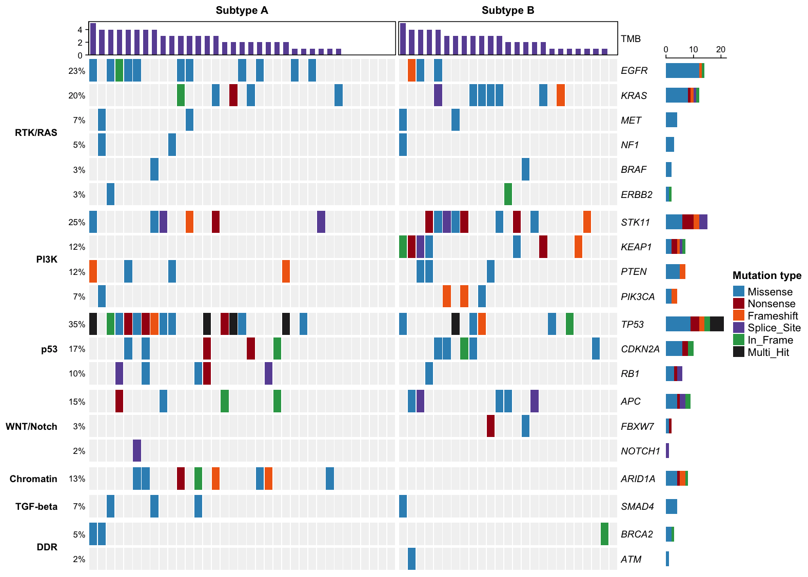

A mutation landscape plot (oncoplot, also called a mutation waterfall plot) displays the somatic alteration profile of a cohort gene by gene and sample by sample: rows are the most frequently mutated genes, columns are the samples, and each filled cell is a mutation, colored by its consequence (missense, nonsense, frameshift, splice site, …). Mutation frequency labels on the left, burden bars on top and the option to split samples by molecular subtype or cohort make the oncoplot the standard summary figure of cancer genomics studies, where it reveals which genes drive which subgroup. This tutorial reproduces the chart type covered by the *顶刊图社* series (issue 008); see the Reference section below.

## Example

{fig-alt="MutationOncoplot DEMO" fig-align="center" width="80%"}

This oncoplot summarizes a simulated 60-sample cohort across 20 cancer driver genes. Samples are grouped by two molecular subtypes (Subtype A and Subtype B), genes are grouped by signaling pathway (`RTK/RAS`, `PI3K`, `p53`, …), and the top barplot shows each sample's total mutation count. Subtype A is dominated by `TP53` (35% of all samples) and `EGFR` mutations, while Subtype B carries most of the `STK11`, `KEAP1` and `KRAS` alterations — exactly the kind of subgroup-specific pattern an oncoplot is meant to expose. Mutation types are color-coded and `TP53` occasionally shows `Multi_Hit` (more than one event). The same cohort is drawn again with the `maftools` engine in sections 4–5.

## Setup

-   System Requirements: Cross-platform (Linux/MacOS/Windows)

-   Programming Language: R

-   Dependencies: `ComplexHeatmap`; `tidyverse`; `maftools`; `cowplot`; `NMF`; `patchwork`

```{r packages setup, message=FALSE, warning=FALSE, output=FALSE}
# Installing necessary packages
if (!requireNamespace("ComplexHeatmap", quietly = TRUE)) {
  install.packages("ComplexHeatmap")
}
if (!requireNamespace("tidyverse", quietly = TRUE)) {
  install.packages("tidyverse")
}
if (!requireNamespace("maftools", quietly = TRUE)) {
  BiocManager::install("maftools")
}
if (!requireNamespace("cowplot", quietly = TRUE)) {
  install.packages("cowplot")
}
if (!requireNamespace("NMF", quietly = TRUE)) {
  BiocManager::install("NMF")
}
if (!requireNamespace("patchwork", quietly = TRUE)) {
  install.packages("patchwork")
}

# Load packages
library(ComplexHeatmap)
library(tidyverse)
library(maftools)
library(cowplot)
library(NMF)
library(patchwork)
```

## Data Preparation

The example simulates a small cohort so the tutorial is fully reproducible without downloading protected TCGA data: 60 samples, two molecular subtypes, and 20 common cancer driver genes mutated with subtype-specific probabilities. `Multi_Hit` marks genes carrying more than one event in a sample.

```{r simulate data, message=FALSE}
set.seed(2026)

genes <- c("TP53", "EGFR", "KRAS", "STK11", "KEAP1", "PIK3CA", "PTEN", "RB1",
           "APC", "ARID1A", "NF1", "NOTCH1", "BRAF", "CDKN2A", "SMAD4", "FBXW7",
           "ATM", "BRCA2", "ERBB2", "MET")
cohort <- rep(c("Subtype A", "Subtype B"), c(35, 25))
samples <- sprintf("S%02d", 1:60)

# Subtype-specific mutation probabilities per gene
p_a <- c(.52, .34, .10, .14, .10, .10, .12, .10, .06, .22, .08, .06, .04, .10, .05, .06, .06, .05, .05, .04)
p_b <- c(.22, .08, .42, .40, .36, .14, .10, .10, .10, .06, .10, .06, .06, .10, .10, .08, .05, .05, .06, .08)
mut_types <- c("Missense", "Nonsense", "Frameshift", "Splice_Site", "In_Frame")
type_p <- c(.58, .14, .12, .08, .08)

mutations <- map_dfr(seq_along(samples), function(i) {
  p <- if (cohort[i] == "Subtype A") p_a else p_b
  hit <- genes[runif(length(genes)) < p]
  if (length(hit) == 0) return(NULL)
  type <- sample(mut_types, length(hit), replace = TRUE, prob = type_p)
  # Tumor suppressors such as TP53 can receive a second hit, shown as Multi_Hit
  if (runif(1) < .15 && "TP53" %in% hit) {
    type[hit == "TP53"] <- "Multi_Hit"
  }
  tibble(sample = samples[i], gene = hit, type = type)
})

head(mutations)
```

**Note:** In your own analysis the input is a long table with one row per mutation, containing at least the sample name, the gene name and the mutation type (from a MAF file, `maftools`, or your variant caller). The code below reshapes it into the alternating matrix used by `oncoPrint()`.

```{r build matrix, message=FALSE}
# Reshape the mutation table into a gene x sample matrix; a cell holds one or
# several alteration types separated by ";"
gene_levels <- names(sort(table(factor(mutations$gene, levels = genes)), decreasing = TRUE))
mat <- matrix("", nrow = length(genes), ncol = length(samples),
              dimnames = list(genes, samples))
for (i in seq_len(nrow(mutations))) {
  cell <- mat[mutations$gene[i], mutations$sample[i]]
  mat[mutations$gene[i], mutations$sample[i]] <-
    if (cell == "") mutations$type[i] else paste(cell, mutations$type[i], sep = ";")
}

# Order samples: by subtype, then by mutation count (waterfall look)
mut_count <- colSums(mat != "")
ord <- order(factor(cohort, levels = c("Subtype A", "Subtype B")), -mut_count)
mat <- mat[gene_levels, ord]

# Annotation vectors aligned with the reordered matrix
cohort_ordered <- factor(cohort[ord], levels = c("Subtype A", "Subtype B"))
tmb <- mut_count[ord]

# Colors for alteration types
mutation_colors <- c(
  Missense = "#3690C0", Nonsense = "#A50F15", Frameshift = "#F16913",
  Splice_Site = "#6A51A3", In_Frame = "#31A354", Multi_Hit = "#252525"
)

# One drawing function per alteration type
rect_fun <- function(color) {
  function(x, y, w, h) grid.rect(x, y, w * 0.9, h * 0.9, gp = gpar(fill = color, col = NA))
}
alter_fun <- list(
  background = rect_fun("#F2F2F2"),
  Missense = rect_fun(mutation_colors["Missense"]),
  Nonsense = rect_fun(mutation_colors["Nonsense"]),
  Frameshift = rect_fun(mutation_colors["Frameshift"]),
  Splice_Site = rect_fun(mutation_colors["Splice_Site"]),
  In_Frame = rect_fun(mutation_colors["In_Frame"]),
  Multi_Hit = rect_fun(mutation_colors["Multi_Hit"])
)
```

The matrix above is the native `ComplexHeatmap` input. The `maftools` workflow instead consumes a **MAF-style table** — one row per variant, with the gene, the sample barcode and the `Variant_Classification` (e.g. `Missense_Mutation`, `Nonsense_Mutation`, `Frame_Shift_Del`). Two details matter when converting:

- **Multi_Hit is derived, not stored.** Our simulated table marks the five gene-sample cells that carry two events with the explicit class `Multi_Hit`, but `read.maf()` does not know it as a mutation class: rows whose `Variant_Classification` is outside its vocabulary are moved to the silent set (`maf@maf.silent`) and excluded from the plots — and a file consisting only of such rows fails with *"No non-synonymous mutations found"*. We therefore expand every `Multi_Hit` cell back into two individual events (`Missense` + `Nonsense`); maftools then re-derives the multi-hit cells itself — which is also how real MAF files behave (one row per variant).
- **Coordinates and alleles** are required by the MAF schema. For plotting they only need to be well-formed; real files carry the actual genomic positions.

```{r convert maf, message=FALSE}
# Expand explicit Multi_Hit cells into two individual events
mutations_long <- bind_rows(
  mutations |> filter(type != "Multi_Hit"),
  mutations |> filter(type == "Multi_Hit") |> mutate(type = "Missense"),
  mutations |> filter(type == "Multi_Hit") |> mutate(type = "Nonsense"))

# Our short type names -> the MAF Variant_Classification vocabulary
maf_class <- c(Missense = "Missense_Mutation", Nonsense = "Nonsense_Mutation",
               Frameshift = "Frame_Shift_Del", Splice_Site = "Splice_Site",
               In_Frame = "In_Frame_Del")
variant_type <- c(Missense = "SNP", Nonsense = "SNP", Frameshift = "DEL",
                  Splice_Site = "SNP", In_Frame = "DEL")

set.seed(7)
maf_data <- mutations_long |>
  mutate(
    Hugo_Symbol = gene,
    Variant_Classification = maf_class[type],
    Variant_Type = variant_type[type],
    Chromosome = paste0("chr", (match(gene, genes) %% 22) + 1),
    Start_Position = 100000L + as.integer(match(gene, genes)) * 54321L +
      row_number() * 37L + sample(1:99L, n(), replace = TRUE),
    End_Position = Start_Position,
    Reference_Allele = "A",
    Tumor_Seq_Allele2 = "G",
    Tumor_Sample_Barcode = sample) |>
  select(Hugo_Symbol, Chromosome, Start_Position, End_Position,
         Reference_Allele, Tumor_Seq_Allele2, Variant_Classification,
         Variant_Type, Tumor_Sample_Barcode)

# Sample-level annotation (kept alongside the MAF)
clin_data <- tibble(Tumor_Sample_Barcode = samples, Subtype = cohort)

# Read everything into a maftools MAF object
maf <- read.maf(maf = as.data.frame(maf_data),
                clinicalData = as.data.frame(clin_data), verbose = FALSE)

head(maf_data)
```

## Visualization

The same cohort is drawn twice: sections 1–3 build the landscape on `ComplexHeatmap::oncoPrint()` — full control over annotation tracks and cell rendering — while sections 4–5 use the `maftools` engine on the MAF representation prepared above, the standard route for real mutation files.

### 1. Basic Plot

The basic oncoplot shows the alteration matrix with one colored block per mutation; the left labels give each gene's mutation frequency and the right barplot counts alterations per gene.

```{r}
#| label: fig-1.1BasicOncoplot
#| fig-cap: "Basic Mutation Landscape Oncoplot"
#| out.width: "95%"
#| warning: false
#| message: false
#| fig-width: 10
#| fig-height: 6.5

p1 <- oncoPrint(mat,
  alter_fun = alter_fun, alter_fun_is_vectorized = FALSE, col = mutation_colors,
  column_order = samples[ord], show_column_names = FALSE,
  row_names_gp = gpar(fontsize = 9, fontface = "italic"), pct_gp = gpar(fontsize = 8),
  heatmap_legend_param = list(title = "Mutation type"))
draw(p1)
```

### 2. Add Cohort Split and Mutation Burden

Splitting the columns by molecular subtype and adding a top barplot of each sample's mutation count turns the matrix into the classic landscape figure: subgroup-specific genes become visually obvious.

```{r}
#| label: fig-1.2CohortOncoplot
#| fig-cap: "Oncoplot split by molecular subtype with mutation burden bars"
#| out.width: "95%"
#| warning: false
#| message: false
#| fig-width: 10
#| fig-height: 7

top_annotation <- HeatmapAnnotation(
  TMB = anno_barplot(tmb, height = unit(1.1, "cm"),
                     gp = gpar(fill = "#6A51A3", col = NA)),
  annotation_name_gp = gpar(fontsize = 9))

p2 <- oncoPrint(mat,
  alter_fun = alter_fun, alter_fun_is_vectorized = FALSE, col = mutation_colors,
  column_order = samples[ord], show_column_names = FALSE,
  column_split = cohort_ordered, column_title_gp = gpar(fontsize = 10, fontface = "bold"),
  top_annotation = top_annotation,
  bottom_annotation = HeatmapAnnotation(
    Subtype = as.character(cohort_ordered),
    col = list(Subtype = c("Subtype A" = "#E08214", "Subtype B" = "#5E3C99")),
    annotation_name_side = "left", annotation_name_gp = gpar(fontsize = 9)),
  row_names_gp = gpar(fontsize = 9, fontface = "italic"), pct_gp = gpar(fontsize = 8),
  heatmap_legend_param = list(title = "Mutation type"))
draw(p2)
```


::: callout-tip
**Key Parameters: **

- `column_split`: splits the columns into panels, here by molecular subtype; `row_split` works the same way for genes (used in Figure 3).
- `top_annotation`: any `HeatmapAnnotation` — the mutation burden barplot (`anno_barplot`) is the conventional choice.
- `alter_fun_is_vectorized = FALSE`: draw alteration blocks one cell at a time; required when the functions above are not vectorized.
:::

### 3. Group Genes by Pathway

Grouping the rows by signaling pathway (`RTK/RAS`, `PI3K`, `p53`, …) organizes the waterfall into functional blocks, which is how oncoplots are usually laid out in publications.

```{r}
#| label: fig-1.3PathwayOncoplot
#| fig-cap: "Oncoplot with genes grouped by signaling pathway"
#| out.width: "95%"
#| warning: false
#| message: false
#| fig-width: 10.5
#| fig-height: 7.5

pathway <- c(
  TP53 = "p53", RB1 = "p53", CDKN2A = "p53",
  EGFR = "RTK/RAS", ERBB2 = "RTK/RAS", MET = "RTK/RAS", KRAS = "RTK/RAS",
  BRAF = "RTK/RAS", NF1 = "RTK/RAS",
  PIK3CA = "PI3K", PTEN = "PI3K", STK11 = "PI3K", KEAP1 = "PI3K",
  APC = "WNT/Notch", NOTCH1 = "WNT/Notch", FBXW7 = "WNT/Notch",
  ARID1A = "Chromatin", SMAD4 = "TGF-beta", ATM = "DDR", BRCA2 = "DDR")
pathway_levels <- c("RTK/RAS", "PI3K", "p53", "WNT/Notch", "Chromatin", "TGF-beta", "DDR")

p3 <- oncoPrint(mat,
  alter_fun = alter_fun, alter_fun_is_vectorized = FALSE, col = mutation_colors,
  column_order = samples[ord], show_column_names = FALSE,
  row_split = factor(pathway[gene_levels], levels = pathway_levels),
  row_title_gp = gpar(fontsize = 9, fontface = "bold"), row_title_rot = 0,
  column_split = cohort_ordered, column_title_gp = gpar(fontsize = 10, fontface = "bold"),
  top_annotation = top_annotation,
  row_names_gp = gpar(fontsize = 9, fontface = "italic"), pct_gp = gpar(fontsize = 8),
  heatmap_legend_param = list(title = "Mutation type"))
draw(p3)
```

Figure 3 reveals the same cohort structure with a functional reading: Subtype A accumulates `TP53` events and RTK/RAS-pathway `EGFR` mutations, while Subtype B concentrates `STK11`/`KEAP1` (PI3K pathway) and `KRAS` alterations.


### 4. maftools Oncoplot

With the cohort available as a MAF object (`maf`), `maftools::oncoplot()` draws the classic cancer-genomics landscape: per-sample mutation-burden bars on top, per-gene frequency and variant-class breakdown on the right, automatic percentage labels and its own colour vocabulary. `sortByMutation = TRUE` arranges the samples into the familiar waterfall order (they are ordered on the binarised mutation matrix).

```{r}
#| label: fig-1.4MaftoolsOncoplot
#| fig-cap: "Basic maftools oncoplot of the same cohort"
#| out.width: "95%"
#| warning: false
#| message: false
#| fig-width: 10
#| fig-height: 6.5

oncoplot(maf = maf, top = 20, sortByMutation = TRUE)
```

::: callout-tip
**Key Parameters: **

- `top`: how many of the most frequently mutated genes to draw (here all 20).
- `sortByMutation`: order samples by mutation count (`TRUE`) or keep file order (`FALSE`).
- Samples without a single alteration are not shown: maftools only knows the samples present in the MAF, so the subtitle reads "Altered in 53 (100%) of 53 samples" — the 53 of the 60 cohort samples that carry at least one mutation.
:::

### 5. maftools with Clinical Annotation

`clinicalFeatures` adds annotation tracks from the clinical table — the direct counterpart of the `column_split` view in Figure 2. `sortByAnnotation = TRUE` groups samples by the annotation, so the subtype-specific genes line up in blocks again (compare the `TP53` block on the left with the `STK11`/`KEAP1` block on the right).

```{r}
#| label: fig-1.5MaftoolsCohortOncoplot
#| fig-cap: "maftools oncoplot annotated and sorted by molecular subtype"
#| out.width: "95%"
#| warning: false
#| message: false
#| fig-width: 10
#| fig-height: 7

oncoplot(maf = maf, top = 20,
         clinicalFeatures = "Subtype", sortByAnnotation = TRUE)
```

::: callout-tip
**Key Parameters: **

- `clinicalFeatures`: column(s) of the clinical table drawn as annotation tracks below the matrix.
- `sortByAnnotation`: sort samples within the annotation groups (`TRUE`).
:::

### 6. Choosing an Engine

Both routes describe the same cohort — `TP53` altered in 40% of the mutated samples (35% of all 60), `STK11`/`KEAP1`/`KRAS` concentrated in Subtype B — but they optimise for different workflows:

- **`ComplexHeatmap::oncoPrint()`** (sections 1–3): full control — custom cell renderers, arbitrary annotation tracks from any data, arbitrary row/column grouping, integration with the rest of the heatmap ecosystem. Best when the oncoplot must compose with other heatmap panels or needs bespoke styling.
- **`maftools::oncoplot()`** (sections 4–5): the standard intake for real MAF files — read a cohort's variants in one call and get publication-ready summaries (burden bars, variant-class breakdown, clinical annotations, derived multi-hit cells). Best for routine cohort figures and for anything downstream in the maftools toolkit (mutual exclusivity, TiTv, driver analysis).

### 7. Aggregated Alteration-Frequency "Minesweeper" Grid

The oncoprints above show **sample-level** cells; the pan-cancer "minesweeper" layout of the reference figure aggregates instead \[4\]: one tile per cancer subtype × gene carrying the number of altered samples, flanked by composition bars of the alteration types (top: per subtype, right: per gene) and an oncogene/tumour-suppressor colour strip. Here is a compact simulated version of that layout:

```{r}
#| label: fig-7.1AlterationGrid
#| fig-cap: "Aggregated alteration-frequency grid: centre tiles count altered samples per subtype × gene, flanking bars show alteration-type composition."
#| out.width: "95%"
#| warning: false
#| message: false
#| fig-width: 10
#| fig-height: 6

set.seed(2026)
subtypes <- c("BRCA_LumA", "BRCA_Basal", "LUAD", "LUSC", "COAD_MSI", "COAD_CIN",
              "KIRC", "STAD_MSI", "HNSC_HPV-", "SKCM")
n_sam <- c(80, 40, 60, 50, 45, 35, 55, 45, 50, 45)
genes_info <- data.frame(
  Gene = c("EGFR", "KRAS", "BRAF", "PIK3CA", "MYC", "CCND1",
           "TP53", "NF1", "PTEN", "RB1", "ARID1A", "CDKN2A"),
  Type = rep(c("OG", "TSG"), each = 6),
  base_rate = c(0.10, 0.15, 0.06, 0.22, 0.12, 0.09,
                0.45, 0.08, 0.12, 0.09, 0.14, 0.20)
)

## sample-level alteration types per gene (simulated per subtype)
alter_ls <- do.call(rbind, lapply(seq_along(subtypes), function(s) {
  do.call(rbind, lapply(genes_info$Gene, function(g) {
    rate <- genes_info$base_rate[genes_info$Gene == g] *
      (1.35 ^ rnorm(1, mean = ifelse(s <= 5, 0.4, -0.2)))     # subtype drift
    n_alt <- rbinom(1, n_sam[s], min(rate, 0.9))
    types <- sample(c("MUT", "AMP", "DEL"), n_alt, replace = TRUE,
                    prob = c(0.6, 0.2, 0.2))
    extra <- if (n_alt > 2 && runif(1) < 0.15) "Multiple" else NULL
    data.frame(subtype = subtypes[s], gene = g,
               type = c(types, extra, NA_character_))
  }))
})) |>
  filter(!is.na(type))

## centre: altered-sample counts per subtype x gene
gene_levels <- rev(genes_info$Gene)
centre <- alter_ls |>
  count(subtype, gene, name = "n_altered") |>
  complete(subtype = subtypes, gene = genes_info$Gene, fill = list(n_altered = 0)) |>
  mutate(Gene = factor(gene, gene_levels),
         Subtype = factor(subtype, subtypes))

## composition bars (shares of alteration types)
comp_st <- alter_ls |> count(subtype, type, name = "n")
comp_ge <- alter_ls |> count(gene, type, name = "n")

p_top <- ggplot(comp_st, aes(x = subtype, y = n, fill = type)) +
  geom_col(position = "fill", width = 1, colour = "grey60", linewidth = .2) +
  scale_fill_brewer(type = "div", palette = "Paired", direction = -1, name = NULL) +
  scale_x_discrete(labels = NULL, limits = subtypes) +
  theme_void(base_size = 9) + theme(legend.position = "none")

p_right <- ggplot(comp_ge, aes(x = gene, y = n, fill = type)) +
  geom_col(position = "fill", width = 1, colour = "grey60", linewidth = .2) +
  scale_fill_brewer(type = "div", palette = "Paired", direction = -1, name = NULL) +
  scale_x_discrete(labels = NULL, limits = gene_levels) +
  coord_flip() + theme_void() +
  theme(legend.position = "bottom", legend.key.size = unit(3, "mm"),
        legend.text = element_text(size = 7))
leg <- cowplot::get_legend(p_right)          # grob insertion drops legends: extract it
p_right <- p_right + theme(legend.position = "none")

p_centre <- ggplot(centre, aes(Subtype, Gene, fill = n_altered)) +
  geom_tile(colour = "grey55", linewidth = .3) +
  geom_text(aes(label = ifelse(n_altered > 0, n_altered, "")), size = 2.6) +
  scale_fill_gradient(low = "white", high = "grey30", name = "Altered\nsamples") +
  theme_minimal(base_size = 10) +
  theme(axis.text.x = element_text(angle = 45, hjust = 1, size = 9),
        axis.text.y = element_text(size = 9, face = "bold",
                                   colour = c(rep("orangered", 6), rep("royalblue", 6))),
        panel.grid = element_blank())

## cowplot grobs keep the edge bars in register with the centre grid
## (verified mechanism; ggarrange/patchwork drifted here)
combined <- insert_xaxis_grob(p_centre, p_top, position = "top", height = unit(0.3, "in"))
combined <- insert_yaxis_grob(combined, p_right, position = "right", width = unit(1.4, "in"))
ggdraw(combined) +
  draw_grob(leg, x = 0.76, y = 0.006, width = 0.23, height = 0.045)  # legend into the empty lower-right corner
```


- Assemble with **cowplot's `insert_xaxis_grob()` / `insert_yaxis_grob()`** (the same mechanism as the marginal-volcano recipe) rather than width/height vectors: grob insertion ties each edge bar to the centre panel's axis space, which is what keeps them aligned with the tiles. Note it discards the edge plot's own axis text — labels belong on the centre grid.

::: callout-tip
**Practice tips**

- Keep **one shared factor order** (`rev(genes_info$Gene)`) for the centre rows, the right bar y-axis and the left strip — mismatched levels are the classic way this figure silently misregisters.
- The centre fill is normalized per gene in the reference (log count against the gene's maximum); the shared count scale used here is simpler but flattens rare genes.
- With real data, take the sample × gene alteration table from a MAF cohort (`maftools::oncoplot`'s input), aggregate per subtype, and keep the reference's "count only known oncogenic alterations" filter.
:::

### 8. De Novo Mutation-Signature Decomposition

Somatic mutation catalogues decompose into **signatures** — trinucleotide-context profiles (96 channels in the full SBS convention) characteristic of mutational processes (APOBEC, tobacco, UV, aging) \[4\]. The maftools/MutationalPatterns route needs a reference genome; the layout itself can be reproduced from a simulated **48-channel** matrix (6 classes x 8 simplified contexts) decomposed with NMF:

```{r}
#| label: fig-8.1SignatureNMF
#| fig-cap: "De novo signature decomposition of a simulated 48-channel catalogue: NMF-extracted signature profiles (top) and per-sample exposures (bottom)."
#| out.width: "95%"
#| warning: false
#| message: false
#| fig-width: 9
#| fig-height: 6

set.seed(902)
bases <- c("C>A", "C>G", "C>T", "T>A", "T>C", "T>G")
ctx <- rep(c("A","C","G","T"), each = 2)  # simplified 3' context labels
channels <- paste0(rep(bases, each = 8), "_", rep(1:8, times = 6))
n_ch <- length(channels); n_samp <- 40

sig_apobec <- c(2, 6, 8, 6, 2, 1, 1, 1)   # TCW motif enrichment, simplified shape
sig_aging  <- c(5, 4, 6, 5, 4, 3, 2, 2)   # flat shape (shared by all classes here)
W_true <- cbind(rep(sig_apobec, 6), rep(sig_aging, 6))
W_true <- W_true / colSums(W_true)
expo <- t(cbind(c(rep(0.7, 15), rep(0.05, 25)), rep(0.5, n_samp)))  # 2 signatures x 40 samples
counts <- round((W_true %*% expo) * 600 +
                matrix(rpois(n_ch * n_samp, 2), nrow = n_ch))  # depth 600 for SNR

fit <- NMF::nmf(counts + 1, rank = 2, method = "brunet", nrun = 1, seed = 902)
W <- NMF::basis(fit); W <- W / colSums(W)                 # channels x 2
H <- NMF::coef(fit)                                       # 2 x samples

sig_df <- as.data.frame(W) |>
  mutate(channel = rep(bases, each = n_ch / 6), pos = rep(1:(n_ch / 6), times = 6)) |>
  pivot_longer(V1:V2, names_to = "signature", values_to = "weight")
sig_df$signature <- ifelse(sig_df$signature == "V1", "Signature A", "Signature B")

expo_df <- as.data.frame(t(H)) |>
  mutate(sample = seq_len(n_samp)) |>
  pivot_longer(V1:V2, names_to = "signature", values_to = "exposure")
expo_df$signature <- ifelse(expo_df$signature == "V1", "Signature A", "Signature B")
expo_df$sample <- factor(expo_df$sample, levels = unique(expo_df$sample[order(expo_df$signature, -expo_df$exposure)]))

p_sig <- ggplot(sig_df, aes(pos, weight, fill = signature)) +
  geom_col(position = "dodge", width = 0.8) +
  facet_grid(signature ~ channel, scales = "free_y") +
  scale_fill_manual(values = c("Signature A" = "#B2182B", "Signature B" = "#2166AC")) +
  labs(x = "3' flanking base", y = "Channel weight", fill = NULL) +
  theme_classic(base_size = 9) +
  theme(legend.position = "none", strip.text = element_text(size = 8))

p_expo <- ggplot(expo_df, aes(sample, exposure, fill = signature)) +
  geom_col(position = "stack", width = 0.9) +
  scale_fill_manual(values = c("Signature A" = "#B2182B", "Signature B" = "#2166AC")) +
  labs(x = "Samples (sorted by dominant signature)", y = "Signature exposure", fill = NULL) +
  theme_classic(base_size = 9) +
  theme(legend.position = "top", axis.text.x = element_blank(),
        legend.key.size = unit(3, "mm"))

p_sig / p_expo + patchwork::plot_layout(heights = c(1.2, 1))
```

::: callout-tip
**Practice tips**

-   Rank selection is the hard part with real data: run `NMF::nmf(rank = 2:5, nrun = 20)` and pick the rank where the cophenetic coefficient starts to drop.
-   The full 96-channel layout orders channels by the 3' flanking base within each of the six substitution classes — repeat `sig_apobec`-style shapes across the six facets, as done here.
-   With real MAF input, `maftools::trinucleotideMatrix()` builds the channel matrix (needs `BSgenome.Hsapiens`), then the plotting half is exactly this.
:::


### 9. Mutation-Context Lego/Heatmap with Class Pie

Mutation signatures read best as a **6 × 16 grid**: six substitution classes, sixteen 3'-flanking contexts per class, bar height or colour depth for counts. The reference figure renders this as a 3D lego plot (`barplot3d` + `rgl`); the 2D heatmap twin carries the same information without the 3D dependency, and the class pie summarises the six-way split \[4\].

```{r}
#| label: fig-9.1ContextHeatmap
#| fig-cap: "Mutation context: 6 substitution classes x 16 flanking contexts as a colour-depth heatmap (left) and the six-class proportion pie (right)."
#| out.width: "95%"
#| warning: false
#| message: false
#| fig-width: 10
#| fig-height: 4.5

set.seed(1701)
mut_types <- c("C>A", "C>G", "C>T", "T>A", "T>C", "T>G")
type_cols <- c("#805D3F", "#72549A", "#5EAFB2", "#3F4F9D", "#F2EC3C", "#74B655")
names(type_cols) <- mut_types
contexts <- c("A_C", "C_C", "G_C", "T_C", "A_G", "C_G", "G_G", "T_G",
              "A_T", "C_T", "G_T", "T_T", "A_A", "C_A", "G_A", "T_A")

## simulate a 96-channel count vector; identical context profile within each
## class (schematic catalogue - real SBS1/aging signatures skew C>T)
counts <- rmultinom(1, 6000,
                    prob = rep(c(4, 2, 3, 1, 2, 2, 3, 1,
                                 6, 3, 4, 2, 1, 1, 1, 1), times = 6))
mut_df <- data.frame(
  mut_type = factor(rep(mut_types, each = 16), levels = mut_types),
  context = factor(rep(contexts, times = 6), levels = contexts),
  count = as.vector(counts))

## left: colour-depth heatmap, rows = contexts, cols = substitution classes
p_heat <- ggplot(mut_df, aes(mut_type, context, fill = count)) +
  geom_tile(colour = "grey80", linewidth = 0.3) +
  geom_text(aes(label = count), size = 2.2) +
  scale_fill_gradient(low = "white", high = "#3F4F9D", name = "Count") +
  scale_x_discrete(limits = mut_types) +
  labs(x = NULL, y = "3' flanking base", title = "Mutation context (96 channels)") +
  theme_minimal(base_size = 10) +
  theme(axis.text.x = element_text(face = "bold", colour = type_cols),
        panel.grid = element_blank())

## right: proportion pie of the six classes
pie_df <- aggregate(count ~ mut_type, mut_df, sum)
pie_df$pct <- pie_df$count / sum(pie_df$count) * 100
p_pie <- ggplot(pie_df, aes(x = "", y = pct, fill = mut_type)) +
  geom_col(width = 1, colour = "white") +
  coord_polar(theta = "y") +
  scale_fill_manual(values = type_cols) +
  geom_text(aes(label = sprintf("%.0f%%", pct)),
            position = position_stack(vjust = 0.5), size = 3) +
  labs(x = NULL, y = NULL, fill = NULL) +
  theme_void(base_size = 10)

patchwork::wrap_elements(full = p_heat) |
  patchwork::wrap_elements(full = p_pie + theme(legend.position = "bottom"))
```

::: callout-tip
**Practice tips**

-   The 4 × 4 block inside each colour class is the lego plot's advantage over the classic 96-bar chart: the two flanking bases read as a matrix, so context preferences (e.g. TpC for APOBEC) pop out.
-   The 3D lego version needs `barplot3d` + `rgl` (screen-only, saved via `rgl.postscript`); this 2D heatmap + pie pair is publication-portable and renders identically on CI.
-   With a real MAF, `maftools::trinucleotideMatrix()` builds the same 96-vector (needs `BSgenome.Hsapiens`); feed `count` from it and keep the plotting half.
:::

### 10. Mutation Landscape with Signature Contribution Track

The reference molecular-landscape panel stacks four evidence layers on one sample axis - alteration matrix, burden, subtype, signature contribution - and orders the samples by the signature that explains their mutation pattern \[4\]. `ComplexHeatmap` composes exactly this: an `oncoPrint` block with `anno_barplot` burden and a class strip, `%v%`-stacked with a `pheatmap` signature block whose columns share the oncoprint sample order.

```{r}
#| label: fig-10.1LandscapeSignature
#| fig-cap: "Two blocks stacked on one sample axis: the oncoprint (top TMB bars, bottom iCS colour strip) over a three-row APOBEC/AFR2/OTHER signature-contribution heatmap, samples sorted by subtype then signature share."
#| out.width: "95%"
#| warning: false
#| message: false
#| fig-width: 8.5
#| fig-height: 4.5

set.seed(6501)
genes_e <- c("TP53", "EGFR", "KRAS", "STK11", "KEAP1", "PIK3CA", "PTEN", "RB1", "CDKN2A", "NF1")
n_e <- 48
subt <- rep(c("iCS-1", "iCS-2", "iCS-3"), c(18, 16, 14))
# 各亚型的突变概率：亚型特异性驱动基因
pa <- c(.65, .55, .25, .10, .15, .20, .10, .15, .10, .05)
pb <- c(.20, .10, .60, .55, .10, .15, .35, .25, .05, .10)
pcx <- c(.15, .20, .20, .15, .75, .10, .10, .10, .55, .40)
samples_e <- sprintf("T%02d", 1:n_e)
mat_e <- matrix("", nrow = length(genes_e), ncol = n_e, dimnames = list(genes_e, samples_e))
tmb_e <- integer(n_e)
for (j in 1:n_e) {
  p_use <- switch(subt[j], "iCS-1" = pa, "iCS-2" = pb, pcx)
  hits <- genes_e[runif(length(genes_e)) < p_use]
  if (length(hits) == 0) { mat_e[genes_e[1], j] <- "Mis"; tmb_e[j] <- 1L; next }
  for (g in hits) {
    mat_e[g, j] <- sample(c("Mis", "Non", "Fs"), 1, prob = c(0.6, 0.25, 0.15))
    tmb_e[j] <- tmb_e[j] + 1L
  }
}
# APOBEC 签名占比 = 原图景观的排序键
sig_key <- ifelse(as.character(subt) == "iCS-1", 0.62,
              ifelse(as.character(subt) == "iCS-2", 0.30, 0.18)) + runif(n_e, -0.05, 0.05)
sig_mat <- rbind(APOBEC = sig_key,
                 AFR2  = 1 - sig_key + runif(n_e, -0.05, 0.05),
                 OTHER = runif(n_e, 0.02, 0.20))
dimnames(sig_mat) <- list(c("APOBEC", "AFR2", "OTHER"), samples_e)
# 先按亚型、亚型内再按签名占比降序
ord <- order(factor(subt, levels = c("iCS-1", "iCS-2", "iCS-3")), -sig_key)
mat_e <- mat_e[, ord]; sig_mat <- sig_mat[, ord]; tmb_e <- tmb_e[ord]
subt_o <- factor(subt[ord], levels = c("iCS-1", "iCS-2", "iCS-3"))
stopifnot(all(tmb_e <= length(genes_e)) && all(tmb_e >= 1) &&
          all(sig_mat["APOBEC", ] >= 0 & sig_mat["APOBEC", ] <= 1))
rect_fun <- function(color) function(x, y, w, h)
  grid.rect(x, y, w * 0.92, h * 0.92, gp = gpar(fill = color, col = NA))
alter_fun <- list(background = rect_fun("#F4F4F4"), Mis = rect_fun("#3690C0"),
                  Non = rect_fun("#A50F15"), Fs = rect_fun("#F16913"))
top_anno <- HeatmapAnnotation(
  TMB = anno_barplot(tmb_e, height = unit(1.0, "cm"),
                     gp = gpar(fill = "#6A51A3", col = NA),
                     axis_param = list(gp = gpar(fontsize = 6))),
  annotation_name_gp = gpar(fontsize = 7))
bot_anno <- HeatmapAnnotation(
  iCS = as.character(subt_o),
  col = list(iCS = c("iCS-1" = "#E08214", "iCS-2" = "#5E3C99", "iCS-3" = "#2A9F8F")),
  annotation_name_side = "left", annotation_name_gp = gpar(fontsize = 7))
op1 <- ComplexHeatmap::oncoPrint(mat_e, alter_fun = alter_fun,
  alter_fun_is_vectorized = FALSE,
  col = c(Mis = "#3690C0", Non = "#A50F15", Fs = "#F16913"),
  show_column_names = FALSE, show_row_names = TRUE,
  row_names_gp = gpar(fontsize = 7, fontface = "italic"),
  row_title_gp = gpar(fontsize = 0.1),
  top_annotation = top_anno, bottom_annotation = bot_anno,
  heatmap_legend_param = list(space = "none"),
  width = unit(8.6, "cm"), height = unit(3.4, "cm"))
# 签名块共享样本 x 序；%v% 将其叠于 oncoprint 之下
op2 <- ComplexHeatmap::pheatmap(mat = sig_mat,
  color = colorRampPalette(c("white", "#B2182B"))(99),
  cluster_rows = FALSE, cluster_cols = FALSE,
  show_rownames = TRUE, show_colnames = FALSE,
  cellwidth = unit(18, "pt"), cellheight = unit(11, "pt"),
  border_color = "white", legend = FALSE)
draw(op1 %v% op2)
```

::: callout-tip
**Practice tips**

-   Both blocks must consume the SAME `ord` permutation of samples - one reordered vector is the whole trick behind a legible stacked landscape.
-   `heatmap_legend_param = list(space = "none")` silences the per-block legend; give legends once, in the caption or a dedicated block.
-   Real data: take per-sample signature exposures from `maftools::trinucleotideMatrix()` + NMF or SigProfiler rather than simulated shares, and let the sort key (`sig_key`) be a genuine SBS exposure.
:::

### 11. 01-Matrix Oncoprint Split by Pathway with Clinical Annotation

Panel-sequencing reports often deliver a **01 matrix** — mutated yes/no per gene per sample, no variant types — with the genes annotated to pathways and a clinical table beside them. The FigureYa42oncoprintV2 layout \[4\] feeds that straight into `ComplexHeatmap::oncoPrint()`: `row_split = pathway` stacks the pathway groups, `show_pct = FALSE` replaces the percentage axis with gene names, and `bottom_annotation` carries the clinical covariates so mutation pattern and phenotype read against each other:

```{r}
#| label: fig-11.1PathwayOncoprint
#| fig-cap: "01-matrix oncoprint of 12 genes in 40 simulated samples: rows split by pathway (RTK/RAS, PI3K, p53/cell cycle), green = mutated, bottom annotation rows carry smoking, stage and treatment; the top barplot counts mutations per sample."
#| out.width: "100%"
#| warning: false
#| message: false
#| fig-width: 10.5
#| fig-height: 6.5

set.seed(4201)
genes_path <- data.frame(
  gene = c("EGFR", "ERBB2", "KRAS", "NRAS", "BRAF", "PIK3CA", "PTEN", "AKT1",
           "TP53", "MDM2", "CDKN2A", "RB1"),
  pathway = c("RTK/RAS", "RTK/RAS", "RTK/RAS", "RTK/RAS", "RTK/RAS",
              "PI3K", "PI3K", "PI3K", "p53/cell cycle", "p53/cell cycle",
              "p53/cell cycle", "p53/cell cycle"))
n_sm <- 40
freq <- c(0.35, 0.2, 0.3, 0.12, 0.25, 0.4, 0.15, 0.1, 0.55, 0.18, 0.22, 0.12)
mat01 <- sapply(freq, function(f) sample(c("mut", ""), n_sm, TRUE, prob = c(f, 1 - f)))
mat01 <- t(mat01)
rownames(mat01) <- genes_path$gene
colnames(mat01) <- paste0("P", sprintf("%02d", 1:n_sm))
mygene <- as.data.frame(mat01)
mygene$pathway <- genes_path$pathway
clin <- data.frame(
  row.names = colnames(mat01),
  Smoking = factor(sample(c("ever", "never"), n_sm, TRUE)),
  Stage = factor(sample(c("I-II", "III-IV"), n_sm, TRUE)),
  Treatment = factor(sample(c("chemo", "ICI", "TKI"), n_sm, TRUE, prob = c(0.4, 0.4, 0.2))))
alter_fun <- list(
  background = function(x, y, w, h) grid.rect(x, y, w - unit(0.5, "mm"), h - unit(0.5, "mm"),
                                              gp = gpar(fill = NA, col = NA)),
  mut = function(x, y, w, h) grid.rect(x, y, w - unit(0.5, "mm"), h - unit(0.5, "mm"),
                                       gp = gpar(fill = "#008000", col = NA)))
col_g <- c("mut" = "#008000")
my_annotation <- HeatmapAnnotation(df = clin,
                                   col = list(Smoking = c(ever = "#7A142C", never = "#D8D155"),
                                              Stage = c("I-II" = "#58CDD9", "III-IV" = "#223D6C"),
                                              Treatment = c(chemo = "#088247", ICI = "#D20A13", TKI = "#FFD121")),
                                   annotation_name_side = "left",
                                   annotation_name_gp = gpar(fontsize = 8))
draw(oncoPrint(mygene[, colnames(mat01)], get_type = function(x) x,
               alter_fun = alter_fun, col = col_g,
               show_pct = FALSE,
               bottom_annotation = my_annotation,
               row_split = mygene$pathway,
               show_heatmap_legend = FALSE,
               column_title = "01-matrix oncoprint split by pathway, clinical data below",
               column_title_gp = gpar(fontsize = 11)))
```

::: callout-tip
**Practice tips**

-   `oncoPrint()` needs the matrix values to be strings matching the `alter_fun`/`col` names — convert the 01 matrix with `mat01[mat01 == 1] <- "mut"; mat01[mat01 == 0] <- ""` before plotting.
-   `get_type = function(x) x` tells oncoPrint each cell already carries its alteration labels verbatim (single-type 01 input); with multi-type MAF data keep the default parser instead.
-   Keep clinical annotation rows to 2-4 factors; the bottom strip is for reading mutation-phenotype alignment, not a second heatmap.
:::

### 12. Co-occurrence / Mutual Exclusivity by Correlogram (FigureYa70mutationEvents)

FigureYa70mutationEvents \[5\] asks the pairwise question behind every oncoprint: do two genes mutate together (co-occurrence, positive association) or avoid each other (mutual exclusivity, negative)? Each pair's 2x2 mutated/not table is tested with Fisher's exact test, the phi correlation coefficient is drawn as a `corrplot` ellipse coloured by sign and sized by magnitude, and the grey cross marks pairs whose test did not pass 0.05. The block below runs the full pipeline on a simulated 8-gene matrix with one exclusivity pair (TP53-KRAS) and one co-occurrence pair (APC-EGFR) planted:

```{r}
#| label: fig-12.1MutCorrplot
#| fig-cap: "Co-occurrence / mutual exclusivity correlogram of 8 simulated genes: ellipse colour and shape encode the phi correlation of the mutated/not 2x2 tables; grey crosses mark non-significant Fisher tests (p >= 0.05)."
#| out.width: "70%"
#| warning: false
#| message: false
#| fig-width: 7
#| fig-height: 7

## freeze:auto re-executes only new chunks in a fresh session — re-attach here
suppressPackageStartupMessages({library(corrplot)})
set.seed(7001)
n_sm2 <- 220
genes2 <- c("TP53", "KRAS", "BRAF", "PIK3CA", "PTEN", "APC", "EGFR", "RB1")
mut <- sapply(c(0.5, 0.3, 0.22, 0.35, 0.15, 0.4, 0.12, 0.18),
              function(f) sample(c(0, 1), n_sm2, TRUE, c(1 - f, f)))
colnames(mut) <- genes2
## plant one mutual-exclusivity pair (TP53-KRAS) and one co-occurrence pair (APC-EGFR)
mut[, 2] <- ifelse(mut[, 1] == 1, sample(c(0, 1), n_sm2, TRUE, c(0.85, 0.15)),
                   sample(c(0, 1), n_sm2, TRUE, c(0.35, 0.65)))
mut[, 6] <- ifelse(mut[, 7] == 1, sample(c(0, 1), n_sm2, TRUE, c(0.15, 0.85)),
                   sample(c(0, 1), n_sm2, TRUE, c(0.7, 0.3)))
corr_mat <- matrix(NA, length(genes2), length(genes2), dimnames = list(genes2, genes2))
pval_mat <- corr_mat
for (i in 1:(length(genes2) - 1)) for (j in (i + 1):length(genes2)) {
  t1 <- table(factor(mut[, i], c(0, 1)), factor(mut[, j], c(0, 1)))
  ft <- fisher.test(t1)
  corr_mat[i, j] <- corr_mat[j, i] <- cor(mut[, i], mut[, j])
  pval_mat[i, j] <- pval_mat[j, i] <- ft$p.value
}
diag(corr_mat) <- 1; diag(pval_mat) <- 0

corrplot(corr_mat, method = "ellipse", type = "upper",
         p.mat = pval_mat, sig.level = 0.05, insig = "pch",
         pch.cex = 2.2, pch.col = "grey30",
         tl.col = "black", tl.srt = 45,
         col = colorRampPalette(c("#2166AC", "#FFFFFF", "#B2182B"))(200),
         title = "Co-occurrence / mutual exclusivity (phi, Fisher test)",
         mar = c(1, 1, 3, 1))
```

::: callout-tip
**Practice tips**

-   The phi coefficient on a 2x2 table is the signed effect size; Fisher's exact p is the evidence — the correlogram shows **both** (ellipse = effect, cross = not significant), which is why `insig = "pch"` beats hiding non-significant pairs.
-   The reference uses the `discover` package's tissue-adjusted test for real TCGA data; the plain Fisher test here ignores sample purity and sequencing coverage — state that caveat when substituting.
-   Test all pairs and correct (the loop above reports raw p; run `p.adjust` over the 28 pairs before drawing if the figure goes into a paper).
:::

## Applications## Applications

-   **Cohort characterization**: first-line summary of a cancer genomics study, usually split by subtype, stage or treatment arm.
-   **Driver discovery**: recurrently altered genes and their co-occurrence or mutual exclusivity patterns.
-   **Mutation burden**: the top barplot summarises the per-sample burden — the ComplexHeatmap route counts mutated genes, the maftools route counts individual variants (they differ only for multi-hit samples).
-   Both engines shown above accept real cohorts: `ComplexHeatmap` composes with any heatmap panel, while `maftools::read.maf()` ingests MAF files from your variant caller directly — it adds `clinicalData` annotation tracks (sections 4–5) and unlocks the wider maftools toolkit (mutual exclusivity, TiTv, driver analysis) downstream.

## Reference

\[1\] 顶刊图社 | 第008期：基因突变全景瀑布图. WeChat article. <http://mp.weixin.qq.com/s?__biz=MzU5NjE2ODU0OQ==&mid=2247483816&idx=1&sn=73bb796a166fb501934ab4fab2aaf28a>

\[2\] Mayakonda A, Lin DC, Assenov Y, Plass C, Koeffler HP. Maftools: efficient and comprehensive analysis of somatic variants in cancer. Genome Res. 2018;28(11):1747-1756. doi:10.1101/gr.239244.118

\[3\] Gu Z, Eils R, Schlesner M. Complex heatmaps reveal patterns and correlations in multidimensional genomic data. Bioinformatics. 2016;32(18):2847-2849. doi:10.1093/bioinformatics/btw313

\[4\] Xiaofan Lu, et al. FigureYa: A Standardized Visualization Framework for Enhancing Biomedical Data Interpretation and Research Efficiency. iMetaMed. 2025. doi:10.1002/imm3.70005

\[5\] Xiaofan Lu, et al. FigureYa: A Standardized Visualization Framework for Enhancing Biomedical Data Interpretation and Research Efficiency. iMetaMed. 2025. doi:10.1002/imm3.70005