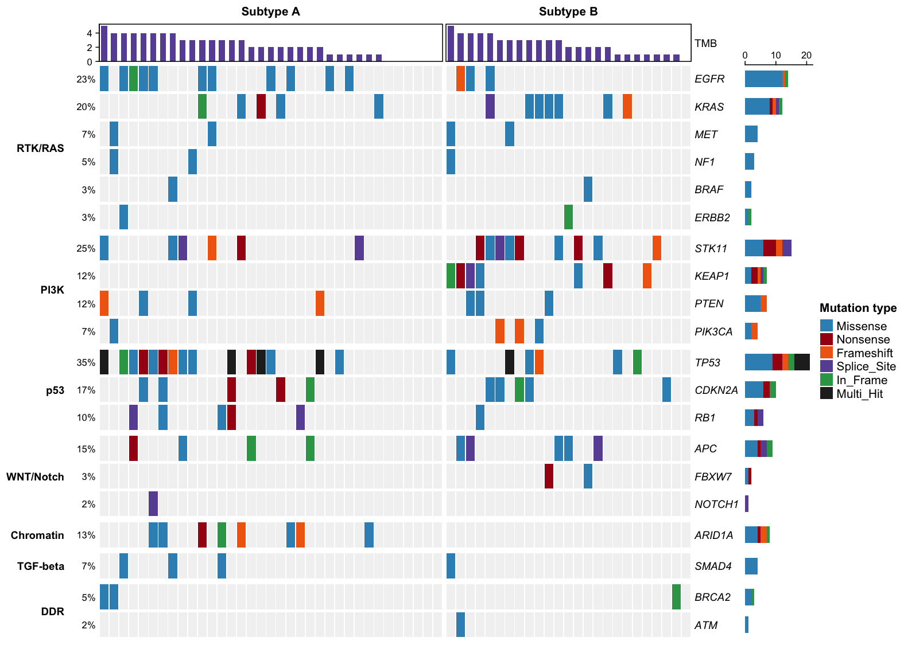

基因突变全景瀑布图（oncoplot，也称突变瀑布图）按基因与样本逐格展示一个队列的体细胞突变谱：行是突变频率最高的基因，列是样本，每个填充的格子代表一次突变，并按突变类型（错义、无义、移码、剪接位点等）着色。左侧的频率标签、顶部的突变负荷条，以及按分子亚型或队列拆分样本的选项，使 oncoplot 成为肿瘤基因组学研究的标配总结图——它能直观揭示哪些基因驱动了哪个亚群。本教程复现《顶刊图社》系列（第008期）介绍的图表类型，见文末参考文献。

## 示例

{fig-alt="MutationOncoplot DEMO" fig-align="center" width="80%"}

这张 oncoplot 汇总了一个模拟的 60 个样本、20 个肿瘤驱动基因的队列。样本按两个分子亚型（Subtype A 与 Subtype B）分组，基因按信号通路（`RTK/RAS`、`PI3K`、`p53` 等）分组，顶部条形图显示每个样本的总突变数。Subtype A 以 `TP53`（占全部样本的 35%）和 `EGFR` 突变为主，而 `STK11`、`KEAP1` 与 `KRAS` 的改变大多集中在 Subtype B——这正是 oncoplot 要揭示的亚群特异性模式。突变类型按颜色编码，`TP53` 偶尔出现 `Multi_Hit`（一个基因发生两次以上事件）。同一队列还将在第 4–5 节用 `maftools` 引擎再次绘制。

## 环境配置

-   系统要求：跨平台（Linux/MacOS/Windows）

-   编程语言：R

-   依赖包：`ComplexHeatmap`；`tidyverse`；`maftools`；`cowplot`；`NMF`；`patchwork`

```{r packages setup, message=FALSE, warning=FALSE, output=FALSE}
# Installing necessary packages
if (!requireNamespace("ComplexHeatmap", quietly = TRUE)) {
  install.packages("ComplexHeatmap")
}
if (!requireNamespace("tidyverse", quietly = TRUE)) {
  install.packages("tidyverse")
}
if (!requireNamespace("maftools", quietly = TRUE)) {
  BiocManager::install("maftools")
}
if (!requireNamespace("cowplot", quietly = TRUE)) {
  install.packages("cowplot")
}
if (!requireNamespace("NMF", quietly = TRUE)) {
  BiocManager::install("NMF")
}
if (!requireNamespace("patchwork", quietly = TRUE)) {
  install.packages("patchwork")
}

# Load packages
library(ComplexHeatmap)
library(tidyverse)
library(maftools)
library(cowplot)
library(NMF)
library(patchwork)
```

## 数据准备

示例模拟了一个小型队列，使教程无需下载受控的 TCGA 数据即可完全复现：60 个样本、两个分子亚型、20 个常见肿瘤驱动基因，按亚型特异性的概率发生突变。`Multi_Hit` 标记在一个样本中发生两次以上事件的基因。

```{r simulate data, message=FALSE}
set.seed(2026)

genes <- c("TP53", "EGFR", "KRAS", "STK11", "KEAP1", "PIK3CA", "PTEN", "RB1",
           "APC", "ARID1A", "NF1", "NOTCH1", "BRAF", "CDKN2A", "SMAD4", "FBXW7",
           "ATM", "BRCA2", "ERBB2", "MET")
cohort <- rep(c("Subtype A", "Subtype B"), c(35, 25))
samples <- sprintf("S%02d", 1:60)

# Subtype-specific mutation probabilities per gene
p_a <- c(.52, .34, .10, .14, .10, .10, .12, .10, .06, .22, .08, .06, .04, .10, .05, .06, .06, .05, .05, .04)
p_b <- c(.22, .08, .42, .40, .36, .14, .10, .10, .10, .06, .10, .06, .06, .10, .10, .08, .05, .05, .06, .08)
mut_types <- c("Missense", "Nonsense", "Frameshift", "Splice_Site", "In_Frame")
type_p <- c(.58, .14, .12, .08, .08)

mutations <- map_dfr(seq_along(samples), function(i) {
  p <- if (cohort[i] == "Subtype A") p_a else p_b
  hit <- genes[runif(length(genes)) < p]
  if (length(hit) == 0) return(NULL)
  type <- sample(mut_types, length(hit), replace = TRUE, prob = type_p)
  # Tumor suppressors such as TP53 can receive a second hit, shown as Multi_Hit
  if (runif(1) < .15 && "TP53" %in% hit) {
    type[hit == "TP53"] <- "Multi_Hit"
  }
  tibble(sample = samples[i], gene = hit, type = type)
})

head(mutations)
```

**注意：** 在你自己的分析中，输入是一张长表，每行一次突变，至少包含样本名、基因名和突变类型（可来自 MAF 文件、`maftools` 或你的变异检测流程）。下方代码会把它整理成 `oncoPrint()` 所需的突变矩阵。

```{r build matrix, message=FALSE}
# Reshape the mutation table into a gene x sample matrix; a cell holds one or
# several alteration types separated by ";"
gene_levels <- names(sort(table(factor(mutations$gene, levels = genes)), decreasing = TRUE))
mat <- matrix("", nrow = length(genes), ncol = length(samples),
              dimnames = list(genes, samples))
for (i in seq_len(nrow(mutations))) {
  cell <- mat[mutations$gene[i], mutations$sample[i]]
  mat[mutations$gene[i], mutations$sample[i]] <-
    if (cell == "") mutations$type[i] else paste(cell, mutations$type[i], sep = ";")
}

# Order samples: by subtype, then by mutation count (waterfall look)
mut_count <- colSums(mat != "")
ord <- order(factor(cohort, levels = c("Subtype A", "Subtype B")), -mut_count)
mat <- mat[gene_levels, ord]

# Annotation vectors aligned with the reordered matrix
cohort_ordered <- factor(cohort[ord], levels = c("Subtype A", "Subtype B"))
tmb <- mut_count[ord]

# Colors for alteration types
mutation_colors <- c(
  Missense = "#3690C0", Nonsense = "#A50F15", Frameshift = "#F16913",
  Splice_Site = "#6A51A3", In_Frame = "#31A354", Multi_Hit = "#252525"
)

# One drawing function per alteration type
rect_fun <- function(color) {
  function(x, y, w, h) grid.rect(x, y, w * 0.9, h * 0.9, gp = gpar(fill = color, col = NA))
}
alter_fun <- list(
  background = rect_fun("#F2F2F2"),
  Missense = rect_fun(mutation_colors["Missense"]),
  Nonsense = rect_fun(mutation_colors["Nonsense"]),
  Frameshift = rect_fun(mutation_colors["Frameshift"]),
  Splice_Site = rect_fun(mutation_colors["Splice_Site"]),
  In_Frame = rect_fun(mutation_colors["In_Frame"]),
  Multi_Hit = rect_fun(mutation_colors["Multi_Hit"])
)
```

上方的矩阵是 `ComplexHeatmap` 的原生输入；`maftools` 工作流则消费 **MAF 风格表格**——每行一个变异，包含基因、样本条码与 `Variant_Classification`（如 `Missense_Mutation`、`Nonsense_Mutation`、`Frame_Shift_Del`）。转换时有两个关键细节：

- **Multi_Hit 是推导出来的，而非存储值。** 我们的模拟表用显式类别 `Multi_Hit` 标记 5 个携带两次事件的基因-样本格，但 `read.maf()` 并不把它当作突变类别：凡 `Variant_Classification` 不在其词表内的行都会被移入 silent 集合（`maf@maf.silent`）并排除出图形——如果文件只由这类行组成，还会直接报错 *"No non-synonymous mutations found"*。因此我们把每个 `Multi_Hit` 格展开为两条独立事件（`Missense` + `Nonsense`），再由 maftools 自行推导出 multi-hit 细胞——真实 MAF 文件的行为同样如此（每行一个变异）。
- **坐标与等位基因**是 MAF 模式的必需列。绘图时只需格式合法；真实文件携带实际基因组位置。

```{r convert maf, message=FALSE}
# Expand explicit Multi_Hit cells into two individual events
mutations_long <- bind_rows(
  mutations |> filter(type != "Multi_Hit"),
  mutations |> filter(type == "Multi_Hit") |> mutate(type = "Missense"),
  mutations |> filter(type == "Multi_Hit") |> mutate(type = "Nonsense"))

# Our short type names -> the MAF Variant_Classification vocabulary
maf_class <- c(Missense = "Missense_Mutation", Nonsense = "Nonsense_Mutation",
               Frameshift = "Frame_Shift_Del", Splice_Site = "Splice_Site",
               In_Frame = "In_Frame_Del")
variant_type <- c(Missense = "SNP", Nonsense = "SNP", Frameshift = "DEL",
                  Splice_Site = "SNP", In_Frame = "DEL")

set.seed(7)
maf_data <- mutations_long |>
  mutate(
    Hugo_Symbol = gene,
    Variant_Classification = maf_class[type],
    Variant_Type = variant_type[type],
    Chromosome = paste0("chr", (match(gene, genes) %% 22) + 1),
    Start_Position = 100000L + as.integer(match(gene, genes)) * 54321L +
      row_number() * 37L + sample(1:99L, n(), replace = TRUE),
    End_Position = Start_Position,
    Reference_Allele = "A",
    Tumor_Seq_Allele2 = "G",
    Tumor_Sample_Barcode = sample) |>
  select(Hugo_Symbol, Chromosome, Start_Position, End_Position,
         Reference_Allele, Tumor_Seq_Allele2, Variant_Classification,
         Variant_Type, Tumor_Sample_Barcode)

# Sample-level annotation (kept alongside the MAF)
clin_data <- tibble(Tumor_Sample_Barcode = samples, Subtype = cohort)

# Read everything into a maftools MAF object
maf <- read.maf(maf = as.data.frame(maf_data),
                clinicalData = as.data.frame(clin_data), verbose = FALSE)

head(maf_data)
```

## 可视化

同一队列将绘制两次：第 1–3 节基于 `ComplexHeatmap::oncoPrint()` 构建全景图——对注释轨道与单元格渲染拥有完全控制；第 4–5 节则在上方准备好的 MAF 表示上使用 `maftools` 引擎——这也是真实变异文件的标配路线。

### 1. 基础绘图

基础 oncoplot 展示突变矩阵，每次突变一个彩色方块；左侧标签给出每个基因的突变频率，右侧条形图统计每个基因的突变数。

```{r}
#| label: fig-1.1BasicOncoplot
#| fig-cap: "基础基因突变全景瀑布图"
#| out.width: "95%"
#| warning: false
#| message: false
#| fig-width: 10
#| fig-height: 6.5

p1 <- oncoPrint(mat,
  alter_fun = alter_fun, alter_fun_is_vectorized = FALSE, col = mutation_colors,
  column_order = samples[ord], show_column_names = FALSE,
  row_names_gp = gpar(fontsize = 9, fontface = "italic"), pct_gp = gpar(fontsize = 8),
  heatmap_legend_param = list(title = "Mutation type"))
draw(p1)
```

### 2. 按分子亚型拆分并添加突变负荷

把列按分子亚型拆分、并在顶部加入每个样本突变数的条形图，矩阵就变成了经典的突变全景图：亚群特异性基因一目了然。

```{r}
#| label: fig-1.2CohortOncoplot
#| fig-cap: "按分子亚型拆分并带突变负荷条的 oncoplot"
#| out.width: "95%"
#| warning: false
#| message: false
#| fig-width: 10
#| fig-height: 7

top_annotation <- HeatmapAnnotation(
  TMB = anno_barplot(tmb, height = unit(1.1, "cm"),
                     gp = gpar(fill = "#6A51A3", col = NA)),
  annotation_name_gp = gpar(fontsize = 9))

p2 <- oncoPrint(mat,
  alter_fun = alter_fun, alter_fun_is_vectorized = FALSE, col = mutation_colors,
  column_order = samples[ord], show_column_names = FALSE,
  column_split = cohort_ordered, column_title_gp = gpar(fontsize = 10, fontface = "bold"),
  top_annotation = top_annotation,
  bottom_annotation = HeatmapAnnotation(
    Subtype = as.character(cohort_ordered),
    col = list(Subtype = c("Subtype A" = "#E08214", "Subtype B" = "#5E3C99")),
    annotation_name_side = "left", annotation_name_gp = gpar(fontsize = 9)),
  row_names_gp = gpar(fontsize = 9, fontface = "italic"), pct_gp = gpar(fontsize = 8),
  heatmap_legend_param = list(title = "Mutation type"))
draw(p2)
```


::: callout-tip
**关键参数：**

- `column_split`：把列拆分成面板，此处按分子亚型；`row_split` 对基因同理（见图 3）。
- `top_annotation`：任意 `HeatmapAnnotation`——突变负荷条形图（`anno_barplot`）是最常用的选择。
- `alter_fun_is_vectorized = FALSE`：逐格绘制突变方块；当绘图函数不是向量化的版本时需要设置。
:::

### 3. 按信号通路分组基因

把行按信号通路（`RTK/RAS`、`PI3K`、`p53` 等）分组，把瀑布图组织成功能区块——这是论文中 oncoplot 的常见排版方式。

```{r}
#| label: fig-1.3PathwayOncoplot
#| fig-cap: "按信号通路分组基因的 oncoplot"
#| out.width: "95%"
#| warning: false
#| message: false
#| fig-width: 10.5
#| fig-height: 7.5

pathway <- c(
  TP53 = "p53", RB1 = "p53", CDKN2A = "p53",
  EGFR = "RTK/RAS", ERBB2 = "RTK/RAS", MET = "RTK/RAS", KRAS = "RTK/RAS",
  BRAF = "RTK/RAS", NF1 = "RTK/RAS",
  PIK3CA = "PI3K", PTEN = "PI3K", STK11 = "PI3K", KEAP1 = "PI3K",
  APC = "WNT/Notch", NOTCH1 = "WNT/Notch", FBXW7 = "WNT/Notch",
  ARID1A = "Chromatin", SMAD4 = "TGF-beta", ATM = "DDR", BRCA2 = "DDR")
pathway_levels <- c("RTK/RAS", "PI3K", "p53", "WNT/Notch", "Chromatin", "TGF-beta", "DDR")

p3 <- oncoPrint(mat,
  alter_fun = alter_fun, alter_fun_is_vectorized = FALSE, col = mutation_colors,
  column_order = samples[ord], show_column_names = FALSE,
  row_split = factor(pathway[gene_levels], levels = pathway_levels),
  row_title_gp = gpar(fontsize = 9, fontface = "bold"), row_title_rot = 0,
  column_split = cohort_ordered, column_title_gp = gpar(fontsize = 10, fontface = "bold"),
  top_annotation = top_annotation,
  row_names_gp = gpar(fontsize = 9, fontface = "italic"), pct_gp = gpar(fontsize = 8),
  heatmap_legend_param = list(title = "Mutation type"))
draw(p3)
```

图 3 从功能角度呈现了同样的队列结构：Subtype A 富集 `TP53` 事件与 RTK/RAS 通路的 `EGFR` 突变，Subtype B 则集中于 `STK11`/`KEAP1`（PI3K 通路）与 `KRAS` 改变。


### 4. maftools 经典 oncoplot

队列此时已作为 MAF 对象（`maf`）就绪，`maftools::oncoplot()` 即可绘制经典的肿瘤基因组学全景图：顶部是每个样本的突变负荷条，右侧是基因频率与变异类型构成，自动百分比标签与 maftools 自带的配色体系。`sortByMutation = TRUE` 把样本排成熟悉的瀑布形态（在二值化突变矩阵上排序）。

```{r}
#| label: fig-1.4MaftoolsOncoplot
#| fig-cap: "同一队列的 maftools 基础 oncoplot"
#| out.width: "95%"
#| warning: false
#| message: false
#| fig-width: 10
#| fig-height: 6.5

oncoplot(maf = maf, top = 20, sortByMutation = TRUE)
```

::: callout-tip
**关键参数：**

- `top`：绘制突变频率最高的前多少个基因（此处为全部 20 个）。
- `sortByMutation`：按突变数排序样本（`TRUE`）或保持文件顺序（`FALSE`）。
- 完全没有突变的样本不会显示：maftools 只知道 MAF 中出现的样本，因此副标题显示 "Altered in 53 (100%) of 53 samples"——即 60 个队列样本中携带至少一个突变的 53 个。
:::

### 5. maftools 临床注释版

`clinicalFeatures` 从临床表添加注释轨道——与图 2 的 `column_split` 视图一一对应。`sortByAnnotation = TRUE` 按注释对样本分组，于是亚型特异基因再次成块排列（对比左侧的 `TP53` 块与右侧的 `STK11`/`KEAP1` 块）。

```{r}
#| label: fig-1.5MaftoolsCohortOncoplot
#| fig-cap: "按分子亚型注释并排序的 maftools oncoplot"
#| out.width: "95%"
#| warning: false
#| message: false
#| fig-width: 10
#| fig-height: 7

oncoplot(maf = maf, top = 20,
         clinicalFeatures = "Subtype", sortByAnnotation = TRUE)
```

::: callout-tip
**关键参数：**

- `clinicalFeatures`：临床表中作为矩阵下方注释轨道绘制的列。
- `sortByAnnotation`：在注释分组内对样本排序（`TRUE`）。
:::

### 6. 如何选择绘图引擎

两条路线描述的是同一个队列——`TP53` 在携带突变的样本中占 40%（全部 60 个样本中占 35%），`STK11`/`KEAP1`/`KRAS` 集中在 Subtype B——但它们各自适合不同的工作流：

- **`ComplexHeatmap::oncoPrint()`**（第 1–3 节）：完全的控制力——自定义单元格渲染、来自任意数据的注释轨道、任意行列分组、与整个热图生态的整合。当 oncoplot 需要与其他热图面板组合或需要定制样式时最为合适。
- **`maftools::oncoplot()`**（第 4–5 节）：真实 MAF 文件的标准入口——一次调用读取整个队列的变异，获得可直接用于发表的汇总（负荷条、变异类型构成、临床注释、自动推导的 multi-hit 细胞）。适合常规队列图以及 maftools 工具链的后续分析（互斥性、TiTv、驱动基因分析）。
### 7. 聚合突变频率"扫雷"网格

上文 oncoprint 展示的是**样本级**单元格；参考文献的泛癌"扫雷"布局改为聚合 \[4\]：每个癌亚型 × 基因一个 tile，携带受累样本数，两侧配置突变类型构成条（顶部：按亚型；右侧：按基因），并带原癌基因/抑癌基因色条。下面是该布局的紧凑模拟版本：

```{r}
#| label: fig-7.1AlterationGrid
#| fig-cap: "聚合突变频率网格：中央 tile 统计每个亚型 × 基因的受累样本数，两侧构成条展示突变类型占比。"
#| out.width: "95%"
#| warning: false
#| message: false
#| fig-width: 10
#| fig-height: 6

set.seed(2026)
subtypes <- c("BRCA_LumA", "BRCA_Basal", "LUAD", "LUSC", "COAD_MSI", "COAD_CIN",
              "KIRC", "STAD_MSI", "HNSC_HPV-", "SKCM")
n_sam <- c(80, 40, 60, 50, 45, 35, 55, 45, 50, 45)
genes_info <- data.frame(
  Gene = c("EGFR", "KRAS", "BRAF", "PIK3CA", "MYC", "CCND1",
           "TP53", "NF1", "PTEN", "RB1", "ARID1A", "CDKN2A"),
  Type = rep(c("OG", "TSG"), each = 6),
  base_rate = c(0.10, 0.15, 0.06, 0.22, 0.12, 0.09,
                0.45, 0.08, 0.12, 0.09, 0.14, 0.20)
)

## 样本级基因突变类型（按亚型模拟）
alter_ls <- do.call(rbind, lapply(seq_along(subtypes), function(s) {
  do.call(rbind, lapply(genes_info$Gene, function(g) {
    rate <- genes_info$base_rate[genes_info$Gene == g] *
      (1.35 ^ rnorm(1, mean = ifelse(s <= 5, 0.4, -0.2)))     # 亚型漂移
    n_alt <- rbinom(1, n_sam[s], min(rate, 0.9))
    types <- sample(c("MUT", "AMP", "DEL"), n_alt, replace = TRUE,
                    prob = c(0.6, 0.2, 0.2))
    extra <- if (n_alt > 2 && runif(1) < 0.15) "Multiple" else NULL
    data.frame(subtype = subtypes[s], gene = g,
               type = c(types, extra, NA_character_))
  }))
})) |>
  filter(!is.na(type))

## 中央：每个亚型 x 基因的受累样本数
gene_levels <- rev(genes_info$Gene)
centre <- alter_ls |>
  count(subtype, gene, name = "n_altered") |>
  complete(subtype = subtypes, gene = genes_info$Gene, fill = list(n_altered = 0)) |>
  mutate(Gene = factor(gene, gene_levels),
         Subtype = factor(subtype, subtypes))

## 构成条（突变类型占比）
comp_st <- alter_ls |> count(subtype, type, name = "n")
comp_ge <- alter_ls |> count(gene, type, name = "n")

p_top <- ggplot(comp_st, aes(x = subtype, y = n, fill = type)) +
  geom_col(position = "fill", width = 1, colour = "grey60", linewidth = .2) +
  scale_fill_brewer(type = "div", palette = "Paired", direction = -1, name = NULL) +
  scale_x_discrete(labels = NULL, limits = subtypes) +
  theme_void(base_size = 9) + theme(legend.position = "none")

p_right <- ggplot(comp_ge, aes(x = gene, y = n, fill = type)) +
  geom_col(position = "fill", width = 1, colour = "grey60", linewidth = .2) +
  scale_fill_brewer(type = "div", palette = "Paired", direction = -1, name = NULL) +
  scale_x_discrete(labels = NULL, limits = gene_levels) +
  coord_flip() + theme_void() +
  theme(legend.position = "bottom", legend.key.size = unit(3, "mm"),
        legend.text = element_text(size = 7))
leg <- cowplot::get_legend(p_right)          # grob insertion drops legends: extract it
p_right <- p_right + theme(legend.position = "none")

p_centre <- ggplot(centre, aes(Subtype, Gene, fill = n_altered)) +
  geom_tile(colour = "grey55", linewidth = .3) +
  geom_text(aes(label = ifelse(n_altered > 0, n_altered, "")), size = 2.6) +
  scale_fill_gradient(low = "white", high = "grey30", name = "Altered\nsamples") +
  theme_minimal(base_size = 10) +
  theme(axis.text.x = element_text(angle = 45, hjust = 1, size = 9),
        axis.text.y = element_text(size = 9, face = "bold",
                                   colour = c(rep("orangered", 6), rep("royalblue", 6))),
        panel.grid = element_blank())

## cowplot grob 让顶部/右侧构成条与中央网格严格同轴
## （已在火山图一节验证过的机制；ggarrange/patchwork 在此会漂移）
combined <- insert_xaxis_grob(p_centre, p_top, position = "top", height = unit(0.3, "in"))
combined <- insert_yaxis_grob(combined, p_right, position = "right", width = unit(1.4, "in"))
ggdraw(combined) +
  draw_grob(leg, x = 0.76, y = 0.006, width = 0.23, height = 0.045)  # legend into the empty lower-right corner
```


- 用 **cowplot 的 `insert_xaxis_grob()` / `insert_yaxis_grob()`** 拼装（与边缘注释火山图同一机制），而不是宽高向量：grob 插入把每个边缘条绑定到中央面板的轴空间，这是构成条与 tile 对齐的保证。注意它会丢弃边缘图自身的轴文字——标签要放在中央网格上。

::: callout-tip
**实践要点**

- 中央行、右侧条 y 轴与左侧色条要保持**同一个因子顺序**（`rev(genes_info$Gene)`）——顺序错位是这张图静默对不上的经典原因。
- 参考图的中央填充按基因归一化（log 计数除以该基因最大值）；这里用的统一计数标尺更简单，但会压平低频基因。
- 真实数据可从 MAF 队列（`maftools::oncoplot` 的输入）取样本 × 基因突变表，按亚型聚合，并保留参考文献"仅统计已知致癌突变"的过滤。
:::

### 8. 从头突变 signature 分解

体细胞突变目录可分解为 **signature**——特征性的三核苷酸上下文谱（完整 SBS 约定为 96 通道；APOBEC、烟草、UV、衰老等突变过程）\[4\]。maftools/MutationalPatterns 路线需要参考基因组；其版式本身可由模拟的 **48 通道**（6 类 × 8 简化上下文）矩阵经 NMF 分解复现：

```{r}
#| label: fig-8.1SignatureNMF
#| fig-cap: "模拟 48 通道突变目录的从头分解：NMF 提取的 signature 谱（上）与各样本的 signature 暴露（下）。"
#| out.width: "95%"
#| warning: false
#| message: false
#| fig-width: 9
#| fig-height: 6

set.seed(902)
bases <- c("C>A", "C>G", "C>T", "T>A", "T>C", "T>G")
channels <- paste0(rep(bases, each = 8), "_", rep(1:8, times = 6))
n_ch <- length(channels); n_samp <- 40

sig_apobec <- c(2, 6, 8, 6, 2, 1, 1, 1)   # TCW motif 富集（简化形状）
sig_aging  <- c(5, 4, 6, 5, 4, 3, 2, 2)   # 平坦形状（此处各类共享）
W_true <- cbind(rep(sig_apobec, 6), rep(sig_aging, 6))
W_true <- W_true / colSums(W_true)
expo <- t(cbind(c(rep(0.7, 15), rep(0.05, 25)), rep(0.5, n_samp)))  # 2 signatures x 40 samples
counts <- round((W_true %*% expo) * 600 +
                matrix(rpois(n_ch * n_samp, 2), nrow = n_ch))  # depth 600 for SNR

fit <- NMF::nmf(counts + 1, rank = 2, method = "brunet", nrun = 1, seed = 902)
W <- NMF::basis(fit); W <- W / colSums(W)                 # 通道 x 2
H <- NMF::coef(fit)                                       # 2 x 样本

sig_df <- as.data.frame(W) |>
  mutate(channel = rep(bases, each = n_ch / 6), pos = rep(1:(n_ch / 6), times = 6)) |>
  pivot_longer(V1:V2, names_to = "signature", values_to = "weight")
sig_df$signature <- ifelse(sig_df$signature == "V1", "Signature A", "Signature B")

expo_df <- as.data.frame(t(H)) |>
  mutate(sample = seq_len(n_samp)) |>
  pivot_longer(V1:V2, names_to = "signature", values_to = "exposure")
expo_df$signature <- ifelse(expo_df$signature == "V1", "Signature A", "Signature B")
expo_df$sample <- factor(expo_df$sample, levels = unique(expo_df$sample[order(expo_df$signature, -expo_df$exposure)]))

p_sig <- ggplot(sig_df, aes(pos, weight, fill = signature)) +
  geom_col(position = "dodge", width = 0.8) +
  facet_grid(signature ~ channel, scales = "free_y") +
  scale_fill_manual(values = c("Signature A" = "#B2182B", "Signature B" = "#2166AC")) +
  labs(x = "3' flanking base", y = "Channel weight", fill = NULL) +
  theme_classic(base_size = 9) +
  theme(legend.position = "none", strip.text = element_text(size = 8))

p_expo <- ggplot(expo_df, aes(sample, exposure, fill = signature)) +
  geom_col(position = "stack", width = 0.9) +
  scale_fill_manual(values = c("Signature A" = "#B2182B", "Signature B" = "#2166AC")) +
  labs(x = "Samples (sorted by dominant signature)", y = "Signature exposure", fill = NULL) +
  theme_classic(base_size = 9) +
  theme(legend.position = "top", axis.text.x = element_blank(),
        legend.key.size = unit(3, "mm"))

p_sig / p_expo + patchwork::plot_layout(heights = c(1.2, 1))
```

::: callout-tip
**实践要点**

-   真实数据的难点在秩选择：`NMF::nmf(rank = 2:5, nrun = 20)`，取 cophenetic 系数开始下降前的秩。
-   完整 96 通道版式按六大替换类内的 3' 侧翼碱基排序通道——把 `sig_apobec` 式形状在六个 facet 中重复即可（如本例）。
-   真实 MAF 输入用 `maftools::trinucleotideMatrix()` 构建通道矩阵（需 `BSgenome.Hsapiens`），之后的绘图半程与本例完全一致。
:::


### 9. 突变上下文乐高/热图与类别饼图

突变 signature 最适合以 **6 × 16 网格**呈现：六个替换类别，每类 16 个 3' 侧翼上下文，柱高或颜色深度表示计数。参考图以 3D 乐高图（`barplot3d` + `rgl`）渲染；2D 热图孪生版携带相同信息且无 3D 依赖，类别饼图总结六分占比 \[4\]。

```{r}
#| label: fig-9.1ContextHeatmap
#| fig-cap: "突变上下文：6 个替换类 × 16 个侧翼上下文的颜色深度热图（左）与六类占比饼图（右）。"
#| out.width: "95%"
#| warning: false
#| message: false
#| fig-width: 10
#| fig-height: 4.5

set.seed(1701)
mut_types <- c("C>A", "C>G", "C>T", "T>A", "T>C", "T>G")
type_cols <- c("#805D3F", "#72549A", "#5EAFB2", "#3F4F9D", "#F2EC3C", "#74B655")
names(type_cols) <- mut_types
contexts <- c("A_C", "C_C", "G_C", "T_C", "A_G", "C_G", "G_G", "T_G",
              "A_T", "C_T", "G_T", "T_T", "A_A", "C_A", "G_A", "T_A")

## 模拟 96 通道计数向量；每类内上下文分布相同（示意目录——真实 SBS1/衰老 signature 偏向 C>T）
counts <- rmultinom(1, 6000,
                    prob = rep(c(4, 2, 3, 1, 2, 2, 3, 1,
                                 6, 3, 4, 2, 1, 1, 1, 1), times = 6))
mut_df <- data.frame(
  mut_type = factor(rep(mut_types, each = 16), levels = mut_types),
  context = factor(rep(contexts, times = 6), levels = contexts),
  count = as.vector(counts))

## 左：颜色深度热图，行 = 上下文，列 = 替换类别
p_heat <- ggplot(mut_df, aes(mut_type, context, fill = count)) +
  geom_tile(colour = "grey80", linewidth = 0.3) +
  geom_text(aes(label = count), size = 2.2) +
  scale_fill_gradient(low = "white", high = "#3F4F9D", name = "Count") +
  scale_x_discrete(limits = mut_types) +
  labs(x = NULL, y = "3' flanking base", title = "Mutation context (96 channels)") +
  theme_minimal(base_size = 10) +
  theme(axis.text.x = element_text(face = "bold", colour = type_cols),
        panel.grid = element_blank())

## 右：六类占比饼图
pie_df <- aggregate(count ~ mut_type, mut_df, sum)
pie_df$pct <- pie_df$count / sum(pie_df$count) * 100
p_pie <- ggplot(pie_df, aes(x = "", y = pct, fill = mut_type)) +
  geom_col(width = 1, colour = "white") +
  coord_polar(theta = "y") +
  scale_fill_manual(values = type_cols) +
  geom_text(aes(label = sprintf("%.0f%%", pct)),
            position = position_stack(vjust = 0.5), size = 3) +
  labs(x = NULL, y = NULL, fill = NULL) +
  theme_void(base_size = 10)

patchwork::wrap_elements(full = p_heat) |
  patchwork::wrap_elements(full = p_pie + theme(legend.position = "bottom"))
```

::: callout-tip
**实践要点**

-   每个颜色类内部的 4 × 4 块是乐高图优于经典 96 柱图之处：两个侧翼碱基构成矩阵，上下文偏好（如 APOBEC 的 TpC）一目了然。
-   3D 乐高版需要 `barplot3d` + `rgl`（仅屏幕显示，经 `rgl.postscript` 保存）；这对 2D 热图 + 饼图可进出版物且在 CI 上渲染一致。
-   真实 MAF 用 `maftools::trinucleotideMatrix()` 构建同一 96 向量（需 `BSgenome.Hsapiens`）；取其 `count` 后保留绘图半程。
:::


### 10. 带签名贡献轨道的突变景观图

参考版分子景观面板把四层证据叠于同一样本轴——突变矩阵、负荷、亚型、签名贡献——并按能解释其突变模式的签名对样本排序 \[4\]。`ComplexHeatmap` 恰可组成此图：带 `anno_barplot` 负荷与类别色带的 `oncoPrint` 区块，以 `%v%` 叠上列序与母图共享的 `pheatmap` 签名区块。

```{r}
#| label: fig-10.1LandscapeSignature
#| fig-cap: "两区块于单一样本轴纵向叠放：oncoprint（顶部 TMB 条、底部 iCS 色带）叠于三行 APOBEC/AFR2/OTHER 签名贡献热图之上，样本按亚型再按签名占比排序。"
#| out.width: "95%"
#| warning: false
#| message: false
#| fig-width: 8.5
#| fig-height: 4.5

set.seed(6501)
genes_e <- c("TP53", "EGFR", "KRAS", "STK11", "KEAP1", "PIK3CA", "PTEN", "RB1", "CDKN2A", "NF1")
n_e <- 48
subt <- rep(c("iCS-1", "iCS-2", "iCS-3"), c(18, 16, 14))
# 各亚型的突变概率：亚型特异性驱动基因
pa <- c(.65, .55, .25, .10, .15, .20, .10, .15, .10, .05)
pb <- c(.20, .10, .60, .55, .10, .15, .35, .25, .05, .10)
pcx <- c(.15, .20, .20, .15, .75, .10, .10, .10, .55, .40)
samples_e <- sprintf("T%02d", 1:n_e)
mat_e <- matrix("", nrow = length(genes_e), ncol = n_e, dimnames = list(genes_e, samples_e))
tmb_e <- integer(n_e)
for (j in 1:n_e) {
  p_use <- switch(subt[j], "iCS-1" = pa, "iCS-2" = pb, pcx)
  hits <- genes_e[runif(length(genes_e)) < p_use]
  if (length(hits) == 0) { mat_e[genes_e[1], j] <- "Mis"; tmb_e[j] <- 1L; next }
  for (g in hits) {
    mat_e[g, j] <- sample(c("Mis", "Non", "Fs"), 1, prob = c(0.6, 0.25, 0.15))
    tmb_e[j] <- tmb_e[j] + 1L
  }
}
# APOBEC 签名占比 = 原图景观的排序键
sig_key <- ifelse(as.character(subt) == "iCS-1", 0.62,
              ifelse(as.character(subt) == "iCS-2", 0.30, 0.18)) + runif(n_e, -0.05, 0.05)
sig_mat <- rbind(APOBEC = sig_key,
                 AFR2  = 1 - sig_key + runif(n_e, -0.05, 0.05),
                 OTHER = runif(n_e, 0.02, 0.20))
dimnames(sig_mat) <- list(c("APOBEC", "AFR2", "OTHER"), samples_e)
# 先按亚型、亚型内再按签名占比降序
ord <- order(factor(subt, levels = c("iCS-1", "iCS-2", "iCS-3")), -sig_key)
mat_e <- mat_e[, ord]; sig_mat <- sig_mat[, ord]; tmb_e <- tmb_e[ord]
subt_o <- factor(subt[ord], levels = c("iCS-1", "iCS-2", "iCS-3"))
stopifnot(all(tmb_e <= length(genes_e)) && all(tmb_e >= 1) &&
          all(sig_mat["APOBEC", ] >= 0 & sig_mat["APOBEC", ] <= 1))
rect_fun <- function(color) function(x, y, w, h)
  grid.rect(x, y, w * 0.92, h * 0.92, gp = gpar(fill = color, col = NA))
alter_fun <- list(background = rect_fun("#F4F4F4"), Mis = rect_fun("#3690C0"),
                  Non = rect_fun("#A50F15"), Fs = rect_fun("#F16913"))
top_anno <- HeatmapAnnotation(
  TMB = anno_barplot(tmb_e, height = unit(1.0, "cm"),
                     gp = gpar(fill = "#6A51A3", col = NA),
                     axis_param = list(gp = gpar(fontsize = 6))),
  annotation_name_gp = gpar(fontsize = 7))
bot_anno <- HeatmapAnnotation(
  iCS = as.character(subt_o),
  col = list(iCS = c("iCS-1" = "#E08214", "iCS-2" = "#5E3C99", "iCS-3" = "#2A9F8F")),
  annotation_name_side = "left", annotation_name_gp = gpar(fontsize = 7))
op1 <- ComplexHeatmap::oncoPrint(mat_e, alter_fun = alter_fun,
  alter_fun_is_vectorized = FALSE,
  col = c(Mis = "#3690C0", Non = "#A50F15", Fs = "#F16913"),
  show_column_names = FALSE, show_row_names = TRUE,
  row_names_gp = gpar(fontsize = 7, fontface = "italic"),
  row_title_gp = gpar(fontsize = 0.1),
  top_annotation = top_anno, bottom_annotation = bot_anno,
  heatmap_legend_param = list(space = "none"),
  width = unit(8.6, "cm"), height = unit(3.4, "cm"))
# 签名块共享样本 x 序；%v% 将其叠于 oncoprint 之下
op2 <- ComplexHeatmap::pheatmap(mat = sig_mat,
  color = colorRampPalette(c("white", "#B2182B"))(99),
  cluster_rows = FALSE, cluster_cols = FALSE,
  show_rownames = TRUE, show_colnames = FALSE,
  cellwidth = unit(18, "pt"), cellheight = unit(11, "pt"),
  border_color = "white", legend = FALSE)
draw(op1 %v% op2)
```

::: callout-tip
**实践要点**

-   两区块必须消费同一个 `ord` 样本置换——一个重排向量便是叠放景观可读的全部机关。
-   `heatmap_legend_param = list(space = "none")` 屏蔽逐块图例；图例只给一次，交图注或专门区块。
-   真实数据以 `maftools::trinucleotideMatrix()` + NMF 或 SigProfiler 取各样本签名暴露量替代模拟占比，排序键（`sig_key`）须为真实 SBS 暴露。
:::

### 11. 01 矩阵 oncoprint：按通路拆分 + 临床注释

panel 测序报告常常给出 **01 矩阵**——每基因每样本突变与否、无变异类型——基因带通路注释、旁边附临床表。FigureYa42oncoprintV2 版式 \[4\] 把它直接喂给 `ComplexHeatmap::oncoPrint()`：`row_split = pathway` 堆叠通路分组，`show_pct = FALSE` 用基因名替换百分比轴，`bottom_annotation` 携带临床协变量，让突变模式与表型对照阅读：

```{r}
#| label: fig-11.1PathwayOncoprint
#| fig-cap: "40 个模拟样本中 12 个基因的 01 矩阵 oncoprint：行按通路拆分（RTK/RAS、PI3K、p53/cell cycle），绿色 = 突变，底部注释行携带吸烟、分期与治疗；顶栏统计每样本突变数。"
#| out.width: "100%"
#| warning: false
#| message: false
#| fig-width: 10.5
#| fig-height: 6.5

set.seed(4201)
genes_path <- data.frame(
  gene = c("EGFR", "ERBB2", "KRAS", "NRAS", "BRAF", "PIK3CA", "PTEN", "AKT1",
           "TP53", "MDM2", "CDKN2A", "RB1"),
  pathway = c("RTK/RAS", "RTK/RAS", "RTK/RAS", "RTK/RAS", "RTK/RAS",
              "PI3K", "PI3K", "PI3K", "p53/cell cycle", "p53/cell cycle",
              "p53/cell cycle", "p53/cell cycle"))
n_sm <- 40
freq <- c(0.35, 0.2, 0.3, 0.12, 0.25, 0.4, 0.15, 0.1, 0.55, 0.18, 0.22, 0.12)
mat01 <- sapply(freq, function(f) sample(c("mut", ""), n_sm, TRUE, prob = c(f, 1 - f)))
mat01 <- t(mat01)
rownames(mat01) <- genes_path$gene
colnames(mat01) <- paste0("P", sprintf("%02d", 1:n_sm))
mygene <- as.data.frame(mat01)
mygene$pathway <- genes_path$pathway
clin <- data.frame(
  row.names = colnames(mat01),
  Smoking = factor(sample(c("ever", "never"), n_sm, TRUE)),
  Stage = factor(sample(c("I-II", "III-IV"), n_sm, TRUE)),
  Treatment = factor(sample(c("chemo", "ICI", "TKI"), n_sm, TRUE, prob = c(0.4, 0.4, 0.2))))
alter_fun <- list(
  background = function(x, y, w, h) grid.rect(x, y, w - unit(0.5, "mm"), h - unit(0.5, "mm"),
                                              gp = gpar(fill = NA, col = NA)),
  mut = function(x, y, w, h) grid.rect(x, y, w - unit(0.5, "mm"), h - unit(0.5, "mm"),
                                       gp = gpar(fill = "#008000", col = NA)))
col_g <- c("mut" = "#008000")
my_annotation <- HeatmapAnnotation(df = clin,
                                   col = list(Smoking = c(ever = "#7A142C", never = "#D8D155"),
                                              Stage = c("I-II" = "#58CDD9", "III-IV" = "#223D6C"),
                                              Treatment = c(chemo = "#088247", ICI = "#D20A13", TKI = "#FFD121")),
                                   annotation_name_side = "left",
                                   annotation_name_gp = gpar(fontsize = 8))
draw(oncoPrint(mygene[, colnames(mat01)], get_type = function(x) x,
               alter_fun = alter_fun, col = col_g,
               show_pct = FALSE,
               bottom_annotation = my_annotation,
               row_split = mygene$pathway,
               show_heatmap_legend = FALSE,
               column_title = "01-matrix oncoprint split by pathway, clinical data below",
               column_title_gp = gpar(fontsize = 11)))
```

::: callout-tip
**实践要点**

-   `oncoPrint()` 要求矩阵值是与 `alter_fun`/`col` 名字匹配的字符串——先用 `mat01[mat01 == 1] <- "mut"; mat01[mat01 == 0] <- ""` 转换 01 矩阵再作图。
-   `get_type = function(x) x` 告诉 oncoPrint 每个格子已经原样携带变异标签（单类型 01 输入）；多类型 MAF 数据请保留默认解析器。
-   临床注释行控制在 2-4 个因子：底部色条是用来读突变-表型对齐的，不是第二张热图。
:::

### 12. 相关图上的共发生/互斥（FigureYa70mutationEvents）

FigureYa70mutationEvents \[5\] 提出每个 oncoprint 背后的配对问题：两个基因是一起突变（共发生、正相关）还是互相回避（互斥、负相关）？每对基因的 2x2 突变/非突变表用 Fisher 精确检验，phi 相关系数以 `corrplot` 椭圆呈现——颜色编码符号、形状大小编码强度，灰色叉号标记未通过 0.05 的配对。下块在模拟的 8 基因矩阵上跑完整流程，植入一对互斥（TP53-KRAS）与一对共发生（APC-EGFR）：

```{r}
#| label: fig-12.1MutCorrplot
#| fig-cap: "8 个模拟基因的共发生/互斥相关图：椭圆的颜色与形状编码突变/非突变 2x2 表的 phi 相关；灰色叉号标记 Fisher 检验不显著（p >= 0.05）的配对。"
#| out.width: "70%"
#| warning: false
#| message: false
#| fig-width: 7
#| fig-height: 7

## freeze:auto 只在新会话中重跑新 chunk——在此重新挂载包
suppressPackageStartupMessages({library(corrplot)})
set.seed(7001)
n_sm2 <- 220
genes2 <- c("TP53", "KRAS", "BRAF", "PIK3CA", "PTEN", "APC", "EGFR", "RB1")
mut <- sapply(c(0.5, 0.3, 0.22, 0.35, 0.15, 0.4, 0.12, 0.18),
              function(f) sample(c(0, 1), n_sm2, TRUE, c(1 - f, f)))
colnames(mut) = genes2
## 植入一对互斥（TP53-KRAS）与一对共发生（APC-EGFR）
mut[, 2] <- ifelse(mut[, 1] == 1, sample(c(0, 1), n_sm2, TRUE, c(0.85, 0.15)),
                   sample(c(0, 1), n_sm2, TRUE, c(0.35, 0.65)))
mut[, 6] <- ifelse(mut[, 7] == 1, sample(c(0, 1), n_sm2, TRUE, c(0.15, 0.85)),
                   sample(c(0, 1), n_sm2, TRUE, c(0.7, 0.3)))
corr_mat <- matrix(NA, length(genes2), length(genes2), dimnames = list(genes2, genes2))
pval_mat <- corr_mat
for (i in 1:(length(genes2) - 1)) for (j in (i + 1):length(genes2)) {
  t1 <- table(factor(mut[, i], c(0, 1)), factor(mut[, j], c(0, 1)))
  ft <- fisher.test(t1)
  corr_mat[i, j] = corr_mat[j, i] = cor(mut[, i], mut[, j])
  pval_mat[i, j] = pval_mat[j, i] = ft$p.value
}
diag(corr_mat) = 1; diag(pval_mat) = 0

corrplot(corr_mat, method = "ellipse", type = "upper",
         p.mat = pval_mat, sig.level = 0.05, insig = "pch",
         pch.cex = 2.2, pch.col = "grey30",
         tl.col = "black", tl.srt = 45,
         col = colorRampPalette(c("#2166AC", "#FFFFFF", "#B2182B"))(200),
         title = "Co-occurrence / mutual exclusivity (phi, Fisher test)",
         mar = c(1, 1, 3, 1))
```

::: callout-tip
**实践要点**

-   2x2 表上的 phi 系数是带符号的效应量；Fisher 精确 p 是证据——相关图**两者都展示**（椭圆 = 效应，叉 = 不显著），这也是 `insig = "pch"` 优于直接隐藏的原因。
-   真实 TCGA 数据请用 `discover` 包的组织校正检验；此处的朴素 Fisher 检验忽略样本纯度与测序覆盖度——替代时请写明该限制。
-   全配对检验后要校正（上例循环输出的是原始 p；若进论文，先对 28 对做 `p.adjust` 再作图）。
:::

## 应用场景## 应用场景

-   **队列刻画**：肿瘤基因组学研究的一线总结图，通常按亚型、分期或治疗臂拆分。
-   **驱动基因发现**：高频突变基因及其共现或互斥模式。
-   **突变负荷**：顶部条形图汇总每个样本的负荷——ComplexHeatmap 路线统计突变基因数，maftools 路线统计独立变异数（仅在 multi-hit 样本上有差异）。
-   上文展示的两套引擎均可用于真实队列：`ComplexHeatmap` 能与任意热图面板组合；`maftools::read.maf()` 则直接读取变异检测流程输出的 MAF 文件——支持 `clinicalData` 注释轨道（第 4–5 节），并解锁 maftools 工具链的后续分析（互斥性、TiTv、驱动基因分析）。

## 参考文献

\[1\] 顶刊图社 | 第008期：基因突变全景瀑布图. 微信公众号文章. <http://mp.weixin.qq.com/s?__biz=MzU5NjE2ODU0OQ==&mid=2247483816&idx=1&sn=73bb796a166fb501934ab4fab2aaf28a>

\[2\] Mayakonda A, Lin DC, Assenov Y, Plass C, Koeffler HP. Maftools: efficient and comprehensive analysis of somatic variants in cancer. Genome Res. 2018;28(11):1747-1756. doi:10.1101/gr.239244.118

\[3\] Gu Z, Eils R, Schlesner M. Complex heatmaps reveal patterns and correlations in multidimensional genomic data. Bioinformatics. 2016;32(18):2847-2849. doi:10.1093/bioinformatics/btw313

\[4\] Xiaofan Lu, et al. FigureYa: A Standardized Visualization Framework for Enhancing Biomedical Data Interpretation and Research Efficiency. iMetaMed. 2025. doi:10.1002/imm3.70005

\[5\] Xiaofan Lu, et al. FigureYa: A Standardized Visualization Framework for Enhancing Biomedical Data Interpretation and Research Efficiency. iMetaMed. 2025. doi:10.1002/imm3.70005