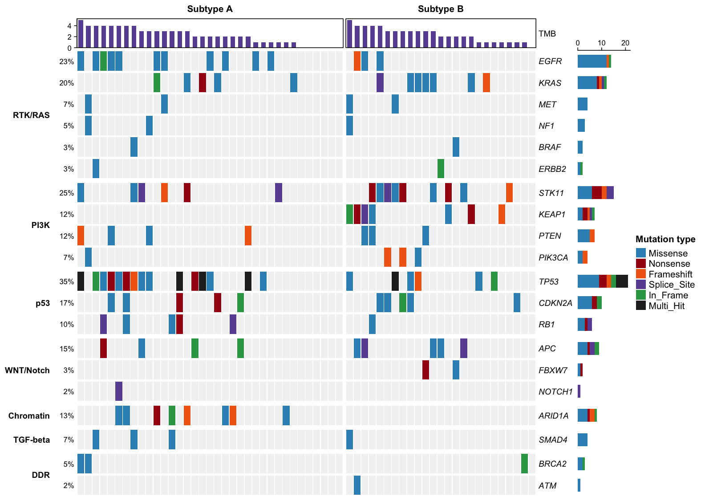

基因突变全景瀑布图（oncoplot，也称突变瀑布图）按基因与样本逐格展示一个队列的体细胞突变谱：行是突变频率最高的基因，列是样本，每个填充的格子代表一次突变，并按突变类型（错义、无义、移码、剪接位点等）着色。左侧的频率标签、顶部的突变负荷条，以及按分子亚型或队列拆分样本的选项，使 oncoplot 成为肿瘤基因组学研究的标配总结图——它能直观揭示哪些基因驱动了哪个亚群。本教程复现《顶刊图社》系列（第008期）介绍的图表类型，见文末参考文献。

## 示例

{fig-alt="MutationOncoplot DEMO" fig-align="center" width="80%"}

这张 oncoplot 汇总了一个模拟的 60 个样本、20 个肿瘤驱动基因的队列。样本按两个分子亚型（Subtype A 与 Subtype B）分组，基因按信号通路（`RTK/RAS`、`PI3K`、`p53` 等）分组，顶部条形图显示每个样本的总突变数。Subtype A 以 `TP53`（占全部样本的 35%）和 `EGFR` 突变为主，而 `STK11`、`KEAP1` 与 `KRAS` 的改变大多集中在 Subtype B——这正是 oncoplot 要揭示的亚群特异性模式。突变类型按颜色编码，`TP53` 偶尔出现 `Multi_Hit`（一个基因发生两次以上事件）。

## 环境配置

-   系统要求：跨平台（Linux/MacOS/Windows）

-   编程语言：R

-   依赖包：`ComplexHeatmap`；`tidyverse`

```{r packages setup, message=FALSE, warning=FALSE, output=FALSE}
# Installing necessary packages
if (!requireNamespace("ComplexHeatmap", quietly = TRUE)) {
  install.packages("ComplexHeatmap")
}
if (!requireNamespace("tidyverse", quietly = TRUE)) {
  install.packages("tidyverse")
}

# Load packages
library(ComplexHeatmap)
library(tidyverse)
```

## 数据准备

示例模拟了一个小型队列，使教程无需下载受控的 TCGA 数据即可完全复现：60 个样本、两个分子亚型、20 个常见肿瘤驱动基因，按亚型特异性的概率发生突变。`Multi_Hit` 标记在一个样本中发生两次以上事件的基因。

```{r simulate data, message=FALSE}
set.seed(2026)

genes <- c("TP53", "EGFR", "KRAS", "STK11", "KEAP1", "PIK3CA", "PTEN", "RB1",
           "APC", "ARID1A", "NF1", "NOTCH1", "BRAF", "CDKN2A", "SMAD4", "FBXW7",
           "ATM", "BRCA2", "ERBB2", "MET")
cohort <- rep(c("Subtype A", "Subtype B"), c(35, 25))
samples <- sprintf("S%02d", 1:60)

# Subtype-specific mutation probabilities per gene
p_a <- c(.52, .34, .10, .14, .10, .10, .12, .10, .06, .22, .08, .06, .04, .10, .05, .06, .06, .05, .05, .04)
p_b <- c(.22, .08, .42, .40, .36, .14, .10, .10, .10, .06, .10, .06, .06, .10, .10, .08, .05, .05, .06, .08)
mut_types <- c("Missense", "Nonsense", "Frameshift", "Splice_Site", "In_Frame")
type_p <- c(.58, .14, .12, .08, .08)

mutations <- map_dfr(seq_along(samples), function(i) {
  p <- if (cohort[i] == "Subtype A") p_a else p_b
  hit <- genes[runif(length(genes)) < p]
  if (length(hit) == 0) return(NULL)
  type <- sample(mut_types, length(hit), replace = TRUE, prob = type_p)
  # Tumor suppressors such as TP53 can receive a second hit, shown as Multi_Hit
  if (runif(1) < .15 && "TP53" %in% hit) {
    type[hit == "TP53"] <- "Multi_Hit"
  }
  tibble(sample = samples[i], gene = hit, type = type)
})

head(mutations)
```

**注意：** 在你自己的分析中，输入是一张长表，每行一次突变，至少包含样本名、基因名和突变类型（可来自 MAF 文件、`maftools` 或你的变异检测流程）。下方代码会把它整理成 `oncoPrint()` 所需的突变矩阵。

```{r build matrix, message=FALSE}
# Reshape the mutation table into a gene x sample matrix; a cell holds one or
# several alteration types separated by ";"
gene_levels <- names(sort(table(factor(mutations$gene, levels = genes)), decreasing = TRUE))
mat <- matrix("", nrow = length(genes), ncol = length(samples),
              dimnames = list(genes, samples))
for (i in seq_len(nrow(mutations))) {
  cell <- mat[mutations$gene[i], mutations$sample[i]]
  mat[mutations$gene[i], mutations$sample[i]] <-
    if (cell == "") mutations$type[i] else paste(cell, mutations$type[i], sep = ";")
}

# Order samples: by subtype, then by mutation count (waterfall look)
mut_count <- colSums(mat != "")
ord <- order(factor(cohort, levels = c("Subtype A", "Subtype B")), -mut_count)
mat <- mat[gene_levels, ord]

# Annotation vectors aligned with the reordered matrix
cohort_ordered <- factor(cohort[ord], levels = c("Subtype A", "Subtype B"))
tmb <- mut_count[ord]

# Colors for alteration types
mutation_colors <- c(
  Missense = "#3690C0", Nonsense = "#A50F15", Frameshift = "#F16913",
  Splice_Site = "#6A51A3", In_Frame = "#31A354", Multi_Hit = "#252525"
)

# One drawing function per alteration type
rect_fun <- function(color) {
  function(x, y, w, h) grid.rect(x, y, w * 0.9, h * 0.9, gp = gpar(fill = color, col = NA))
}
alter_fun <- list(
  background = rect_fun("#F2F2F2"),
  Missense = rect_fun(mutation_colors["Missense"]),
  Nonsense = rect_fun(mutation_colors["Nonsense"]),
  Frameshift = rect_fun(mutation_colors["Frameshift"]),
  Splice_Site = rect_fun(mutation_colors["Splice_Site"]),
  In_Frame = rect_fun(mutation_colors["In_Frame"]),
  Multi_Hit = rect_fun(mutation_colors["Multi_Hit"])
)
```

## 可视化

### 1. 基础绘图

基础 oncoplot 展示突变矩阵，每次突变一个彩色方块；左侧标签给出每个基因的突变频率，右侧条形图统计每个基因的突变数。

```{r}
#| label: fig-1.1BasicOncoplot
#| fig-cap: "基础基因突变全景瀑布图"
#| out.width: "95%"
#| warning: false
#| message: false
#| fig-width: 10
#| fig-height: 6.5

p1 <- oncoPrint(mat,
  alter_fun = alter_fun, alter_fun_is_vectorized = FALSE, col = mutation_colors,
  column_order = samples[ord], show_column_names = FALSE,
  row_names_gp = gpar(fontsize = 9, fontface = "italic"), pct_gp = gpar(fontsize = 8),
  heatmap_legend_param = list(title = "Mutation type"))
draw(p1)
```

### 2. 按分子亚型拆分并添加突变负荷

把列按分子亚型拆分、并在顶部加入每个样本突变数的条形图，矩阵就变成了经典的突变全景图：亚群特异性基因一目了然。

```{r}
#| label: fig-1.2CohortOncoplot
#| fig-cap: "按分子亚型拆分并带突变负荷条的 oncoplot"
#| out.width: "95%"
#| warning: false
#| message: false
#| fig-width: 10
#| fig-height: 7

top_annotation <- HeatmapAnnotation(
  TMB = anno_barplot(tmb, height = unit(1.1, "cm"),
                     gp = gpar(fill = "#6A51A3", col = NA)),
  annotation_name_gp = gpar(fontsize = 9))

p2 <- oncoPrint(mat,
  alter_fun = alter_fun, alter_fun_is_vectorized = FALSE, col = mutation_colors,
  column_order = samples[ord], show_column_names = FALSE,
  column_split = cohort_ordered, column_title_gp = gpar(fontsize = 10, fontface = "bold"),
  top_annotation = top_annotation,
  bottom_annotation = HeatmapAnnotation(
    Subtype = as.character(cohort_ordered),
    col = list(Subtype = c("Subtype A" = "#E08214", "Subtype B" = "#5E3C99")),
    annotation_name_side = "left", annotation_name_gp = gpar(fontsize = 9)),
  row_names_gp = gpar(fontsize = 9, fontface = "italic"), pct_gp = gpar(fontsize = 8),
  heatmap_legend_param = list(title = "Mutation type"))
draw(p2)
```

::: callout-tip
**关键参数：**

- `column_split`：把列拆分成面板，此处按分子亚型；`row_split` 对基因同理（见图 3）。
- `top_annotation`：任意 `HeatmapAnnotation`——突变负荷条形图（`anno_barplot`）是最常用的选择。
- `alter_fun_is_vectorized = FALSE`：逐格绘制突变方块；当绘图函数不是向量化的版本时需要设置。
:::

### 3. 按信号通路分组基因

把行按信号通路（`RTK/RAS`、`PI3K`、`p53` 等）分组，把瀑布图组织成功能区块——这是论文中 oncoplot 的常见排版方式。

```{r}
#| label: fig-1.3PathwayOncoplot
#| fig-cap: "按信号通路分组基因的 oncoplot"
#| out.width: "95%"
#| warning: false
#| message: false
#| fig-width: 10.5
#| fig-height: 7.5

pathway <- c(
  TP53 = "p53", RB1 = "p53", CDKN2A = "p53",
  EGFR = "RTK/RAS", ERBB2 = "RTK/RAS", MET = "RTK/RAS", KRAS = "RTK/RAS",
  BRAF = "RTK/RAS", NF1 = "RTK/RAS",
  PIK3CA = "PI3K", PTEN = "PI3K", STK11 = "PI3K", KEAP1 = "PI3K",
  APC = "WNT/Notch", NOTCH1 = "WNT/Notch", FBXW7 = "WNT/Notch",
  ARID1A = "Chromatin", SMAD4 = "TGF-beta", ATM = "DDR", BRCA2 = "DDR")
pathway_levels <- c("RTK/RAS", "PI3K", "p53", "WNT/Notch", "Chromatin", "TGF-beta", "DDR")

p3 <- oncoPrint(mat,
  alter_fun = alter_fun, alter_fun_is_vectorized = FALSE, col = mutation_colors,
  column_order = samples[ord], show_column_names = FALSE,
  row_split = factor(pathway[gene_levels], levels = pathway_levels),
  row_title_gp = gpar(fontsize = 9, fontface = "bold"), row_title_rot = 0,
  column_split = cohort_ordered, column_title_gp = gpar(fontsize = 10, fontface = "bold"),
  top_annotation = top_annotation,
  row_names_gp = gpar(fontsize = 9, fontface = "italic"), pct_gp = gpar(fontsize = 8),
  heatmap_legend_param = list(title = "Mutation type"))
draw(p3)
```

图 3 从功能角度呈现了同样的队列结构：Subtype A 富集 `TP53` 事件与 RTK/RAS 通路的 `EGFR` 突变，Subtype B 则集中于 `STK11`/`KEAP1`（PI3K 通路）与 `KRAS` 改变。

## 应用场景

-   **队列刻画**：肿瘤基因组学研究的一线总结图，通常按亚型、分期或治疗臂拆分。
-   **驱动基因发现**：高频突变基因及其共现或互斥模式。
-   **突变负荷**：顶部条形图统计每个样本的突变基因数。
-   `maftools` 包提供了广泛使用的替代实现（`maftools::oncoplot()`），可直接读取 MAF 文件；本教程使用的 `ComplexHeatmap` 方案让图形留在通用热图框架内，并支持任意注释轨道。

## 参考文献

\[1\] 顶刊图社 | 第008期：基因突变全景瀑布图. 微信公众号文章. <http://mp.weixin.qq.com/s?__biz=MzU5NjE2ODU0OQ==&mid=2247483816&idx=1&sn=73bb796a166fb501934ab4fab2aaf28a>

\[2\] Mayakonda A, Lin DC, Assenov Y, Plass C, Koeffler HP. Maftools: efficient and comprehensive analysis of somatic variants in cancer. Genome Res. 2018;28(11):1747-1756. doi:10.1101/gr.239244.118

\[3\] Gu Z, Eils R, Schlesner M. Complex heatmaps reveal patterns and correlations in multidimensional genomic data. Bioinformatics. 2016;32(18):2847-2849. doi:10.1093/bioinformatics/btw313
