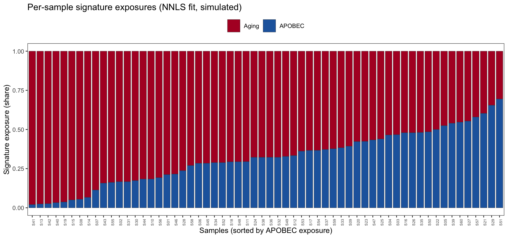

Each tumour's somatic catalogue is a mixture of **mutational signatures** — 96-channel trinucleotide-context profiles left by mutational processes (aging, APOBEC, tobacco, UV). Tools like `deconstructSigs` and `SigProfiler` fit a non-negative least squares (NNLS) model to recover each sample's **signature exposures**; the reference figure then plots per-sample exposures as a stacked bar sorted by one signature \[1\]. This tutorial reproduces the fit-and-plot loop on simulated 96-channel catalogues with two planted signatures — no external signature tool needed, because the "signatures" and the counts are simulated in-chunk:

## Example

{fig-alt="MutationSignaturePlot DEMO" fig-align="center" width="60%"}

## Setup

-   System Requirements: Cross-platform (Linux/MacOS/Windows)

-   Programming language: R

-   Dependent packages: `ggplot2`; `dplyr`; `tidyr`

```{r packages setup, message=FALSE, warning=FALSE, output=FALSE}
suppressPackageStartupMessages({
  library(ggplot2)
  library(dplyr)
  library(tidyr)
})
```

```{r}
sessioninfo::session_info("attached")
```

## Data Preparation

Two 96-channel reference "signatures" (an aging-like flat C>T profile and an APOBEC-like TCW profile) over 60 simulated samples. Each sample's observed 96-channel count vector is drawn from its planted exposure mixture; the NNLS fit then recovers the exposures from the counts alone:

```{r load data}
set.seed(11001)
contexts <- c("C>A", "C>G", "C>T", "T>A", "T>C", "T>G")
## proper 96-channel labels: 6 substitution types x 16 flanking pairs
flanks <- as.vector(outer(c("A", "C", "G", "T"), c("A", "C", "G", "T"), paste0))
ch96 <- paste0(rep(contexts, each = 16), "_", rep(flanks, times = 6))
sig1 <- rep(c(3, 1, 1, 3), times = 6)      # aging-like flat profile
sig2 <- rep(c(1, 1, 5, 1), times = 6)      # APOBEC-like TCW profile
W <- cbind(Aging = sig1 / sum(sig1), APOBEC = sig2 / sum(sig2))
n_sm4 <- 60
expo <- cbind(Aging = runif(n_sm4, 0.2, 0.9), APOBEC = runif(n_sm4, 0, 0.5))
expo <- expo / rowSums(expo)
## observed 96-channel counts: multinomial draws from each sample's mixture
counts <- t(apply(expo, 1, function(e) as.vector(rmultinom(1, 120, W %*% e))))
```

## Visualization

### 1. NNLS Exposure Fit

The fit is a plain non-negative least squares per sample: regress the count vector on the two reference signatures, clip negatives to zero, renormalise to shares. `deconstructSigs::whichSignatures()` does exactly this (with trinucleotide context correction); the loop below is the dependency-free core:

```{r}
#| label: fig-1.1SignatureExposures
#| fig-cap: "Recovered per-sample signature exposures (NNLS on the simulated 96-channel counts), sorted by APOBEC exposure: the planted APOBEC-high samples separate cleanly from the aging-dominated majority."
#| out.width: "100%"
#| warning: false
#| message: false
#| fig-width: 10
#| fig-height: 4.5

nnls_fit <- function(x, W) {
  coef <- lm(x ~ W - 1)$coefficients
  coef[coef < 0] <- 0                      # non-negativity, as deconstructSigs
  coef / sum(coef)
}
expo_fit <- t(apply(counts, 1, nnls_fit, W = W))
colnames(expo_fit) <- colnames(W)
sig_exp <- data.frame(sample = sprintf("S%02d", 1:n_sm4), expo_fit)
sig_exp2 <- sig_exp[order(sig_exp$APOBEC), ]
sig_long <- sig_exp2 %>%
  pivot_longer(-sample, names_to = "signature", values_to = "exposure") %>%
  mutate(sample = factor(sample, levels = sig_exp2$sample))

ggplot(sig_long, aes(sample, exposure, fill = signature)) +
  geom_col(width = 0.85, colour = "grey25", linewidth = 0.15) +
  scale_fill_manual(values = c(Aging = "#B2182B", APOBEC = "#2166AC"), name = NULL) +
  labs(x = "Samples (sorted by APOBEC exposure)", y = "Signature exposure (share)",
       title = "Per-sample signature exposures (NNLS fit, simulated)") +
  theme_bw(base_size = 10) +
  theme(axis.text.x = element_text(angle = 90, size = 5),
        legend.position = "top", panel.grid = element_blank())
```

### 2. Fit-Quality Reconstruction Check

Before trusting the exposures, check the **reconstruction**: each sample's observed catalogue against the catalogue implied by its fitted exposures. Cosine similarity near 1 means two signatures suffice:

```{r}
#| label: fig-2.1Reconstruction
#| fig-cap: "Reconstruction quality per sample: observed (dark) vs fitted (light) counts across the 96 channels for two samples at the APOBEC extremes; cosine similarity in each title."
#| out.width: "100%"
#| warning: false
#| message: false
#| fig-width: 10
#| fig-height: 4

cosine <- function(a, b) sum(a * b) / (sqrt(sum(a^2)) * sqrt(sum(b^2)))
pred <- t(apply(expo_fit, 1, function(e) 120 * as.vector(W %*% e)))
cs <- apply(cbind(counts, pred), 1, function(r) cosine(r[1:96], r[97:192]))
extremes <- c(which.min(sig_exp$APOBEC), which.max(sig_exp$APOBEC))
chk <- do.call(rbind, lapply(extremes, function(i) {
  lab <- sprintf("S%02d  (cosine = %.2f)", i, cs[i])
  data.frame(channel = rep(ch96, 2),
             count = c(counts[i, ], pred[i, ]),
             which = rep(c("observed", "fitted"), each = 96),
             sample = lab)
}))
chk$channel <- factor(chk$channel, levels = ch96)
ggplot(chk, aes(channel, count, fill = which)) +
  geom_col(position = "dodge") +
  facet_wrap(~sample, nrow = 2, scales = "free_y") +
  scale_fill_manual(values = c(observed = "grey35", fitted = "#E69F00"), name = NULL) +
  labs(x = NULL, y = "Mutation count", title = "Reconstruction quality check") +
  theme_bw(base_size = 10) +
  theme(axis.text.x = element_text(angle = 90, size = 4.5),
        legend.position = "top", panel.grid = element_blank())
```

::: callout-tip
**Practice tips**

-   NNLS is the core of every signature tool — `deconstructSigs::whichSignatures()` adds trinucleotide-frequency normalization and a "unknown" signature for unexplained counts; skip the unknown signature only for simulated data.
-   Always show the reconstruction: a high exposure fit with low cosine similarity means the signature set is missing a process, and the exposures are not trustworthy.
-   Sort the exposure barplot by the signature you discuss (APOBEC here) — an unsorted barplot hides the biological grouping the figure exists to show.
:::

## Applications

::: {#fig-MutationSignatureApplications1}
{fig-alt="MutationSignaturePlot Application" fig-align="center" width="60%"}

Per-sample signature exposures
:::

The exposure barplot plus reconstruction check applies to any NNLS-fitted mixture: COSMIC SBS signatures via SigProfiler, drug response mixtures, or cell-type deconvolution.

## Reference

\[1\] Xiaofan Lu, et al. FigureYa: A Standardized Visualization Framework for Enhancing Biomedical Data Interpretation and Research Efficiency. iMetaMed. 2025. doi:10.1002/imm3.70005

\[2\] Rosenthal R, McGranahan N, Herrero J, Taylor BS, Swanton C. deconstructSigs: delineating mutational processes in single tumors. PLoS Comput Biol. 2016;12(2):e1004723. doi:10.1371/journal.pcbi.1004723
