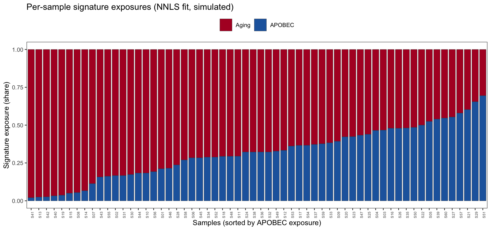

每个肿瘤的体细胞目录是**突变 signature** 的混合物——96 通道三核苷酸上下文谱（衰老、APOBEC、烟草、UV）。`deconstructSigs`/`SigProfiler` 用非负最小二乘（NNLS）拟合每样本的 **signature 暴露量**；参考图随后将逐样本暴露量画成按某一 signature 排序的堆积柱 \[1\]。本教程在模拟 96 通道目录（植入两个 signature）上复现拟合-绘图循环——无需外部 signature 工具，signature 和计数均在 chunk 内模拟：

## Example

{fig-alt="MutationSignaturePlot DEMO" fig-align="center" width="60%"}

## Setup

-   系统要求：跨平台（Linux/MacOS/Windows）

-   编程语言：R

-   依赖包：`ggplot2`；`dplyr`；`tidyr`

```{r packages setup, message=FALSE, warning=FALSE, output=FALSE}
suppressPackageStartupMessages({
  library(ggplot2)
  library(dplyr)
  library(tidyr)
})
```

```{r}
sessioninfo::session_info("attached")
```

## 数据准备

两个 96 通道参考"signature"（衰老样平坦 C>T 谱与 APOBEC 样 TCW 谱）× 60 个模拟样本。每样本的观测 96 通道计数向量从其植入暴露混合物抽取；NNLS 拟合则仅从计数反推暴露：

```{r load data}
sessioninfo::session_info("attached")
```

## Visualization

### 1. NNLS 暴露拟合

每样本的拟合是简单的非负最小二乘：计数向量对两条参考 signature 做回归、负值截零、再归一化为份额。`deconstructSigs::whichSignatures()` 做的正是这件事（加上三核苷酸频率校正）；下循环是免依赖核心：

```{r}
#| label: fig-1.1SignatureExposures
#| fig-cap: "模拟 96 通道计数的 NNLS 逐样本 signature 暴露量（按 APOBEC 排序）：植入的 APOBEC 高样本与衰老主导的多数样本清晰分离。"
#| out.width: "100%"
#| warning: false
#| message: false
#| fig-width: 10
#| fig-height: 4.5

set.seed(11001)
contexts <- c("C>A", "C>G", "C>T", "T>A", "T>C", "T>G")
## proper 96-channel labels: 6 substitution types x 16 flanking pairs
flanks <- as.vector(outer(c("A", "C", "G", "T"), c("A", "C", "G", "T"), paste0))
ch96 <- paste0(rep(contexts, each = 16), "_", rep(flanks, times = 6))
sig1 <- rep(c(3, 1, 1, 3), times = 6)      # aging-like flat profile
sig2 <- rep(c(1, 1, 5, 1), times = 6)      # APOBEC-like TCW profile
W <- cbind(Aging = sig1 / sum(sig1), APOBEC = sig2 / sum(sig2))
n_sm4 <- 60
expo <- cbind(Aging = runif(n_sm4, 0.2, 0.9), APOBEC = runif(n_sm4, 0, 0.5))
expo <- expo / rowSums(expo)
## observed 96-channel counts: multinomial draws from each sample's mixture
counts <- t(apply(expo, 1, function(e) as.vector(rmultinom(1, 120, W %*% e))))
```

### 2. 拟合质量重构检查

在信任暴露量之前检查**重构**：每样本的观测目录 vs 其拟合暴露所隐含的目录。余弦相似度接近 1 说明两条 signature 足够：

```{r}
#| label: fig-2.1Reconstruction
#| fig-cap: "逐样本重构质量：APOBEC 两端样本的观测（深色）vs 拟合（浅色）96 通道计数；标题标注余弦相似度。"
#| out.width: "100%"
#| warning: false
#| message: false
#| fig-width: 10
#| fig-height: 4

#| label: fig-1.1SignatureExposures
#| fig-cap: "Recovered per-sample signature exposures (NNLS on the simulated 96-channel counts), sorted by APOBEC exposure: the planted APOBEC-high samples separate cleanly from the aging-dominated majority."
#| out.width: "100%"
#| warning: false
#| message: false
#| fig-width: 10
#| fig-height: 4.5

nnls_fit <- function(x, W) {
  coef <- lm(x ~ W - 1)$coefficients
  coef[coef < 0] <- 0                      # non-negativity, as deconstructSigs
  coef / sum(coef)
}
expo_fit <- t(apply(counts, 1, nnls_fit, W = W))
colnames(expo_fit) <- colnames(W)
sig_exp <- data.frame(sample = sprintf("S%02d", 1:n_sm4), expo_fit)
sig_exp2 <- sig_exp[order(sig_exp$APOBEC), ]
sig_long <- sig_exp2 %>%
  pivot_longer(-sample, names_to = "signature", values_to = "exposure") %>%
  mutate(sample = factor(sample, levels = sig_exp2$sample))

ggplot(sig_long, aes(sample, exposure, fill = signature)) +
  geom_col(width = 0.85, colour = "grey25", linewidth = 0.15) +
  scale_fill_manual(values = c(Aging = "#B2182B", APOBEC = "#2166AC"), name = NULL) +
  labs(x = "Samples (sorted by APOBEC exposure)", y = "Signature exposure (share)",
       title = "Per-sample signature exposures (NNLS fit, simulated)") +
  theme_bw(base_size = 10) +
  theme(axis.text.x = element_text(angle = 90, size = 5),
        legend.position = "top", panel.grid = element_blank())
```

::: callout-tip
**实践要点**

-   NNLS 是所有 signature 工具的核心——`deconstructSigs::whichSignatures()` 增加了三核苷酸频率归一化和"未知"signature 来承接未解释的计数；模拟数据可省略未知 signature。
-   务必展示重构：高暴露拟合但低余弦相似度意味着 signature 集缺少某个过程，暴露量不可信。
-   暴露柱状图按要讨论的 signature 排序——未排序的柱状图会隐藏这张图要展示的生物学分组。
:::

## Applications

::: {#fig-MutationSignatureApplications1}
{fig-alt="MutationSignaturePlot Application" fig-align="center" width="60%"}

逐样本 signature 暴露量
:::

暴露柱状图 + 重构检查适用于任何 NNLS 拟合混合物：SigProfiler 的 COSMIC SBS signature、药物响应混合物或细胞类型去卷积。

## Reference

\[1\] Xiaofan Lu, et al. FigureYa: A Standardized Visualization Framework for Enhancing Biomedical Data Interpretation and Research Efficiency. iMetaMed. 2025. doi:10.1002/imm3.70005

\[2\] Rosenthal R, McGranahan N, Herrero J, Taylor BS, Swanton C. deconstructSigs: delineating mutational processes in single tumors. PLoS Comput Biol. 2016;12(2):e1004723. doi:10.1371/journal.pcbi.1004723