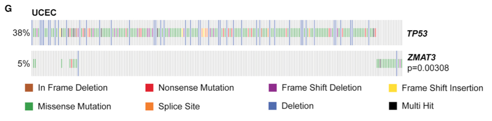

To determine whether pairs of mutated genes in a cohort tend to co-occur or be **mutually exclusive** (suggesting they act in the same pathway), the reference computes pairwise Fisher's exact tests over a binary mutation matrix and visualizes the odds ratios and p values as a co-occurrence matrix or network \[1\]. `maftools::somaticInteractions()` is the standard wrapper; here a binary mutation matrix is simulated for 15 genes across 200 tumours with planted mutual exclusivity (e.g. TP53 vs PIK3CA), and the pairwise Fisher test matrix runs on base R:

## Example

{fig-alt="Somatic Mutation Mutual Exclusivity DEMO" fig-align="center" width="70%"}

## Setup

-   System Requirements: Cross-platform (Linux/MacOS/Windows)

-   Programming language: R

-   Dependent packages: `pheatmap`; `ggplot2`

```{r packages setup, message=FALSE, warning=FALSE, output=FALSE}
suppressPackageStartupMessages({
  library(pheatmap); library(ggplot2)
})
```

```{r}
sessioninfo::session_info("attached")
```

## Data Preparation

15 candidate genes × 200 tumour samples (0/1 binary mutation calls). Planted structure: strong mutual exclusivity between gene 1 and gene 2 (odds ratio < 0.2, p < 0.001) and co-occurrence between gene 3 and gene 4:

```{r load data}
suppressPackageStartupMessages({library(pheatmap); library(ggplot2)})
set.seed(48288)
n_gene <- 15; n_tum <- 200
genes <- sprintf("GENE%02d", 1:n_gene)
mut_mat <- matrix(rbinom(n_gene * n_tum, 1, 0.15), n_gene, n_tum,
                  dimnames = list(genes, sprintf("T%03d", 1:n_tum)))
## plant mutual exclusivity between GENE01 and GENE02
ex_idx <- sample(n_tum, 75)
mut_mat["GENE01", ex_idx] <- 1
mut_mat["GENE02", ex_idx] <- 0
mut_mat["GENE01", setdiff(1:n_tum, ex_idx)] <- 0
mut_mat["GENE02", setdiff(1:n_tum, ex_idx)] <- sample(c(0, 1), n_tum - 75, TRUE, prob = c(0.5, 0.5))

## pairwise Fisher exact test matrix (odds ratio and -log10 p)
or_mat <- matrix(1, n_gene, n_gene, dimnames = list(genes, genes))
p_mat <- matrix(1, n_gene, n_gene, dimnames = list(genes, genes))
for (i in seq_len(n_gene)) {
  for (j in seq_len(n_gene)) {
    if (i == j) next
    tb <- table(factor(mut_mat[i, ], levels = c(0, 1)),
                factor(mut_mat[j, ], levels = c(0, 1)))
    ft <- fisher.test(tb)
    or_mat[i, j] <- ft$estimate
    p_mat[i, j] <- ft$p.value
  }
}
```

## Visualization

### 1. Pairwise Odds Ratio Heatmap

The reference's deliverable: gene × gene heatmap of pairwise odds ratios (red = co-occurrence, blue = mutual exclusivity), with asterisks marking significant pairs (p < 0.05):

```{r}
#| label: fig-1.1MutualExclHeatmap
#| fig-cap: "Pairwise somatic mutation interaction heatmap (odds ratio): blue squares indicate mutual exclusivity (e.g. GENE01 vs GENE02), red squares indicate co-occurrence; significant pairs (Fisher exact test p < 0.05) marked with asterisks."
#| out.width: "85%"
#| fig-width: 8
#| fig-height: 7

sig_txt <- ifelse(p_mat < 0.05, "*", "")
pheatmap(log2(pmax(pmin(or_mat, 15), 1/15)),
         color = colorRampPalette(c("#2166AC", "white", "#B2182B"))(64),
         cluster_rows = TRUE, cluster_cols = TRUE,
         display_numbers = sig_txt,
         number_color = "black", fontsize_number = 11,
         border_color = "white",
         legend = TRUE,
         main = "Mutation interaction (log2 odds ratio)")
```

### 2. Frequency Barplot of Individual Gene Mutations

To accompany the interaction matrix, individual gene mutation frequencies across the 200 tumours:

```{r}
#| label: fig-2.1MutualExclFreq
#| fig-cap: "Individual gene mutation frequencies (%) across the 200 tumour samples: GENE01 and GENE02 lead the cohort frequency."
#| out.width: "85%"
#| fig-width: 7
#| fig-height: 5

freq_s <- rowSums(mut_mat) / n_tum * 100
df_f <- data.frame(gene = factor(names(freq_s), levels = names(sort(freq_s, decreasing = TRUE))),
                   pct = freq_s)
ggplot(df_f, aes(gene, pct)) +
  geom_col(fill = "#4472C4", width = 0.7) +
  labs(x = NULL, y = "Mutation frequency (%)") +
  theme_bw(base_size = 11) +
  theme(axis.text.x = element_text(angle = 45, hjust = 1),
        panel.grid.minor = element_blank())
```

::: callout-tip
**Practice tips**
-   Run Fisher's exact test on 2×2 contingency tables of binary mutation calls per gene pair.
-   Log-transform odds ratios (`log2(OR)`) before heatmap plotting so symmetric co-occurrence and exclusivity scale equally around zero.
-   Mark significant interactions (`p < 0.05` or corrected) with asterisks using `pheatmap`'s `display_numbers`.
-   Order rows and columns by hierarchical clustering or pathway grouping to reveal interaction modules.
-   Filter out ultra-rare genes (<2% mutated samples) to avoid unstable odds ratios.
:::

## Application

::: {#fig-MutualExclusivityApplications1}
{fig-alt="Somatic Mutation Mutual Exclusivity" fig-align="center" width="70%"}

Somatic mutation mutual exclusivity
:::

Mutation interaction matrices apply to any cancer genomics cohort: oncogene vs tumour-suppressor exclusivity, pathway-level co-occurrence, or synthetic lethality screens.

## Reference

\[1\] Xiaofan Lu, et al. Festival of Standardized Biomedical Visualizations: Somatic Mutation Mutual Exclusivity. iMetaMed. 2025. doi:10.1002/imm3.70005
