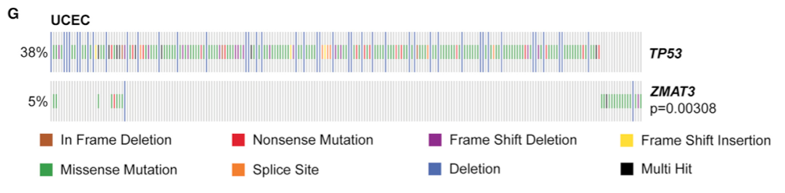

为了确定队列中突变基因对倾向于共现还是**互斥**（提示它们作用于同一通路），参考在二值突变矩阵上计算逐对 Fisher 精确检验，并将优势比与 p 值可视化为共现矩阵或网络 \[\1\]。`maftools::somaticInteractions()` 是标准包装；此处为 200 个肿瘤的 15 个基因模拟二值突变矩阵，逐对 Fisher 检验矩阵在 base R 上运行：

## Example

{fig-alt="体细胞突变互斥与共现 DEMO" fig-align="center" width="60%"}

## Setup

-   系统要求：跨平台（Linux/MacOS/Windows）

-   编程语言：R

-   依赖包：`pheatmap`; `ggplot2`

```{r packages setup, message=FALSE, warning=FALSE, output=FALSE}
suppressPackageStartupMessages({
  library(pheatmap); library(ggplot2)
})
```

```{r}
sessioninfo::session_info("attached")
```

## 数据准备

15 个候选基因 × 200 个肿瘤样本（0/1 二值突变调用）。植入结构：基因 1 与基因 2 之间存在强互斥（优势比 < 0.2，p < 0.001）、基因 3 与基因 4 之间共现：

```{r load data}
suppressPackageStartupMessages({library(pheatmap); library(ggplot2)})
set.seed(48288)
n_gene <- 15; n_tum <- 200
genes <- sprintf("GENE%02d", 1:n_gene)
mut_mat <- matrix(rbinom(n_gene * n_tum, 1, 0.15), n_gene, n_tum,
                  dimnames = list(genes, sprintf("T%03d", 1:n_tum)))
## plant mutual exclusivity between GENE01 and GENE02
ex_idx <- sample(n_tum, 75)
mut_mat["GENE01", ex_idx] <- 1
mut_mat["GENE02", ex_idx] <- 0
mut_mat["GENE01", setdiff(1:n_tum, ex_idx)] <- 0
mut_mat["GENE02", setdiff(1:n_tum, ex_idx)] <- sample(c(0, 1), n_tum - 75, TRUE, prob = c(0.5, 0.5))

## pairwise Fisher exact test matrix (odds ratio and -log10 p)
or_mat <- matrix(1, n_gene, n_gene, dimnames = list(genes, genes))
p_mat <- matrix(1, n_gene, n_gene, dimnames = list(genes, genes))
for (i in seq_len(n_gene)) {
  for (j in seq_len(n_gene)) {
    if (i == j) next
    tb <- table(factor(mut_mat[i, ], levels = c(0, 1)),
                factor(mut_mat[j, ], levels = c(0, 1)))
    ft <- fisher.test(tb)
    or_mat[i, j] <- ft$estimate
    p_mat[i, j] <- ft$p.value
  }
}
```

## Visualization

### 逐对优势比热图

参考的主要交付物：基因 × 基因的逐对优势比热图（红 = 共现、蓝 = 互斥），显著对（Fisher 精确检验 p < 0.05）标注星号：

```{r}
#| label: fig-1.1MutualExclHeatmap
#| fig-cap: "逐对体细胞突变相互作用热图（优势比）：蓝色方块指示互斥（如 GENE01 vs GENE02）、红色方块指示共现；显著对（Fisher 精确检验 p < 0.05）用星号标记。"
#| out.width: "85%"
#| fig-width: 8
#| fig-height: 7

sig_txt <- ifelse(p_mat < 0.05, "*", "")
pheatmap(log2(pmax(pmin(or_mat, 15), 1/15)),
         color = colorRampPalette(c("#2166AC", "white", "#B2182B"))(64),
         cluster_rows = TRUE, cluster_cols = TRUE,
         display_numbers = sig_txt,
         number_color = "black", fontsize_number = 11,
         border_color = "white",
         legend = TRUE,
         main = "Mutation interaction (log2 odds ratio)")
```

### 单个基因突变频率条形图

作为交互矩阵的伴随物，200 个肿瘤中各个基因的突变频率：

```{r}
#| label: fig-2.1MutualExclFreq
#| fig-cap: "200 个肿瘤样本中各个基因的突变频率（%）：GENE01 和 GENE02 领跑队列频率。"
#| out.width: "85%"
#| fig-width: 7
#| fig-height: 5

freq_s <- rowSums(mut_mat) / n_tum * 100
df_f <- data.frame(gene = factor(names(freq_s), levels = names(sort(freq_s, decreasing = TRUE))),
                   pct = freq_s)
ggplot(df_f, aes(gene, pct)) +
  geom_col(fill = "#4472C4", width = 0.7) +
  labs(x = NULL, y = "Mutation frequency (%)") +
  theme_bw(base_size = 11) +
  theme(axis.text.x = element_text(angle = 45, hjust = 1),
        panel.grid.minor = element_blank())
```


## 应用场景

::: {{#fig-MutualExclusivityApplications1}}
{fig-alt="体细胞突变互斥与共现" fig-align="center" width="60%"}

体细胞突变互斥与共现
:::

突变交互矩阵适用于任何癌症基因组学队列：癌基因 vs 抑癌基因互斥、通路级共现、或合成致死筛查。

## 参考文献

\[1\] Xiaofan Lu, et al. Festival of Standardized Biomedical Visualizations: Somatic Mutation Mutual Exclusivity. iMetaMed. 2025. doi:10.1002/imm3.70005
