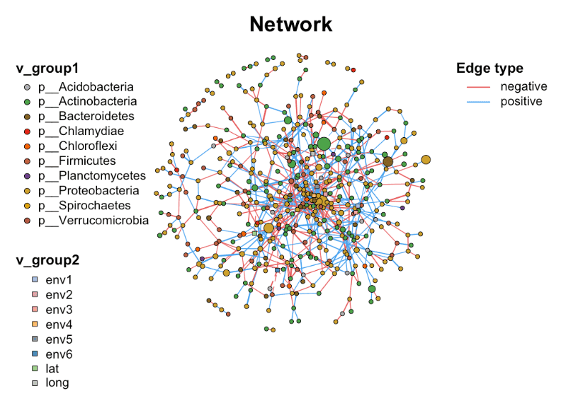

In microbiome research, it is crucial to understand the interactions between microorganisms. Network analysis is a powerful method that can help us visualize and quantify these complex relationships. Next, we will introduce the network operation and annotation functions of the `MetaNet` package, which can make our network analysis more in-depth and intuitive.

## Example

{fig-alt="NetworkPlot DEMO" fig-align="center" width="60%"}

## Setup

-   System Requirements: Cross-platform (Linux/MacOS/Windows)

-   Programming language: R

-   Dependent packages: `MetaNet`; `pcutils`; `igraph`; `dplyr`

```{r packages setup, message=FALSE, warning=FALSE, output=FALSE}
# Installing necessary packages
if (!requireNamespace("MetaNet", quietly = TRUE)) {
  install.packages("MetaNet")
}
if (!requireNamespace("pcutils", quietly = TRUE)) {
  install.packages("pcutils")
}
if (!requireNamespace("igraph", quietly = TRUE)) {
  install.packages("igraph")
}
if (!requireNamespace("dplyr", quietly = TRUE)) {
  install.packages("dplyr")
}

# Load packages
library(MetaNet)
library(pcutils)
library(igraph)
library(dplyr)
```

```{r}
sessioninfo::session_info("attached")
```

## Data Preparation

### 1. Load data

- The data uses the `otutab` dataset in pcutils
- MetaNet is an R package for comprehensive network analysis of omics data
- The `c_net_calculate()` function is used to quickly calculate the correlation between variables
- The `c_net_build()` function is used to build the network

```{r load data1, message=FALSE}
data(otutab, package = "pcutils")
t(otutab) -> totu
c_net_calculate(totu, method = "spearman") -> corr
c_net_build(corr, r_threshold = 0.6, p_threshold = 0.05, delete_single = T) -> co_net
class(co_net) 
```

### 2. Get network properties

After building a network with MetaNet, you get a classification object, which comes from igraph. This means that you can use MetaNet's proprietary functions and igraph's general functions at the same time. Next, learn how to get basic information about the network:

```{r load data2}
# Get overall network properties
get_n(co_net)
# View node properties
get_v(co_net) %>% head(5)
# View edge properties
get_e(co_net) %>% head(5)
```

The data frames returned by these functions contain the most basic key information of multi-omics biological networks, such as node name, grouping, size, edge weight, etc.
MetaNet has set some internal attributes (such as `v_group`, `v_class`, `e_type`, etc.) when building the network, which will affect subsequent analysis and visualization.

### 3. Adding biological meaning to networks

In microbiome research, network structure alone is not enough, we need to integrate biological information such as taxonomy and abundance. MetaNet provides flexible annotation functions:

```{r load data3}
# Adding classification information to a node
c_net_annotate(co_net, taxonomy["Phylum"], mode = "v") -> co_net1
anno <- data.frame("from" = "s__un_f__Thermomonosporaceae", 
                   "to" = "s__Actinocorallia_herbida", new_atr = "new")
c_net_annotate(co_net, anno, mode = "e") -> co_net1
```

In MetaNet, a `c_net_set()` function is provided, which can add multiple annotation tables at the same time and specify which columns are used to set node size, color and other attributes:

```{r load data4}
Abundance_df <- data.frame("Abundance" = colSums(totu))
co_net1 <- c_net_set(co_net, taxonomy["Phylum"], Abundance_df)
co_net1 <- co_net
V(co_net1)$new_attri <- seq_len(length(co_net1))
E(co_net1)$new_attri <- "new attribute"
get_e(co_net1) %>% head(5)
```

In this way, a network information with both statistical significance and biological background can be obtained.

## Visualization

### 1. Build network

Simple multi-omics network: contains information of microbiome, metabolome, transcriptome, etc.

```{r}
#| label: fig1.1BasicNetwork
#| fig-cap: "Basic Network"
#| out.width: "95%"
#| warning: false
#| message: false

# Basic Network
data("multi_test", package = "MetaNet")
data("c_net", package = "MetaNet")
multi1 <- multi_net_build(list(Microbiome = micro, Metabolome = metab, Transcriptome = transc))
plot(multi1)
```

### 2. Add annotation

```{r}
#| label: fig1.2Annotation
#| fig-cap: "Add annotation"
#| out.width: "95%"
#| warning: false
#| message: false

# Set the node class
multi1_with_anno <- c_net_set(multi1, 
                              micro_g, metab_g, 
                              transc_g, 
                              vertex_class = c("Phylum", "kingdom", "type"))

# Set the node size
multi1_with_anno <- c_net_set(multi1_with_anno,
                              data.frame("Abundance1" = colSums(micro)),
                              data.frame("Abundance2" = colSums(metab)),
                              data.frame("Abundance3" = colSums(transc)),
                              vertex_size = paste0("Abundance", 1:3))

plot(multi1_with_anno)
```

### 3. Filter subnetwork

```{r}
#| label: fig1.3SubNetwork
#| fig-cap: "Filter subnetwork"
#| out.width: "95%"
#| warning: false
#| message: false

# Filter subnetwork
data("multi_net", package = "MetaNet")
multi2 <- c_net_filter(multi1_with_anno, v_group %in% 
                         c("Microbiome", "Metabolome")) %>%
  c_net_filter(., e_class == "intra", mode = "e")

plot(multi2, lty_legend = T, main = "Sub-network") 
```

### 4. Merge Network

```{r}
#| label: fig1.4MergeNetwork1
#| fig-cap: "Network1"
#| out.width: "95%"
#| warning: false
#| message: false

# Network1
data("c_net")
plot(co_net)
```

```{r}
#| label: fig1.4MergeNetwork2
#| fig-cap: "Network2"
#| out.width: "95%"
#| warning: false
#| message: false

# Network2
data("c_net")
plot(co_net2)
```

```{r}
#| label: fig1.4MergeNetwork3
#| fig-cap: "Merge Network"
#| out.width: "95%"
#| warning: false
#| message: false

# Merge Network
co_net_union <- c_net_union(co_net, co_net2)
plot(co_net_union)
```

The MetaNet package provides a comprehensive set of tools for microbial network analysis, from basic network construction to advanced annotation and visualization. By flexibly using these functions, we can extract meaningful biological patterns from complex microbiome data and provide new perspectives for understanding the structure and function of microbial communities.

### 5. Hub-Spoke Interaction Network

Interaction databases (STRING chat, ComPPI) answer one protein per query; the resulting table reads best as a **hub-spoke drawing**: the bait sits large in the centre, interactors radiate around it, each edge is coloured by its evidence class (cellular location, motif, peak overlap...) and the number of edges per spoke encodes how many evidence lines support the interaction \[5,6\].

```{r}
#| label: fig-5.1HubSpoke
#| fig-cap: "Hub-spoke interaction network: central bait (large pink node), interactors around it; edge colour = evidence class, edge width = interaction score, and partners with two evidence lines get two curved edges."
#| out.width: "80%"
#| warning: false
#| message: false
#| fig-width: 6
#| fig-height: 7

set.seed(501)
hub <- "EGFR"
partners <- paste0("PRT", sprintf("%02d", 1:22))
locs <- c("Nucleus", "Cytosol", "Membrane", "Extracellular")
loc_pal <- setNames(c("#445EAD", "#70C17A", "#F7C07C", "#EA6767"), locs)

## one row per evidence line: a STRING-chat table (or ComPPI rows split by "|")
links <- do.call(rbind, lapply(partners, function(pt) {
  n_ev <- sample(1:2, 1)
  data.frame(source = hub, target = pt,
             Loc = sample(locs, n_ev, replace = TRUE),
             score = round(runif(n_ev, 0.6, 0.99), 2))
}))
head(links, 3)

net <- graph_from_data_frame(links, directed = FALSE)

vertexes <- igraph::vertex_attr(net, "name")
net <- set_edge_attr(net, "color", value = loc_pal[links$Loc])
net <- set_edge_attr(net, "width", value = links$score)

set.seed(501)
lay <- layout_with_dh(net)

plot(net, layout = lay,
     vertex.shape = "circle",                       # igraph 2.x draws frame.width natively
     vertex.size = ifelse(vertexes == hub, 15, 3),
     vertex.color = "hotpink",
     vertex.frame.color = "white",
     vertex.frame.width = ifelse(vertexes == hub, 4, 1),
     vertex.label.color = ifelse(vertexes == hub, "black", "grey30"),
     vertex.label.cex = ifelse(vertexes == hub, 0.9, 0.6),
     vertex.label.dist = ifelse(vertexes == hub, 0.9, 0.4),
     edge.curved = curve_multiple(net, start = 0.08))
legend("bottomleft", bty = "n", cex = 0.7, lty = 1, lwd = 2,
       legend = names(loc_pal), col = loc_pal,
       title = "Evidence class")
```

::: callout-tip
**Practice tips**

-   The input is one row **per evidence line**, not per partner: a partner with motif + ATAC-peak + H3K27ac evidence gets three curved edges, and the visual thickness of the spoke is the evidence count.
-   `layout_with_dh()` (Davidson-Harel) works well for these small hub layouts but is stochastic — set a seed, and accept Illustrator-style fine tuning of label positions for publication.
-   When the interaction score is a *combined* probability across evidence classes (as ComPPI reports per location), combine as `1 - prod(1 - x_i * x_hub)` — the probability that at least one evidence chain holds — before drawing.
:::

## Reference

\[1\] K. Contrepois, S. Wu, K. J. Moneghetti, D. Hornburg, et al., [Molecular Choreography of Acute Exercise](https://doi.org/10.1016/j.cell.2020.04.043). Cell. 2020;181(5):1112-1130.e16.

\[2\] Y. Deng, Y. Jiang, Y. Yang, Z. He, et al., Molecular ecological network analyses. BMC bioinformatics (2012), doi:10.1186/1471-2105-13-113.

\[3\] Faust K, Raes J. Microbial interactions: from networks to models. Nat Rev Microbiol. 2012;10(8):538-550. doi:10.1038/nrmicro2832

\[4\] Chen Peng (2025). MetaNet: Network Analysis for Omics Data. R package

\[5\] Szklarczyk D, Gable AL, Nastou KC, et al. The STRING database in 2021: customizable protein-protein networks, and functional characterization of user-uploaded gene/measurement sets. Nucleic Acids Res. 2021;49(D1):D605-D612. doi:10.1093/nar/gkaa1074

\[6\] Veres DV, Gyurkó DM, Thaler B, Szalay KZ, Fazekas D, Korcsmáros T, Csermely P. ComPPI: a cellular compartment-specific database for protein-protein interaction network analysis. Nucleic Acids Res. 2015;43(D1):D485-D493. doi:10.1093/nar/gku1007

