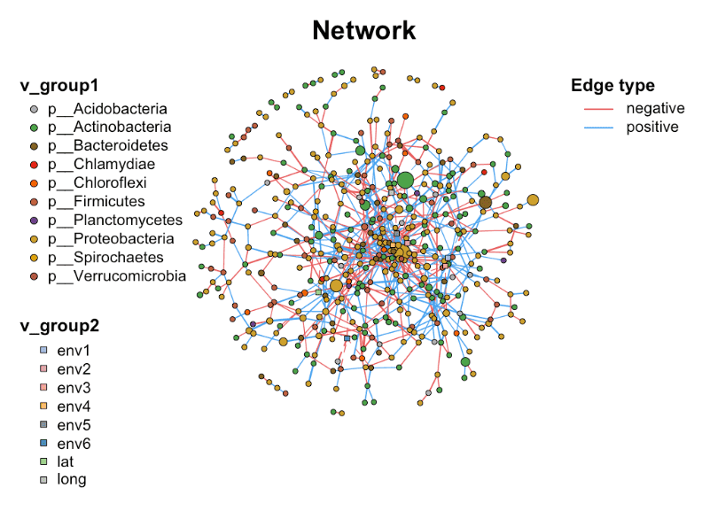

在微生物组学研究中，理解微生物之间的相互作用至关重要。而网络分析作为一种强大的方法，能够帮助我们可视化和量化这些复杂关系。接下来向大家介绍 `MetaNet` 包的网络操作与注释功能，它能让我们的网络分析更加深入和直观。

## 示例

{fig-alt="NetworkPlot DEMO" fig-align="center" width="60%"}

## 环境配置

-   系统要求： 跨平台（Linux/MacOS/Windows）

-   编程语言：R

-   依赖包：`MetaNet`; `pcutils`; `igraph`; `dplyr`


```{r packages setup, message=FALSE, warning=FALSE, output=FALSE}
# 安装包
if (!requireNamespace("MetaNet", quietly = TRUE)) {
  install.packages("MetaNet")
}
if (!requireNamespace("pcutils", quietly = TRUE)) {
  install.packages("pcutils")
}
if (!requireNamespace("igraph", quietly = TRUE)) {
  install.packages("igraph")
}
if (!requireNamespace("dplyr", quietly = TRUE)) {
  install.packages("dplyr")
}

# 加载包
library(MetaNet)
library(pcutils)
library(igraph)
library(dplyr)
```

```{r}
sessioninfo::session_info("attached")
```

## 数据准备

### 1. 导入数据

- 数据使用 pcutils 中的 `otutab` 数据集
- MetaNet 是一个针对组学数据的综合网络分析 R 包
- `c_net_calculate()` 函数用于快速计算变量间的相关性
- `c_net_build()` 函数用于构建网络

```{r load data1, message=FALSE}
data(otutab, package = "pcutils")
t(otutab) -> totu
c_net_calculate(totu, method = "spearman") -> corr
c_net_build(corr, r_threshold = 0.6, p_threshold = 0.05, delete_single = T) -> co_net
class(co_net) 
```

### 2. 获取网络属性

用 MetaNet 构建网络后，得到的是一个分类对象，它来自 igraph。意味着可以同时使用 MetaNet 的专有功能和 igraph 的通用功能。接下来了解如何获取网络的基本信息：

```{r load data2}
# 获取整体网络属性
get_n(co_net)
# 查看节点(顶点)属性
get_v(co_net) %>% head(5)
### 查看边属性
get_e(co_net) %>% head(5)
```

这些函数返回的数据框包含了最基本的多组学生物网络的关键信息，如节点名称、分组、大小、边的权重等。
MetaNet 在构建网络时已经设置了一些内部属性（如`v_group`、`v_class`、`e_type`等），这些属性将影响后续的分析和可视化。

### 3. 为网络添加生物学意义

在微生物组研究中，仅有网络结构是不够的，我们需要整合分类学、丰度等生物学信息。MetaNet 提供了灵活的注释功能：

```{r load data3}
# 向节点添加分类信息
c_net_annotate(co_net, taxonomy["Phylum"], mode = "v") -> co_net1
anno <- data.frame("from" = "s__un_f__Thermomonosporaceae", 
                   "to" = "s__Actinocorallia_herbida", new_atr = "new")
c_net_annotate(co_net, anno, mode = "e") -> co_net1
```

在 MetaNet 中提供 `c_net_set()` 函数，它可以同时添加多个注释表并指定哪些列用于设置节点大小、颜色等属性：

```{r load data4}
Abundance_df <- data.frame("Abundance" = colSums(totu))
co_net1 <- c_net_set(co_net, taxonomy["Phylum"], Abundance_df)
co_net1 <- co_net
V(co_net1)$new_attri <- seq_len(length(co_net1))
E(co_net1)$new_attri <- "new attribute"
get_e(co_net1) %>% head(5)
```

这样，就能获得一个既有统计意义又有生物学背景的网络信息。

## 可视化

### 1. 构建网络

简单多组学网络：包含微生物组，代谢组，转录组等信息。

```{r}
#| label: fig1.1BasicNetwork
#| fig-cap: "基础网络图"
#| out.width: "95%"
#| warning: false
#| message: false

# 基础网络图
data("multi_test", package = "MetaNet")
data("c_net", package = "MetaNet")
multi1 <- multi_net_build(list(Microbiome = micro, Metabolome = metab, Transcriptome = transc))
plot(multi1)
```

### 2. 添加 annotation

```{r}
#| label: fig1.2Annotation
#| fig-cap: "添加 annotation"
#| out.width: "95%"
#| warning: false
#| message: false

# 设置顶点类别
multi1_with_anno <- c_net_set(multi1, 
                              micro_g, metab_g, 
                              transc_g, 
                              vertex_class = c("Phylum", "kingdom", "type"))

# 设置顶点大小
multi1_with_anno <- c_net_set(multi1_with_anno,
                              data.frame("Abundance1" = colSums(micro)),
                              data.frame("Abundance2" = colSums(metab)),
                              data.frame("Abundance3" = colSums(transc)),
                              vertex_size = paste0("Abundance", 1:3))

plot(multi1_with_anno)
```

### 3. 筛选子网络

```{r}
#| label: fig1.3SubNetwork
#| fig-cap: "筛选子网络"
#| out.width: "95%"
#| warning: false
#| message: false

# 筛选子网络
data("multi_net", package = "MetaNet")
multi2 <- c_net_filter(multi1_with_anno, v_group %in% 
                         c("Microbiome", "Metabolome")) %>%
  c_net_filter(., e_class == "intra", mode = "e")

plot(multi2, lty_legend = T, main = "Sub-network") 
```

### 4. 合并网络

```{r}
#| label: fig1.4MergeNetwork1
#| fig-cap: "网络1"
#| out.width: "95%"
#| warning: false
#| message: false

# 网络1
data("c_net")
plot(co_net)
```

```{r}
#| label: fig1.4MergeNetwork2
#| fig-cap: "网络2"
#| out.width: "95%"
#| warning: false
#| message: false

# 网络2
data("c_net")
plot(co_net2)
```

```{r}
#| label: fig1.4MergeNetwork3
#| fig-cap: "合并网络"
#| out.width: "95%"
#| warning: false
#| message: false

# 合并网络
co_net_union <- c_net_union(co_net, co_net2)
plot(co_net_union)
```

MetaNet 包为微生物网络分析提供了全面的工具集，从基础的网络构建到高级的注释与可视化。通过灵活使用这些功能，我们能够从复杂的微生物组数据中提取有意义的生物学模式，为理解微生物群落结构与功能提供新视角。
### 5. 中心-放射互作网络

互作数据库（STRING chat、ComPPI）一次回答一个蛋白；结果表最适合画成**中心-放射图**：诱饵蛋白居中放大，互作蛋白向外辐射，每条边按证据类别着色（亚细胞定位、motif、peak 重叠……），每根辐条上的边数编码支持该互作的证据条数 \[5,6\]。

```{r}
#| label: fig-5.1HubSpoke
#| fig-cap: "中心-放射互作网络：中央诱饵蛋白（粉色大节点），互作蛋白环绕；边色 = 证据类别，边宽 = 互作得分，含两条证据的伙伴画两条曲线边。"
#| out.width: "80%"
#| warning: false
#| message: false
#| fig-width: 6
#| fig-height: 7

set.seed(501)
hub <- "EGFR"
partners <- paste0("PRT", sprintf("%02d", 1:22))
locs <- c("Nucleus", "Cytosol", "Membrane", "Extracellular")
loc_pal <- setNames(c("#445EAD", "#70C17A", "#F7C07C", "#EA6767"), locs)

## 一行一条证据：STRING chat 表（或 ComPPI 按"|"拆分的行）
links <- do.call(rbind, lapply(partners, function(pt) {
  n_ev <- sample(1:2, 1)
  data.frame(source = hub, target = pt,
             Loc = sample(locs, n_ev, replace = TRUE),
             score = round(runif(n_ev, 0.6, 0.99), 2))
}))
head(links, 3)

net <- graph_from_data_frame(links, directed = FALSE)

vertexes <- igraph::vertex_attr(net, "name")
net <- set_edge_attr(net, "color", value = loc_pal[links$Loc])
net <- set_edge_attr(net, "width", value = links$score)

set.seed(501)
lay <- layout_with_dh(net)

plot(net, layout = lay,
     vertex.shape = "circle",                       # igraph 2.x draws frame.width natively
     vertex.size = ifelse(vertexes == hub, 15, 3),
     vertex.color = "hotpink",
     vertex.frame.color = "white",
     vertex.frame.width = ifelse(vertexes == hub, 4, 1),
     vertex.label.color = ifelse(vertexes == hub, "black", "grey30"),
     vertex.label.cex = ifelse(vertexes == hub, 0.9, 0.6),
     vertex.label.dist = ifelse(vertexes == hub, 0.9, 0.4),
     edge.curved = curve_multiple(net, start = 0.08))
legend("bottomleft", bty = "n", cex = 0.7, lty = 1, lwd = 2,
       legend = names(loc_pal), col = loc_pal,
       title = "Evidence class")
```

::: callout-tip
**实践要点**

-   输入是**每条证据一行**，而非每个伙伴一行：同时有 motif + ATAC-peak + H3K27ac 三种证据的伙伴会有三条曲线边，辐条的视觉厚度就是证据数。
-   `layout_with_dh()`（Davidson-Harel）适合这类小型 hub 布局但是随机算法——设好 seed；发表级成图可在 Illustrator 里微调标签位置。
-   当互作得分是跨证据类别的组合概率时（ComPPI 按定位报告），按 `1 - prod(1 - x_i * x_hub)` 组合——即至少一条证据链成立的概率——然后再画图。
:::

## 参考文献

\[1\] K. Contrepois, S. Wu, K. J. Moneghetti, D. Hornburg, et al., [Molecular Choreography of Acute Exercise](https://doi.org/10.1016/j.cell.2020.04.043). Cell. 2020;181(5):1112-1130.e16.

\[2\] Y. Deng, Y. Jiang, Y. Yang, Z. He, et al., Molecular ecological network analyses. BMC bioinformatics (2012), doi:10.1186/1471-2105-13-113.

\[3\] Faust K, Raes J. Microbial interactions: from networks to models. Nat Rev Microbiol. 2012;10(8):538-550. doi:10.1038/nrmicro2832

\[4\] Chen Peng (2025). MetaNet: Network Analysis for Omics Data. R package

\[5\] Szklarczyk D, Gable AL, Nastou KC, et al. The STRING database in 2021: customizable protein-protein networks, and functional characterization of user-uploaded gene/measurement sets. Nucleic Acids Res. 2021;49(D1):D605-D612. doi:10.1093/nar/gkaa1074

\[6\] Veres DV, Gyurkó DM, Thaler B, Szalay KZ, Fazekas D, Korcsmáros T, Csermely P. ComPPI: a cellular compartment-specific database for protein-protein interaction network analysis. Nucleic Acids Res. 2015;43(D1):D485-D493. doi:10.1093/nar/gku1007

