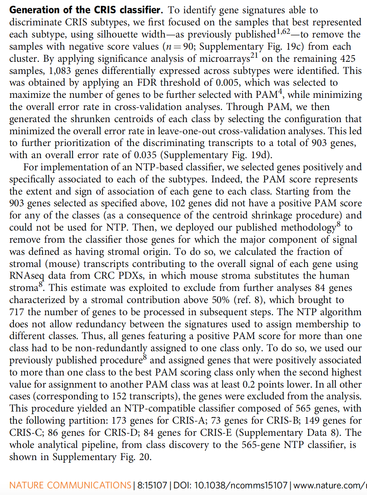

With subtype labels known for a training cohort, **PAM** (Prediction Analysis of Microarrays) shrinks each subtype's centroid toward its shrunken marker genes, and **NTP** (Nearest Template Prediction) assigns a new sample to the subtype whose template its expression profile best matches — a significance-quantified nearest-centroid that works across cohorts and platforms \[1\]. Both steps are re-implemented in-page (centroid shrinkage + template correlation with permutation p) and validated on a held-out simulated cohort:

## Example

{fig-alt="NTP/PAM Subtype Classification DEMO" fig-align="center" width="70%"}

## Setup

-   System Requirements: Cross-platform (Linux/MacOS/Windows)

-   Programming language: R

-   Dependent packages: `ggplot2`; `pheatmap`

```{r packages setup, message=FALSE, warning=FALSE, output=FALSE}
suppressPackageStartupMessages({
  library(ggplot2); library(pheatmap)
})
```

```{r}
sessioninfo::session_info("attached")
```

## Data Preparation

A training cohort (90 samples, 3 subtypes) and an independent test cohort (60 samples) on **different simulated platforms** (additive offset + extra noise), so the classifier must survive a batch shift. Marker genes are subtype-specific: 40 genes up in one subtype and near zero in the others:

```{r load data}
suppressPackageStartupMessages({library(ggplot2); library(pheatmap)})
set.seed(50302)
subtypes <- c("S1", "S2", "S3")
n_tr <- 30; n_te <- 20
genes <- sprintf("G%03d", 1:500)

mk_cohort <- function(n_te_each, offset = 0, noise = 1) {
  lab <- rep(subtypes, each = n_te_each)
  X <- matrix(rnorm(length(genes) * length(lab), 6 + offset, noise),
              length(genes), length(lab), dimnames = list(genes, NULL))
  for (k in seq_along(subtypes)) {
    mk <- sprintf("G%03d", ((k - 1) * 40 + 1):(k * 40))
    X[mk, lab == subtypes[k]] <- X[mk, lab == subtypes[k]] + 2.4
  }
  colnames(X) <- sprintf("S%03d", seq_len(ncol(X)))
  list(X = X, y = factor(lab, levels = subtypes))
}
train <- mk_cohort(n_tr)
test <- mk_cohort(n_te, offset = 0.8, noise = 1.25)
```

## Visualization

### 1. PAM Shrunken Centroids

The reference's first step: per-subtype mean expression, shrunk toward the global mean by a soft-threshold `delta` — genes whose subtype-specific signal survives shrinkage become the template. The heatmap shows which markers remain after shrinkage:

```{r}
#| label: fig-1.1NtpPamCentroids
#| fig-cap: "PAM shrunken centroids (3 subtypes x top marker genes): after soft-threshold shrinkage only the subtype-specific markers retain signal, giving each subtype a compact template."
#| out.width: "90%"
#| fig-width: 7
#| fig-height: 7

global_mean <- rowMeans(train$X)
delta <- 0.9
centroids <- sapply(subtypes, function(st) rowMeans(train$X[, train$y == st]))
shrunk <- sign(centroids - global_mean) *
  pmax(abs(centroids - global_mean) - delta, 0)
markers <- rownames(shrunk)[apply(abs(shrunk), 1, max) > 0.4]
## keep the strongest markers so the heatmap fits one page
top_n <- 40
markers <- markers[order(-apply(abs(shrunk[markers, , drop = FALSE]), 1, max))][seq_len(min(top_n, length(markers)))]
cat("markers retained after shrinkage:", length(markers), "of", length(genes), "\n")

pheatmap(shrunk[markers, ],
         color = colorRampPalette(c("#2166AC", "white", "#B2182B"))(64),
         cluster_rows = TRUE, cluster_cols = FALSE,
         border_color = "white", fontsize_row = 6,
         show_colnames = TRUE, fontsize_col = 10,
         cellwidth = 46, cellheight = 10,
         main = "PAM shrunken centroids (marker genes)",
         legend = TRUE)
```

### 2. NTP Prediction on the Independent Cohort

Second step: each test sample is correlated (Pearson) against all three templates; the best-matching template wins, and a permutation of the sample's gene labels gives a p value for "this match is better than chance". The confusion matrix shows the recovery rate across the platform shift:

```{r}
#| label: fig-2.1NtpPrediction
#| fig-cap: "NTP prediction on an independent cohort with a simulated platform shift (offset + extra noise): the confusion matrix shows near-complete recovery of the three subtypes, and the per-sample best-template correlation is clearly separated from the permutation null."
#| out.width: "90%"
#| fig-width: 9
#| fig-height: 4.4

ntp_predict <- function(x, templates, n_perm = 200) {
  cc <- apply(templates, 2, function(t) cor(as.numeric(x), as.numeric(t)))
  best <- names(which.max(cc))
  null <- replicate(n_perm,
    max(apply(templates, 2, function(t) cor(sample(as.numeric(x)), as.numeric(t)))))
  p <- (sum(null >= max(cc)) + 1) / (n_perm + 1)
  c(best = best, p = as.numeric(p), rho = as.numeric(max(cc)))
}
templates <- shrunk[markers, , drop = FALSE]
## correlate only the marker genes (the template's own feature space)
test_markers <- test$X[markers, , drop = FALSE]
pred <- do.call(rbind, lapply(seq_len(ncol(test_markers)), function(j)
  as.data.frame(as.list(ntp_predict(as.numeric(test_markers[, j]), templates)))))
pred_df <- data.frame(sample = colnames(test$X), truth = test$y,
                      predicted = factor(pred[, "best"], levels = subtypes),
                      rho = as.numeric(pred[, "rho"]),
                      p = as.numeric(pred[, "p"]))
cm <- table(pred_df$truth, pred_df$predicted)
cm
cat("accuracy:", round(100 * sum(diag(cm)) / sum(cm), 1), "%\n")

op <- par(mfrow = c(1, 2), mar = c(4.3, 4.4, 3.4, 1))
image(1:3, 1:3, t(cm[3:1, ]), col = colorRampPalette(c("white", "#08519C"))(64),
      axes = FALSE, xlab = "predicted", ylab = "truth",
      main = sprintf("NTP confusion (%d/%d correct)", sum(diag(cm)), sum(cm)))
axis(1, 1:3, subtypes); axis(2, 1:3, rev(subtypes))
for (i in 1:3) for (j in 1:3)
  text(j, 4 - i, cm[i, j], cex = 1.1,
       col = ifelse(cm[i, j] > 8, "white", "grey15"))
box()
hist(pred_df$rho, breaks = 18, col = "#9ECAE1", border = "white",
     xlab = "best-template correlation", main = "Match strength")
par(op)
```

::: callout-tip
**Practice tips**

-   Shrink **after** centring on the global mean: PAM's delta is a soft-threshold on the *deviation* from the overall centroid, not the raw subtype mean.
-   Choose `delta` by cross-validated error inside the training cohort — an under-shrunk template keeps noise genes, an over-shrunk one empties the template.
-   NTP's correlation against templates is inherently platform-tolerant, which is why it survives the offset/noise shift here; still, z-score each cohort within itself before correlating.
-   Report the permutation p with every call: a best-template ρ of 0.3 is not an assignment, it is a coin flip dressed up.
-   Validate on an independent cohort from another platform, not a random split of the same data — the whole reason to use NTP is cross-cohort transfer.
:::

## Application

::: {#fig-NtpPamApplications1}
{fig-alt="NTP/PAM Subtype Classification" fig-align="center" width="70%"}

NTP/PAM subtype classification
:::

PAM/NTP classifiers apply wherever a published subtype scheme must be transferred: assigning TCGA subtypes to a new cohort, calling CMS/PAM50 labels on a custom RNA-seq set, or projecting published signatures onto single-cell pseudobulk.

## Reference

\[1\] Xiaofan Lu, et al. FigureYa: A Standardized Visualization Framework for Enhancing Biomedical Data Interpretation and Research Efficiency. iMetaMed. 2025. doi:10.1002/imm3.70005
