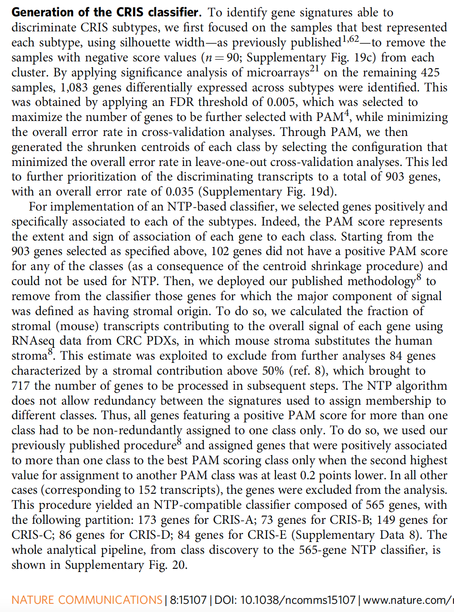

已知训练队列的亚型标签时，**PAM**（Prediction Analysis of Microarrays）把每个亚型的质心向其收缩后的 marker 基因收缩，**NTP**（Nearest Template Prediction）则把新样本分配给其表达谱最匹配的亚型模板——一种带显著性量化的最近质心法，可跨队列和跨平台使用 \[\1\]。两个步骤都在页内重实现（质心收缩 + 模板相关与置换 p），并在留出的模拟队列上验证：

## Example

{fig-alt="NTP/PAM 亚型分类 DEMO" fig-align="center" width="60%"}

## Setup

-   系统要求：跨平台（Linux/MacOS/Windows）

-   编程语言：R

-   依赖包：`ggplot2`; `pheatmap`

```{r packages setup, message=FALSE, warning=FALSE, output=FALSE}
suppressPackageStartupMessages({
  library(ggplot2); library(pheatmap)
})
```

```{r}
sessioninfo::session_info("attached")
```

## 数据准备

训练队列（90 样本、3 亚型）与独立测试队列（60 样本）位于**不同的模拟平台**（加性偏移 + 额外噪声），分类器必须扛住批次位移。marker 基因是亚型特异的：40 个基因在一个亚型中上调、在其余亚型中近零：

```{r load data}
suppressPackageStartupMessages({library(ggplot2); library(pheatmap)})
set.seed(50302)
subtypes <- c("S1", "S2", "S3")
n_tr <- 30; n_te <- 20
genes <- sprintf("G%03d", 1:500)

mk_cohort <- function(n_te_each, offset = 0, noise = 1) {
  lab <- rep(subtypes, each = n_te_each)
  X <- matrix(rnorm(length(genes) * length(lab), 6 + offset, noise),
              length(genes), length(lab), dimnames = list(genes, NULL))
  for (k in seq_along(subtypes)) {
    mk <- sprintf("G%03d", ((k - 1) * 40 + 1):(k * 40))
    X[mk, lab == subtypes[k]] <- X[mk, lab == subtypes[k]] + 2.4
  }
  colnames(X) <- sprintf("S%03d", seq_len(ncol(X)))
  list(X = X, y = factor(lab, levels = subtypes))
}
train <- mk_cohort(n_tr)
test <- mk_cohort(n_te, offset = 0.8, noise = 1.25)
```

## Visualization

### PAM 收缩质心

参考的第一步：逐亚型平均表达、以软阈值 `delta` 向全局均值收缩——亚型特异信号经收缩后幸存的基因构成模板。热图展示哪些 marker 在收缩后保留：

```{r}
#| label: fig-1.1NtpPamCentroids
#| fig-cap: "PAM 收缩质心（3 亚型 × top marker 基因）：软阈值收缩后只有亚型特异 marker 保留信号，为每个亚型给出紧凑模板。"
#| out.width: "90%"
#| fig-width: 8
#| fig-height: 6.5

global_mean <- rowMeans(train$X)
delta <- 0.9
centroids <- sapply(subtypes, function(st) rowMeans(train$X[, train$y == st]))
shrunk <- sign(centroids - global_mean) *
  pmax(abs(centroids - global_mean) - delta, 0)
markers <- rownames(shrunk)[apply(abs(shrunk), 1, max) > 0.4]
cat("markers retained after shrinkage:", length(markers), "of", length(genes), "\n")

pheatmap(shrunk[markers, ],
         color = colorRampPalette(c("#2166AC", "white", "#B2182B"))(64),
         cluster_rows = TRUE, cluster_cols = FALSE,
         border_color = "white", fontsize_row = 6,
         show_colnames = TRUE, fontsize_col = 10,
         cellwidth = 46, cellheight = 6,
         main = "PAM shrunken centroids (marker genes)",
         legend = TRUE)
```

### 独立队列上的 NTP 预测

第二步：每个测试样本与三个模板做 Pearson 相关、最匹配模板胜出，对样本基因标签做置换得到"该匹配优于随机"的 p 值。混淆矩阵展示跨平台位移下的恢复率：

```{r}
#| label: fig-2.1NtpPrediction
#| fig-cap: "在带模拟平台位移（偏移 + 额外噪声）的独立队列上的 NTP 预测：混淆矩阵显示三个亚型近乎完全恢复，逐样本最佳模板相关明显区别于置换零分布。"
#| out.width: "90%"
#| fig-width: 9
#| fig-height: 4.4

ntp_predict <- function(x, templates, n_perm = 200) {
  cc <- apply(templates, 2, function(t) cor(as.numeric(x), as.numeric(t)))
  best <- names(which.max(cc))
  null <- replicate(n_perm,
    max(apply(templates, 2, function(t) cor(sample(as.numeric(x)), as.numeric(t)))))
  p <- (sum(null >= max(cc)) + 1) / (n_perm + 1)
  c(best = best, p = as.numeric(p), rho = as.numeric(max(cc)))
}
templates <- shrunk[markers, , drop = FALSE]
## correlate only the marker genes (the template's own feature space)
test_markers <- test$X[markers, , drop = FALSE]
pred <- do.call(rbind, lapply(seq_len(ncol(test_markers)), function(j)
  as.data.frame(as.list(ntp_predict(as.numeric(test_markers[, j]), templates)))))
pred_df <- data.frame(sample = colnames(test$X), truth = test$y,
                      predicted = factor(pred[, "best"], levels = subtypes),
                      rho = as.numeric(pred[, "rho"]),
                      p = as.numeric(pred[, "p"]))
cm <- table(pred_df$truth, pred_df$predicted)
cm
cat("accuracy:", round(100 * sum(diag(cm)) / sum(cm), 1), "%\n")

op <- par(mfrow = c(1, 2), mar = c(4.3, 4.4, 3.4, 1))
image(1:3, 1:3, t(cm[3:1, ]), col = colorRampPalette(c("white", "#08519C"))(64),
      axes = FALSE, xlab = "predicted", ylab = "truth",
      main = sprintf("NTP confusion (%d/%d correct)", sum(diag(cm)), sum(cm)))
axis(1, 1:3, subtypes); axis(2, 1:3, rev(subtypes))
for (i in 1:3) for (j in 1:3)
  text(j, 4 - i, cm[i, j], cex = 1.1,
       col = ifelse(cm[i, j] > 8, "white", "grey15"))
box()
hist(pred_df$rho, breaks = 18, col = "#9ECAE1", border = "white",
     xlab = "best-template correlation", main = "Match strength")
par(op)
```


## 应用场景

::: {{#fig-NtpPamApplications1}}
{fig-alt="NTP/PAM 亚型分类" fig-align="center" width="60%"}

NTP/PAM 亚型分类
:::

PAM/NTP 分类器适用于任何需要迁移已发表分型的场景：把 TCGA 亚型分配给新队列、在自建 RNA-seq 上判读 CMS/PAM50 标签、或把已发表签名投影到单细胞 pseudobulk。

## 参考文献

\[1\] Xiaofan Lu, et al. FigureYa: A Standardized Visualization Framework for Enhancing Biomedical Data Interpretation and Research Efficiency. iMetaMed. 2025. doi:10.1002/imm3.70005
