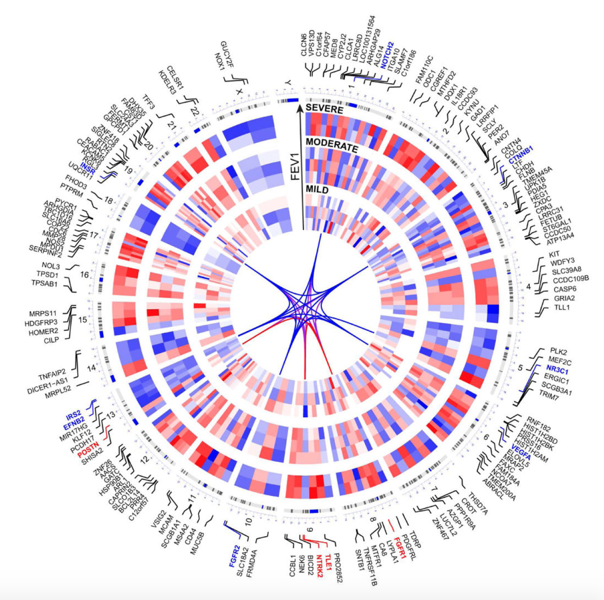

参考的 OmicCircos 环形图把**基因组多层数据叠在同一坐标系**：外层弧段为拷贝数片段、散点环为基因级数值（如表达 log2FC）、内层弧为样本级信号——扩增可以直接对着它打击的基因读取 \[1\]。`OmicCircos` 包不在本仓库 lockfile；环形图用 `circlize` 基因组函数在页内重实现（染色体基环、片段弧、数值散点），并用放大面板展示重排最多的染色体：

## Example

{fig-alt="多组学 Circos DEMO" fig-align="center" width="70%"}

## Setup

-   系统要求：跨平台（Linux/MacOS/Windows）

-   编程语言：R

-   依赖包：`circlize`; `ComplexHeatmap`

```{r packages setup, message=FALSE, warning=FALSE, output=FALSE}
suppressPackageStartupMessages({
  library(circlize); library(ComplexHeatmap)
})
```

```{r}
sessioninfo::session_info("attached")
```

## 数据准备

8 条染色体、带 cytoband 风格片段表与逐片段拷贝数状态（植入 chr7q 扩增与 chr12p 缺失），另有 400 个基因的表达 log2FC——扩增片段内的基因上调、缺失片段内的基因下调：

```{r load data}
suppressPackageStartupMessages({library(circlize)})
set.seed(52331)
chrs <- c("chr1", "chr2", "chr3", "chr4", "chr7", "chr9", "chr12", "chr17")

## cytoband-style segments per chromosome (Mb scale)
cyto <- do.call(rbind, lapply(chrs, function(chr) {
  n_seg <- sample(8, 1)
  starts <- cumsum(c(0, sample(20:60, n_seg - 1, replace = TRUE)))
  ends <- c(starts[-1], starts[n_seg] + sample(20:60, 1))
  data.frame(Chr = chr, Start = starts, End = ends,
             Name = paste0("p", seq_len(n_seg)))
}))
seg <- cbind(cyto, CNV = sample(c("Gain", "Loss", "Neutral"), nrow(cyto),
                                TRUE, prob = c(0.2, 0.18, 0.62)))
seg$CNV[seg$Chr == "chr7" & seg$Start >= 60] <- "Gain"
seg$CNV[seg$Chr == "chr12" & seg$End <= 60] <- "Loss"

## genes inside the segments with expression log2FC
genes <- do.call(rbind, lapply(seq_len(nrow(seg)), function(k) {
  n_g <- sample(3:8, 1)
  data.frame(Chr = seg$Chr[k],
             Start = round(seq(seg$Start[k], seg$End[k], length.out = n_g), 1))
}))
## globally unique names: per-chromosome running index
genes$gene <- unlist(lapply(split(seq_len(nrow(genes)), genes$Chr), function(ix)
  sprintf("%s_G%02d", sub("chr", "", genes$Chr[ix][1]), seq_along(ix))))
genes$lfc <- rnorm(nrow(genes), 0, 0.4)
genes$lfc[genes$Chr == "chr7" & genes$Start >= 60] <- genes$lfc[genes$Chr == "chr7" & genes$Start >= 60] + 1.7
genes$lfc[genes$Chr == "chr12" & genes$End <= 60] <- genes$lfc[genes$Chr == "chr12" & genes$End <= 60] - 1.4

## circlize genomic helpers need Chr FIRST and Mb-scale coordinates
seg_g <- seg[, c("Chr", "Start", "End", "CNV")]
gene_g <- genes[, c("Chr", "Start", "Start", "lfc")]
colnames(gene_g) <- c("Chr", "Start", "End", "lfc")
cnv_col <- c(Gain = "#B2182B", Loss = "#2166AC", Neutral = "grey85")
```

## Visualization

### 1. 多组学 Circos 环形图

参考的环形图：外层染色体基环、按 CNV 状态着色的片段弧、内环基因表达 log2FC 散点——chr7q 扩增弧与上调散点对齐：

```{r}
#| label: fig-1.1OmiccircosRing
#| fig-cap: "8 条染色体的多组学 circos（Mb 尺度）：按拷贝数状态着色的弧段（红 Gain / 蓝 Loss / 灰 Neutral）与内环的基因表达 log2FC 散点；chr7q Gain 与 chr12p Loss 分别与同向的基因散点对齐，即植入的多组学一致性。"
#| out.width: "90%"
#| fig-width: 7.5
#| fig-height: 7.5

circos.clear()
circos.par(start.degree = 90, gap.degree = 4, track.margin = c(0.01, 0.01))
circos.genomicInitialize(seg_g, plotType = "labels", labels.cex = 0.75)

## track 1: CNV segment arcs
circos.genomicTrack(seg_g, ylim = c(0, 1), track.height = 0.12,
    panel.fun = function(region, value, ...) {
      col <- unname(cnv_col[value$CNV])
      circos.genomicRect(region, value, ytop = 1, ybottom = 0, col = col, border = NA)
})
## track 2: gene expression scatter
circos.genomicTrack(gene_g, ylim = c(-2.4, 2.4), track.height = 0.24,
    panel.fun = function(region, value, ...) {
      circos.points((region[, 1] + region[, 2]) / 2, value$lfc,
                    pch = 16, cex = 0.42,
                    col = ifelse(value$lfc > 0, "#B2182B", "#2166AC"))
      circos.lines(c(0, 200), c(0, 0), col = "grey60", lty = 2)
})
legend("bottomright", bty = "n", pch = 15, pt.cex = 2.2, cex = 0.85,
       col = cnv_col[c("Gain", "Loss", "Neutral")],
       legend = c("Gain", "Loss", "Neutral"), title = "CNV")
```

### 2. chr7 放大与基因标签

参考的 plus 面板：放大重排最多的染色体，分辨被扩增的单个基因：

```{r}
#| label: fig-2.1OmiccircosZoom
#| fig-cap: "chr7 放大：q 臂的 Gain 弧段（红）携带上调散点；仅标注效应最强的基因（|log2FC| > 1.9），每个坐标只标一个名字。"
#| out.width: "85%"
#| fig-width: 6.5
#| fig-height: 6.5

zoom_chr <- "chr7"
zoom_seg <- seg_g[seg_g$Chr == zoom_chr, ]
zoom_gene <- gene_g[gene_g$Chr == zoom_chr, ]
zoom_gene$gene <- ""
sel <- zoom_gene$Start >= 60          # q-arm genes carry the planted Gain
zoom_gene$gene[sel] <- genes$gene[genes$Chr == zoom_chr & genes$Start >= 60]

circos.clear()
circos.par(start.degree = 90, gap.degree = 8)
circos.genomicInitialize(zoom_seg, plotType = "labels", labels.cex = 0.8)
circos.genomicTrack(zoom_seg, ylim = c(0, 1), track.height = 0.16,
    panel.fun = function(region, value, ...) {
      circos.genomicRect(region, value, ytop = 1, ybottom = 0,
                         col = unname(cnv_col[value$CNV]), border = NA)
})
circos.genomicTrack(zoom_gene, ylim = c(-2.4, 2.4), track.height = 0.3,
    panel.fun = function(region, value, ...) {
      circos.points((region[, 1] + region[, 2]) / 2, value$lfc,
                    pch = 16, cex = 0.6,
                    col = ifelse(value$lfc > 0, "#B2182B", "#2166AC"))
      circos.lines(c(0, 200), c(0, 0), col = "grey60", lty = 2)
      ## label only the strongest-effect genes so labels never collide
      show <- abs(value$lfc) > 1.9
      if (any(show)) {
        lab_x <- (region[, 1] + region[, 2])[show]
        lab_y <- value$lfc[show]
        lab_g <- value$gene[show]
        ## one label per coordinate (segment boundaries share positions):
        ## keep the strongest-effect gene at each duplicated x
        keep <- !duplicated(round(lab_x, 6))
        circos.text(lab_x[keep] + 3, lab_y[keep] + 0.32, lab_g[keep],
                    cex = 0.6, facing = "inside")
      }
})
```

::: callout-tip
**实践要点**
-   circlize 基因组函数要求**染色体列在第一列**、坐标单位与基环一致（此处 Mb）——基因名在前时轨道静默不画（无报错、空轨道）。
-   散点环保持**统一数值尺度**（固定 `ylim = c(-2.4, 2.4)`）使各臂可比；逐轨道自动缩放会制造假信号。
-   片段按**状态**着色（Gain/Loss/Neutral）而非原始比率——三种颜色一眼可读，连续色阶会淹没片段。
-   环形图之后跟一个**放大面板**展示重排最多的染色体：环形图告诉你在哪，放大面板告诉你哪些基因。
-   一致性是故事：CNV 弧与表达散点方向必须一致——Gain 配下调散点指向调控效应而非剂量效应。
:::

## 应用场景

::: {#fig-OmiccircosApplications1}
{fig-alt="多组学 Circos" fig-align="center" width="70%"}

多组学 Circos（CNV 片段 + 表达散点）
:::

多组学 circos 环形图适用于任何基因组锚定的比较：TCGA CNV-表达一致性、区域甲基化 vs 表达、或结构变异断点热点对基因密度。

## 参考文献

\[1\] Xiaofan Lu, et al. FigureYa: A Standardized Visualization Framework for Enhancing Biomedical Data Interpretation and Research Efficiency. iMetaMed. 2025. doi:10.1002/imm3.70005
