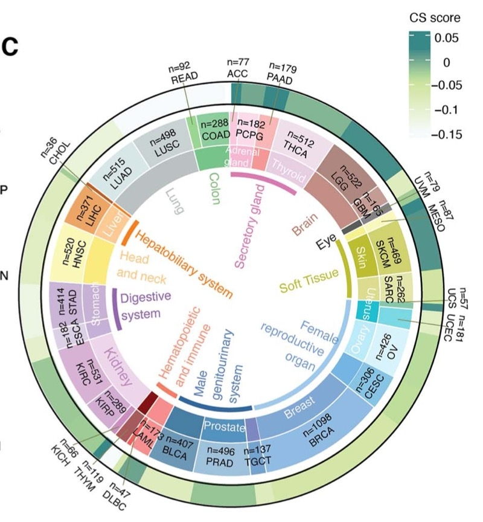

The reference's Fig. 1C: a circular layout whose **concentric tracks run from tissue type to cancer type to the mean score** (its example: cellular-senescence score), letting a reader compare a quantitative score across dozens of cancer types while keeping their tissue lineage visible on the same ring \[1\]. `circlize` builds the three-track ring; the sector ordering, track heights and label placement are the reference's:

## Example

{fig-alt="Pan-Cancer Circos Score Track DEMO" fig-align="center" width="70%"}

## Setup

-   System Requirements: Cross-platform (Linux/MacOS/Windows)

-   Programming language: R

-   Dependent packages: `circlize`; `ComplexHeatmap`; `RColorBrewer`

```{r packages setup, message=FALSE, warning=FALSE, output=FALSE}
suppressPackageStartupMessages({
  library(circlize); library(ComplexHeatmap); library(RColorBrewer)
})
```

```{r}
sessioninfo::session_info("attached")
```

## Data Preparation

28 cancer types nested under 8 tissue systems, each with a mean senescence-style score. Sectors are ordered **by tissue then cancer**, so each tissue's cancers form a contiguous arc — the property that makes the inner track readable:

```{r load data}
suppressPackageStartupMessages({
  library(circlize); library(ComplexHeatmap); library(RColorBrewer)
})
set.seed(50303)
tissue <- c("Digestive" = 6, "Respiratory" = 3, "Urogenital" = 5,
            "Reproductive" = 4, "Nervous" = 2, "Skin" = 2,
            "Endocrine" = 3, "Haematologic" = 3)
cancers <- unlist(lapply(names(tissue), function(t)
  sprintf("%s_%02d", substr(t, 1, 3), seq_len(tissue[[t]]))))
tissue_of <- rep(names(tissue), tissue)
names(tissue_of) <- cancers

## score: planted tissue-level baseline + cancer-level variation
base <- c(Digestive = 0.35, Respiratory = 0.5, Urogenital = 0.4,
          Reproductive = 0.62, Nervous = 0.3, Skin = 0.55,
          Endocrine = 0.45, Haematologic = 0.25)
score <- base[tissue_of] + rnorm(length(cancers), 0, 0.13)
score <- pmin(pmax(score, 0), 1)
names(score) <- cancers
ord <- order(factor(tissue_of, levels = names(tissue)), score)
```

## Visualization

### 1. Three-Track Circular Score Map

The reference's layout: outer ring = tissue system, middle ring = cancer type, inner bar track = mean score. Tissue colours group the cancers visually without needing a legend for every type:

```{r}
#| label: fig-1.1PancanCircos
#| fig-cap: "Pan-cancer circular score map: from outside in, the tissue system ring, the cancer-type ring, and the mean senescence-style score bar track; cancers are ordered by tissue so each system occupies one arc."
#| out.width: "75%"
#| fig-width: 7.5
#| fig-height: 7.5

tis_col <- setNames(brewer.pal(8, "Set2"), names(tissue))
circos.clear()
circos.par(gap.degree = 1.2, start.degree = 90)
circos.initialize(factors = factor(cancers[ord], levels = cancers[ord]),
                  xlim = c(0, 1))
## track 1: tissue
circos.track(ylim = c(0, 1), track.height = 0.07, bg.border = NA,
             panel.fun = function(x, y) {
               cl <- CELL_META$sector.index
               circos.rect(CELL_META$xlim[1], 0, CELL_META$xlim[2], 1,
                           col = tis_col[tissue_of[cl]], border = "white", lwd = 0.4)
             })
## track 2: cancer labels
circos.track(ylim = c(0, 1), track.height = 0.12, bg.border = NA,
             panel.fun = function(x, y) {
               circos.text(CELL_META$xcenter, 0.5, CELL_META$sector.index,
                           facing = "clockwise", niceFacing = TRUE,
                           adj = c(0, 0.5), cex = 0.5)
             })
## track 3: score bars
circos.track(ylim = c(0, 1), track.height = 0.3, bg.border = NA,
             panel.fun = function(x, y) {
               cl <- CELL_META$sector.index
               circos.rect(CELL_META$xlim[1], 0, CELL_META$xlim[2], score[cl],
                           col = tis_col[tissue_of[cl]], border = NA)
               circos.yaxis(side = "left", labels.cex = 0.4,
                            sector.index = CELL_META$sector.index,
                            track.index = CELL_META$track.index)
             })
text(0, 0, "mean\nscore", cex = 0.8)
circos.clear()
```

### 2. Tissue-Level Aggregation

The ring condenses 28 values; the companion panel aggregates them to the 8 tissue systems so the tissue ordering in the ring is quantifiable:

```{r}
#| label: fig-2.1PancanCircosTissue
#| fig-cap: "Mean score per tissue system with individual cancer values overlaid as points: Reproductive and Skin lead, Haematologic is lowest, matching the arc pattern of the circular map."
#| out.width: "80%"
#| fig-width: 7.5
#| fig-height: 5

df_t <- data.frame(cancer = cancers, tissue = factor(tissue_of, levels = names(tissue)),
                   score = as.numeric(score))
ggplot2::ggplot(df_t, ggplot2::aes(tissue, score, fill = tissue)) +
  ggplot2::geom_boxplot(outlier.shape = NA, alpha = 0.55, width = 0.62) +
  ggplot2::geom_point(shape = 21, size = 1.7,
                      position = ggplot2::position_jitter(width = 0.13),
                      ggplot2::aes(colour = tissue), alpha = 0.8) +
  ggplot2::scale_fill_manual(values = tis_col, guide = "none") +
  ggplot2::scale_colour_manual(values = tis_col, guide = "none") +
  ggplot2::labs(x = NULL, y = "mean score") +
  ggplot2::theme_bw(base_size = 10.5) +
  ggplot2::theme(axis.text.x = ggplot2::element_text(angle = 45, hjust = 1),
                 panel.grid.minor = ggplot2::element_blank())
```

::: callout-tip
**Practice tips**

-   Order sectors **by the grouping variable, then by value** (`order(tissue, score)`): a ring sorted alphabetically scatters each tissue across the circle and destroys the inner track's readability.
-   Use the same colour for a cancer and its tissue ring — that redundancy is what makes a three-track ring legible without a 28-entry legend.
-   Keep the score track's bar baseline at zero and draw a y axis inside the sector; a floating bar with no scale cannot be compared across axes.
-   `gap.degree = 1` separates adjacent sectors; larger gaps shrink the arcs and make labels collide.
-   Aggregate the ring values in a companion panel — a 28-sector ring reports, it does not test.
:::

## Application

::: {#fig-PancanCircosApplications1}
{fig-alt="Pan-Cancer Circos Score Track" fig-align="center" width="70%"}

Pan-cancer circos score track
:::

Three-track score rings apply to any nested categorical comparison: tissue → cancer → score, organ → cell type → abundance, or pathway family → pathway → activity.

## Reference

\[1\] Xiaofan Lu, et al. FigureYa: A Standardized Visualization Framework for Enhancing Biomedical Data Interpretation and Research Efficiency. iMetaMed. 2025. doi:10.1002/imm3.70005
