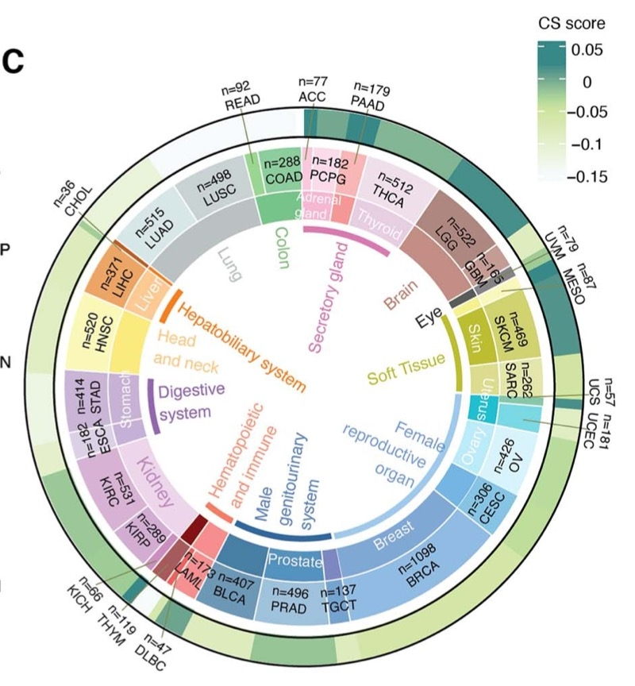

参考的 Fig. 1C：环形版式的**同心轨道从组织类型到癌种再到平均评分**（其示例为细胞衰老评分），让读者在同一环上比较数十个癌种的定量评分、同时保留其组织来源 \[\1\]。`circlize` 构建三轨环；扇区排序、轨道高度与标签放置均按参考：

## Example

{fig-alt="泛癌 Circos 评分轨道 DEMO" fig-align="center" width="60%"}

## Setup

-   系统要求：跨平台（Linux/MacOS/Windows）

-   编程语言：R

-   依赖包：`circlize`; `ComplexHeatmap`; `RColorBrewer`

```{r packages setup, message=FALSE, warning=FALSE, output=FALSE}
suppressPackageStartupMessages({
  library(circlize); library(ComplexHeatmap); library(RColorBrewer)
})
```

```{r}
sessioninfo::session_info("attached")
```

## 数据准备

28 个癌种嵌套在 8 个组织系统下，各带平均衰老式评分。扇区**按组织再按癌种**排序，使每个组织系统的癌种形成连续弧——这正是让内轨可读的性质：

```{r load data}
suppressPackageStartupMessages({
  library(circlize); library(ComplexHeatmap); library(RColorBrewer)
})
set.seed(50303)
tissue <- c("Digestive" = 6, "Respiratory" = 3, "Urogenital" = 5,
            "Reproductive" = 4, "Nervous" = 2, "Skin" = 2,
            "Endocrine" = 3, "Haematologic" = 3)
cancers <- unlist(lapply(names(tissue), function(t)
  sprintf("%s_%02d", substr(t, 1, 3), seq_len(tissue[[t]]))))
tissue_of <- rep(names(tissue), tissue)
names(tissue_of) <- cancers

## score: planted tissue-level baseline + cancer-level variation
base <- c(Digestive = 0.35, Respiratory = 0.5, Urogenital = 0.4,
          Reproductive = 0.62, Nervous = 0.3, Skin = 0.55,
          Endocrine = 0.45, Haematologic = 0.25)
score <- base[tissue_of] + rnorm(length(cancers), 0, 0.13)
score <- pmin(pmax(score, 0), 1)
names(score) <- cancers
ord <- order(factor(tissue_of, levels = names(tissue)), score)
```

## Visualization

### 三轨环形评分图

参考的版式：外环 = 组织系统、中环 = 癌种、内条轨 = 平均评分。组织配色在视觉上分组癌种，无需为每个类型提供图例：

```{r}
#| label: fig-1.1PancanCircos
#| fig-cap: "泛癌环形评分图：由外向内依次为组织系统环、癌种名称环、平均衰老式评分条轨；癌种按组织排序，使每个系统占据一段弧。"
#| out.width: "75%"
#| fig-width: 7.5
#| fig-height: 7.5

tis_col <- setNames(brewer.pal(8, "Set2"), names(tissue))
circos.clear()
circos.par(gap.degree = 1.2, start.degree = 90)
circos.initialize(factors = factor(cancers[ord], levels = cancers[ord]),
                  xlim = c(0, 1))
## track 1: tissue
circos.track(ylim = c(0, 1), track.height = 0.07, bg.border = NA,
             panel.fun = function(x, y) {
               cl <- CELL_META$sector.index
               circos.rect(CELL_META$xlim[1], 0, CELL_META$xlim[2], 1,
                           col = tis_col[tissue_of[cl]], border = "white", lwd = 0.4)
             })
## track 2: cancer labels
circos.track(ylim = c(0, 1), track.height = 0.12, bg.border = NA,
             panel.fun = function(x, y) {
               circos.text(CELL_META$xcenter, 0.5, CELL_META$sector.index,
                           facing = "clockwise", niceFacing = TRUE,
                           adj = c(0, 0.5), cex = 0.5)
             })
## track 3: score bars
circos.track(ylim = c(0, 1), track.height = 0.3, bg.border = NA,
             panel.fun = function(x, y) {
               cl <- CELL_META$sector.index
               circos.rect(CELL_META$xlim[1], 0, CELL_META$xlim[2], score[cl],
                           col = tis_col[tissue_of[cl]], border = NA)
               circos.yaxis(side = "left", labels.cex = 0.4,
                            sector.index = CELL_META$sector.index,
                            track.index = CELL_META$track.index)
             })
text(0, 0, "mean\nscore", cex = 0.8)
circos.clear()
```

### 组织级汇总

环形压缩了 28 个值；伴生面板把它们汇总到 8 个组织系统，使环中的组织排序可量化：

```{r}
#| label: fig-2.1PancanCircosTissue
#| fig-cap: "逐组织系统的平均评分并把单个癌种值以点叠加：生殖与皮肤系统领先、血液系统最低，与环形图的弧段模式一致。"
#| out.width: "80%"
#| fig-width: 7.5
#| fig-height: 5

df_t <- data.frame(cancer = cancers, tissue = factor(tissue_of, levels = names(tissue)),
                   score = as.numeric(score))
ggplot2::ggplot(df_t, ggplot2::aes(tissue, score, fill = tissue)) +
  ggplot2::geom_boxplot(outlier.shape = NA, alpha = 0.55, width = 0.62) +
  ggplot2::geom_point(shape = 21, size = 1.7,
                      position = ggplot2::position_jitter(width = 0.13),
                      ggplot2::aes(colour = tissue), alpha = 0.8) +
  ggplot2::scale_fill_manual(values = tis_col, guide = "none") +
  ggplot2::scale_colour_manual(values = tis_col, guide = "none") +
  ggplot2::labs(x = NULL, y = "mean score") +
  ggplot2::theme_bw(base_size = 10.5) +
  ggplot2::theme(axis.text.x = ggplot2::element_text(angle = 45, hjust = 1),
                 panel.grid.minor = ggplot2::element_blank())
```


## 应用场景

::: {{#fig-PancanCircosApplications1}}
{fig-alt="泛癌 Circos 评分轨道" fig-align="center" width="60%"}

泛癌 Circos 评分轨道
:::

三轨评分环适用于任何嵌套分类比较：组织 → 癌种 → 评分、器官 → 细胞类型 → 丰度、或通路家族 → 通路 → 活性。

## 参考文献

\[1\] Xiaofan Lu, et al. FigureYa: A Standardized Visualization Framework for Enhancing Biomedical Data Interpretation and Research Efficiency. iMetaMed. 2025. doi:10.1002/imm3.70005
