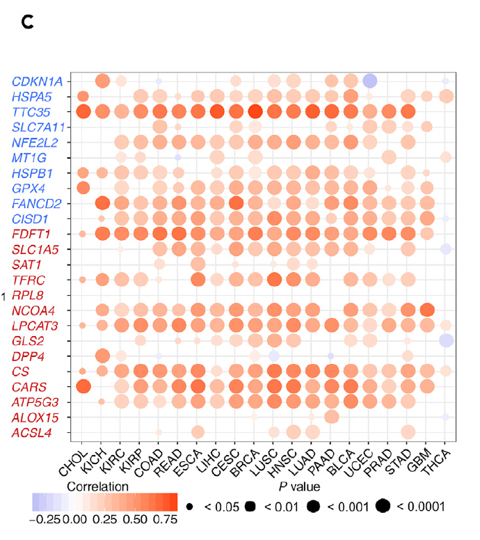

The reference's Fig. 1C: for each pathway gene × cancer type, the **Spearman correlation between the gene's somatic CNA (GISTIC value) and its expression** — cis-effects show as strong positive correlations — drawn as a dot plot with size = −log10(p) and colour = correlation sign, one panel per gene or one grid over the whole cohort \[1\]. The pancancer CNA/expression pairs are simulated with planted cis-correlations; the aggregation and the dot-plot grammar (including the ComplexHeatmap companion) run on ggplot2 + ComplexHeatmap:

## Example

{fig-alt="Pan-Cancer CNA-Expression Correlation DEMO" fig-align="center" width="70%"}

## Setup

-   System Requirements: Cross-platform (Linux/MacOS/Windows)

-   Programming language: R

-   Dependent packages: `ggplot2`; `ComplexHeatmap`; `circlize`

```{r packages setup, message=FALSE, warning=FALSE, output=FALSE}
suppressPackageStartupMessages({
  library(ggplot2); library(ComplexHeatmap); library(circlize)
})
```

```{r}
sessioninfo::session_info("attached")
```

## Data Preparation

Six ferroptosis genes × 20 cancer types, each with a simulated per-patient pair (GISTIC CNA value ∈ {-2, -1, 0, 1, 2} and log2 expression). Planted cis-effects: SLC7A11 and GPX4 carry strong positive CNA→expression coupling in most types; MT1G couples negatively in one type; the rest are null — exactly the structure the reference's screen hunts for:

```{r load data}
suppressPackageStartupMessages({
  library(ggplot2); library(ComplexHeatmap); library(circlize)
})
set.seed(44268)
genes <- c("SLC7A11", "GPX4", "NFE2L2", "MT1G", "EMC2", "CDKN1A")
tumors <- c("BLCA","BRCA","CESC","CHOL","COAD","ESCA","GBM","HNSC","KICH",
            "KIRC","KIRP","LIHC","LUAD","LUSC","PAAD","PRAD","READ","STAD",
            "THCA","UCEC")
cis <- list(SLC7A11 = 0.9, GPX4 = 0.75, MT1G = -0.5)
res <- do.call(rbind, lapply(genes, function(g) {
  do.call(rbind, lapply(tumors, function(cc) {
    n <- sample(120:400, 1)
    cna <- sample(-2:2, n, TRUE, prob = c(0.08, 0.17, 0.5, 0.17, 0.08))
    eff <- if (!is.null(cis[[g]])) cis[[g]] else
      if (g == "MT1G" && cc == "KIRC") -0.5 else 0.05
    expr <- 5 + eff * cna + rnorm(n, 0, 1.1)
    ct <- suppressWarnings(cor.test(cna, expr, method = "spearman"))
    data.frame(gene = g, cancer = cc,
               rho = unname(ct$estimate),
               pvalue = ct$p.value,
               n = n)
  }))
}))
res$nl <- pmin(-log10(res$pvalue), 12)
res$direction <- ifelse(res$rho > 0, "positive", "negative")
```

## Visualization

### 1. The Dot Grid: rho × Significance per Gene × Cancer

The reference's Fig. 1C rendering: x = cancer, y = gene, dot size = −log10(p), colour = correlation direction. Every cis-planted gene shows a consistent positive band across most types; MT1G's negative KIRC-specific point stands alone:

```{r}
#| label: fig-1.1CnaExprDots
#| fig-cap: "Spearman correlation between CNA and expression, per gene (rows) x cancer (columns): dot size = -log10(p) (capped at 12), colour = direction (red = positive, blue = negative). The planted cis-effects (SLC7A11, GPX4 positive; MT1G negative in KIRC) stand out from the null family."
#| out.width: "95%"
#| fig-width: 9.5
#| fig-height: 5.2

res$cancer <- factor(res$cancer, levels = tumors)
ggplot(res, aes(cancer, gene)) +
  geom_point(aes(size = nl, colour = direction), alpha = 0.85) +
  scale_size_continuous(range = c(0.6, 4.2), guide = "none") +
  scale_colour_manual(values = c(positive = "#B2182B", negative = "#2166AC")) +
  labs(x = NULL, y = NULL, colour = "CNA vs expression") +
  theme_bw(base_size = 10.5) +
  theme(axis.text.x = element_text(angle = 45, hjust = 1, size = 8),
        panel.grid.minor = element_blank(),
        legend.position = "top")
```

### 2. The Companion Heatmap: Signed −log10(p)

The reference's dense-information alternative: a heatmap of signed −log10(p) (positive correlations red, negative blue) with a per-gene row annotation counting the significant cancers — the grid that survives journal shrinking:

```{r}
#| label: fig-2.1CnaExprHeatmap
#| fig-cap: "Signed -log10(p) heatmap (positive = red, negative = blue) with per-gene counts of significant cancers as the row annotation: the SLC7A11/GPX4 rows are significant in nearly every type; MT1G's single significant point is the KIRC negative."
#| out.width: "95%"
#| fig-width: 9.5
#| fig-height: 4.6

sig_signed <- matrix(NA, length(genes), length(tumors),
                     dimnames = list(genes, tumors))
for (k in seq_len(nrow(res))) {
  v <- ifelse(res$rho[k] > 0, res$nl[k], -res$nl[k])
  sig_signed[res$gene[k], res$cancer[k]] <- v
}
sig_ct <- rowSums(abs(sig_signed) > -log10(0.05), na.rm = TRUE)
Heatmap(sig_signed, name = "signed\n-log10(p)",
        col = colorRamp2(c(-12, 0, 12), c("#2166AC", "white", "#B2182B")),
        cluster_rows = FALSE, cluster_columns = FALSE,
        na_col = "grey92",
        row_names_side = "left",
        row_names_gp = grid::gpar(fontsize = 8),
        column_names_gp = grid::gpar(fontsize = 8),
        right_annotation = rowAnnotation(
          `# sig.` = anno_barplot(sig_ct, width = unit(1.4, "cm"),
                                  gp = grid::gpar(fill = "#4472C4"))),
        heatmap_legend_param = list(title = "signed\n-log10(p)"))
```

::: callout-tip
**Practice tips**

-   Spearman over the **discrete CNA values** is the standard here (GISTIC calls are ordinal); ties are constant — pass `exact = FALSE` warnings are expected and harmless.
-   A cis-effect has a **direction**: split the signed −log10(p) by correlation sign, or a strong negative cis-lookalike (MT1G here) hides beside strong positives.
-   Cap −log10(p) at a fixed value (12 here): one n = 400 near-zero p compresses every other dot to invisibility.
-   Dot size and dot colour carry different channels (significance vs direction); never encode both in size — small dots become invisible before their colour is read.
-   A cis-correlation is expected for **any** amplified gene — highlight only the correlations that exceed the genome-wide background, not every red dot.
:::

## Application

::: {#fig-PancanCnvExprApplications1}
{fig-alt="Pan-Cancer CNA-Expression Correlation" fig-align="center" width="70%"}

Pan-cancer CNA-expression correlation
:::

The gene × cancer correlation grid applies to any paired copy-number/expression cohort: m6A regulators, ferroptosis, or drug-target genes — wherever "is the copy-number change actually doing something to expression" needs a pan-cancer answer.

## Reference

\[1\] Xiaofan Lu, et al. FigureYa: A Standardized Visualization Framework for Enhancing Biomedical Data Interpretation and Research Efficiency. iMetaMed. 2025. doi:10.1002/imm3.70005
