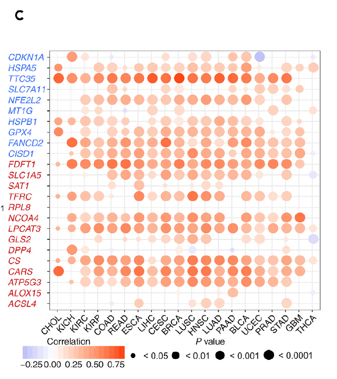

参考的 Fig. 1C：对每个通路基因 × 癌种，**该基因体细胞 CNA（GISTIC 值）与其表达的 Spearman 相关**——cis 效应表现为强正相关——画成 size = −log10(p)、colour = 相关方向的点图，逐基因一面板或整队列一张网格 \[\1\]。泛癌 CNA/表达配对由植入 cis 相关的模拟数据替代；聚合与点图语法（含 ComplexHeatmap 伴随图）在 ggplot2 + ComplexHeatmap 上运行：

## Example

{fig-alt="泛癌 CNA-表达相关 DEMO" fig-align="center" width="60%"}

## Setup

-   系统要求：跨平台（Linux/MacOS/Windows）

-   编程语言：R

-   依赖包：`ggplot2`; `ComplexHeatmap`; `circlize`

```{r packages setup, message=FALSE, warning=FALSE, output=FALSE}
suppressPackageStartupMessages({
  library(ggplot2); library(ComplexHeatmap); library(circlize)
})
```

```{r}
sessioninfo::session_info("attached")
```

## 数据准备

六个铁死亡基因 × 20 个癌种，各配一组模拟的逐患者（GISTIC CNA 值 ∈ {-2,-1,0,1,2} 与 log2 表达）。植入 cis 效应：SLC7A11 与 GPX4 在多数类型中携带强正向 CNA→表达耦合、MT1G 在一个类型中负耦合、其余为零——正是参考筛查要猎取的结构：

```{r load data}
suppressPackageStartupMessages({
  library(ggplot2); library(ComplexHeatmap); library(circlize)
})
set.seed(44268)
genes <- c("SLC7A11", "GPX4", "NFE2L2", "MT1G", "EMC2", "CDKN1A")
tumors <- c("BLCA","BRCA","CESC","CHOL","COAD","ESCA","GBM","HNSC","KICH",
            "KIRC","KIRP","LIHC","LUAD","LUSC","PAAD","PRAD","READ","STAD",
            "THCA","UCEC")
cis <- list(SLC7A11 = 0.9, GPX4 = 0.75, MT1G = -0.5)
res <- do.call(rbind, lapply(genes, function(g) {
  do.call(rbind, lapply(tumors, function(cc) {
    n <- sample(120:400, 1)
    cna <- sample(-2:2, n, TRUE, prob = c(0.08, 0.17, 0.5, 0.17, 0.08))
    eff <- if (!is.null(cis[[g]])) cis[[g]] else
      if (g == "MT1G" && cc == "KIRC") -0.5 else 0.05
    expr <- 5 + eff * cna + rnorm(n, 0, 1.1)
    ct <- suppressWarnings(cor.test(cna, expr, method = "spearman"))
    data.frame(gene = g, cancer = cc,
               rho = unname(ct$estimate),
               pvalue = ct$p.value,
               n = n)
  }))
}))
res$nl <- pmin(-log10(res$pvalue), 12)
res$direction <- ifelse(res$rho > 0, "positive", "negative")
```

## Visualization

### 点网格：逐基因 × 癌种的 rho × 显著性

参考的 Fig. 1C 渲染：x = 癌种、y = 基因、点大小 = −log10(p)、颜色 = 相关方向。每个 cis 植入基因在多数类型中呈一致的正向带；MT1G 的负向 KIRC 特异点独自站立：

```{r}
#| label: fig-1.1CnaExprDots
#| fig-cap: "CNA 与表达的 Spearman 相关，逐基因（行）× 癌种（列）：点大小 = -log10(p)（封顶 12）、颜色 = 方向（红 = 正、蓝 = 负）。植入的 cis 效应（SLC7A11、GPX4 正；MT1G 在 KIRC 负）从零假设家族中突出。"
#| out.width: "95%"
#| fig-width: 9.5
#| fig-height: 5.2

res$cancer <- factor(res$cancer, levels = tumors)
ggplot(res, aes(cancer, gene)) +
  geom_point(aes(size = nl, colour = direction), alpha = 0.85) +
  scale_size_continuous(range = c(0.6, 4.2), guide = "none") +
  scale_colour_manual(values = c(positive = "#B2182B", negative = "#2166AC")) +
  labs(x = NULL, y = NULL, colour = "CNA vs expression") +
  theme_bw(base_size = 10.5) +
  theme(axis.text.x = element_text(angle = 45, hjust = 1, size = 8),
        panel.grid.minor = element_blank(),
        legend.position = "top")
```

### 伴随热图：带符号 −log10(p)

参考的高信息密度替代：带符号 −log10(p) 热图（正 = 红、负 = 蓝）加逐基因行注释统计显著癌种数——经得起期刊缩排的网格：

```{r}
#| label: fig-2.1CnaExprHeatmap
#| fig-cap: "带符号 -log10(p) 热图（正 = 红、负 = 蓝）加显著癌种数的逐基因条形注释：SLC7A11/GPX4 行几乎每个类型都显著；MT1G 的唯一显著点是 KIRC 的负值。"
#| out.width: "95%"
#| fig-width: 9.5
#| fig-height: 4.6

sig_signed <- matrix(NA, length(genes), length(tumors),
                     dimnames = list(genes, tumors))
for (k in seq_len(nrow(res))) {
  v <- ifelse(res$rho[k] > 0, res$nl[k], -res$nl[k])
  sig_signed[res$gene[k], res$cancer[k]] <- v
}
sig_ct <- rowSums(abs(sig_signed) > -log10(0.05), na.rm = TRUE)
Heatmap(sig_signed, name = "signed\n-log10(p)",
        col = colorRamp2(c(-12, 0, 12), c("#2166AC", "white", "#B2182B")),
        cluster_rows = FALSE, cluster_columns = FALSE,
        na_col = "grey92",
        row_names_side = "left",
        row_names_gp = grid::gpar(fontsize = 8),
        column_names_gp = grid::gpar(fontsize = 8),
        right_annotation = rowAnnotation(
          `# sig.` = anno_barplot(sig_ct, width = unit(1.4, "cm"),
                                  gp = grid::gpar(fill = "#4472C4"))),
        heatmap_legend_param = list(title = "signed\n-log10(p)"))
```


## 应用场景

::: {{#fig-PancanCnvExprApplications1}}
{fig-alt="泛癌 CNA-表达相关" fig-align="center" width="60%"}

泛癌 CNA-表达相关
:::

基因 × 癌种的相关网格适用于任何配对拷贝数/表达队列：m6A 调控子、铁死亡或药物靶基因——凡"拷贝数变化是否真的在驱动表达"需要泛癌答案处。

## 参考文献

\[1\] Xiaofan Lu, et al. FigureYa: A Standardized Visualization Framework for Enhancing Biomedical Data Interpretation and Research Efficiency. iMetaMed. 2025. doi:10.1002/imm3.70005
