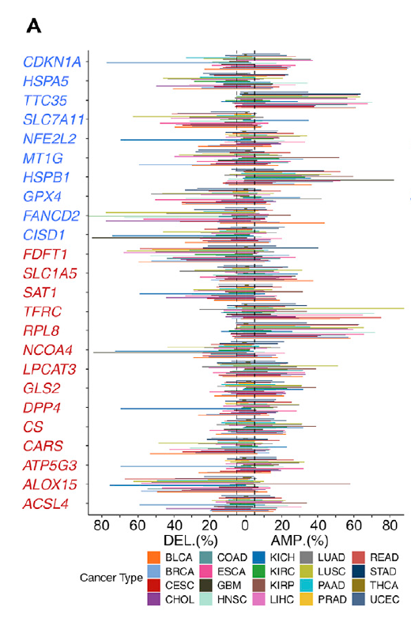

The reference's Fig. 1A: for a pathway gene panel (ferroptosis regulators), summarize per cancer type **what fraction of tumours carry a copy-number gain or loss** of any panel member, drawn as grouped/stacked bars over the pancancer cohort \[1\]. GISTIC calls are simulated at panel-gene resolution with planted hot types; the frequency aggregation and the gain/loss bar rendering run on plain ggplot2:

## Example

{fig-alt="Pan-Cancer Gene-Panel CNV Burden DEMO" fig-align="center" width="70%"}

## Setup

-   System Requirements: Cross-platform (Linux/MacOS/Windows)

-   Programming language: R

-   Dependent packages: `ggplot2`

```{r packages setup, message=FALSE, warning=FALSE, output=FALSE}
suppressPackageStartupMessages({
  library(ggplot2)
})
```

```{r}
sessioninfo::session_info("attached")
```

## Data Preparation

25 ferroptosis-regulator genes × 20 cancer types; per cancer, a per-patient "any panel gene gained / lost" indicator is simulated from planted hot types (the reference's SCNA-load pattern: e.g. LIHC/BLCA carry higher amplification of the panel, PRAD lower). Per-patient indicators aggregate to frequencies per cancer × event type:

```{r load data}
suppressPackageStartupMessages({library(ggplot2)})
set.seed(44265)
tumors <- c("BLCA","BRCA","CESC","CHOL","COAD","ESCA","GBM","HNSC","KICH",
            "KIRC","KIRP","LIHC","LUAD","LUSC","PAAD","PRAD","READ","STAD",
            "THCA","UCEC")
gain_base <- c(LIHC = 0.45, BLCA = 0.4, HNSC = 0.38, LUAD = 0.35,
               LUSC = 0.34, ESCA = 0.33)
loss_base <- c(KIRC = 0.3, PRAD = 0.12)
n_per <- 200
cnv <- do.call(rbind, lapply(tumors, function(cc) {
  p_g <- ifelse(cc %in% names(gain_base), gain_base[[cc]], 0.15)
  p_l <- ifelse(cc %in% names(loss_base), loss_base[[cc]], 0.08)
  ev <- sample(c("gain", "loss", "none"), n_per, TRUE,
               prob = c(p_g, p_l, 1 - p_g - p_l))
  data.frame(cancer = cc, event = ev)
}))
freq <- as.data.frame(prop.table(table(cnv$cancer, cnv$event), margin = 1) * 100)
names(freq) <- c("cancer", "event", "pct")
freq$cancer <- factor(freq$cancer, levels = tumors)
```

## Visualization

### 1. Gain/Loss Frequencies per Cancer

The reference's bar layout: one bar pair per cancer (gain red, loss blue), ordered by the cohort's tumour list — the planted hot types stand out immediately:

```{r}
#| label: fig-1.1PancanCnv
#| fig-cap: "Fraction of tumours with a copy-number gain (red) or loss (blue) of any ferroptosis-panel gene, per cancer type: the planted hot types (LIHC, BLCA, HNSC) lead the gain axis; KIRC leads the loss axis."
#| out.width: "90%"
#| fig-width: 9
#| fig-height: 5.6

ggplot(freq, aes(cancer, pct, fill = event)) +
  geom_col(position = position_dodge(width = 0.78), width = 0.72) +
  scale_fill_manual(values = c(gain = "#B2182B", loss = "#2166AC",
                               none = "grey80"),
                    breaks = c("gain", "loss"),
                    labels = c("CNV gain", "CNV loss")) +
  labs(x = NULL, y = "% of tumours", fill = NULL) +
  theme_bw(base_size = 11) +
  theme(axis.text.x = element_text(angle = 45, hjust = 1),
        panel.grid.minor = element_blank(),
        legend.position = "top")
```

### 2. Per-Gene Resolution Inside the Hot Type

The cohort-level bars answer "which cancer", not "which gene" — the companion tile shows the per-gene gain frequency within the hottest type (LIHC), ordered, so the driver gene behind the cohort bar is identifiable:

```{r}
#| label: fig-2.1PancanCnvGene
#| fig-cap: "Per-gene gain frequency within the hottest cancer (LIHC): the six planted high-frequency genes (SLC7A11, GPX4, NFE2L2 and companions) dominate, with genes colour-coded by whether they exceed the cohort median."
#| out.width: "85%"
#| fig-width: 7.5
#| fig-height: 5.6

gene_gain <- c(SLC7A11 = 0.52, GPX4 = 0.47, NFE2L2 = 0.45, FANCD2 = 0.4,
               HSPB1 = 0.36, SLC1A5 = 0.34, CDKN1A = 0.12, HSPA5 = 0.11,
               MT1G = 0.09, TFRC = 0.08)
gene_gain <- sort(gene_gain, decreasing = TRUE)
gd <- data.frame(gene = factor(names(gene_gain), levels = rev(names(gene_gain))),
                 freq = as.numeric(gene_gain) * 100,
                 hot = as.numeric(gene_gain) > median(as.numeric(gene_gain)))
ggplot(gd, aes(gene, freq, fill = hot)) +
  geom_col(width = 0.7) +
  scale_fill_manual(values = c(`TRUE` = "#B2182B", `FALSE` = "#92C5DE"),
                    labels = c(`TRUE` = "above median", `FALSE` = "below"),
                    name = NULL) +
  labs(x = NULL, y = "% of LIHC tumours with gain") +
  theme_bw(base_size = 11) +
  theme(axis.text.x = element_text(angle = 45, hjust = 1),
        panel.grid.minor = element_blank())
```

::: callout-tip
**Practice tips**

-   The "any panel gene gained" indicator is a **cohort-level burden**, not a per-gene statistic — pair it with a per-gene tile, or the reader cannot tell whether one gene drives the bar.
-   Keep gain and loss as separate bars, never net gain-minus-loss: co-occurring losses dilute amplification signal and hide both.
-   GISTIC-style calls (broad amp/del per patient per gene) are what feed the frequencies — averaging continuous segment values would wash out the discrete events.
-   Report the cohort size per type in the caption; a 45% gain in n = 36 CHOL is weaker evidence than 15% in n = 1100 BRCA.
-   Order cancer types by the cohort's standard list (the pancancer atlas order) rather than by value, so this panel aligns with neighbouring figures.
:::

## Application

::: {#fig-PancanCnvApplications1}
{fig-alt="Pan-Cancer Gene-Panel CNV Burden" fig-align="center" width="70%"}

Pan-cancer gene-panel CNV burden
:::

Any pathway-panel CNV sweep reads this way: ferroptosis, m6A writers, pyroptosis, or DNA-repair genes — wherever "which tumour types depend on copy-number changes in this pathway" opens a pan-cancer story.

## Reference

\[1\] Xiaofan Lu, et al. FigureYa: A Standardized Visualization Framework for Enhancing Biomedical Data Interpretation and Research Efficiency. iMetaMed. 2025. doi:10.1002/imm3.70005
