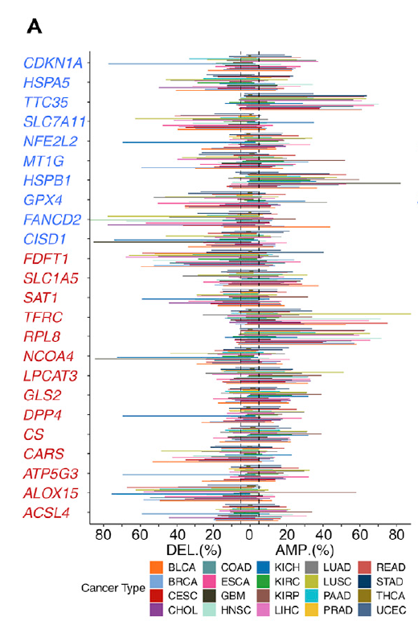

参考的 Fig. 1A：对通路基因面板（铁死亡调控基因），汇总每个癌种中**多大比例的肿瘤携带面板成员的拷贝数获得或缺失**，以分组/堆叠条形画在泛癌队列上 \[\1\]。GISTIC 调用在基因面板分辨率上模拟并植入热门类型；频率聚合与 gain/loss 条形渲染用朴素 ggplot2 运行：

## Example

{fig-alt="泛癌基因面板 CNV 负荷 DEMO" fig-align="center" width="60%"}

## Setup

-   系统要求：跨平台（Linux/MacOS/Windows）

-   编程语言：R

-   依赖包：`ggplot2`

```{r packages setup, message=FALSE, warning=FALSE, output=FALSE}
suppressPackageStartupMessages({
  library(ggplot2)
})
```

```{r}
sessioninfo::session_info("attached")
```

## 数据准备

25 个铁死亡调控基因 × 20 个癌种；逐癌种模拟"任一面板基因获得 / 缺失"的逐患者指示，来自植入的热门类型（参考的 SCNA 负荷形态：如 LIHC/BLCA 面板扩增更高、PRAD 更低）。逐患者指示聚合为 癌种 × 事件类型 频率：

```{r load data}
suppressPackageStartupMessages({library(ggplot2)})
set.seed(44265)
tumors <- c("BLCA","BRCA","CESC","CHOL","COAD","ESCA","GBM","HNSC","KICH",
            "KIRC","KIRP","LIHC","LUAD","LUSC","PAAD","PRAD","READ","STAD",
            "THCA","UCEC")
gain_base <- c(LIHC = 0.45, BLCA = 0.4, HNSC = 0.38, LUAD = 0.35,
               LUSC = 0.34, ESCA = 0.33)
loss_base <- c(KIRC = 0.3, PRAD = 0.12)
n_per <- 200
cnv <- do.call(rbind, lapply(tumors, function(cc) {
  p_g <- ifelse(cc %in% names(gain_base), gain_base[[cc]], 0.15)
  p_l <- ifelse(cc %in% names(loss_base), loss_base[[cc]], 0.08)
  ev <- sample(c("gain", "loss", "none"), n_per, TRUE,
               prob = c(p_g, p_l, 1 - p_g - p_l))
  data.frame(cancer = cc, event = ev)
}))
freq <- as.data.frame(prop.table(table(cnv$cancer, cnv$event), margin = 1) * 100)
names(freq) <- c("cancer", "event", "pct")
freq$cancer <- factor(freq$cancer, levels = tumors)
```

## Visualization

### 逐癌种获得/缺失频率

参考的条形版式：每癌种一对条（gain 红、loss 蓝）、按队列癌种清单排序——植入的热门类型立刻可见：

```{r}
#| label: fig-1.1PancanCnv
#| fig-cap: "每个癌种携带任一铁死亡面板基因拷贝数获得（红）或缺失（蓝）的肿瘤比例：植入的热门类型（LIHC、BLCA、HNSC）领跑 gain 轴；KIRC 领跑 loss 轴。"
#| out.width: "90%"
#| fig-width: 9
#| fig-height: 5.6

ggplot(freq, aes(cancer, pct, fill = event)) +
  geom_col(position = position_dodge(width = 0.78), width = 0.72) +
  scale_fill_manual(values = c(gain = "#B2182B", loss = "#2166AC",
                               none = "grey80"),
                    breaks = c("gain", "loss"),
                    labels = c("CNV gain", "CNV loss")) +
  labs(x = NULL, y = "% of tumours", fill = NULL) +
  theme_bw(base_size = 11) +
  theme(axis.text.x = element_text(angle = 45, hjust = 1),
        panel.grid.minor = element_blank(),
        legend.position = "top")
```

### 热门类型内的逐基因分辨率

队列级条形回答"哪个癌种"，不回答"哪个基因"——伴随瓦片图展示最热类型（LIHC）内逐基因的获得频率、排序后使队列条背后的驱动基因可被指认：

```{r}
#| label: fig-2.1PancanCnvGene
#| fig-cap: "最热癌种（LIHC）内逐基因的获得频率：植入的六个高频基因（SLC7A11、GPX4、NFE2L2 及同伴）主导，基因按是否超过队列中位数着色。"
#| out.width: "85%"
#| fig-width: 7.5
#| fig-height: 5.6

gene_gain <- c(SLC7A11 = 0.52, GPX4 = 0.47, NFE2L2 = 0.45, FANCD2 = 0.4,
               HSPB1 = 0.36, SLC1A5 = 0.34, CDKN1A = 0.12, HSPA5 = 0.11,
               MT1G = 0.09, TFRC = 0.08)
gene_gain <- sort(gene_gain, decreasing = TRUE)
gd <- data.frame(gene = factor(names(gene_gain), levels = rev(names(gene_gain))),
                 freq = as.numeric(gene_gain) * 100,
                 hot = as.numeric(gene_gain) > median(as.numeric(gene_gain)))
ggplot(gd, aes(gene, freq, fill = hot)) +
  geom_col(width = 0.7) +
  scale_fill_manual(values = c(`TRUE` = "#B2182B", `FALSE` = "#92C5DE"),
                    labels = c(`TRUE` = "above median", `FALSE` = "below"),
                    name = NULL) +
  labs(x = NULL, y = "% of LIHC tumours with gain") +
  theme_bw(base_size = 11) +
  theme(axis.text.x = element_text(angle = 45, hjust = 1),
        panel.grid.minor = element_blank())
```


## 应用场景

::: {{#fig-PancanCnvApplications1}}
{fig-alt="泛癌基因面板 CNV 负荷" fig-align="center" width="60%"}

泛癌基因面板 CNV 负荷
:::

任何通路面板 CNV 扫描都这样读：铁死亡、m6A writers、细胞焦亡或 DNA 修复基因——凡"哪些肿瘤类型依赖该通路的拷贝数变化"开启泛癌故事处。

## 参考文献

\[1\] Xiaofan Lu, et al. FigureYa: A Standardized Visualization Framework for Enhancing Biomedical Data Interpretation and Research Efficiency. iMetaMed. 2025. doi:10.1002/imm3.70005
