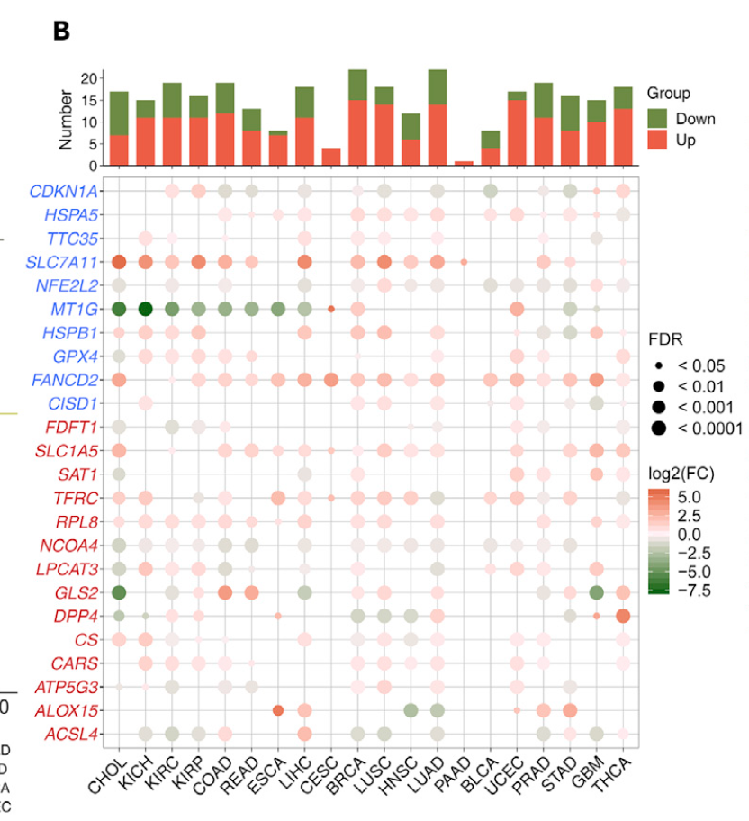

The reference's Fig. 1B recipe: for a curated pathway panel (its example: ferroptosis regulators), run **tumour-vs-normal limma inside every cancer type** of the pancancer cohort, then present the result twice — a bar chart of the number of significant up/down genes per cancer (red/green) and a heatmap of fold change with FDR significance marks per cancer × gene \[1\]. The pancancer-atlas TSVs are replaced by a simulated tumour/normal cohort with planted per-cancer dysregulation; limma runs unchanged from the lockfile:

## Example

{fig-alt="Pan-Cancer Tumour-vs-Normal DE Panel DEMO" fig-align="center" width="70%"}

## Setup

-   System Requirements: Cross-platform (Linux/MacOS/Windows)

-   Programming language: R

-   Dependent packages: `limma`; `ComplexHeatmap`; `ggplot2`

```{r packages setup, message=FALSE, warning=FALSE, output=FALSE}
suppressPackageStartupMessages({
  library(limma); library(ComplexHeatmap); library(circlize); library(ggplot2)
})
```

```{r}
sessioninfo::session_info("attached")
```

## Data Preparation

25 ferroptosis-regulator-style genes across 20 tumour types with paired tumour/normal samples (n ≈ 30-60 pairs per type, like the pancancer atlas). Planted dysregulation: three genes up-regulated in a third of the cancers, two down-regulated broadly, one cancer-specific event — so both the bar counts and the heatmap gradient have interpretable structure. One limma model per cancer type, exactly the reference's `twoclasslimma` loop:

```{r load data}
suppressPackageStartupMessages({
  library(limma); library(ComplexHeatmap); library(circlize); library(ggplot2)
})
set.seed(44263)
frg <- c("CDKN1A","HSPA5","SLC7A11","NFE2L2","MT1G","HSPB1","GPX4","FANCD2",
         "CISD1","FDFT1","SLC1A5","SAT1","TFRC","RPL8","NCOA4","LPCAT3",
         "GLS2","DPP4","CS","CARS","ATP5G3","ALOX15","ACSL4","EMC2","TTC35")
tumors <- c("BLCA","BRCA","CESC","CHOL","COAD","ESCA","GBM","HNSC","KICH",
            "KIRC","KIRP","LIHC","LUAD","LUSC","PAAD","PRAD","READ","STAD",
            "THCA","UCEC")
up_in <- list(SLC7A11 = c("KIRC","LIHC","LUAD","HNSC"), GPX4 = c("BRCA","THCA"),
              NFE2L2 = c("LUAD","LUSC","HNSC"))
down_in <- list(MT1G = tumors[-6], ALOX15 = c("PRAD","CESC"))

res_list <- lapply(tumors, function(cc) {
  n <- sample(30:60, 1)
  nor <- sapply(frg, function(g) rnorm(n, 5, 0.8))
  tum <- nor + rnorm(n * length(frg), 0, 0.5)
  colnames(tum) <- frg; colnames(nor) <- frg
  for (g in names(up_in)) if (cc %in% up_in[[g]])
    tum[, g] <- tum[, g] + 2.1
  for (g in names(down_in)) if (cc %in% down_in[[g]])
    tum[, g] <- tum[, g] - 1.8
  gset <- cbind(t(tum), t(nor))   # genes x samples (limma orientation)
  colnames(gset) <- c(sprintf("%s-T%02d", cc, 1:n),
                      sprintf("%s-N%02d", cc, 1:n))
  pd <- data.frame(Group = rep(c("pT", "pN"), c(n, n)),
                   row.names = colnames(gset))
  d <- model.matrix(~ -1 + factor(pd$Group, levels = c("pT", "pN")))
  colnames(d) <- c("pT", "pN")
  f <- eBayes(contrasts.fit(lmFit(gset, d),
            makeContrasts(pT - pN, levels = d)), 0.01)
  tt <- topTable(f, number = Inf, sort.by = "none")
  data.frame(cancer = cc, gene = frg,
             log2fc = tt$logFC, padj = tt$adj.P.Val)
})
res <- do.call(rbind, res_list)
res$signif <- ifelse(res$padj < 0.05,
                     ifelse(res$log2fc > 0, "up", "down"), "ns")
```

## Visualization

### 1. Significant-DEG Counts per Cancer

The reference's upper bar panel: for every cancer, the count of significant up (red) vs down (green) genes — stacked so the total bar height reads "how dysregulated is this type":

```{r}
#| label: fig-1.1PancanDiffCounts
#| fig-cap: "Number of significant tumour-vs-normal DE genes per cancer type (limma, FDR < 0.05): up-regulated in red, down-regulated in green; the planted hot types (KIRC, LUAD, HNSC) carry the largest bars."
#| out.width: "85%"
#| fig-width: 8
#| fig-height: 5.2

cnt <- as.data.frame.matrix(table(res$cancer, res$signif))
cnt <- cnt[, intersect(c("up", "down"), colnames(cnt)), drop = FALSE]
cnt_df <- data.frame(cancer = rep(factor(rownames(cnt), levels = tumors),
                                 ncol(cnt)),
                     stack(cnt))
ggplot(cnt_df, aes(cancer, values, fill = ind)) +
  geom_col(width = 0.72) +
  scale_fill_manual(values = c(up = "#C2151A", down = "#6F8B35"),
                    labels = c(up = "up in tumour", down = "down in tumour")) +
  labs(x = NULL, y = "# significant genes", fill = NULL) +
  theme_bw(base_size = 11) +
  theme(axis.text.x = element_text(angle = 45, hjust = 1),
        panel.grid.minor = element_blank(),
        legend.position = "top")
```

### 2. Fold-Change Heatmap with Significance Marks

The reference's lower heatmap: log2FC per cancer × gene with **white body + coloured borders** — red border/text for significant up, green for significant down, grey for non-significant — the FDR layer carried by the cell outline rather than a second heatmap:

```{r}
#| label: fig-2.1PancanDiffHeatmap
#| fig-cap: "log2 fold change (tumour vs normal) per cancer x gene, drawn as white-bodied cells with coloured outlines: red = significant up, green = significant down, grey = FDR >= 0.05; the planted programmes (SLC7A11/GPX4/NFE2L2 up, MT1G/ALOX15 down) read as coloured rows."
#| out.width: "95%"
#| fig-width: 9.5
#| fig-height: 7

fc_mat <- reshape(res[, c("cancer", "gene", "log2fc")],
                  idvar = "gene", timevar = "cancer", direction = "wide")
fc_mat <- as.matrix(fc_mat[, -1]); rownames(fc_mat) <- res$gene[1:nrow(fc_mat)]
colnames(fc_mat) <- tumors
sig_mat <- reshape(res[, c("cancer", "gene", "signif")],
                   idvar = "gene", timevar = "cancer", direction = "wide")
sig_mat <- as.matrix(sig_mat[, -1]); rownames(sig_mat) <- res$gene[1:nrow(sig_mat)]
border_col <- matrix(c(ns = "grey70", up = "#C2151A", down = "#6F8B35")[c(
  sig_mat)], nrow(sig_mat), ncol(sig_mat))
Heatmap(fc_mat, name = "log2FC",
        col = colorRamp2(c(-2.5, 0, 2.5), c("#1F78B4", "white", "#C2151A")),
        cluster_rows = TRUE, cluster_columns = FALSE,
        column_title = NULL,
        rect_gp = grid::gpar(col = border_col, lwd = 1.6),
        row_names_gp = grid::gpar(fontsize = 7.5),
        column_names_gp = grid::gpar(fontsize = 8),
        heatmap_legend_param = list(title = "log2FC\n(tumour vs normal)"))
```

::: callout-tip
**Practice tips**

-   Run limma **inside each cancer type** — pooling tumour/normal across types mixes the between-type baseline into the contrast and hides type-specific dysregulation.
-   Carry the FDR layer in the cell *outline* (white body + coloured border): a second FDR heatmap doubles the area for the same message; the border encoding keeps both channels in one grid.
-   Order the bar panel by the reference's tumour list (or by total count) — alphabetical order with 20 types reads fine, but the pancancer atlas order is what reviewers of the original figure expect.
-   Tumour/normal pairs are usually unpaired in the pancancer atlas (different patients) — use the two-group design (`~ -1 + Group`), not paired.
-   Restrict to cancers that actually have normal samples (the reference's hardcoded 20-type list); types without normals silently produce empty rows.
:::

## Application

::: {#fig-PancanDiffApplications1}
{fig-alt="Pan-Cancer Tumour-vs-Normal DE Panel" fig-align="center" width="70%"}

Pan-cancer tumour-vs-normal DE panel
:::

The two-panel recipe applies to any curated gene panel swept across the pancancer cohort: ferroptosis, m6A regulators, pyroptosis, metabolic enzymes — swap the gene list, keep the per-type limma + counts/heatmap presentation.

## Reference

\[1\] Xiaofan Lu, et al. FigureYa: A Standardized Visualization Framework for Enhancing Biomedical Data Interpretation and Research Efficiency. iMetaMed. 2025. doi:10.1002/imm3.70005
