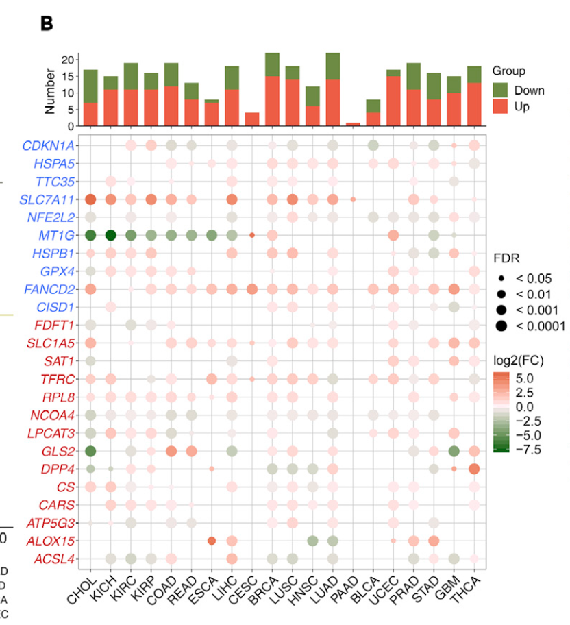

参考的 Fig. 1B 配方：对一条精选通路基因面板（其示例为铁死亡调控基因），在泛癌队列的**每个癌种内**跑肿瘤 vs 正常 limma，然后把结果呈现两次——逐癌种的显著上调/下调基因数条形图（红/绿）+ 倍数变化热图（FDR 显著性以格线标注）\[\1\]。泛癌 atlas 的 TSV 由带植入失调的模拟肿瘤/正常队列替代；limma 在 lockfile 中原样运行：

## Example

{fig-alt="泛癌肿瘤-正常差异表达面板 DEMO" fig-align="center" width="60%"}

## Setup

-   系统要求：跨平台（Linux/MacOS/Windows）

-   编程语言：R

-   依赖包：`limma`; `ComplexHeatmap`; `ggplot2`

```{r packages setup, message=FALSE, warning=FALSE, output=FALSE}
suppressPackageStartupMessages({
  library(limma); library(ComplexHeatmap); library(circlize); library(ggplot2)
})
```

```{r}
sessioninfo::session_info("attached")
```

## 数据准备

25 个铁死亡调控基因 × 20 个癌种（各配对约 30-60 对肿瘤/正常样本，与泛癌 atlas 一致）。植入失调：三个基因在三分之一的癌种中上调、两个广泛下调、一个癌种特异事件——条形计数与热图梯度因此都有可解读的结构。逐癌种一个 limma 模型，即参考的 `twoclasslimma` 循环：

```{r load data}
suppressPackageStartupMessages({
  library(limma); library(ComplexHeatmap); library(circlize); library(ggplot2)
})
set.seed(44263)
frg <- c("CDKN1A","HSPA5","SLC7A11","NFE2L2","MT1G","HSPB1","GPX4","FANCD2",
         "CISD1","FDFT1","SLC1A5","SAT1","TFRC","RPL8","NCOA4","LPCAT3",
         "GLS2","DPP4","CS","CARS","ATP5G3","ALOX15","ACSL4","EMC2","TTC35")
tumors <- c("BLCA","BRCA","CESC","CHOL","COAD","ESCA","GBM","HNSC","KICH",
            "KIRC","KIRP","LIHC","LUAD","LUSC","PAAD","PRAD","READ","STAD",
            "THCA","UCEC")
up_in <- list(SLC7A11 = c("KIRC","LIHC","LUAD","HNSC"), GPX4 = c("BRCA","THCA"),
              NFE2L2 = c("LUAD","LUSC","HNSC"))
down_in <- list(MT1G = tumors[-6], ALOX15 = c("PRAD","CESC"))

res_list <- lapply(tumors, function(cc) {
  n <- sample(30:60, 1)
  nor <- sapply(frg, function(g) rnorm(n, 5, 0.8))
  tum <- nor + rnorm(n * length(frg), 0, 0.5)
  colnames(tum) <- frg; colnames(nor) <- frg
  for (g in names(up_in)) if (cc %in% up_in[[g]])
    tum[, g] <- tum[, g] + 2.1
  for (g in names(down_in)) if (cc %in% down_in[[g]])
    tum[, g] <- tum[, g] - 1.8
  gset <- cbind(t(tum), t(nor))   # genes x samples (limma orientation)
  colnames(gset) <- c(sprintf("%s-T%02d", cc, 1:n),
                      sprintf("%s-N%02d", cc, 1:n))
  pd <- data.frame(Group = rep(c("pT", "pN"), c(n, n)),
                   row.names = colnames(gset))
  d <- model.matrix(~ -1 + factor(pd$Group, levels = c("pT", "pN")))
  colnames(d) <- c("pT", "pN")
  f <- eBayes(contrasts.fit(lmFit(gset, d),
            makeContrasts(pT - pN, levels = d)), 0.01)
  tt <- topTable(f, number = Inf, sort.by = "none")
  data.frame(cancer = cc, gene = frg,
             log2fc = tt$logFC, padj = tt$adj.P.Val)
})
res <- do.call(rbind, res_list)
res$signif <- ifelse(res$padj < 0.05,
                     ifelse(res$log2fc > 0, "up", "down"), "ns")
```

## Visualization

### 逐癌种显著 DEG 计数

参考的上半条形面板：每个癌种的显著上调（红）vs 下调（绿）基因数堆叠——总柱高读作"这个癌种失调多少"：

```{r}
#| label: fig-1.1PancanDiffCounts
#| fig-cap: "逐癌种的显著肿瘤-正常 DE 基因数（limma，FDR < 0.05）：上调红、下调绿；植入的热门类型（KIRC、LUAD、HNSC）柱最高。"
#| out.width: "85%"
#| fig-width: 8
#| fig-height: 5.2

cnt <- as.data.frame.matrix(table(res$cancer, res$signif))
cnt <- cnt[, intersect(c("up", "down"), colnames(cnt)), drop = FALSE]
cnt_df <- data.frame(cancer = rep(factor(rownames(cnt), levels = tumors),
                                 ncol(cnt)),
                     stack(cnt))
ggplot(cnt_df, aes(cancer, values, fill = ind)) +
  geom_col(width = 0.72) +
  scale_fill_manual(values = c(up = "#C2151A", down = "#6F8B35"),
                    labels = c(up = "up in tumour", down = "down in tumour")) +
  labs(x = NULL, y = "# significant genes", fill = NULL) +
  theme_bw(base_size = 11) +
  theme(axis.text.x = element_text(angle = 45, hjust = 1),
        panel.grid.minor = element_blank(),
        legend.position = "top")
```

### 倍数变化热图 + 显著性格线

参考的下半热图：癌种 × 基因的 log2FC，**白色格体 + 彩色格线**——显著上调红格线、显著下调绿格线、非显著灰格线——FDR 层由格外而不是第二张热图承载：

```{r}
#| label: fig-2.1PancanDiffHeatmap
#| fig-cap: "癌种 × 基因的 log2 倍数变化（肿瘤 vs 正常），白体彩色格线：红 = 显著上调、绿 = 显著下调、灰 = FDR >= 0.05；植入的程序（SLC7A11/GPX4/NFE2L2 上调、MT1G/ALOX15 下调）读作整行格线。"
#| out.width: "95%"
#| fig-width: 9.5
#| fig-height: 7

fc_mat <- reshape(res[, c("cancer", "gene", "log2fc")],
                  idvar = "gene", timevar = "cancer", direction = "wide")
fc_mat <- as.matrix(fc_mat[, -1]); rownames(fc_mat) <- res$gene[1:nrow(fc_mat)]
colnames(fc_mat) <- tumors
sig_mat <- reshape(res[, c("cancer", "gene", "signif")],
                   idvar = "gene", timevar = "cancer", direction = "wide")
sig_mat <- as.matrix(sig_mat[, -1]); rownames(sig_mat) <- res$gene[1:nrow(sig_mat)]
border_col <- matrix(c(ns = "grey70", up = "#C2151A", down = "#6F8B35")[c(
  sig_mat)], nrow(sig_mat), ncol(sig_mat))
Heatmap(fc_mat, name = "log2FC",
        col = colorRamp2(c(-2.5, 0, 2.5), c("#1F78B4", "white", "#C2151A")),
        cluster_rows = TRUE, cluster_columns = FALSE,
        column_title = NULL,
        rect_gp = grid::gpar(col = border_col, lwd = 1.6),
        row_names_gp = grid::gpar(fontsize = 7.5),
        column_names_gp = grid::gpar(fontsize = 8),
        heatmap_legend_param = list(title = "log2FC\n(tumour vs normal)"))
```


## 应用场景

::: {{#fig-PancanDiffApplications1}}
{fig-alt="泛癌肿瘤-正常差异表达面板" fig-align="center" width="60%"}

泛癌肿瘤-正常差异表达面板
:::

双面板配方适用于任何精选基因面板的泛癌扫描：铁死亡、m6A 调控子、细胞焦亡、代谢酶——换基因清单、保留逐癌种 limma + 计数/热图呈现。

## 参考文献

\[1\] Xiaofan Lu, et al. FigureYa: A Standardized Visualization Framework for Enhancing Biomedical Data Interpretation and Research Efficiency. iMetaMed. 2025. doi:10.1002/imm3.70005
