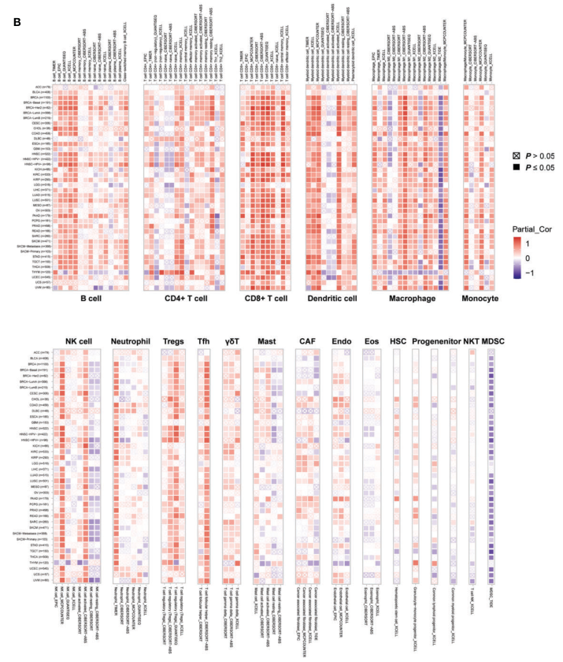

A pan-cancer immune-correlation figure asks one question per tile: *in this tumour type, does the gene's expression track this immune cell's infiltration?* The reference answers it for CD96 with three deconvolution algorithms — TIMER (19 cell types, one small heatmap per cell type arranged in two rows), EPIC (8 cell types) and CIBERSORT (22 cell types) — each tile a Spearman ρ on a blue→red ramp with a separate shape for significant vs non-significant \[1\]. The reference assembles its per-cell-type tables by hand from the TIMER2.0 web server and runs EPIC/CIBERSORT through IOBR; this tutorial simulates the per-cancer-type correlation tables directly (the ggplot2 rendering — including the two-row patchwork layout with per-panel widths — is the reference's) so the whole page runs on ggplot2 + patchwork:

## Example

{fig-alt="Pan-Cancer Gene–Immune Infiltration Map DEMO" fig-align="center" width="75%"}

## Setup

-   System Requirements: Cross-platform (Linux/MacOS/Windows)

-   Programming language: R

-   Dependent packages: `ggplot2`; `patchwork`

```{r packages setup, message=FALSE, warning=FALSE, output=FALSE}
suppressPackageStartupMessages({
  library(ggplot2); library(patchwork)
})
```

```{r}
sessioninfo::session_info("attached")
```

## Data Preparation

Simulated per-cancer-type Spearman results for a query gene, in the shape the reference assembles from TIMER2.0: one table per immune cell type, columns `cancer / infiltrates / cor / p.value`. Three algorithms with different cell-type panels (TIMER-like 6 cell types, EPIC-like 8, CIBERSORT-like 20) and a planted CD96-like signature: strong positive correlation with cytotoxic T cells in most tumours, negative with "other cells", plus per-type noise so some tiles are non-significant:

```{r load data}
suppressPackageStartupMessages({library(ggplot2); library(patchwork)})
set.seed(40234)
cancers <- c("BRCA", "LUAD", "LIHC", "COAD", "STAD", "KIRC", "GBM",
             "SKCM", "PRAD", "BLCA", "OV", "CESC")
cells <- list(
  TIMER   = c("B cell", "T cell CD4+", "T cell CD8+", "Neutrophil",
              "Macrophage", "Myeloid DC"),
  EPIC    = c("B cells", "CAFs", "CD4 T cells", "CD8 T cells",
              "Endothelial", "Macrophages", "NK cells", "other cells"),
  CIBERSORT = c("B cells naive", "B cells memory", "Plasma cells",
                "T cells CD8", "T cells CD4 memory", "T cells follicular helper",
                "Tregs", "T cells gamma delta", "NK cells resting",
                "NK cells activated", "Monocytes", "Macrophages M0",
                "Macrophages M1", "Macrophages M2", "DCs resting",
                "DCs activated", "Mast cells resting", "Mast cells activated",
                "Eosinophils", "Neutrophils")
  # (20 cell types, matching the official CIBERSORT panel's core)
)
effect <- c("T cell CD8+" = 0.75, "CD8 T cells" = 0.7, "T cells CD8" = 0.72,
            "T cell CD4+" = 0.45, "CD4 T cells" = 0.4, "T cells CD4 memory" = 0.35,
            "NK cells" = 0.3, "NK cells activated" = 0.28,
            "other cells" = -0.65)
mk_table <- function(method) {
  do.call(rbind, lapply(cancers, function(cc) {
    data.frame(cancer = cc, infiltrates = cells[[method]],
               cor = sapply(cells[[method]], function(cl) {
                 base <- ifelse(cl %in% names(effect), effect[[cl]], 0.1)
                 base + rnorm(1, 0, 0.22)
               }),
               p.value = runif(length(cells[[method]]), 0, 1))
  }))
}
sim <- lapply(names(cells), mk_table)
names(sim) <- names(cells)
## planted significance where |rho| is large
for (m in names(sim)) {
  sim[[m]]$p.value <- ifelse(abs(sim[[m]]$cor) > 0.3,
                             runif(nrow(sim[[m]]), 0, 0.01),
                             runif(nrow(sim[[m]]), 0.05, 1))
}
prep <- function(x) {
  x$pvalue <- ifelse(x$p.value >= 0.05, "p>=0.05", "p<0.05")
  x$cancer <- factor(x$cancer, levels = cancers)
  x
}
sim <- lapply(sim, prep)
```

## Visualization

### 1. Single-Panel Algorithm (EPIC-Like, 8 Cell Types)

The reference's EPIC rendering: one ggplot tile-map, cancer types on y, cell types on x, colour = Spearman ρ capped to [-1, 1], shape = significance. Square markers (15) for significant, open diamonds (7) for non-significant:

```{r}
#| label: fig-1.1PancanImmuneEpic
#| fig-cap: "EPIC-like panel: Spearman correlation of the query gene with 8 immune cell types across 12 tumour types; colour = rho (blue -1 to red +1), filled square = p<0.05, open diamond = non-significant."
#| out.width: "80%"
#| fig-width: 7
#| fig-height: 6

plot_one <- function(x, x_pos = "bottom") {
  ggplot(x, aes(infiltrates, cancer, shape = pvalue, color = cor)) +
    geom_point(size = 3) +
    scale_shape_manual(values = c(15, 7)) +
    scale_color_gradient2(low = "#2b8cbe", mid = "white", high = "#e41a1c",
                          limits = c(-1, 1)) +
    scale_x_discrete(position = x_pos) +
    theme_bw() +
    theme(axis.title.y = element_blank(),
          axis.title.x = element_blank(),
          axis.text.x = element_text(angle = 90, hjust = ifelse(x_pos == "top", 0, 1),
                                     vjust = 0, size = 7.5),
          axis.text.y = element_text(size = 8.5))
}
plot_one(sim$EPIC)
```

### 2. Two-Row Layout for Many Cell Types (TIMER-Like)

The reference's TIMER layout: one small heatmap **per immune cell type**, arranged in two rows with a breakpoint (8 top / 11 bottom in the reference), panels sized by their number of cancer types via `plot_layout(widths = ...)`, x labels only on the outer edges, and a single collected legend. Here the 6 TIMER-like cell types split 3 + 3; the same recipe extends to the reference's 19:

```{r}
#| label: fig-2.1PancanImmuneTimer
#| fig-cap: "TIMER-like two-row assembly: one sub-heatmap per immune cell type (3 top, 3 bottom), x labels only on the outer edge, panels sized equally, one collected colour legend."
#| out.width: "100%"
#| fig-width: 9.5
#| fig-height: 6

panels <- lapply(sim$TIMER$infiltrates, function(cl) {
  sub <- sim$TIMER[sim$TIMER$infiltrates == cl, ]
  plot_one(sub) + ggtitle(cl) +
    theme(plot.title = element_text(size = 9, hjust = 0.5))
})
top <- panels[[1]] + scale_x_discrete(labels = NULL) +
  theme(axis.text.x = element_blank()) +
  panels[[2]] + scale_x_discrete(labels = NULL) +
  theme(axis.text.x = element_blank()) +
  panels[[3]] + scale_x_discrete(position = "top") +
  plot_layout(nrow = 1)
bottom <- panels[[4]] + panels[[5]] + panels[[6]] + plot_layout(nrow = 1)
top / bottom + plot_layout(heights = c(1, 1.15), guides = "collect") +
  plot_annotation(theme = theme(legend.position = "right"))
```

### 3. Wide Algorithm (CIBERSORT-Like, 22 Cell Types)

The CIBERSORT-style rendering for many cell types in a single tall panel — the same tile grammar with rotated labels carrying the load:

```{r}
#| label: fig-3.1PancanImmuneCibersort
#| fig-cap: "CIBERSORT-like single tall panel: 22 cell types × 12 tumour types; the planted cytotoxic-T and other-cells correlations reproduce across all three algorithms."
#| out.width: "85%"
#| fig-width: 8.5
#| fig-height: 7

plot_one(sim$CIBERSORT) +
  theme(axis.text.x = element_text(angle = 90, hjust = 1, vjust = 0, size = 7))
```

::: callout-tip
**Practice tips**

-   Keep the colour scale **fixed at [-1, 1] with white at 0** across every panel of a multi-algorithm figure — per-panel free scales make red/blue tiles incomparable between algorithms.
-   Two visual channels per tile (colour = effect size, shape = significance) is one more than most readers track; state in the caption which channel answers the primary question and use the other as a filter, not a headline.
-   When one algorithm has many cell types, split into per-cell-type sub-panels and size them with `plot_layout(widths = ...)` — a single 19-column panel forces unreadable label rotation.
-   Spearman, not Pearson: deconvolution scores are bounded (0-1) and heteroscedastic across tumour types, so rank correlation is the honest summary.
-   Report the cohort size per tumour type (the reference appends "(n=...)" to each label) — a correlation from 36 samples is not the same evidence as one from 1100.
:::

## Application

::: {#fig-PancanImmuneApplications1}
{fig-alt="Pan-Cancer Gene–Immune Infiltration Map" fig-align="center" width="75%"}

Pan-cancer gene–immune infiltration map
:::

The tile-map grammar generalizes to any gene × feature × tumour-type correlation sweep: mutation burden vs pathway scores, drug sensitivity vs target expression, or methylation vs immune infiltration — anywhere a candidate biomarker needs a pan-cancer sanity check.

## Reference

\[1\] Xiaofan Lu, et al. FigureYa: A Standardized Visualization Framework for Enhancing Biomedical Data Interpretation and Research Efficiency. iMetaMed. 2025. doi:10.1002/imm3.70005
