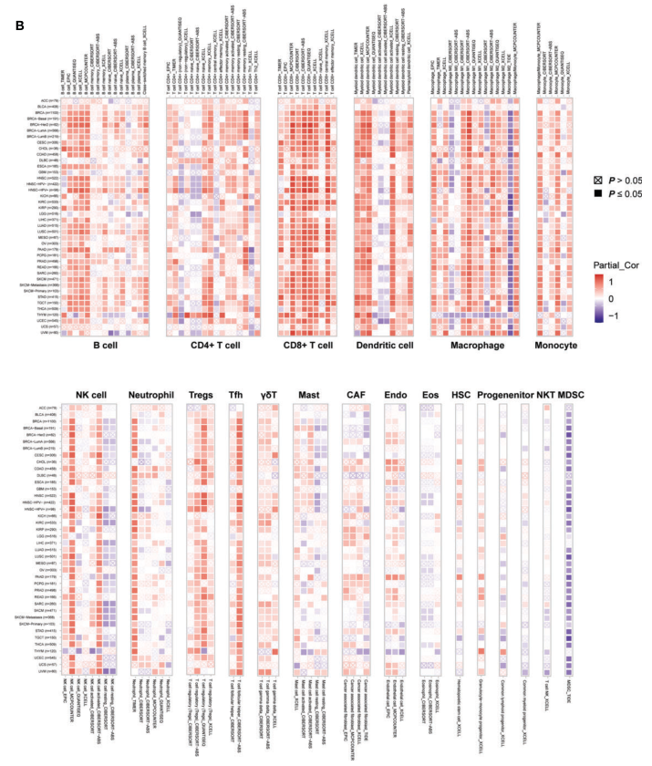

泛癌免疫相关图逐格回答一个问题：*在该癌种中，基因表达是否随该免疫细胞浸润同步变化？*参考文档用三种去卷积算法回答 CD96 的这一问题——TIMER（19 种细胞，每种一张小热图排两行）、EPIC（8 种）与 CIBERSORT（22 种）——每格一个 Spearman ρ、蓝→红色带、显著与否用形状区分 \[1\]。参考从 TIMER2.0 网页逐张导出、EPIC/CIBERSORT 走 IOBR；本教程直接模拟逐癌种相关表（ggplot2 渲染——含按面板宽度拼接的两行 patchwork 版式——是参考的），整页仅依赖 ggplot2 + patchwork：

## Example

{fig-alt="泛癌基因-免疫浸润相关图谱 DEMO" fig-align="center" width="60%"}

## Setup

-   系统要求：跨平台（Linux/MacOS/Windows）

-   编程语言：R

-   依赖包：`ggplot2`; `patchwork`

```{r packages setup, message=FALSE, warning=FALSE, output=FALSE}
suppressPackageStartupMessages({
  library(ggplot2); library(patchwork)
})
```

```{r}
sessioninfo::session_info("attached")
```

## 数据准备

查询基因的逐癌种 Spearman 结果模拟表，形状与参考从 TIMER2.0 拼出的输入一致：每免疫细胞类型一张表、`cancer / infiltrates / cor / p.value` 列。三种算法细胞面板不同（TIMER 式 6 种、EPIC 式 8 种、CIBERSORT 式 20 种），植入 CD96 式签名：细胞毒性 T 细胞在多数肿瘤中强正相关、other cells 负相关，逐型加噪声让部分格子不显著：

```{r load data}
suppressPackageStartupMessages({library(ggplot2); library(patchwork)})
set.seed(40234)
cancers <- c("BRCA", "LUAD", "LIHC", "COAD", "STAD", "KIRC", "GBM",
             "SKCM", "PRAD", "BLCA", "OV", "CESC")
cells <- list(
  TIMER   = c("B cell", "T cell CD4+", "T cell CD8+", "Neutrophil",
              "Macrophage", "Myeloid DC"),
  EPIC    = c("B cells", "CAFs", "CD4 T cells", "CD8 T cells",
              "Endothelial", "Macrophages", "NK cells", "other cells"),
  CIBERSORT = c("B cells naive", "B cells memory", "Plasma cells",
                "T cells CD8", "T cells CD4 memory", "T cells follicular helper",
                "Tregs", "T cells gamma delta", "NK cells resting",
                "NK cells activated", "Monocytes", "Macrophages M0",
                "Macrophages M1", "Macrophages M2", "DCs resting",
                "DCs activated", "Mast cells resting", "Mast cells activated",
                "Eosinophils", "Neutrophils")
  # (20 cell types, matching the official CIBERSORT panel's core)
)
effect <- c("T cell CD8+" = 0.75, "CD8 T cells" = 0.7, "T cells CD8" = 0.72,
            "T cell CD4+" = 0.45, "CD4 T cells" = 0.4, "T cells CD4 memory" = 0.35,
            "NK cells" = 0.3, "NK cells activated" = 0.28,
            "other cells" = -0.65)
mk_table <- function(method) {
  do.call(rbind, lapply(cancers, function(cc) {
    data.frame(cancer = cc, infiltrates = cells[[method]],
               cor = sapply(cells[[method]], function(cl) {
                 base <- ifelse(cl %in% names(effect), effect[[cl]], 0.1)
                 base + rnorm(1, 0, 0.22)
               }),
               p.value = runif(length(cells[[method]]), 0, 1))
  }))
}
sim <- lapply(names(cells), mk_table)
names(sim) <- names(cells)
## planted significance where |rho| is large
for (m in names(sim)) {
  sim[[m]]$p.value <- ifelse(abs(sim[[m]]$cor) > 0.3,
                             runif(nrow(sim[[m]]), 0, 0.01),
                             runif(nrow(sim[[m]]), 0.05, 1))
}
prep <- function(x) {
  x$pvalue <- ifelse(x$p.value >= 0.05, "p>=0.05", "p<0.05")
  x$cancer <- factor(x$cancer, levels = cancers)
  x
}
sim <- lapply(sim, prep)
```

## Visualization

### 单面板算法（EPIC 式，8 种细胞）

参考的 EPIC 渲染：一张 ggplot 瓦片图，癌种在 y、细胞在 x、颜色 = Spearman ρ 截断到 [-1,1]、形状 = 显著性。显著格实心方块（15）、不显著空心菱形（7）：

```{r}
#| label: fig-1.1PancanImmuneEpic
#| fig-cap: "EPIC 式面板：查询基因与 8 种免疫细胞在 12 个癌种中的 Spearman 相关；颜色 = rho（蓝 -1 到红 +1）、实心方块 = p<0.05、空心菱形 = 不显著。"
#| out.width: "80%"
#| fig-width: 7
#| fig-height: 6

plot_one <- function(x, x_pos = "bottom") {
  ggplot(x, aes(infiltrates, cancer, shape = pvalue, color = cor)) +
    geom_point(size = 3) +
    scale_shape_manual(values = c(15, 7)) +
    scale_color_gradient2(low = "#2b8cbe", mid = "white", high = "#e41a1c",
                          limits = c(-1, 1)) +
    scale_x_discrete(position = x_pos) +
    theme_bw() +
    theme(axis.title.y = element_blank(),
          axis.title.x = element_blank(),
          axis.text.x = element_text(angle = 90, hjust = ifelse(x_pos == "top", 0, 1),
                                     vjust = 0, size = 7.5),
          axis.text.y = element_text(size = 8.5))
}
plot_one(sim$EPIC)
```

### 多细胞类型的两行版式（TIMER 式）

参考的 TIMER 版式：**每免疫细胞类型一张小热图**，两行排布、断点分隔（参考为 8 上/11 下），`plot_layout(widths = ...)` 按癌种数调面板宽、x 轴标签只画外缘、图例收集为一份。此处 6 种细胞分 3+3；同一配方可扩展到参考的 19 种：

```{r}
#| label: fig-2.1PancanImmuneTimer
#| fig-cap: "TIMER 式两行拼装：每免疫细胞类型一张子热图（上 3 下 3）、x 标签只画外缘、面板等宽、图例收集为一份。"
#| out.width: "100%"
#| fig-width: 9.5
#| fig-height: 6

panels <- lapply(sim$TIMER$infiltrates, function(cl) {
  sub <- sim$TIMER[sim$TIMER$infiltrates == cl, ]
  plot_one(sub) + ggtitle(cl) +
    theme(plot.title = element_text(size = 9, hjust = 0.5))
})
top <- panels[[1]] + scale_x_discrete(labels = NULL) +
  theme(axis.text.x = element_blank()) +
  panels[[2]] + scale_x_discrete(labels = NULL) +
  theme(axis.text.x = element_blank()) +
  panels[[3]] + scale_x_discrete(position = "top") +
  plot_layout(nrow = 1)
bottom <- panels[[4]] + panels[[5]] + panels[[6]] + plot_layout(nrow = 1)
top / bottom + plot_layout(heights = c(1, 1.15), guides = "collect") +
  plot_annotation(theme = theme(legend.position = "right"))
```

### 宽面板算法（CIBERSORT 式，20 种细胞）

CIBERSORT 式渲染：单张高面板承载 20 种细胞——同一瓦片语法，靠旋转标签承载信息量：

```{r}
#| label: fig-3.1PancanImmuneCibersort
#| fig-cap: "CIBERSORT 式单张高面板：20 种细胞 × 12 癌种；植入的细胞毒性 T 与 other cells 相关性在三种算法中重现。"
#| out.width: "85%"
#| fig-width: 8.5
#| fig-height: 7

plot_one(sim$CIBERSORT) +
  theme(axis.text.x = element_text(angle = 90, hjust = 1, vjust = 0, size = 7))
```


## 应用场景

::: {{#fig-PancanImmuneApplications1}}
{fig-alt="泛癌基因-免疫浸润相关图谱" fig-align="center" width="60%"}

泛癌基因-免疫浸润相关图谱
:::

瓦片图语法可推广到任何 基因 × 特征 × 癌种 的相关普查：突变负荷 vs 通路评分、药敏 vs 靶点表达、甲基化 vs 免疫浸润——凡候选标记需要泛癌交叉验证处。

## 参考文献

\[1\] Xiaofan Lu, et al. FigureYa: A Standardized Visualization Framework for Enhancing Biomedical Data Interpretation and Research Efficiency. iMetaMed. 2025. doi:10.1002/imm3.70005
