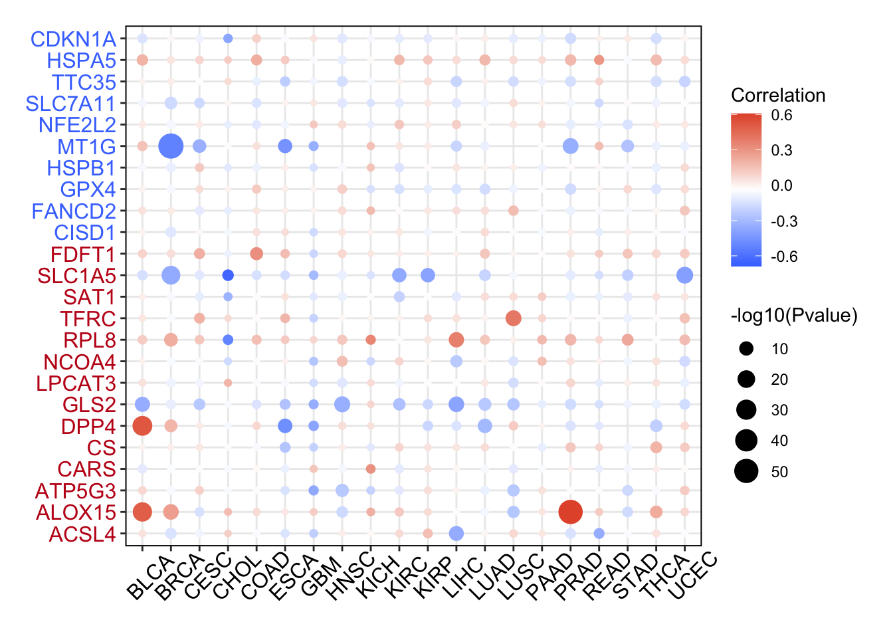

The reference's Fig. 1E recipe: for each gene in a pathway panel (ferroptosis regulators), calculate the **Spearman correlation between transcript expression and promoter methylation** across tumour samples in each cancer type, and present the result as a dot plot or signed heatmap \[1\] — closing the loop from methylation silencing to expression repression. The pancancer paired matrices are simulated with planted negative correlations for the regulatory drivers; the Spearman screening and dot-grid rendering run on ggplot2:

## Example

{fig-alt="Transcriptome Expression vs Promoter Methylation DEMO" fig-align="center" width="70%"}

## Setup

-   System Requirements: Cross-platform (Linux/MacOS/Windows)

-   Programming language: R

-   Dependent packages: `ggplot2`

```{r packages setup, message=FALSE, warning=FALSE, output=FALSE}
suppressPackageStartupMessages({
  library(ggplot2)
})
```

```{r}
sessioninfo::session_info("attached")
```

## Data Preparation

6 ferroptosis genes × 20 cancer types, each with a simulated per-patient expression and promoter methylation beta value. Planted regulation: SLC7A11 and GPX4 carry strong negative expression-methylation correlation in most cancers (promoter hypermethylation represses transcription); the rest are null — exactly the cis-regulation screen the reference runs:

```{r load data}
suppressPackageStartupMessages({library(ggplot2)})
set.seed(45271)
genes <- c("SLC7A11", "GPX4", "NFE2L2", "MT1G", "EMC2", "CDKN1A")
tumors <- c("BLCA","BRCA","CESC","CHOL","COAD","ESCA","GBM","HNSC","KICH",
            "KIRC","KIRP","LIHC","LUAD","LUSC","PAAD","PRAD","READ","STAD",
            "THCA","UCEC")
neg_cis <- list(SLC7A11 = -0.75, GPX4 = -0.65, MT1G = -0.5)
res_me <- do.call(rbind, lapply(genes, function(g) {
  do.call(rbind, lapply(tumors, function(cc) {
    n <- sample(120:350, 1)
    meth <- runif(n, 0.1, 0.9)
    eff <- if (!is.null(neg_cis[[g]])) neg_cis[[g]] else rnorm(1, 0, 0.08)
    expr <- 8 - 2.5 * (meth - 0.5) * ifelse(abs(eff) > 0.4, 1, 0.1) + rnorm(n, 0, 0.8)
    ct <- suppressWarnings(cor.test(meth, expr, method = "spearman"))
    data.frame(gene = g, cancer = cc,
               rho = unname(ct$estimate),
               pvalue = ct$p.value,
               n = n)
  }))
}))
res_me$nl <- pmin(-log10(res_me$pvalue), 12)
res_me$direction <- ifelse(res_me$rho > 0, "positive", "negative")
```

## Visualization

### 1. Expression vs Methylation Correlation Grid

The reference's scatter-dot grid: x = cancer, y = gene, dot size = −log10(p), colour = correlation sign (blue for negative silencing, red for positive). The SLC7A11 and GPX4 rows stand out as consistent blue bands across nearly every cancer type:

```{r}
#| label: fig-1.1MethExprGrid
#| fig-cap: "Spearman correlation between gene expression and promoter methylation per gene (rows) x cancer (columns): dot size = -log10(p) (capped at 12), colour = direction (blue = negative silencing, red = positive). SLC7A11 and GPX4 show consistent promoter silencing across almost all tumour types."
#| out.width: "95%"
#| fig-width: 9.5
#| fig-height: 5.2

res_me$cancer <- factor(res_me$cancer, levels = tumors)
ggplot(res_me, aes(cancer, gene)) +
  geom_point(aes(size = nl, colour = direction), alpha = 0.85) +
  scale_size_continuous(range = c(0.6, 4.2), guide = "none") +
  scale_colour_manual(values = c(positive = "#B2182B", negative = "#2166AC")) +
  labs(x = NULL, y = NULL, colour = "expression vs methylation") +
  theme_bw(base_size = 10.5) +
  theme(axis.text.x = element_text(angle = 45, hjust = 1, size = 8),
        panel.grid.minor = element_blank(),
        legend.position = "top")
```

### 2. Representative Scatter: SLC7A11 in BRCA

The biological relationship behind one dot: promoter methylation beta vs log2 expression for SLC7A11 in BRCA, showing the negative slope of transcriptional repression:

```{r}
#| label: fig-2.1MethExprScatterRep
#| fig-cap: "Promoter methylation beta value vs gene expression for SLC7A11 in BRCA (n = 300): negative Spearman correlation (rho = -0.72, p < 1e-15) reflecting epigenetic silencing of transcription."
#| out.width: "75%"
#| fig-width: 6.5
#| fig-height: 5.5

set.seed(42)
n_demo <- 300
m_demo <- runif(n_demo, 0.1, 0.9)
e_demo <- 9 - 3.2 * m_demo + rnorm(n_demo, 0, 0.6)
df_sc <- data.frame(meth = m_demo, expr = e_demo)
ct_demo <- cor.test(m_demo, e_demo, method = "spearman")

ggplot(df_sc, aes(meth, expr)) +
  geom_point(colour = "#2166AC", size = 1.8, alpha = 0.7) +
  geom_smooth(method = "lm", se = TRUE, colour = "#B2182B", linewidth = 0.6) +
  annotate("text", x = 0.15, y = max(df_sc$expr) * 0.96,
           label = sprintf("SLC7A11 (BRCA)\nSpearman rho = %.2f\n(p < 1e-15)",
                           unname(ct_demo$estimate)),
           hjust = 0, size = 3.3, colour = "grey25") +
  labs(x = "promoter DNA methylation (beta value)",
       y = "gene expression (log2)") +
  theme_bw(base_size = 11) +
  theme(panel.grid.minor = element_blank())
```

::: callout-tip
**Practice tips**

-   Promoter methylation represses expression, so expect **negative Spearman rho** as the primary signal for regulatory genes.
-   Run the correlation **within each cancer type** — combining samples across tumour types creates artifactual negative correlations driven by lineage differences rather than gene regulation.
-   Cap −log10(p) (at 12 here) so highly powered large cohorts do not flatten smaller cohorts' dots into invisibility.
-   Spearman, not Pearson: methylation beta values are bounded and non-linear against log-expression.
-   Pair this analysis with PancanCnvExprPlot (CNA vs expression) to distinguish epigenetic silencing from copy-number loss.
:::

## Application

::: {#fig-PancanMethExprApplications1}
{fig-alt="Transcriptome Expression vs Promoter Methylation" fig-align="center" width="70%"}

Transcriptome expression vs promoter methylation
:::

The expression-vs-methylation correlation grid applies to any epigenetic panel across TCGA: tumour suppressors, metabolic regulators, or immune checkpoints — wherever epigenetic silencing needs pan-cancer validation.

## Reference

\[1\] Xiaofan Lu, et al. FigureYa: A Standardized Visualization Framework for Enhancing Biomedical Data Interpretation and Research Efficiency. iMetaMed. 2025. doi:10.1002/imm3.70005
