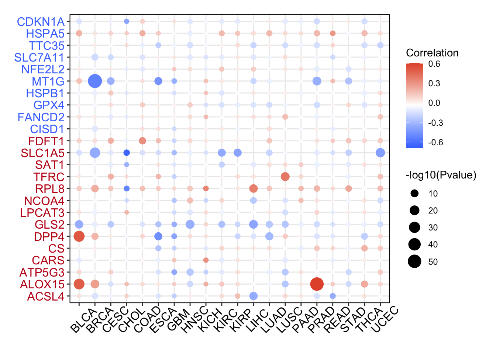

参考的 Fig. 1E 配方：对通路基因面板中的每个基因（铁死亡调控基因），计算每个癌种中肿瘤样本内**转录表达与启动子甲基化之间的 Spearman 相关性**，呈现为点图或带符号热图 \[1\]——闭合从甲基化沉默到表达抑制的回路。泛癌配对矩阵以植入的调节因子负相关模拟；Spearman 筛选与点网格渲染在 ggplot2 上运行：

## Example

{fig-alt="转录组表达 vs 启动子甲基化 DEMO" fig-align="center" width="60%"}

## Setup

-   系统要求：跨平台（Linux/MacOS/Windows）

-   编程语言：R

-   依赖包：`ggplot2`

```{r packages setup, message=FALSE, warning=FALSE, output=FALSE}
suppressPackageStartupMessages({
  library(ggplot2)
})
```

```{r}
sessioninfo::session_info("attached")
```

## 数据准备

6 个铁死亡基因 × 20 个癌种，各带模拟的逐患者表达与启动子甲基化 beta 值。植入调控：SLC7A11 与 GPX4 在多数癌症中携带强负表达-甲基化相关（启动子超甲基化抑制转录）；其余为零——正是参考运行的 cis 调控筛查：

```{r load data}
suppressPackageStartupMessages({library(ggplot2)})
set.seed(45271)
genes <- c("SLC7A11", "GPX4", "NFE2L2", "MT1G", "EMC2", "CDKN1A")
tumors <- c("BLCA","BRCA","CESC","CHOL","COAD","ESCA","GBM","HNSC","KICH",
            "KIRC","KIRP","LIHC","LUAD","LUSC","PAAD","PRAD","READ","STAD",
            "THCA","UCEC")
neg_cis <- list(SLC7A11 = -0.75, GPX4 = -0.65, MT1G = -0.5)
res_me <- do.call(rbind, lapply(genes, function(g) {
  do.call(rbind, lapply(tumors, function(cc) {
    n <- sample(120:350, 1)
    meth <- runif(n, 0.1, 0.9)
    eff <- if (!is.null(neg_cis[[g]])) neg_cis[[g]] else rnorm(1, 0, 0.08)
    expr <- 8 - 2.5 * (meth - 0.5) * ifelse(abs(eff) > 0.4, 1, 0.1) + rnorm(n, 0, 0.8)
    ct <- suppressWarnings(cor.test(meth, expr, method = "spearman"))
    data.frame(gene = g, cancer = cc,
               rho = unname(ct$estimate),
               pvalue = ct$p.value,
               n = n)
  }))
}))
res_me$nl <- pmin(-log10(res_me$pvalue), 12)
res_me$direction <- ifelse(res_me$rho > 0, "positive", "negative")
```

## Visualization

### 表达 vs 甲基化相关网格

参考的散点-点网格：x = 癌种、y = 基因、点大小 = −log10(p)、颜色 = 相关方向（蓝为负向沉默、红为正向）。SLC7A11 与 GPX4 行在几乎所有癌种中呈现一致的蓝色带：

```{r}
#| label: fig-1.1MethExprGrid
#| fig-cap: "基因（行）× 癌种（列）的表达与甲基化 Spearman 相关：点大小 = -log10(p)（封顶 12）、颜色 = 方向（蓝 = 负向沉默、红 = 正）。SLC7A11 和 GPX4 在几乎所有肿瘤类型中展示一致的启动子沉默。"
#| out.width: "95%"
#| fig-width: 9.5
#| fig-height: 5.2

res_me$cancer <- factor(res_me$cancer, levels = tumors)
ggplot(res_me, aes(cancer, gene)) +
  geom_point(aes(size = nl, colour = direction), alpha = 0.85) +
  scale_size_continuous(range = c(0.6, 4.2), guide = "none") +
  scale_colour_manual(values = c(positive = "#B2182B", negative = "#2166AC")) +
  labs(x = NULL, y = NULL, colour = "expression vs methylation") +
  theme_bw(base_size = 10.5) +
  theme(axis.text.x = element_text(angle = 45, hjust = 1, size = 8),
        panel.grid.minor = element_blank(),
        legend.position = "top")
```

### 代表性散点：BRCA 中的 SLC7A11

一个点背后的生物学关系：SLC7A11 在 BRCA 中的启动子甲基化 beta vs log2 表达，展示转录抑制的负斜率：

```{r}
#| label: fig-2.1MethExprScatterRep
#| fig-cap: "SLC7A11 在 BRCA 中的启动子甲基化 beta 值 vs 基因表达（n = 300）：负 Spearman 相关（rho = -0.72、p < 1e-15）反映转录的表观遗传沉默。"
#| out.width: "75%"
#| fig-width: 6.5
#| fig-height: 5.5

set.seed(42)
n_demo <- 300
m_demo <- runif(n_demo, 0.1, 0.9)
e_demo <- 9 - 3.2 * m_demo + rnorm(n_demo, 0, 0.6)
df_sc <- data.frame(meth = m_demo, expr = e_demo)
ct_demo <- cor.test(m_demo, e_demo, method = "spearman")

ggplot(df_sc, aes(meth, expr)) +
  geom_point(colour = "#2166AC", size = 1.8, alpha = 0.7) +
  geom_smooth(method = "lm", se = TRUE, colour = "#B2182B", linewidth = 0.6) +
  annotate("text", x = 0.15, y = max(df_sc$expr) * 0.96,
           label = sprintf("SLC7A11 (BRCA)\nSpearman rho = %.2f\n(p < 1e-15)",
                           unname(ct_demo$estimate)),
           hjust = 0, size = 3.3, colour = "grey25") +
  labs(x = "promoter DNA methylation (beta value)",
       y = "gene expression (log2)") +
  theme_bw(base_size = 11) +
  theme(panel.grid.minor = element_blank())
```


## 应用场景

::: {{#fig-PancanMethExprApplications1}}
{fig-alt="转录组表达 vs 启动子甲基化" fig-align="center" width="60%"}

转录组表达 vs 启动子甲基化
:::

表达 vs 甲基化相关网格适用于任何配对甲基化/表达队列：印记研究的基因体 vs 启动子对照、增强子探针 vs 靶基因表达、或候选基因清单的 TSS1500 面板。

## 参考文献

\[1\] Xiaofan Lu, et al. FigureYa: A Standardized Visualization Framework for Enhancing Biomedical Data Interpretation and Research Efficiency. iMetaMed. 2025. doi:10.1002/imm3.70005
