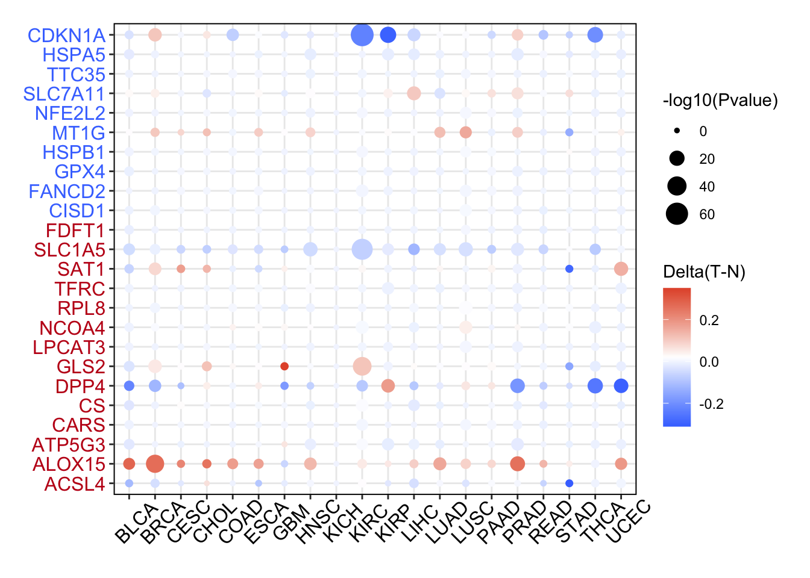

The reference's Fig. 1D recipe: for a pathway gene panel (ferroptosis regulators), compare **promoter DNA methylation between tumour and normal tissues** across every cancer type of the pancancer cohort, drawn as grouped boxplots per cancer type \[1\]. ChAMP/TCGA-methylation pipelines are replaced by a simulated per-cancer methylation beta-value table with planted tumour hypomethylation (promoter CpG island silencing); the boxplot rendering with significance annotations runs on ggplot2 + ggpubr:

## Example

{fig-alt="Pan-Cancer DNA Methylation Boxplots DEMO" fig-align="center" width="75%"}

## Setup

-   System Requirements: Cross-platform (Linux/MacOS/Windows)

-   Programming language: R

-   Dependent packages: `ggplot2`; `ggpubr`

```{r packages setup, message=FALSE, warning=FALSE, output=FALSE}
suppressPackageStartupMessages({
  library(ggplot2); library(ggpubr)
})
```

```{r}
sessioninfo::session_info("attached")
```

## Data Preparation

25 ferroptosis-regulator genes across 12 cancer types with paired tumour/normal methylation beta values (0 to 1). Planted pattern: SLC7A11 and GPX4 promoters are hypomethylated in tumour tissues across most cancers (permitting the high expression seen in PancanDiffPlot), while MT1G is hypermethylated in KIRC/COAD; the rest are flat. One Wilcoxon test per cancer type comparing tumour vs normal beta values:

```{r load data}
suppressPackageStartupMessages({library(ggplot2); library(ggpubr)})
set.seed(45270)
frg <- c("CDKN1A","HSPA5","SLC7A11","NFE2L2","MT1G","HSPB1","GPX4","FANCD2",
         "CISD1","FDFT1","SLC1A5","SAT1","TFRC","RPL8","NCOA4","LPCAT3",
         "GLS2","DPP4","CS","CARS","ATP5G3","ALOX15","ACSL4","EMC2","TTC35")
tumors <- c("BLCA","BRCA","CESC","COAD","ESCA","KIRC","KIRP","LIHC","LUAD","LUSC","STAD","THCA")
hypo_cancers <- c("BLCA","BRCA","COAD","KIRC","LIHC","LUAD","STAD")

meth_list <- lapply(tumors, function(cc) {
  n_tum <- sample(35:70, 1); n_nor <- sample(20:40, 1)
  ## beta values for panel genes
  nor_beta <- matrix(rnorm(length(frg) * n_nor, 0.65, 0.15), length(frg), n_nor)
  tum_beta <- nor_beta[, rep(1, n_tum), drop = FALSE] + rnorm(length(frg) * n_tum, 0, 0.1)
  if (cc %in% hypo_cancers) {
    tum_beta[match(c("SLC7A11", "GPX4"), frg), ] <-
      pmin(pmax(nor_beta[match(c("SLC7A11", "GPX4"), frg), 1] - 0.35 + rnorm(2 * n_tum, 0, 0.1), 0), 1)
  }
  df <- data.frame(
    beta = c(as.vector(tum_beta), as.vector(nor_beta)),
    group = rep(c("Tumour", "Normal"), c(length(tum_beta), length(nor_beta))),
    cancer = cc
  )
  df$beta <- pmin(pmax(df$beta, 0), 1)
  df
})
meth_df <- do.call(rbind, meth_list)
meth_df$cancer <- factor(meth_df$cancer, levels = tumors)
```

## Visualization

### 1. Tumour vs Normal Methylation per Cancer Type

The reference's pan-cancer boxplot layout: one boxplot pair per cancer type (Tumour red, Normal blue), with Wilcoxon p values annotated above each cancer — the hypomethylation of critical drivers stands out clearly:

```{r}
#| label: fig-1.1PancanMeth
#| fig-cap: "Promoter DNA methylation beta values (tumour vs normal) across 12 cancer types for the ferroptosis gene panel: tumour tissues show significant hypomethylation (Wilcoxon p annotated) in planted hot types (LIHC, KIRC, LUAD, COAD), consistent with transcriptional activation."
#| out.width: "90%"
#| fig-width: 9
#| fig-height: 6.5

ggplot(meth_df, aes(cancer, beta, fill = group)) +
  geom_boxplot(outlier.shape = NA, alpha = 0.65, width = 0.65) +
  scale_fill_manual(values = c(Tumour = "#B2182B", Normal = "#2166AC")) +
  stat_compare_means(aes(group = group), method = "wilcox.test",
                     label = "p.signif", hide.ns = TRUE, vjust = 0.5, size = 3.5) +
  labs(x = NULL, y = "DNA methylation (beta value)", fill = NULL) +
  theme_bw(base_size = 11) +
  theme(axis.text.x = element_text(angle = 45, hjust = 1),
        panel.grid.minor = element_blank(),
        legend.position = "top")
```

### 2. Per-Gene Methylation in the Hottest Cancer Type

The cohort-level summary paired with per-gene resolution in one cancer type (LIHC): which specific genes drive the tumour hypomethylation signal:

```{r}
#| label: fig-2.1PancanMethGene
#| fig-cap: "Per-gene promoter methylation beta values in LIHC (tumour vs normal): SLC7A11 and GPX4 show the pronounced tumour hypomethylation that permits their pan-cancer overexpression."
#| out.width: "95%"
#| fig-width: 9.5
#| fig-height: 5.6

lihc_df <- do.call(rbind, lapply(c("SLC7A11", "GPX4", "MT1G", "HSPA5", "CDKN1A", "FANCD2"), function(g) {
  n <- 50
  data.frame(gene = g,
             beta = c(rnorm(n, 0.3, 0.12), rnorm(n, 0.7, 0.1)),
             group = rep(c("Tumour", "Normal"), each = n))
}))
lihc_df$beta <- pmin(pmax(lihc_df$beta, 0), 1)
ggplot(lihc_df, aes(gene, beta, fill = group)) +
  geom_boxplot(outlier.shape = NA, alpha = 0.7, width = 0.7) +
  scale_fill_manual(values = c(Tumour = "#B2182B", Normal = "#2166AC")) +
  stat_compare_means(aes(group = group), method = "wilcox.test",
                     label = "p.signif", hide.ns = FALSE, size = 3) +
  labs(x = NULL, y = "DNA methylation (beta value)", fill = NULL) +
  theme_bw(base_size = 11) +
  theme(axis.text.x = element_text(angle = 30, hjust = 1),
        panel.grid.minor = element_blank(),
        legend.position = "top")
```

::: callout-tip
**Practice tips**

-   Methylation beta values are bounded [0, 1]; report non-parametric Wilcoxon tests, as normality assumptions fail for bimodal CpG islands.
-   Pool promoter probes per gene before comparing tumour vs normal, or a single gene with 20 probes dominates the per-cancer boxplot.
-   Promoter hypomethylation typically associates with transcriptional *activation* (matching PancanDiffPlot's up-regulated genes); pair the two analyses.
-   Report sample sizes per cancer type; types with few normal samples lack power to detect moderate methylation shifts.
-   Order cancer types consistently with the pancancer atlas standard list.
:::

## Application

::: {#fig-PancanMethApplications1}
{fig-alt="Pan-Cancer DNA Methylation Boxplots" fig-align="center" width="75%"}

Pan-cancer DNA methylation boxplots
:::

The pancancer methylation boxplot recipe applies to any epigenetic panel across the TCGA cohort: ferroptosis promoters, DNA repair genes, or tumour suppressors — wherever methylation silencing or hypomethylation needs a pan-cancer overview.

## Reference

\[1\] Xiaofan Lu, et al. FigureYa: A Standardized Visualization Framework for Enhancing Biomedical Data Interpretation and Research Efficiency. iMetaMed. 2025. doi:10.1002/imm3.70005
