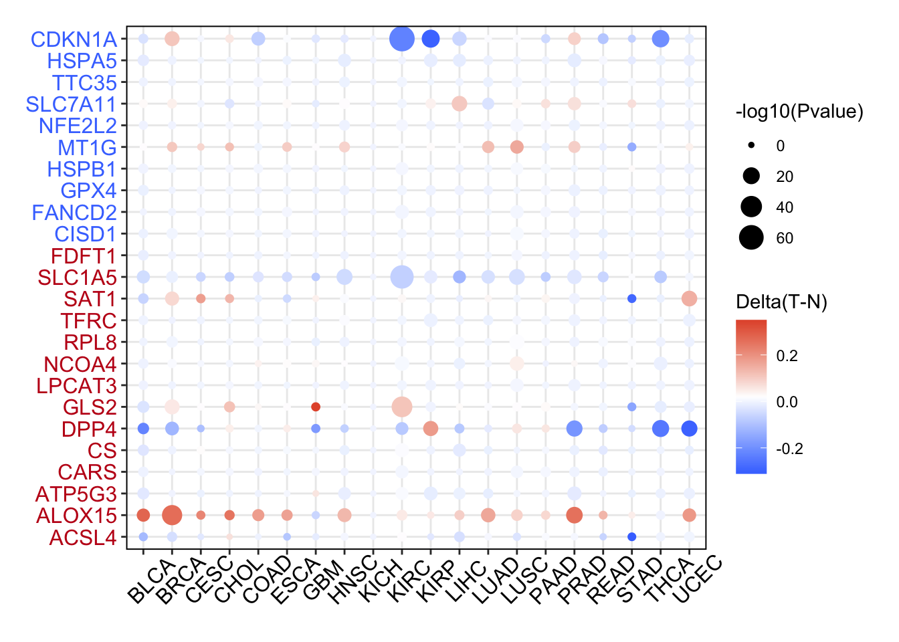

参考的 Fig. 1D 配方：对通路基因面板（铁死亡调控基因），在泛癌队列的每个癌种中比较**启动子 DNA 甲基化在肿瘤与正常组织间的差异**，画成逐癌种分组箱线图 \[1\]。ChAMP/TCGA 甲基化管线由带植入肿瘤低甲基化的模拟逐癌种甲基化 beta 值表替代；带显著性注释的箱线图在 ggplot2 + ggpubr 上运行：

## Example

{fig-alt="泛癌 DNA 甲基化箱线图 DEMO" fig-align="center" width="60%"}

## Setup

-   系统要求：跨平台（Linux/MacOS/Windows）

-   编程语言：R

-   依赖包：`ggplot2`; `ggpubr`

```{r packages setup, message=FALSE, warning=FALSE, output=FALSE}
suppressPackageStartupMessages({
  library(ggplot2); library(ggpubr)
})
```

```{r}
sessioninfo::session_info("attached")
```

## 数据准备

25 个铁死亡调控基因跨 12 个癌种，带配对的肿瘤/正常甲基化 beta 值（0 到 1）。植入模式：SLC7A11 与 GPX4 启动子在多数癌症的肿瘤组织中低甲基化（允许 PancanDiffPlot 中见到的高表达）、MT1G 在 KIRC/COAD 中高甲基化；其余平坦。逐癌种一个 Wilcoxon 检验比较肿瘤 vs 正常 beta 值：

```{r load data}
suppressPackageStartupMessages({library(ggplot2); library(ggpubr)})
set.seed(45270)
frg <- c("CDKN1A","HSPA5","SLC7A11","NFE2L2","MT1G","HSPB1","GPX4","FANCD2",
         "CISD1","FDFT1","SLC1A5","SAT1","TFRC","RPL8","NCOA4","LPCAT3",
         "GLS2","DPP4","CS","CARS","ATP5G3","ALOX15","ACSL4","EMC2","TTC35")
tumors <- c("BLCA","BRCA","CESC","COAD","ESCA","KIRC","KIRP","LIHC","LUAD","LUSC","STAD","THCA")
hypo_cancers <- c("BLCA","BRCA","COAD","KIRC","LIHC","LUAD","STAD")

meth_list <- lapply(tumors, function(cc) {
  n_tum <- sample(35:70, 1); n_nor <- sample(20:40, 1)
  ## beta values for panel genes
  nor_beta <- matrix(rnorm(length(frg) * n_nor, 0.65, 0.15), length(frg), n_nor)
  tum_beta <- nor_beta[, rep(1, n_tum), drop = FALSE] + rnorm(length(frg) * n_tum, 0, 0.1)
  if (cc %in% hypo_cancers) {
    tum_beta[match(c("SLC7A11", "GPX4"), frg), ] <-
      pmin(pmax(nor_beta[match(c("SLC7A11", "GPX4"), frg), 1] - 0.35 + rnorm(2 * n_tum, 0, 0.1), 0), 1)
  }
  df <- data.frame(
    beta = c(as.vector(tum_beta), as.vector(nor_beta)),
    group = rep(c("Tumour", "Normal"), c(length(tum_beta), length(nor_beta))),
    cancer = cc
  )
  df$beta <- pmin(pmax(df$beta, 0), 1)
  df
})
meth_df <- do.call(rbind, meth_list)
meth_df$cancer <- factor(meth_df$cancer, levels = tumors)
```

## Visualization

### 逐癌种肿瘤 vs 正常甲基化

参考的泛癌箱线图版式：每癌种一对箱线（肿瘤红、正常蓝），每个癌种上方标注 Wilcoxon p——关键驱动因子的低甲基化一目了然：

```{r}
#| label: fig-1.1PancanMeth
#| fig-cap: "12 个癌种中铁死亡基因面板的启动子 DNA 甲基化 beta 值（肿瘤 vs 正常）：植入的热门类型（LIHC、KIRC、LUAD、COAD）中肿瘤组织呈现显著低甲基化（标注 Wilcoxon p），与转录激活一致。"
#| out.width: "90%"
#| fig-width: 9
#| fig-height: 6.5

ggplot(meth_df, aes(cancer, beta, fill = group)) +
  geom_boxplot(outlier.shape = NA, alpha = 0.65, width = 0.65) +
  scale_fill_manual(values = c(Tumour = "#B2182B", Normal = "#2166AC")) +
  stat_compare_means(aes(group = group), method = "wilcox.test",
                     label = "p.signif", hide.ns = TRUE, vjust = 0.5, size = 3.5) +
  labs(x = NULL, y = "DNA methylation (beta value)", fill = NULL) +
  theme_bw(base_size = 11) +
  theme(axis.text.x = element_text(angle = 45, hjust = 1),
        panel.grid.minor = element_blank(),
        legend.position = "top")
```

### 最热癌种内的逐基因甲基化

队列级汇总与最热癌种（LIHC）内逐基因分辨率配对：识别驱动肿瘤低甲基化的具体基因：

```{r}
#| label: fig-2.1PancanMethGene
#| fig-cap: "LIHC 中逐基因的启动子甲基化 beta 值（肿瘤 vs 正常）：SLC7A11 和 GPX4 呈现显著的肿瘤低甲基化，支持其泛癌过表达。"
#| out.width: "95%"
#| fig-width: 9.5
#| fig-height: 5.6

lihc_df <- do.call(rbind, lapply(c("SLC7A11", "GPX4", "MT1G", "HSPA5", "CDKN1A", "FANCD2"), function(g) {
  n <- 50
  data.frame(gene = g,
             beta = c(rnorm(n, 0.3, 0.12), rnorm(n, 0.7, 0.1)),
             group = rep(c("Tumour", "Normal"), each = n))
}))
lihc_df$beta <- pmin(pmax(lihc_df$beta, 0), 1)
ggplot(lihc_df, aes(gene, beta, fill = group)) +
  geom_boxplot(outlier.shape = NA, alpha = 0.7, width = 0.7) +
  scale_fill_manual(values = c(Tumour = "#B2182B", Normal = "#2166AC")) +
  stat_compare_means(aes(group = group), method = "wilcox.test",
                     label = "p.signif", hide.ns = FALSE, size = 3) +
  labs(x = NULL, y = "DNA methylation (beta value)", fill = NULL) +
  theme_bw(base_size = 11) +
  theme(axis.text.x = element_text(angle = 30, hjust = 1),
        panel.grid.minor = element_blank(),
        legend.position = "top")
```


## 应用场景

::: {{#fig-PancanMethApplications1}}
{fig-alt="泛癌 DNA 甲基化箱线图" fig-align="center" width="60%"}

泛癌 DNA 甲基化箱线图
:::

泛癌甲基化箱线图配方适用于 TCGA 队列的任何表观遗传面板：铁死亡启动子、DNA 修复基因、或抑癌基因——凡甲基化沉默或低甲基化需要泛癌总览处。

## 参考文献

\[1\] Xiaofan Lu, et al. FigureYa: A Standardized Visualization Framework for Enhancing Biomedical Data Interpretation and Research Efficiency. iMetaMed. 2025. doi:10.1002/imm3.70005
