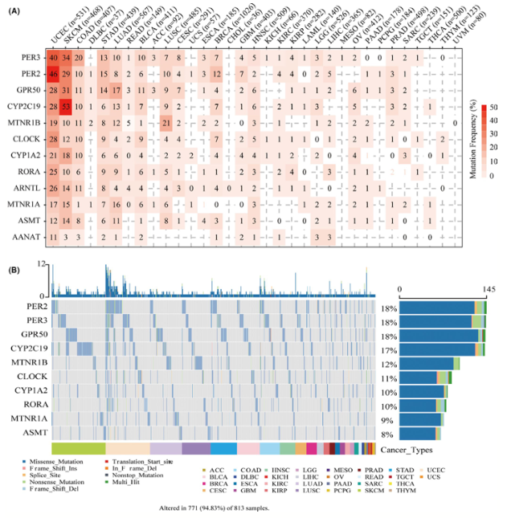

The reference's Fig. 2 oncoplot: for a panel of pathway genes (melanogenesis/melatonergic regulators), display the **somatic mutation frequency and variant types** across cancer types or sample cohorts, paired with a mutation frequency bar chart and a variant-class breakdown \[1\]. Maftools/GenVisR produce the reference input; here a mutation matrix and cohort annotations are simulated directly, and the oncoplot summary (mutation frequency bars + variant breakdown) runs on ggplot2 + ComplexHeatmap:

## Example

{fig-alt="Pan-Cancer Somatic Mutation Landscape DEMO" fig-align="center" width="75%"></p>

## Setup

-   System Requirements: Cross-platform (Linux/MacOS/Windows)

-   Programming language: R

-   Dependent packages: `ggplot2`; `ComplexHeatmap`

```{r packages setup, message=FALSE, warning=FALSE, output=FALSE}
suppressPackageStartupMessages({
  library(ggplot2); library(ComplexHeatmap)
})
```

```{r}
sessioninfo::session_info("attached")
```

## Data Preparation

16 pathway genes × 120 samples. Somatic mutation classes (missense, nonsense, frameshift del, splice site, multi-hit) are assigned with planted frequencies (some genes mutated in 25-40% of samples, others flat). A mutation frequency barplot and an oncoplot matrix summarize the landscape:

```{r load data}
suppressPackageStartupMessages({library(ggplot2); library(ComplexHeatmap)})
set.seed(46276)
genes <- sprintf("MELATONIN%02d", 1:16)
n_sam <- 120
sams <- sprintf("S%03d", 1:n_sam)
mut_classes <- c("Missense", "Nonsense", "Frame_Shift_Del", "Splice_Site", "Multi_Hit")

mut_mat <- matrix("", length(genes), n_sam, dimnames = list(genes, sams))
mut_probs <- c(0.38, 0.32, 0.28, 0.22, 0.18, 0.15, rep(0.04, 10))
for (i in seq_along(genes)) {
  p_mut <- mut_probs[i]
  has_mut <- runif(n_sam) < p_mut
  if (any(has_mut)) {
    mut_mat[i, has_mut] <- sample(mut_classes, sum(has_mut), TRUE,
                                  prob = c(0.6, 0.15, 0.12, 0.08, 0.05))
  }
}
## frequency per gene
freq_df <- data.frame(
  gene = genes,
  pct = rowSums(mut_mat != "") / n_sam * 100
)
freq_df <- freq_df[order(freq_df$pct, decreasing = TRUE), ]
freq_df$gene <- factor(freq_df$gene, levels = freq_df$gene)
```

## Visualization

### 1. Mutation Frequency Bar Chart

The reference's Fig. 2A: bar chart of mutation frequency per gene across the cohort, with values labelled above each bar:

```{r}
#| label: fig-1.1SnvFreq
#| fig-cap: "Somatic mutation frequency (%) of pathway regulators across 120 samples: the top recurrently mutated genes exceed 30% frequency, while tail genes show low mutation rates."
#| out.width: "85%"
#| fig-width: 8
#| fig-height: 5

ggplot(freq_df, aes(gene, pct)) +
  geom_col(fill = "#4472C4", width = 0.7) +
  geom_text(aes(label = sprintf("%.1f%%", pct)), vjust = -0.4, size = 2.8) +
  scale_y_continuous(limits = c(0, max(freq_df$pct) * 1.15)) +
  labs(x = NULL, y = "Mutation frequency (%)") +
  theme_bw(base_size = 11) +
  theme(axis.text.x = element_text(angle = 45, hjust = 1),
        panel.grid.minor = element_blank())
```

### 2. Mutation Oncoplot (Variant Types)

The reference's Fig. 2B: oncoplot matrix where each cell is coloured by variant class (Missense, Nonsense, Frameshift del, etc.) with sidebar frequency bars:

```{r}
#| label: fig-2.1SnvOncoplot
#| fig-cap: "Somatic mutation oncoplot showing variant distribution across 120 samples (columns) and pathway genes (rows): colours encode variant class (Missense, Nonsense, Frame_Shift_Del, Splice_Site, Multi_Hit)."
#| out.width: "95%"
#| fig-width: 9.5
#| fig-height: 6.5

alter_fun <- list(
  background = function(x, y, w, h) grid::grid.rect(x, y, w - unit(0.5, "mm"), h - unit(0.5, "mm"), gp = grid::gpar(fill = "#EEEEEE", col = NA)),
  Missense = function(x, y, w, h) grid::grid.rect(x, y, w - unit(0.5, "mm"), h - unit(0.5, "mm"), gp = grid::gpar(fill = "#E41A1C", col = NA)),
  Nonsense = function(x, y, w, h) grid::grid.rect(x, y, w - unit(0.5, "mm"), h - unit(0.5, "mm"), gp = grid::gpar(fill = "#377EB8", col = NA)),
  Frame_Shift_Del = function(x, y, w, h) grid::grid.rect(x, y, w - unit(0.5, "mm"), h - unit(0.5, "mm"), gp = grid::gpar(fill = "#4DAF4A", col = NA)),
  Splice_Site = function(x, y, w, h) grid::grid.rect(x, y, w - unit(0.5, "mm"), h - unit(0.5, "mm"), gp = grid::gpar(fill = "#984EA3", col = NA)),
  Multi_Hit = function(x, y, w, h) grid::grid.rect(x, y, w - unit(0.5, "mm"), h - unit(0.5, "mm"), gp = grid::gpar(fill = "#FF7F00", col = NA))
)
col_pal <- c(Missense = "#E41A1C", Nonsense = "#377EB8",
             Frame_Shift_Del = "#4DAF4A", Splice_Site = "#984EA3",
             Multi_Hit = "#FF7F00")

oncoPrint(mut_mat[as.character(freq_df$gene), ],
          alter_fun = alter_fun, col = col_pal,
          column_title = "Somatic Mutation Landscape (Oncoplot)",
          show_column_names = FALSE,
          row_names_side = "left",
          pct_side = "right")
```

::: callout-tip
**Practice tips**

-   Order oncoplot rows by mutation frequency (descending) so the most altered drivers lead the visual hierarchy.
-   Use a consistent colour palette for variant classes across all oncoplots in a publication (e.g. red for missense, blue for nonsense).
-   `oncoPrint()` in `ComplexHeatmap` expects a matrix of semicolon-separated alteration strings per cell; empty strings denote wild-type.
-   Pair the oncoplot with a simple mutation-frequency barplot for readability when sample counts are large.
-   State the variant classification rules (e.g. MAF definitions) in the methods; oncoplots hide filtering thresholds unless stated.
:::

## Application

::: {#fig-PancanSnvApplications1}
{fig-alt="Pan-Cancer Somatic Mutation Landscape" fig-align="center" width="75%"}

Pan-cancer somatic mutation landscape
:::

Somatic mutation oncoplots apply to any targeted gene panel or whole-exome cohort: pathway drivers, drug resistance mutations, or tumor suppressor screens — wherever mutation frequency and co-occurrence matter.

## Reference

\[1\] Xiaofan Lu, et al. Festival of Standardized Biomedical Visualizations: Pan-Cancer SNV Landscape. iMetaMed. 2025. doi:10.1002/imm3.70005
