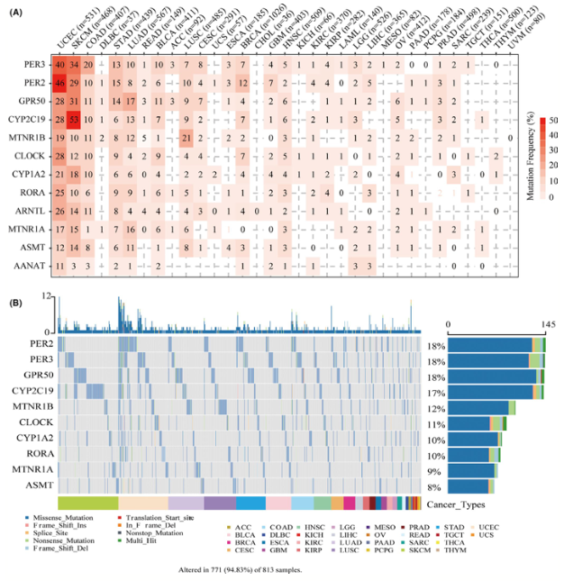

参考的 Fig. 2 oncoplot：对通路基因面板（黑色素生成/褪黑素调控子），在癌种或样本队列间展示**单核苷酸变异（SNV）频率与变异类型**，配以突变频率条形图和变异类别 breakdown \[\1\]。Maftools/GenVisR 产出参考输入；此处直接模拟突变矩阵与队列注释，oncoplot 汇总（突变频率条 + 变异 breakdown）在 ggplot2 + ComplexHeatmap 上运行：

## Example

{fig-alt="泛癌体细胞突变景观 DEMO" fig-align="center" width="60%"}

## Setup

-   系统要求：跨平台（Linux/MacOS/Windows）

-   编程语言：R

-   依赖包：`ggplot2`; `ComplexHeatmap`

```{r packages setup, message=FALSE, warning=FALSE, output=FALSE}
suppressPackageStartupMessages({
  library(ggplot2); library(ComplexHeatmap)
})
```

```{r}
sessioninfo::session_info("attached")
```

## 数据准备

16 个通路基因 × 120 样本。体细胞突变类别（错义、无义、移码缺失、剪接位点、多重命中）按植入频率分配（部分基因在 25-40% 样本中突变、其余平坦）。突变频率条形图与 oncoplot 矩阵汇总：

```{r load data}
suppressPackageStartupMessages({library(ggplot2); library(ComplexHeatmap)})
set.seed(46276)
genes <- sprintf("MELATONIN%02d", 1:16)
n_sam <- 120
sams <- sprintf("S%03d", 1:n_sam)
mut_classes <- c("Missense", "Nonsense", "Frame_Shift_Del", "Splice_Site", "Multi_Hit")

mut_mat <- matrix("", length(genes), n_sam, dimnames = list(genes, sams))
mut_probs <- c(0.38, 0.32, 0.28, 0.22, 0.18, 0.15, rep(0.04, 10))
for (i in seq_along(genes)) {
  p_mut <- mut_probs[i]
  has_mut <- runif(n_sam) < p_mut
  if (any(has_mut)) {
    mut_mat[i, has_mut] <- sample(mut_classes, sum(has_mut), TRUE,
                                  prob = c(0.6, 0.15, 0.12, 0.08, 0.05))
  }
}
## frequency per gene
freq_df <- data.frame(
  gene = genes,
  pct = rowSums(mut_mat != "") / n_sam * 100
)
freq_df <- freq_df[order(freq_df$pct, decreasing = TRUE), ]
freq_df$gene <- factor(freq_df$gene, levels = freq_df$gene)
```

## Visualization

### 突变频率条形图

参考的 Fig. 2A：队列中每基因突变频率的条形图、每条上方印刷数值：

```{r}
#| label: fig-1.1SnvFreq
#| fig-cap: "120 个样本中通路调节子的体细胞突变频率（%）：顶部复发突变基因超过 30% 频率，尾部基因突变率较低。"
#| out.width: "85%"
#| fig-width: 8
#| fig-height: 5

ggplot(freq_df, aes(gene, pct)) +
  geom_col(fill = "#4472C4", width = 0.7) +
  geom_text(aes(label = sprintf("%.1f%%", pct)), vjust = -0.4, size = 2.8) +
  scale_y_continuous(limits = c(0, max(freq_df$pct) * 1.15)) +
  labs(x = NULL, y = "Mutation frequency (%)") +
  theme_bw(base_size = 11) +
  theme(axis.text.x = element_text(angle = 45, hjust = 1),
        panel.grid.minor = element_blank())
```

### 突变 Oncoplot（变异类型）

参考的 Fig. 2B：oncoplot 矩阵、每格按变异类（错义、无义、移码缺失等）着色、侧边附频率条：

```{r}
#| label: fig-2.1SnvOncoplot
#| fig-cap: "展示 120 个样本（列）与通路基因（行）间变异分布的体细胞突变 oncoplot：颜色编码变异类（错义、无义、移码缺失、剪接位点、多重命中）。"
#| out.width: "95%"
#| fig-width: 9.5
#| fig-height: 6.5

alter_fun <- list(
  background = function(x, y, w, h) grid::grid.rect(x, y, w - unit(0.5, "mm"), h - unit(0.5, "mm"), gp = grid::gpar(fill = "#EEEEEE", col = NA)),
  Missense = function(x, y, w, h) grid::grid.rect(x, y, w - unit(0.5, "mm"), h - unit(0.5, "mm"), gp = grid::gpar(fill = "#E41A1C", col = NA)),
  Nonsense = function(x, y, w, h) grid::grid.rect(x, y, w - unit(0.5, "mm"), h - unit(0.5, "mm"), gp = grid::gpar(fill = "#377EB8", col = NA)),
  Frame_Shift_Del = function(x, y, w, h) grid::grid.rect(x, y, w - unit(0.5, "mm"), h - unit(0.5, "mm"), gp = grid::gpar(fill = "#4DAF4A", col = NA)),
  Splice_Site = function(x, y, w, h) grid::grid.rect(x, y, w - unit(0.5, "mm"), h - unit(0.5, "mm"), gp = grid::gpar(fill = "#984EA3", col = NA)),
  Multi_Hit = function(x, y, w, h) grid::grid.rect(x, y, w - unit(0.5, "mm"), h - unit(0.5, "mm"), gp = grid::gpar(fill = "#FF7F00", col = NA))
)
col_pal <- c(Missense = "#E41A1C", Nonsense = "#377EB8",
             Frame_Shift_Del = "#4DAF4A", Splice_Site = "#984EA3",
             Multi_Hit = "#FF7F00")

oncoPrint(mut_mat[as.character(freq_df$gene), ],
          alter_fun = alter_fun, col = col_pal,
          column_title = "Somatic Mutation Landscape (Oncoplot)",
          show_column_names = FALSE,
          row_names_side = "left",
          pct_side = "right")
```


## 应用场景

::: {{#fig-PancanSnvApplications1}}
{fig-alt="泛癌体细胞突变景观" fig-align="center" width="60%"}

泛癌体细胞突变景观
:::

体细胞突变 oncoplot 适用于任何靶向基因面板或全外显子队列：通路驱动子、耐药突变、或抑癌基因筛查——凡突变频率与共现性重要处。

## 参考文献

\[1\] Xiaofan Lu, et al. Festival of Standardized Biomedical Visualizations: Pan-Cancer SNV Landscape. iMetaMed. 2025. doi:10.1002/imm3.70005
