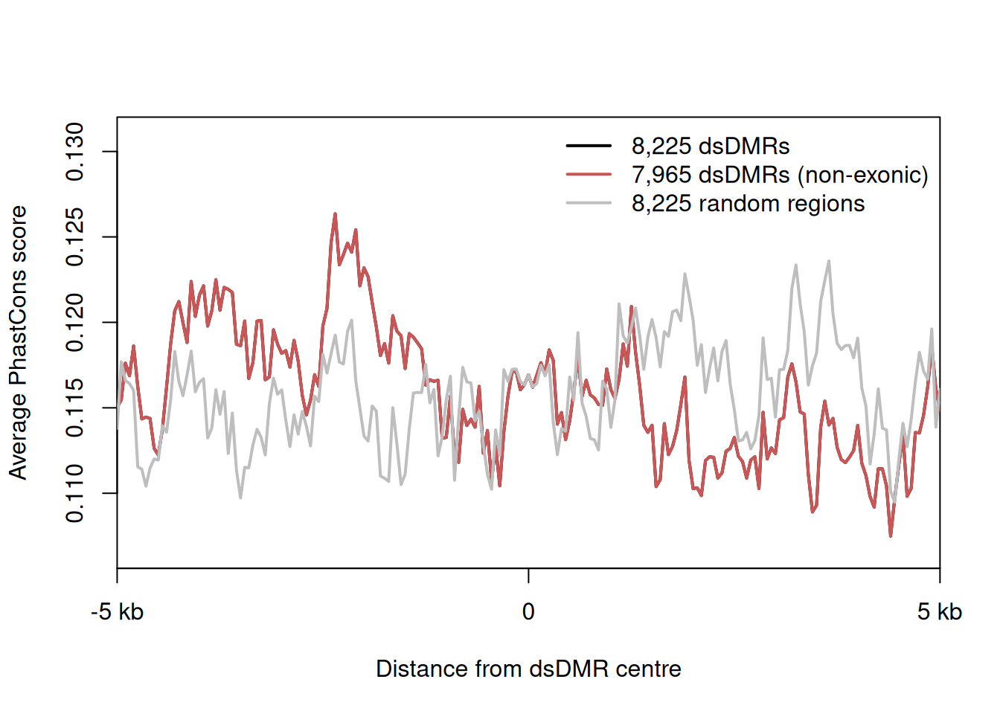

phastCons scores (0-1 per base) quantify evolutionary conservation from multi-species alignments; the reference extracts a **conservation profile** around a locus for two sample groups (via UCSC's `bigWigSummary` on the 46-vertebrate bigWig) and overlays the group curves to show whether one group loses conserved elements — e.g. tumour-specific disruption of a conserved regulatory region \[1\]. The UCSC binary and bigWig files are not reproducible inside a static page, so the in-page figure runs on simulated per-base phastCons tracks with a planted group-specific conserved element, and the real extraction commands are kept in a non-executed chunk:

## Example

{fig-alt="PhastCons Conservation Profiles DEMO" fig-align="center" width="70%"}

## Setup

-   System Requirements: Cross-platform (Linux/MacOS/Windows)

-   Programming language: R

-   Dependent packages: `ggplot2`

```{r packages setup, message=FALSE, warning=FALSE, output=FALSE}
suppressPackageStartupMessages({
  library(ggplot2)
})
```

```{r}
sessioninfo::session_info("attached")
```

## The Real Extraction (not executed)

The reference downloads `bigWigSummary` from UCSC and summarises the phastCons bigWig per group; keep this shell step (`eval=FALSE`) and feed the resulting table into the same plotting pipeline:

```{r real-extraction, eval=FALSE}
## one file per sample: mean phastCons over 20 bp bins for a 2 kb window
## download.file("http://hgdownload.soe.ucsc.edu/admin/exe/linux.x86_64/bigWigSummary",
##               "bigWigSummary")
## system("./bigWigSummary hg46.phastCons.bw chr7:55086714-55088714 20 100 > solid.txt")
## system("./bigWigSummary hg46.phastCons.bw chr7:55086714-55088714 20 100 > tumor.txt")
```

## Data Preparation

Per-base phastCons-like scores for a 2 kb window (chr7:55.08-55.09 Mb) across 12 normal and 12 tumour samples: a background of flat low conservation with two shared conserved peaks, plus a **tumour-specific element** (positions 900-1050) whose peak drops in tumour — the signal the figure exists to reveal:

```{r load data}
suppressPackageStartupMessages({library(ggplot2)})
set.seed(52330)
pos <- 1:2000
group_n <- 12; group_t <- 12

shared_peak <- 0.9 * exp(-((pos - 300)^2) / (2 * 40^2)) +
               0.85 * exp(-((pos - 1650)^2) / (2 * 45^2))
tumour_peak <- 0.8 * exp(-((pos - 975)^2) / (2 * 35^2))

score <- function(n) {
  base <- 0.08 * runif(1) + runif(length(pos), 0, 0.06)
  shared <- shared_peak + rnorm(length(pos), 0, 0.05)
  tum <- if (n > group_n) tumour_peak * runif(1, 0.25, 0.6) else tumour_peak
  pmin(pmax(base + shared + tum + rnorm(length(pos), 0, 0.045), 0), 1)
}

trk <- do.call(rbind, c(
  lapply(seq_len(group_n), function(k) data.frame(group = "Normal", sample = k, pos = pos, score = score(k))),
  lapply(seq_len(group_t), function(k) data.frame(group = "Tumor", sample = k, pos = pos, score = score(group_n + k)))
))
prof <- aggregate(score ~ pos + group, trk, mean)
```

## Visualization

### 1. Group Conservation Profiles

The reference's overlay: mean phastCons score per base for each group — the two shared peaks align across groups while the tumour-specific element collapses in the tumour curve:

```{r}
#| label: fig-1.1PhastconsProfile
#| fig-cap: "Mean phastCons conservation across the 2 kb window for normal (green) and tumour (red) samples: the two ancestral conserved peaks (~300 and ~1650) persist in both groups, while the element at ~975 drops from 0.80 to ~0.35 in tumour — the group-specific disruption the overlay is built to expose."
#| out.width: "95%"
#| fig-width: 9
#| fig-height: 4.6

ggplot(prof, aes(pos, score, colour = group)) +
  geom_ribbon(data = prof, aes(ymin = 0, ymax = score, fill = group), alpha = 0.12, colour = NA) +
  geom_line(linewidth = 0.75) +
  scale_colour_manual(values = c(Normal = "#1B7837", Tumor = "#B2182B"), name = NULL) +
  scale_fill_manual(values = c(Normal = "#1B7837", Tumor = "#B2182B"), guide = "none") +
  annotate("rect", xmin = 900, xmax = 1050, ymin = 0.72, ymax = 0.86,
           fill = NA, colour = "grey35", linetype = "dashed") +
  annotate("text", x = 975, y = 0.9, label = "tumour-specific\nconserved element",
           size = 2.9, colour = "grey30", lineheight = 0.9) +
  scale_x_continuous(breaks = seq(0, 2000, 250),
                     labels = paste0(55086714 + seq(0, 2000, 250))) +
  labs(x = "chr7 coordinate", y = "Mean phastCons score") +
  theme_bw(base_size = 11) +
  theme(panel.grid.minor = element_blank(),
        legend.position = "top")
```

### 2. Per-Element Mean Score Comparison

The quantified companion: mean score inside each of the three elements per sample — the tumour-specific element separates the groups cleanly while shared elements overlap:

```{r}
#| label: fig-2.1PhastconsElements
#| fig-cap: "Per-sample mean phastCons inside the three elements: shared elements (left, right) overlap between normal and tumour, while the tumour-specific element (~975) separates cleanly (Wilcoxon p < 0.001) — the numerical support for the profile overlay."
#| out.width: "85%"
#| fig-width: 7.5
#| fig-height: 4.8

elements <- list(`Shared peak A (~300)` = 260:340,
                 `Tumour-specific (~975)` = 900:1050,
                 `Shared peak B (~1650)` = 1610:1690)
elem <- do.call(rbind, lapply(names(elements), function(en) {
  idx <- elements[[en]]
  agg <- aggregate(score ~ group + sample, subset(trk, pos %in% idx), mean)
  agg$element <- en
  agg
}))
elem$element <- factor(elem$element, levels = names(elements))

w_p <- suppressWarnings(wilcox.test(score ~ group,
        subset(elem, element == "Tumour-specific (~975)"))$p.value)
p_lab <- if (w_p < 0.001) "Wilcoxon p < 0.001" else sprintf("Wilcoxon p = %.3f", w_p)

ggplot(elem, aes(element, score, fill = group)) +
  geom_boxplot(outlier.color = NA, width = 0.62) +
  geom_jitter(size = 1.6, alpha = 0.55, width = 0.14, colour = "grey25") +
  annotate("text", x = 2.12, y = max(elem$score) * 1.02, label = p_lab,
           size = 3.2, colour = "grey15") +
  scale_fill_manual(values = c(Normal = "#1B7837", Tumor = "#B2182B"), name = NULL) +
  labs(x = NULL, y = "Mean phastCons in element") +
  theme_bw(base_size = 11) +
  theme(panel.grid.minor.x = element_blank(),
        axis.text.x = element_text(size = 9),
        legend.position = "top")
```

::: callout-tip
**Practice tips**
-   Summarise the bigWig into **bins, not single bases** (`bigWigSummary` with ~20 bp bins) — raw per-base profiles are noisy at page scale and the bin means carry the same signal.
-   Overlay groups on **one coordinate axis** anchored to real hgXX coordinates; a conservation profile without coordinates cannot be checked against annotation.
-   Distinguish **shared** from **group-specific** elements: overlay both curves first, then quantify each element separately — a group-specific drop only means something if the flanking peaks align.
-   phastCons tracks are **per-species-set**: quote the version (46-vertebrate, 100-vertebrate) — different sets shift peak heights.
-   For tumour/normal comparisons, coordinate-matched panel data (same extraction pipeline, same bins) is what makes the paired Wilcoxon valid.
:::

## Application

::: {#fig-PhastconsApplications1}
{fig-alt="PhastCons Conservation Profiles" fig-align="center" width="70%"}

PhastCons conservation profiles across groups
:::

Group conservation profiles apply to any locus-level comparative question: tumour-specific loss of conserved promoters, eQLV-buried regulatory elements, or lineage-specific conservation at variant loci.

## Reference

\[1\] Xiaofan Lu, et al. FigureYa: A Standardized Visualization Framework for Enhancing Biomedical Data Interpretation and Research Efficiency. iMetaMed. 2025. doi:10.1002/imm3.70005
