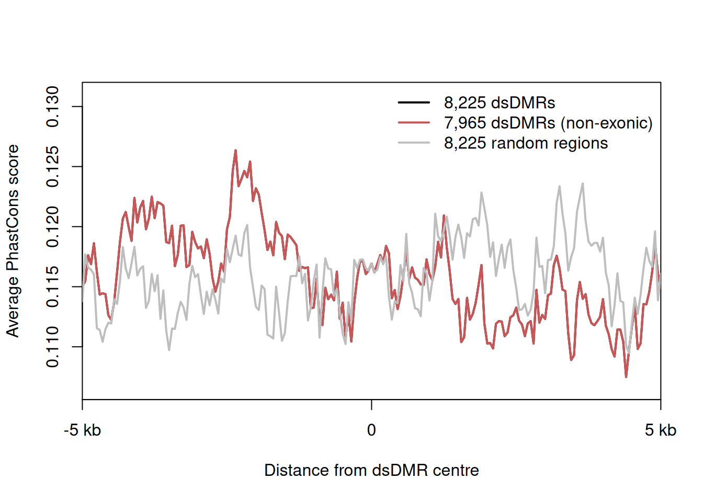

phastCons 分数（每碱基 0-1）从多物种比对量化进化保守性；参考流程对两组样本（经 UCSC `bigWigSummary` 从 46 物种 bigWig 提取）提取一个位点附近的**保守性谱**并叠加两组曲线，观察某组是否丢失了保守元件——例如肿瘤特异地破坏保守调控区 \[1\]。UCSC 二进制工具与 bigWig 文件无法在静态页面内复现，页内图形运行在模拟的逐碱基 phastCons 轨迹上（植入组特异保守元件），真实提取命令以未执行 chunk 保留：

## Example

{fig-alt="跨组 phastCons 保守性谱 DEMO" fig-align="center" width="70%"}

## Setup

-   系统要求：跨平台（Linux/MacOS/Windows）

-   编程语言：R

-   依赖包：`ggplot2`

```{r packages setup, message=FALSE, warning=FALSE, output=FALSE}
suppressPackageStartupMessages({
  library(ggplot2)
})
```

```{r}
sessioninfo::session_info("attached")
```

## 真实提取（不执行）

参考流程从 UCSC 下载 `bigWigSummary` 并按组汇总 phastCons bigWig；保留该 shell 步骤（`eval=FALSE`），把产出的表格接入同一绘图管线：

```{r real-extraction, eval=FALSE}
## one file per sample: mean phastCons over 20 bp bins for a 2 kb window
## download.file("http://hgdownload.soe.ucsc.edu/admin/exe/linux.x86_64/bigWigSummary",
##               "bigWigSummary")
## system("./bigWigSummary hg46.phastCons.bw chr7:55086714-55088714 20 100 > solid.txt")
## system("./bigWigSummary hg46.phastCons.bw chr7:55086714-55088714 20 100 > tumor.txt")
```

## 数据准备

chr7:55.08-55.09 Mb 的 2 kb 窗口、12 正常 + 12 肿瘤样本的逐碱基 phastCons 样分数：低保守背景上有两个共享保守峰，另有一个**肿瘤特异元件**（900-1050）其峰值在肿瘤中塌陷——即本图要揭示的信号：

```{r load data}
suppressPackageStartupMessages({library(ggplot2)})
set.seed(52330)
pos <- 1:2000
group_n <- 12; group_t <- 12

shared_peak <- 0.9 * exp(-((pos - 300)^2) / (2 * 40^2)) +
               0.85 * exp(-((pos - 1650)^2) / (2 * 45^2))
tumour_peak <- 0.8 * exp(-((pos - 975)^2) / (2 * 35^2))

score <- function(n) {
  base <- 0.08 * runif(1) + runif(length(pos), 0, 0.06)
  shared <- shared_peak + rnorm(length(pos), 0, 0.05)
  tum <- if (n > group_n) tumour_peak * runif(1, 0.25, 0.6) else tumour_peak
  pmin(pmax(base + shared + tum + rnorm(length(pos), 0, 0.045), 0), 1)
}

trk <- do.call(rbind, c(
  lapply(seq_len(group_n), function(k) data.frame(group = "Normal", sample = k, pos = pos, score = score(k))),
  lapply(seq_len(group_t), function(k) data.frame(group = "Tumor", sample = k, pos = pos, score = score(group_n + k)))
))
prof <- aggregate(score ~ pos + group, trk, mean)
```

## Visualization

### 1. 两组保守性谱叠加

参考的叠加图：每组每碱基的平均 phastCons 分数——两个共享峰在两组间对齐，而肿瘤特异元件在肿瘤曲线中塌陷：

```{r}
#| label: fig-1.1PhastconsProfile
#| fig-cap: "2 kb 窗口内正常（绿）与肿瘤（红）的平均 phastCons 保守性：两个祖先保守峰（~300 与 ~1650）在两组间保持，而 ~975 的元件在肿瘤中从 0.80 降至 ~0.35——叠加图要暴露的组特异破坏。"
#| out.width: "95%"
#| fig-width: 9
#| fig-height: 4.6

ggplot(prof, aes(pos, score, colour = group)) +
  geom_ribbon(data = prof, aes(ymin = 0, ymax = score, fill = group), alpha = 0.12, colour = NA) +
  geom_line(linewidth = 0.75) +
  scale_colour_manual(values = c(Normal = "#1B7837", Tumor = "#B2182B"), name = NULL) +
  scale_fill_manual(values = c(Normal = "#1B7837", Tumor = "#B2182B"), guide = "none") +
  annotate("rect", xmin = 900, xmax = 1050, ymin = 0.72, ymax = 0.86,
           fill = NA, colour = "grey35", linetype = "dashed") +
  annotate("text", x = 975, y = 0.9, label = "tumour-specific\nconserved element",
           size = 2.9, colour = "grey30", lineheight = 0.9) +
  scale_x_continuous(breaks = seq(0, 2000, 250),
                     labels = paste0(55086714 + seq(0, 2000, 250))) +
  labs(x = "chr7 coordinate", y = "Mean phastCons score") +
  theme_bw(base_size = 11) +
  theme(panel.grid.minor = element_blank(),
        legend.position = "top")
```

### 2. 逐元件平均分数比较

量化补充：每个样本在各元件内的平均分数——共享元件两组重叠、肿瘤特异元件干净分开：

```{r}
#| label: fig-2.1PhastconsElements
#| fig-cap: "三个元件的逐样本平均 phastCons：共享元件（左、右）两组重叠，而肿瘤特异元件（~975）干净分开（Wilcoxon p < 0.001）——谱叠加图的数值支撑。"
#| out.width: "85%"
#| fig-width: 7.5
#| fig-height: 4.8

elements <- list(`Shared peak A (~300)` = 260:340,
                 `Tumour-specific (~975)` = 900:1050,
                 `Shared peak B (~1650)` = 1610:1690)
elem <- do.call(rbind, lapply(names(elements), function(en) {
  idx <- elements[[en]]
  agg <- aggregate(score ~ group + sample, subset(trk, pos %in% idx), mean)
  agg$element <- en
  agg
}))
elem$element <- factor(elem$element, levels = names(elements))

w_p <- suppressWarnings(wilcox.test(score ~ group,
        subset(elem, element == "Tumour-specific (~975)"))$p.value)
p_lab <- if (w_p < 0.001) "Wilcoxon p < 0.001" else sprintf("Wilcoxon p = %.3f", w_p)

ggplot(elem, aes(element, score, fill = group)) +
  geom_boxplot(outlier.color = NA, width = 0.62) +
  geom_jitter(size = 1.6, alpha = 0.55, width = 0.14, colour = "grey25") +
  annotate("text", x = 2.12, y = max(elem$score) * 1.02, label = p_lab,
           size = 3.2, colour = "grey15") +
  scale_fill_manual(values = c(Normal = "#1B7837", Tumor = "#B2182B"), name = NULL) +
  labs(x = NULL, y = "Mean phastCons in element") +
  theme_bw(base_size = 11) +
  theme(panel.grid.minor.x = element_blank(),
        axis.text.x = element_text(size = 9),
        legend.position = "top")
```

::: callout-tip
**实践要点**
-   bigWig 按**分箱而非单碱基**汇总（`bigWigSummary` 取 ~20 bp 箱）——原始逐碱基谱在页面尺度噪声大，箱均值携带同样信号。
-   两组叠加用**同一坐标轴**并锚定真实 hgXX 坐标——没有坐标的保守性谱无法对照注释。
-   区分**共享**与**组特异**元件：先叠加两条曲线，再逐元件单独量化——只有侧翼峰对齐时组特异的下降才有意义。
-   phastCons 轨迹**依物种集合而定**：注明版本（46 物种、100 物种）——不同集合会移动峰高。
-   肿瘤/正常比较要坐标对齐的 panel 数据（同一提取管线、同一分箱），配对 Wilcoxon 才成立。
:::

## 应用场景

::: {#fig-PhastconsApplications1}
{fig-alt="跨组 phastCons 保守性谱" fig-align="center" width="70%"}

跨组 phastCons 保守性谱
:::

分组保守性谱适用于任何位点级比较问题：肿瘤特异的保守启动子丢失、被 eQLV 掩埋的调控元件、或变异位点的谱系特异保守性。

## 参考文献

\[1\] Xiaofan Lu, et al. FigureYa: A Standardized Visualization Framework for Enhancing Biomedical Data Interpretation and Research Efficiency. iMetaMed. 2025. doi:10.1002/imm3.70005
