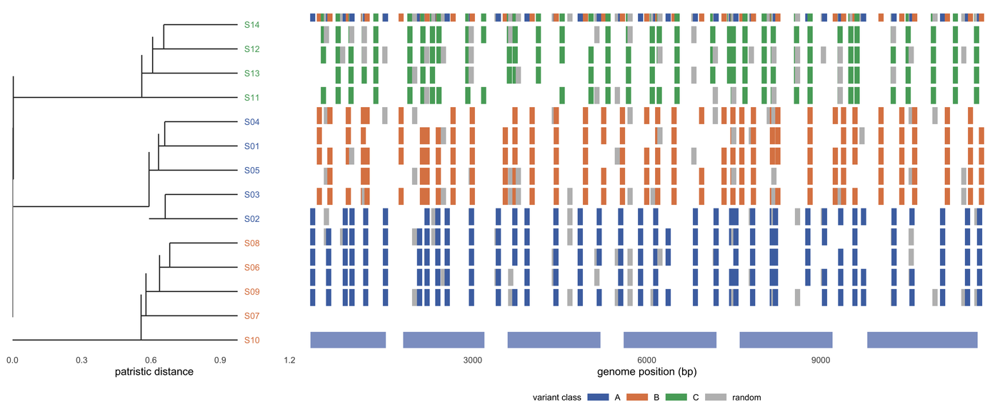

Phylogeny-plus-genome figures are the standard plate of pathogen genomic surveillance. Nextclade, Panoptes, Taxonium and Gingr all draw the same two objects — a tree and a genome-anchored matrix or track — and the only thing that makes the combination readable is that the leaf order is shared by construction \[1-3\]. A tree drawn by one tool and a matrix drawn by another, with leaves sorted alphabetically in one and by topology in the other, is the most common failure in this figure family.

This tutorial builds the tree, the mutation matrix, a circular metadata view and a per-clade variant density track from one simulated set of 14 genomes, so the leaf order is a single vector that every panel consumes.

## Example

{fig-alt="Phylogeny Genome Plot DEMO" fig-align="center" width="85%"}

An average-linkage tree of 14 pathogen genomes aligned to a mutation matrix and a six-gene model: each row is one tip, each mark a variant that genome carries, coloured by the clade the variant defines, with a top strip giving the variant class. Tree and matrix share one leaf-order vector, so rows cannot drift apart, and the six blue blocks are the gene bodies.

## Setup

-   System Requirements: Cross-platform (Linux/MacOS/Windows)

-   Programming language: R

-   Dependent packages: `ggplot2`; `dplyr`; `tidyr`; `patchwork`

```{r packages setup, message=FALSE, warning=FALSE, output=FALSE}
if (!requireNamespace("ggplot2", quietly = TRUE)) install.packages("ggplot2")
if (!requireNamespace("dplyr", quietly = TRUE)) install.packages("dplyr")
if (!requireNamespace("tidyr", quietly = TRUE)) install.packages("tidyr")
if (!requireNamespace("patchwork", quietly = TRUE)) install.packages("patchwork")

library(ggplot2)
library(dplyr)
library(tidyr)
library(patchwork)
```

```{r}
sessioninfo::session_info("attached")
```

## Data Preparation

Fourteen pathogen genomes, a 12 kb genome with six genes, and 150 variant sites; three clades contribute clade-specific variants and the rest are background.

```{r load data, message=FALSE, warning=FALSE}
set.seed(43521)

## 14 pathogen genomes, a 12 kb genome with six genes, and 150 variant sites.
## Three clades contribute clade-specific variants; the rest are background.
n_strain <- 14
strains <- sprintf("S%02d", 1:n_strain)
clade <- rep(c("A", "B", "C"), c(5, 5, 4))
genome_len <- 12000
genes <- data.frame(
  gene = c("g1", "g2", "g3", "g4", "g5", "g6"),
  start = c(200, 1800, 3600, 5600, 7600, 9800),
  end   = c(1500, 3200, 5200, 7200, 9200, 11700)
)
n_var <- 150
var_pos <- sort(sample(200:(genome_len - 200), n_var))
var_clade <- rep(c("A", "B", "C", "random"), length.out = n_var)

## ALT allele matrix: clade-specific variants are near-fixed in their clade,
## background variants appear at 25%.
snp <- matrix(0L, nrow = n_strain, ncol = n_var,
              dimnames = list(strains, paste0("v", seq_len(n_var))))
for (j in seq_len(n_var)) {
  snp[, j] <- if (var_clade[j] == "random") {
    rbinom(n_strain, 1, 0.25)
  } else {
    as.integer(clade == var_clade[j] & runif(n_strain) < 0.9)
  }
}

## Average-linkage tree from the binary variant distance.
hc <- hclust(dist(snp, method = "binary"), method = "average")
tip_order <- hc$order
n <- length(tip_order)
ypos <- setNames(seq_len(n), strains[tip_order])

## Convert the dendrogram to a segment table: leaves at x = root height, root
## at x = 0. The same table drives the rectangular and the circular tree.
mid_of <- function(node) {
  if (is.leaf(node)) return(unname(ypos[[attr(node, "label")]]))
  mean(c(mid_of(node[[1]]), mid_of(node[[2]])))
}
seg_from <- function(node, parent_h) {
  if (is.leaf(node)) {
    y <- ypos[[attr(node, "label")]]
    return(data.frame(x0 = parent_h, x1 = 0, y0 = y, y1 = y))
  }
  h <- attr(node, "height")
  c1 <- node[[1]]
  c2 <- node[[2]]
  m1 <- mid_of(c1)
  m2 <- mid_of(c2)
  rbind(seg_from(c1, h), seg_from(c2, h),
        data.frame(x0 = c(parent_h, h), x1 = c(h, h),
                   y0 = c(mid_of(node), m1), y1 = c(mid_of(node), m2)))
}
dend <- as.dendrogram(hc)
root_h <- attr(dend, "height")
seg <- seg_from(dend, root_h)
seg$x0 <- root_h - seg$x0
seg$x1 <- root_h - seg$x1

tip <- data.frame(strain = strains[tip_order], y = seq_len(n),
                  clade = clade[match(strains[tip_order], strains)])
pal_clade <- c(A = "#4c72b0", B = "#dd8452", C = "#55a868", random = "#bdbdbd")

## Long table of alleles that are present (ALT = 1), used by the matrix.
present <- as.data.frame(as.table(snp)) |>
  setNames(c("strain", "variant", "alt")) |>
  filter(alt == 1) |>
  mutate(pos = var_pos[as.integer(sub("v", "", variant))],
         y = ypos[as.character(strain)],
         vclade = var_clade[as.integer(sub("v", "", variant))])
```

## Visualization

### 1. Tree, Mutation Matrix and Gene Track on One Row Axis

Nextclade, Panoptes and Taxonium all make the same promise: every row of the matrix is a tip of the tree, and every column is a position in the genome \[1,2\]. That promise is only kept if the leaf order of the tree and the row order of the matrix are the **same object**. Here both are built from one `ypos` vector, so a change of topology cannot silently reorder one panel and not the other. The gene track below the matrix answers the question the matrix raises: which gene does a column of mutations fall in.

```{r}
#| label: fig-1TreeMutationMatrix
#| fig-cap: "Average-linkage tree of 14 pathogen genomes aligned to a mutation matrix and a six-gene model: each row is one tip, each mark is a variant carried by that genome, coloured by the clade the variant defines, and the top strip gives the variant class. The tree and the matrix share one leaf-order vector, so rows cannot drift apart; the six blue blocks are the gene bodies. All data are simulated."
#| out.width: "100%"
#| warning: false
#| message: false
#| fig-width: 10.5
#| fig-height: 4.4
#| fig-dpi: 300

p_tree <- ggplot() +
  geom_segment(data = seg, aes(x = x0, xend = x1, y = y0, yend = y1),
               linewidth = 0.4, colour = "#333333") +
  geom_text(data = tip, aes(root_h * 1.03, y, label = strain, colour = clade),
            hjust = 0, size = 2.3, show.legend = FALSE) +
  scale_colour_manual(values = pal_clade) +
  scale_x_continuous(limits = c(0, root_h * 1.26), expand = c(0, 0)) +
  ## Same y limits as the matrix panel, so rows align across the two plots.
  scale_y_continuous(limits = c(-1.7, n + 1.1), expand = c(0, 0)) +
  labs(x = "distance from root", y = NULL) +
  theme_minimal(base_size = 8) +
  theme(panel.grid = element_blank(), axis.text.y = element_blank(),
        axis.text.x = element_text(size = 6.4))

## The matrix is drawn as marks only where ALT is present. A full 0/1 tile grid
## would be mostly background and would bury the clade-specific columns.
p_mat <- ggplot() +
  geom_rect(data = present,
            aes(xmin = pos - 45, xmax = pos + 45, ymin = y - 0.42,
                ymax = y + 0.42, fill = vclade)) +
  geom_rect(data = data.frame(pos = var_pos, vclade = var_clade),
            aes(xmin = pos - 45, xmax = pos + 45, ymin = n + 0.65,
                ymax = n + 1.05, fill = vclade)) +
  geom_rect(data = genes, aes(xmin = start, xmax = end, ymin = -1.5, ymax = -0.7),
            fill = "#8da0cb") +
  scale_fill_manual(values = pal_clade, name = "variant class") +
  scale_x_continuous(expand = c(0.005, 0.005)) +
  scale_y_continuous(limits = c(-1.7, n + 1.1), expand = c(0, 0)) +
  labs(x = "genome position (bp)", y = NULL) +
  theme_minimal(base_size = 8) +
  theme(panel.grid = element_blank(), axis.text.y = element_blank(),
        legend.position = "bottom", legend.direction = "horizontal",
        legend.key.height = unit(0.22, "cm"),
        legend.text = element_text(size = 6.4),
        legend.title = element_text(size = 6.6),
        axis.text.x = element_text(size = 6.4))

p_tree + p_mat + plot_layout(widths = c(1, 2.4))
```

### 2. Circular Tree With Metadata Rings

When the tip count grows, a rectangular tree either shrinks the matrix or runs off the page, and the circular layout trades one kind of readability for another: topology is harder to read, but tips and metadata fit. The rings encode attributes that are not in the tree — here region as colour and collection year as a continuous fill — and they are only interpretable if the tip order is identical between the tree and the rings. That is why both are drawn from the same segment table rather than from two separate tool runs \[2,3\].

```{r}
#| label: fig-2CircularTree
#| fig-cap: "The same tree in polar coordinates: radial lines are branches, arcs are the connectors, and the tip order is unchanged. Two outer tracks add metadata — region as an inner colour arc and collection year as outer points on a continuous colour scale — plus clade-coloured tip dots. The rings are legible only because they use the same tip positions as the tree."
#| out.width: "100%"
#| warning: false
#| message: false
#| fig-width: 5.6
#| fig-height: 5.6
#| fig-dpi: 300

## The same segment table in polar coordinates: a branch with constant y is a
## radial line, and a connector with constant x is an arc.
theta <- function(y) -pi / 2 + 2 * pi * (y - 0.5) / n
polar <- list()
for (i in seq_len(nrow(seg))) {
  s <- seg[i, ]
  if (s$y0 == s$y1) {
    a <- theta(s$y0)
    polar[[length(polar) + 1]] <- data.frame(
      x = c(s$x0 * cos(a), s$x1 * cos(a)),
      y = c(s$x0 * sin(a), s$x1 * sin(a)), g = paste0("r", i))
  } else {
    a <- seq(theta(s$y0), theta(s$y1), length.out = 20)
    polar[[length(polar) + 1]] <- data.frame(
      x = s$x0 * cos(a), y = s$x0 * sin(a), g = paste0("a", i))
  }
}
pseg <- do.call(rbind, polar)

meta <- data.frame(
  strain = strains, clade = clade,
  region = rep(c("East", "West", "South", "North"), length.out = n_strain),
  year = sample(2019:2028, n_strain, replace = TRUE)
) |>
  mutate(y = ypos[strain], ang = theta(y),
         lab_ang = ifelse(cos(ang) >= 0, ang * 180 / pi, ang * 180 / pi + 180),
         hjust = ifelse(cos(ang) >= 0, 0, 1))

r_ring <- root_h * 1.14
r_year <- root_h * 1.24
r_lab <- root_h * 1.40
arc <- function(a0, a1, r, npts = 12) {
  a <- seq(a0, a1, length.out = npts)
  data.frame(x = r * cos(a), y = r * sin(a))
}
reg <- do.call(rbind, lapply(seq_len(nrow(meta)), function(i) {
  d <- arc(meta$ang[i] - pi / n * 0.8, meta$ang[i] + pi / n * 0.8, r_ring)
  d$g <- paste0("g", i)
  d$region <- meta$region[i]
  d
}))
year_pts <- data.frame(x = r_year * cos(meta$ang), y = r_year * sin(meta$ang),
                       year = meta$year)

ggplot() +
  geom_path(data = pseg, aes(x, y, group = g), linewidth = 0.35, colour = "#333333") +
  geom_point(data = meta, aes(root_h * 1.04 * cos(ang), root_h * 1.04 * sin(ang),
                              colour = clade), size = 1.3) +
  geom_path(data = reg, aes(x, y, group = g, colour = region),
            linewidth = 2.1, lineend = "butt") +
  geom_point(data = year_pts, aes(x, y, fill = year), shape = 21, size = 2.0,
             colour = "white", stroke = 0.15) +
  geom_text(data = meta, aes(r_lab * cos(ang), r_lab * sin(ang), label = strain,
                             angle = lab_ang, hjust = hjust),
            size = 1.9, colour = "#333333") +
  scale_colour_manual(
    values = c(pal_clade, East = "#1b9e77", West = "#d95f02",
               South = "#7570b3", North = "#e7298a"), name = NULL) +
  scale_fill_gradientn(colours = c("#fde0c5", "#fd8d3c", "#7f2704"), name = NULL) +
  coord_equal(clip = "off") +
  theme_void(base_size = 9) +
  theme(legend.position = "none")
```

### 3. Variant Density by Clade Along the Genome

The mutation matrix says where variants are; the density track says which clade they belong to and whether they cluster. Clade-specific peaks over a gene are the visual signature of diversifying selection or of a recombination breakpoint, but the lines must be read against the clade sizes and against the gene model, or a peak in a large clade will look like a peak in the genome \[4,5\]. The shaded gene bodies are the reference frame; without them a density line has no annotation.

```{r}
#| label: fig-3VariantDensity
#| fig-cap: "ALT alleles per 250 bp bin along the genome, one line per clade (A, B, C). Clade-specific peaks are visible where a lineage accumulates variants, and the shaded gene bodies give the annotation frame. The counts are raw, not normalised by clade size, so the relative height of two lines reflects both the number of genomes and the number of variants."
#| out.width: "100%"
#| warning: false
#| message: false
#| fig-width: 10
#| fig-height: 3.4
#| fig-dpi: 300

## ALT allele counts per 250 bp bin, one line per clade. Gene bodies are shaded
## for orientation; the lines are not normalised by clade size.
dens <- as.data.frame(as.table(snp)) |>
  setNames(c("strain", "variant", "alt")) |>
  mutate(pos = var_pos[as.integer(sub("v", "", variant))],
         clade = clade[match(strain, strains)]) |>
  mutate(bin = cut(pos, breaks = seq(0, genome_len, by = 250), include.lowest = TRUE)) |>
  group_by(clade, bin) |>
  summarise(n_alt = sum(alt), .groups = "drop") |>
  mutate(mid = as.numeric(sub("\\((.*),.*", "\\1", bin)) + 125)

ggplot(dens, aes(mid, n_alt, colour = clade)) +
  geom_rect(data = genes, aes(xmin = start, xmax = end, ymin = -Inf, ymax = Inf),
            inherit.aes = FALSE, fill = "#8da0cb", alpha = 0.10) +
  geom_line(linewidth = 0.5) +
  geom_point(size = 0.45) +
  scale_colour_manual(values = pal_clade, name = "clade") +
  labs(x = "genome position (bp)", y = "ALT alleles per 250 bp bin") +
  theme_minimal(base_size = 8) +
  theme(panel.grid.minor = element_blank(), legend.position = "bottom",
        legend.direction = "horizontal", legend.key.height = unit(0.2, "cm"),
        legend.text = element_text(size = 6.4),
        legend.title = element_text(size = 6.6))
```

::: callout-tip
**Practice tips**

-   Build the tree and the matrix from one leaf-order vector. Re-sorting either panel after the fact is the most common way to produce a figure whose rows do not mean what the caption says.
-   State the distance model and the linkage (here binary distance, average linkage). A tree drawn from a different distance is a different claim, not a redraw of the same one.
-   Put the gene model on the same axis as the variant matrix. A mutation column without a gene context cannot be interpreted, and a separate legend forces the reader to do the alignment by eye.
-   Mark which variants define a clade and which are background. Without that distinction, a dense matrix looks like a mutator phenotype rather than a lineage.
-   Circle layouts need a stated tip order and a readable ring legend. If the rings come from a separate metadata join, check the join before the layout: a silent reorder is invisible in the finished figure.
-   Normalise density by clade size when the claim is about rate. A clade with twice as many genomes will produce twice as many ALT counts at the same per-genome rate.
:::

## Application

Phylogeny-plus-genome figures are the working plates of pathogen surveillance: **tree + mutation matrix** for clade definition and transmission tracking, **circular tree + metadata rings** for large-sample overviews, and **per-clade variant density** for locating selection and recombination signals. All three share one tree and one variant set here; any inconsistency in leaf order changes the conclusion without changing the picture.

## Reference
\[1\] Aksamentov I, Roemer C, Hodcroft EB, Neher RA. Nextclade: clade assignment, mutation calling and quality control for viral genomes. J Open Source Softw. 2021;6(67):3773. doi:10.21105/joss.03773

\[2\] Hadfield J, Megill C, Bell SM, et al. Nextstrain: real-time tracking of pathogen evolution. Bioinformatics. 2018;34(23):4121-4123. doi:10.1093/bioinformatics/bty407

\[3\] Sanderson T. Taxonium: a web-based tool for exploring large phylogenetic trees. eLife. 2022;11:e82392. doi:10.7554/eLife.82392

\[4\] Vauterin P, Jeffery B, Miles A, Amato R, Hart L, Wright I, et al. Panoptes: web-based exploration of large scale genome variation data. Bioinformatics. 2017;33(20):3243-3249. doi:10.1093/bioinformatics/btx410

\[5\] Croucher NJ, Page AJ, Connor TR, et al. Rapid phylogenetic analysis of large samples of recombinant bacterial whole genome sequences using Gubbins. Nucleic Acids Res. 2015;43(3):e15. doi:10.1093/nar/gku1196
