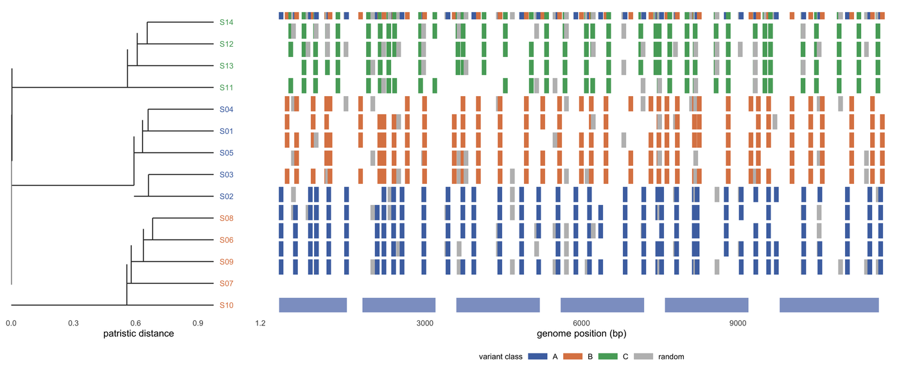

系统发生 + 基因组联合图是病原基因组监测的标准图版。Nextclade、Panoptes、Taxonium 与 Gingr 画的都是同样的两个对象——一棵树，以及一个锚定在基因组上的矩阵或轨道——而让这种组合可读的唯一条件是叶序在构造上就是共享的 \[1-3\]。用工具 A 画树、工具 B 画矩阵，一边按字母排序、另一边按拓扑排序，是这一类图最常见的错误。

本教程用同一套 14 个模拟基因组生成树、突变矩阵、环形元数据视图与按分支的变异密度轨道，叶序是一个被所有面板共同使用的向量。

## 示例

{fig-alt="系统发育基因组图 DEMO" fig-align="center" width="85%"}

14 个病原基因组的平均连接聚类树，与突变矩阵和六基因模型对齐：每行一个末端，每个标记是该基因组携带的变异，颜色表示该变异所定义的支系，顶部条带给出版本类别。树与矩阵共用同一个叶序向量，因此行不会错位；六个蓝色区块是基因本体。

## 环境配置

-   系统要求： 跨平台（Linux/MacOS/Windows）

-   编程语言：R

-   依赖包：`ggplot2`；`dplyr`；`tidyr`；`patchwork`

```{r packages setup, message=FALSE, warning=FALSE, output=FALSE}
if (!requireNamespace("ggplot2", quietly = TRUE)) install.packages("ggplot2")
if (!requireNamespace("dplyr", quietly = TRUE)) install.packages("dplyr")
if (!requireNamespace("tidyr", quietly = TRUE)) install.packages("tidyr")
if (!requireNamespace("patchwork", quietly = TRUE)) install.packages("patchwork")

library(ggplot2)
library(dplyr)
library(tidyr)
library(patchwork)
```

```{r}
sessioninfo::session_info("attached")
```

## 数据准备

14 个病原基因组、一段 12 kb 基因组（6 个基因）与 150 个变异位点；三个分支各自贡献分支特异变异，其余为背景变异。

```{r load data, message=FALSE, warning=FALSE}
set.seed(43521)

## 14 pathogen genomes, a 12 kb genome with six genes, and 150 variant sites.
## Three clades contribute clade-specific variants; the rest are background.
n_strain <- 14
strains <- sprintf("S%02d", 1:n_strain)
clade <- rep(c("A", "B", "C"), c(5, 5, 4))
genome_len <- 12000
genes <- data.frame(
  gene = c("g1", "g2", "g3", "g4", "g5", "g6"),
  start = c(200, 1800, 3600, 5600, 7600, 9800),
  end   = c(1500, 3200, 5200, 7200, 9200, 11700)
)
n_var <- 150
var_pos <- sort(sample(200:(genome_len - 200), n_var))
var_clade <- rep(c("A", "B", "C", "random"), length.out = n_var)

## ALT allele matrix: clade-specific variants are near-fixed in their clade,
## background variants appear at 25%.
snp <- matrix(0L, nrow = n_strain, ncol = n_var,
              dimnames = list(strains, paste0("v", seq_len(n_var))))
for (j in seq_len(n_var)) {
  snp[, j] <- if (var_clade[j] == "random") {
    rbinom(n_strain, 1, 0.25)
  } else {
    as.integer(clade == var_clade[j] & runif(n_strain) < 0.9)
  }
}

## Average-linkage tree from the binary variant distance.
hc <- hclust(dist(snp, method = "binary"), method = "average")
tip_order <- hc$order
n <- length(tip_order)
ypos <- setNames(seq_len(n), strains[tip_order])

## Convert the dendrogram to a segment table: leaves at x = root height, root
## at x = 0. The same table drives the rectangular and the circular tree.
mid_of <- function(node) {
  if (is.leaf(node)) return(unname(ypos[[attr(node, "label")]]))
  mean(c(mid_of(node[[1]]), mid_of(node[[2]])))
}
seg_from <- function(node, parent_h) {
  if (is.leaf(node)) {
    y <- ypos[[attr(node, "label")]]
    return(data.frame(x0 = parent_h, x1 = 0, y0 = y, y1 = y))
  }
  h <- attr(node, "height")
  c1 <- node[[1]]
  c2 <- node[[2]]
  m1 <- mid_of(c1)
  m2 <- mid_of(c2)
  rbind(seg_from(c1, h), seg_from(c2, h),
        data.frame(x0 = c(parent_h, h), x1 = c(h, h),
                   y0 = c(mid_of(node), m1), y1 = c(mid_of(node), m2)))
}
dend <- as.dendrogram(hc)
root_h <- attr(dend, "height")
seg <- seg_from(dend, root_h)
seg$x0 <- root_h - seg$x0
seg$x1 <- root_h - seg$x1

tip <- data.frame(strain = strains[tip_order], y = seq_len(n),
                  clade = clade[match(strains[tip_order], strains)])
pal_clade <- c(A = "#4c72b0", B = "#dd8452", C = "#55a868", random = "#bdbdbd")

## Long table of alleles that are present (ALT = 1), used by the matrix.
present <- as.data.frame(as.table(snp)) |>
  setNames(c("strain", "variant", "alt")) |>
  filter(alt == 1) |>
  mutate(pos = var_pos[as.integer(sub("v", "", variant))],
         y = ypos[as.character(strain)],
         vclade = var_clade[as.integer(sub("v", "", variant))])
```

## 可视化

### 1. 树、突变矩阵与基因轨道共享同一行轴

Nextclade、Panoptes 与 Taxonium 都给出同一个承诺：矩阵的每一行是树的一个末端，每一列是基因组上的一个位置 \[1,2\]。这个承诺只有在树的叶序与矩阵的行序是**同一个对象**时才成立。这里两者都由同一个 `ypos` 向量生成，因此拓扑变化不可能悄悄只重排其中一个面板。矩阵下方的基因轨道回答矩阵提出的问题：这一列突变落在哪个基因里。

```{r}
#| label: fig-1TreeMutationMatrix
#| fig-cap: "14 个病原基因组的平均连接树，与突变矩阵和六基因模型对齐：每行一个末端，每个标记是该基因组携带的一个变异，按该变异所定义的分支着色，顶部条带给出变异类别。树与矩阵共享同一个叶序向量，因此行不会错位；六个蓝色块是基因体。全部数据为模拟数据。全部数据为模拟数据。"
#| out.width: "100%"
#| warning: false
#| message: false
#| fig-width: 10.5
#| fig-height: 4.4
#| fig-dpi: 300

p_tree <- ggplot() +
  geom_segment(data = seg, aes(x = x0, xend = x1, y = y0, yend = y1),
               linewidth = 0.4, colour = "#333333") +
  geom_text(data = tip, aes(root_h * 1.03, y, label = strain, colour = clade),
            hjust = 0, size = 2.3, show.legend = FALSE) +
  scale_colour_manual(values = pal_clade) +
  scale_x_continuous(limits = c(0, root_h * 1.26), expand = c(0, 0)) +
  ## 与矩阵面板使用完全相同的 y 范围，保证两个面板的行逐一对齐。
  scale_y_continuous(limits = c(-1.7, n + 1.1), expand = c(0, 0)) +
  labs(x = "distance from root", y = NULL) +
  theme_minimal(base_size = 8) +
  theme(panel.grid = element_blank(), axis.text.y = element_blank(),
        axis.text.x = element_text(size = 6.4))

## The matrix is drawn as marks only where ALT is present. A full 0/1 tile grid
## would be mostly background and would bury the clade-specific columns.
p_mat <- ggplot() +
  geom_rect(data = present,
            aes(xmin = pos - 45, xmax = pos + 45, ymin = y - 0.42,
                ymax = y + 0.42, fill = vclade)) +
  geom_rect(data = data.frame(pos = var_pos, vclade = var_clade),
            aes(xmin = pos - 45, xmax = pos + 45, ymin = n + 0.65,
                ymax = n + 1.05, fill = vclade)) +
  geom_rect(data = genes, aes(xmin = start, xmax = end, ymin = -1.5, ymax = -0.7),
            fill = "#8da0cb") +
  scale_fill_manual(values = pal_clade, name = "variant class") +
  scale_x_continuous(expand = c(0.005, 0.005)) +
  scale_y_continuous(limits = c(-1.7, n + 1.1), expand = c(0, 0)) +
  labs(x = "genome position (bp)", y = NULL) +
  theme_minimal(base_size = 8) +
  theme(panel.grid = element_blank(), axis.text.y = element_blank(),
        legend.position = "bottom", legend.direction = "horizontal",
        legend.key.height = unit(0.22, "cm"),
        legend.text = element_text(size = 6.4),
        legend.title = element_text(size = 6.6),
        axis.text.x = element_text(size = 6.4))

p_tree + p_mat + plot_layout(widths = c(1, 2.4))
```

### 2. 带元数据环的环形树

当末端数量增大时，矩形树要么压缩矩阵、要么超出页面；环形版式用一种可读性换取另一种：拓扑更难读，但末端与元数据放得下。环上编码的是树里没有的属性——这里地区作颜色、采样年份作连续填充——而它们只有在树的叶序与环的顺序完全一致时才可解读。这正是两者都由同一张片段表生成、而不是分别跑两个工具的原因 \[2,3\]。

```{r}
#| label: fig-2CircularTree
#| fig-cap: "同一棵树在极坐标中的呈现：径向线是分支，弧线是连接线，叶序保持不变。两条外轨补充元数据——内层为地区颜色的弧段，外层为按连续色标着色的采样年份点——外加按分支着色的末端点。这些环之所以可读，只是因为它们使用与树相同的末端位置。"
#| out.width: "100%"
#| warning: false
#| message: false
#| fig-width: 5.6
#| fig-height: 5.6
#| fig-dpi: 300

## The same segment table in polar coordinates: a branch with constant y is a
## radial line, and a connector with constant x is an arc.
theta <- function(y) -pi / 2 + 2 * pi * (y - 0.5) / n
polar <- list()
for (i in seq_len(nrow(seg))) {
  s <- seg[i, ]
  if (s$y0 == s$y1) {
    a <- theta(s$y0)
    polar[[length(polar) + 1]] <- data.frame(
      x = c(s$x0 * cos(a), s$x1 * cos(a)),
      y = c(s$x0 * sin(a), s$x1 * sin(a)), g = paste0("r", i))
  } else {
    a <- seq(theta(s$y0), theta(s$y1), length.out = 20)
    polar[[length(polar) + 1]] <- data.frame(
      x = s$x0 * cos(a), y = s$x0 * sin(a), g = paste0("a", i))
  }
}
pseg <- do.call(rbind, polar)

meta <- data.frame(
  strain = strains, clade = clade,
  region = rep(c("East", "West", "South", "North"), length.out = n_strain),
  year = sample(2019:2028, n_strain, replace = TRUE)
) |>
  mutate(y = ypos[strain], ang = theta(y),
         lab_ang = ifelse(cos(ang) >= 0, ang * 180 / pi, ang * 180 / pi + 180),
         hjust = ifelse(cos(ang) >= 0, 0, 1))

r_ring <- root_h * 1.14
r_year <- root_h * 1.24
r_lab <- root_h * 1.40
arc <- function(a0, a1, r, npts = 12) {
  a <- seq(a0, a1, length.out = npts)
  data.frame(x = r * cos(a), y = r * sin(a))
}
reg <- do.call(rbind, lapply(seq_len(nrow(meta)), function(i) {
  d <- arc(meta$ang[i] - pi / n * 0.8, meta$ang[i] + pi / n * 0.8, r_ring)
  d$g <- paste0("g", i)
  d$region <- meta$region[i]
  d
}))
year_pts <- data.frame(x = r_year * cos(meta$ang), y = r_year * sin(meta$ang),
                       year = meta$year)

ggplot() +
  geom_path(data = pseg, aes(x, y, group = g), linewidth = 0.35, colour = "#333333") +
  geom_point(data = meta, aes(root_h * 1.04 * cos(ang), root_h * 1.04 * sin(ang),
                              colour = clade), size = 1.3) +
  geom_path(data = reg, aes(x, y, group = g, colour = region),
            linewidth = 2.1, lineend = "butt") +
  geom_point(data = year_pts, aes(x, y, fill = year), shape = 21, size = 2.0,
             colour = "white", stroke = 0.15) +
  geom_text(data = meta, aes(r_lab * cos(ang), r_lab * sin(ang), label = strain,
                             angle = lab_ang, hjust = hjust),
            size = 1.9, colour = "#333333") +
  scale_colour_manual(
    values = c(pal_clade, East = "#1b9e77", West = "#d95f02",
               South = "#7570b3", North = "#e7298a"), name = NULL) +
  scale_fill_gradientn(colours = c("#fde0c5", "#fd8d3c", "#7f2704"), name = NULL) +
  coord_equal(clip = "off") +
  theme_void(base_size = 9) +
  theme(legend.position = "none")
```

### 3. 各分支沿基因组的变异密度

突变矩阵回答变异在哪里；密度轨道回答它们属于哪个分支、是否成簇。落在某个基因上的分支特异峰，是多样化选择或重组断点的视觉特征，但读线时必须同时对照分支大小与基因模型，否则大分支里的峰会看起来像整个基因组里的峰 \[4,5\]。阴影基因体是参照系；没有它，一条密度线没有任何注释。

```{r}
#| label: fig-3VariantDensity
#| fig-cap: "沿基因组每 250 bp 分箱的 ALT 等位基因数，每个分支一条线（A、B、C）。分支特异峰出现在该谱系累积变异的位置，阴影基因体提供注释参照。计数是原始值，未按分支大小归一化，因此两条线的相对高度同时反映基因组数量与变异数量。"
#| out.width: "100%"
#| warning: false
#| message: false
#| fig-width: 10
#| fig-height: 3.4
#| fig-dpi: 300

## ALT allele counts per 250 bp bin, one line per clade. Gene bodies are shaded
## for orientation; the lines are not normalised by clade size.
dens <- as.data.frame(as.table(snp)) |>
  setNames(c("strain", "variant", "alt")) |>
  mutate(pos = var_pos[as.integer(sub("v", "", variant))],
         clade = clade[match(strain, strains)]) |>
  mutate(bin = cut(pos, breaks = seq(0, genome_len, by = 250), include.lowest = TRUE)) |>
  group_by(clade, bin) |>
  summarise(n_alt = sum(alt), .groups = "drop") |>
  mutate(mid = as.numeric(sub("\\((.*),.*", "\\1", bin)) + 125)

ggplot(dens, aes(mid, n_alt, colour = clade)) +
  geom_rect(data = genes, aes(xmin = start, xmax = end, ymin = -Inf, ymax = Inf),
            inherit.aes = FALSE, fill = "#8da0cb", alpha = 0.10) +
  geom_line(linewidth = 0.5) +
  geom_point(size = 0.45) +
  scale_colour_manual(values = pal_clade, name = "clade") +
  labs(x = "genome position (bp)", y = "ALT alleles per 250 bp bin") +
  theme_minimal(base_size = 8) +
  theme(panel.grid.minor = element_blank(), legend.position = "bottom",
        legend.direction = "horizontal", legend.key.height = unit(0.2, "cm"),
        legend.text = element_text(size = 6.4),
        legend.title = element_text(size = 6.6))
```

::: callout-tip
**实践要点**

-   用同一个叶序向量生成树和矩阵。事后重排任何一个面板，是让图的每一行不再代表图注所说含义的最常见做法。
-   写明距离模型与连接方式（此处为二元距离、平均连接）。用不同距离画出的树是另一个结论，而不是同一结论的重画。
-   把基因模型放在与突变矩阵相同的轴上。没有基因上下文的突变列无法解释，而另设图例会迫使读者用眼睛做对齐。
-   标明哪些变异定义分支、哪些是背景。没有这个区分，密集的矩阵看起来像突变表型，而不是一个谱系。
-   环形版式必须声明叶序并提供可读的环图例。如果环来自另一次元数据连接，先检查连接本身：静默的重排在一张成品图里是看不见的。
-   当主张是关于速率时，按分支大小归一化密度。基因组数量翻倍的分支，在相同单位基因组速率下会产生翻倍的 ALT 计数。
:::

## 应用

系统发生 + 基因组图是病原监测的日常工作图：**树 + 突变矩阵**用于分支定义与传播链追踪，**环形树 + 元数据环**用于大规模样本总览，**分支变异密度**用于定位选择与重组信号。三张图共用同一棵树与同一套变异，任何叶序不一致都会让结论在无声中改变。

## 参考资料
\[1\] Aksamentov I, Roemer C, Hodcroft EB, Neher RA. Nextclade: clade assignment, mutation calling and quality control for viral genomes. J Open Source Softw. 2021;6(67):3773. doi:10.21105/joss.03773

\[2\] Hadfield J, Megill C, Bell SM, et al. Nextstrain: real-time tracking of pathogen evolution. Bioinformatics. 2018;34(23):4121-4123. doi:10.1093/bioinformatics/bty407

\[3\] Sanderson T. Taxonium: a web-based tool for exploring large phylogenetic trees. eLife. 2022;11:e82392. doi:10.7554/eLife.82392

\[4\] Vauterin P, Jeffery B, Miles A, Amato R, Hart L, Wright I, et al. Panoptes: web-based exploration of large scale genome variation data. Bioinformatics. 2017;33(20):3243-3249. doi:10.1093/bioinformatics/btx410

\[5\] Croucher NJ, Page AJ, Connor TR, et al. Rapid phylogenetic analysis of large samples of recombinant bacterial whole genome sequences using Gubbins. Nucleic Acids Res. 2015;43(3):e15. doi:10.1093/nar/gku1196
