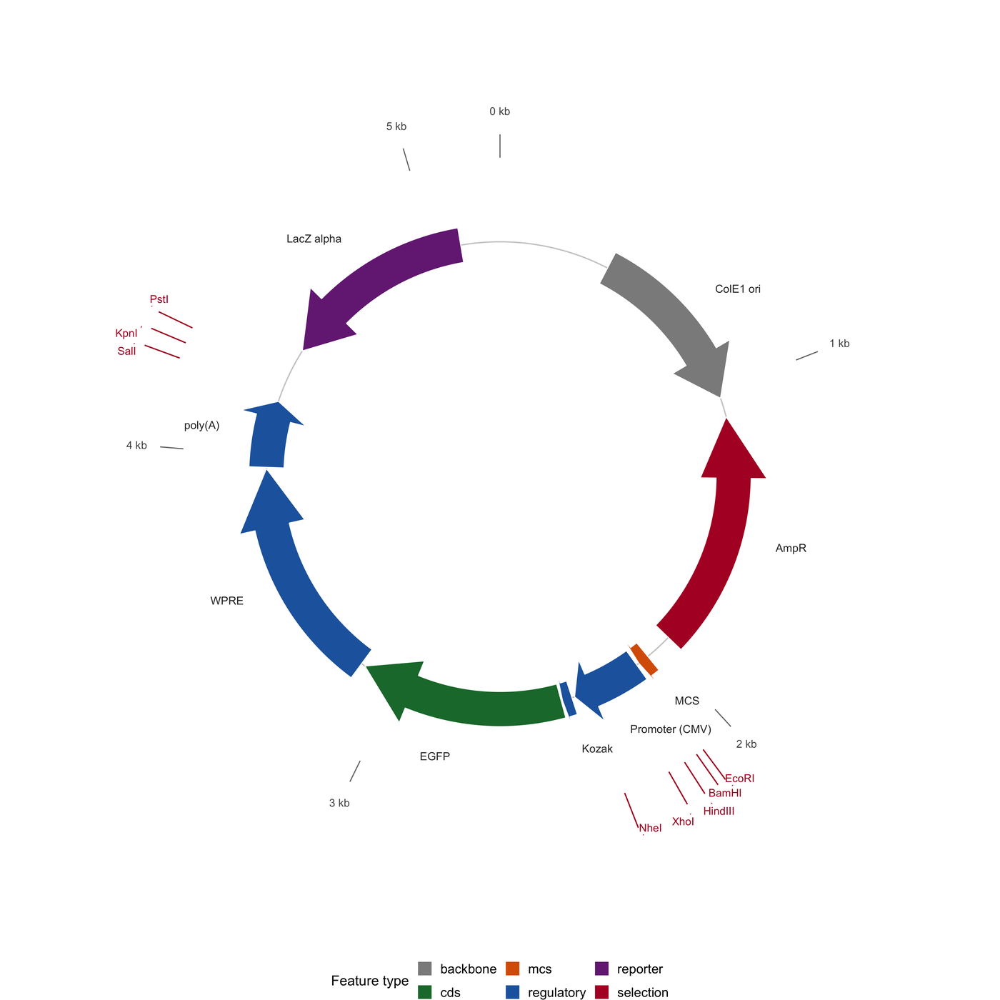

质粒图谱是分子克隆的施工图：圆周即序列，特征箭头表示编码区及其方向，外圈刻度环标出酶切位点。它像蓝图一样被阅读——箭头方向告诉你基因在哪条链上，环上的位置告诉你引物结合在哪里，位点列表告诉你哪套酶切能把构建体线性化。

本教程用纯 ggplot2 重建 SnapGene / ApE / **plasmapR** 的版式 \[1,2\]。特征来自类 GenBank 的特征表，酶切位点通过对真实识别序列的匹配得到，载体骨架与插入片段按克隆记录的方式组装。

## 示例

{fig-alt="质粒图谱 DEMO" fig-align="center" width="85%"}

5,240 bp EGFP 表达质粒的环形图：内圈是带链方向的特征箭头，中间是 kb 刻度环，外圈是单一酶切位点。AmpR 与 LacZ-alpha 因为位于反向链而画成逆时针，无视链方向的图谱会把它们画错方向。

## Setup

-   系统要求：跨平台（Linux/MacOS/Windows）

-   编程语言：R

-   依赖包：`ggplot2`；`dplyr`；`tidyr`；`scales`；`ggrepel`

```{r packages setup, message=FALSE, warning=FALSE, output=FALSE}
if (!requireNamespace("ggplot2", quietly = TRUE)) install.packages("ggplot2")
if (!requireNamespace("dplyr", quietly = TRUE)) install.packages("dplyr")
if (!requireNamespace("tidyr", quietly = TRUE)) install.packages("tidyr")
if (!requireNamespace("scales", quietly = TRUE)) install.packages("scales")
if (!requireNamespace("ggrepel", quietly = TRUE)) install.packages("ggrepel")

library(ggplot2)
library(dplyr)
library(tidyr)
library(scales)
library(ggrepel)
```

```{r}
sessioninfo::session_info("attached")
```

## 数据准备

构建体是一个 5,240 bp 的 pUC19 衍生表达载体，携带 EGFP 表达盒：ColE1 复制起点、氨苄抗性基因、启动子、EGFP 编码序列与 poly(A) 信号，以及多克隆位点。特征坐标即 GenBank 特征表中最普通的 1-based 起止列；酶切位点通过对序列做字面匹配得到，因此这张图是记录的真实渲染，而不是手工摆放的示意图。

```{r load data, message=FALSE, warning=FALSE}
set.seed(4355)

plasmid_len <- 5240

features <- tibble(
  name = c("ColE1 ori", "AmpR", "Promoter (CMV)", "Kozak", "EGFP", "WPRE",
           "poly(A)", "MCS", "LacZ alpha"),
  start = c(400, 1100, 2100, 2360, 2400, 3150, 3960, 2050, 4400),
  end = c(1030, 1950, 2350, 2395, 3135, 3955, 4200, 2090, 5100),
  strand = c(1, -1, 1, 1, 1, 1, 1, 1, -1),
  type = c("backbone", "selection", "regulatory", "regulatory", "cds",
           "regulatory", "regulatory", "mcs", "reporter")
)

## Recognition sequences of the enzymes usually listed on such a map. The
## site finder is a literal search on the double-stranded sequence, so a map
## cannot contain a site the sequence does not have.
enzymes <- tribble(
  ~enzyme, ~site,
  "EcoRI",   "GAATTC",
  "BamHI",   "GGATCC",
  "HindIII", "AAGCTT",
  "XhoI",    "CTCGAG",
  "NheI",    "GCTAGC",
  "SalI",    "GTCGAC",
  "KpnI",    "GGTACC",
  "PstI",    "CTGCAG"
)

## Deterministic pseudo-sequence with the sites planted at fixed positions.
seq_char <- rep(c("A", "C", "G", "T"), length.out = plasmid_len)
planted <- c(EcoRI = 2085, BamHI = 2105, HindIII = 2140, XhoI = 2185,
             NheI = 2305, SalI = 4220, KpnI = 4260, PstI = 4300)
for (en in names(planted)) {
  p <- planted[[en]]
  site <- enzymes$site[enzymes$enzyme == en]
  seq_char[p:(p + nchar(site) - 1)] <- strsplit(site, "")[[1]]
}
sequence <- paste(seq_char, collapse = "")

reverse_complement <- function(x) {
  chartr("ACGT", "TGCA", paste(rev(strsplit(x, "")[[1]]), collapse = ""))
}

find_sites <- function(site, sequence) {
  hits <- gregexpr(site, sequence, fixed = TRUE)[[1]]
  hits <- hits[hits > 0]
  rc <- gregexpr(reverse_complement(site), sequence, fixed = TRUE)[[1]]
  rc <- rc[rc > 0]
  sort(unique(c(hits, rc)))
}

sites <- enzymes |>
  rowwise() |>
  mutate(pos = list(find_sites(site, sequence))) |>
  unnest(pos) |>
  ungroup() |>
  mutate(cut = (pos + nchar(site) / 2) %% plasmid_len + 1)

sites |> count(enzyme, name = "n_sites") |> arrange(desc(n_sites))
```

```{r}
#| label: data-check
## A sanity check a real cloning record would also run: no feature may run
## past the origin and no site may be reported twice.
stopifnot(all(features$start >= 1), all(features$end <= plasmid_len),
          nrow(sites) == length(unique(paste(sites$enzyme, sites$cut))))
summary(as.numeric(width <- features$end - features$start + 1))
```

## 可视化

### 1. 带特征箭头与酶切环的环状图谱

圆环以笛卡尔坐标精确绘制（而非极坐标变形）：位置（bp）映射到圆心角，特征以分块箭头表示其链方向，外圈刻度环只标出单一酶切位点的酶——这两点正是克隆决策真正依赖的信息。

```{r}
#| label: fig-1.1PlasmidCircle
#| fig-cap: "模拟的 5,240 bp EGFP 表达质粒（合成序列）环状图谱：内环为带链方向的特征箭头，外圈为 kb 刻度环与单一酶切位点。AmpR 与 LacZ alpha 逆时针，因为它们位于反义链。"
#| out.width: "80%"
#| warning: false
#| message: false
#| fig-width: 8
#| fig-height: 8
#| fig-dpi: 300

type_colours <- c(backbone = "#8c8c8c", selection = "#b2182b",
                  regulatory = "#2166ac", cds = "#1b7837", mcs = "#d95f02",
                  reporter = "#762a83")

## Angular position: 12 o'clock at bp 1, running clockwise.
bp_to_deg <- function(bp) 90 - (bp - 1) / plasmid_len * 360

to_xy <- function(deg, r) {
  t <- deg * pi / 180
  data.frame(x = r * cos(t), y = r * sin(t))
}

## A strand-aware block arrow on a circle of radius r, returning ONE closed
## polygon per feature (body + head), so a white outline never cuts the head
## off from the body.
ring_arrow <- function(start, end, r, half, strand, n_pt = 40) {
  if (end < start) end <- end + plasmid_len        # feature wraps the origin
  ## On a clockwise circle, the arrow head must sit at the 3' end in the
  ## direction of travel: increasing bp for +, decreasing bp for -.
  head <- max((end - start) * 0.26, 1)
  arc <- function(from, to) seq(from, to, length.out = n_pt)

  if (strand > 0) {
    outer <- data.frame(bp = arc(start, end - head), r = r + half)
    barb_out <- data.frame(bp = c(end - head, end - head), r = c(r + half, r + half * 1.9))
    apex <- data.frame(bp = end, r = r)
    barb_in <- data.frame(bp = c(end - head, end - head), r = c(r - half * 1.9, r - half))
    inner <- data.frame(bp = rev(arc(start, end - head)), r = r - half)
  } else {
    ## Travel from `end` (5' in bp terms) back toward `start`; the head
    ## therefore points at decreasing bp.
    outer <- data.frame(bp = arc(end, start + head), r = r + half)
    barb_out <- data.frame(bp = c(start + head, start + head), r = c(r + half, r + half * 1.9))
    apex <- data.frame(bp = start, r = r)
    barb_in <- data.frame(bp = c(start + head, start + head), r = c(r - half * 1.9, r - half))
    inner <- data.frame(bp = rev(arc(end, start + head)), r = r - half)
  }

  poly <- rbind(outer, barb_out, apex, barb_in, inner)
  poly$deg <- bp_to_deg(poly$bp)
  poly
}

feature_shapes <- bind_rows(lapply(seq_len(nrow(features)), function(i) {
  f <- features[i, ]
  ring_arrow(f$start, f$end, r = 1, half = 0.075, strand = f$strand) |>
    mutate(name = f$name, type = f$type)
}))

feature_shapes <- feature_shapes |>
  mutate(xy = Map(to_xy, deg, r)) |>
  unnest(xy) |>
  select(-bp, -deg, -r)

## The label sits just outside the arrow at its angular midpoint; labels on
## the left half are right-aligned so their text never crosses the ring.
feature_lab <- features |>
  mutate(deg = bp_to_deg((start + end) / 2)) |>
  mutate(xy = Map(to_xy, deg, 1.22)) |>
  unnest(xy) |>
  mutate(side = if_else(x >= 0, 1, -1))

unique_cutters <- sites |> count(enzyme, name = "n") |> filter(n == 1) |>
  inner_join(sites, by = "enzyme")

tick_df <- tibble(kb = seq(0, 5000, by = 1000)) |>
  mutate(deg = bp_to_deg(kb + 1),
         x0 = 1.36 * cos(deg * pi / 180), y0 = 1.36 * sin(deg * pi / 180),
         x1 = 1.46 * cos(deg * pi / 180), y1 = 1.46 * sin(deg * pi / 180),
         lx = 1.56 * cos(deg * pi / 180), ly = 1.56 * sin(deg * pi / 180),
         label = paste0(kb / 1000, " kb"))

site_df <- unique_cutters |>
  mutate(deg = bp_to_deg(cut),
         x0 = 1.46 * cos(deg * pi / 180), y0 = 1.46 * sin(deg * pi / 180),
         x1 = 1.62 * cos(deg * pi / 180), y1 = 1.62 * sin(deg * pi / 180))

p_plasmid <- ggplot() +
  ## Backbone circle.
  geom_path(data = to_xy(seq(0, 360, length.out = 720), 1), aes(x, y),
            colour = "#cccccc", linewidth = 0.35) +
  geom_polygon(data = feature_shapes, aes(x = x, y = y, group = name, fill = type),
               colour = "white", linewidth = 0.25) +
  ## Labels outside the ring, horizontal on the right side and mirrored on
  ## the left, so nothing is rotated upside down.
  geom_text(data = filter(feature_lab, side > 0), aes(x, y, label = name),
            hjust = 0, size = 2.25, colour = "#333333") +
  geom_text(data = filter(feature_lab, side < 0), aes(x, y, label = name),
            hjust = 1, size = 2.25, colour = "#333333") +
  ## kb scale ticks.
  geom_segment(data = tick_df, aes(x0, y0, xend = x1, yend = y1),
               linewidth = 0.3, colour = "#777777") +
  geom_text(data = tick_df, aes(lx, ly, label = label), size = 2.2,
            colour = "#555555") +
  ## Restriction sites.
  geom_segment(data = site_df, aes(x0, y0, xend = x1, yend = y1),
               linewidth = 0.35, colour = "#b2182b") +
  geom_text_repel(data = site_df, aes(x = 1.66 * cos(deg * pi / 180),
                                      y = 1.66 * sin(deg * pi / 180), label = enzyme),
                  size = 2.2, colour = "#b2182b", seed = 3,
                  min.segment.length = 0, segment.size = 0.18,
                  max.overlaps = Inf, box.padding = 0.12) +
  scale_fill_manual(values = type_colours, name = "Feature type") +
  coord_fixed(clip = "off") +
  scale_x_continuous(limits = c(-1.85, 1.85)) +
  scale_y_continuous(limits = c(-1.85, 1.85)) +
  theme_void(base_size = 9) +
  theme(legend.position = "bottom",
        legend.text = element_text(size = 7.5),
        legend.title = element_text(size = 8),
        legend.key.size = unit(0.32, "cm"))

p_plasmid
```

::: callout-tip
**Practice tips**

-   箭头方向必须跟随链方向。反义链 CDS 的逆时针箭头是图上信息量最大、也最容易画错的一点。
-   外圈只显示*单一*切断位点，或标明每种酶有几个位点。一个写着 "EcoRI" 实则切三刀的环，会误导所有后续酶切实验。
-   位点必须由序列搜索得到，绝不凭记忆维护列表。质粒会被反复测序与重新注释，手工维护的位点表必然漂移。
-   径向轨道要少：骨架、表达盒、位点。若需要第四层同心轨道来画启动子变体，通常意味着该构建体应该另开一张图。
:::

### 2. 含插入片段与引物的线性克隆图谱

同一记录画成线性图，即补充材料里的那张：载体骨架、插入片段的精确连接点、引物退火位置，以及克隆所用的酶切位点。连接点坐标正是读者会逐一核对的地方。

```{r}
#| label: fig-1.2PlasmidLinear
#| fig-cap: "同一质粒的线性图谱，按构建片段（骨架 / 插入）着色，标注构建所用的克隆位点与两条测序引物（箭头）；插入片段覆盖 2,050-4,200 bp，连接点位于多克隆位点内。"
#| out.width: "100%"
#| warning: false
#| message: false
#| fig-width: 10
#| fig-height: 3.4
#| fig-dpi: 300

segments <- tibble(
  segment = c("Backbone (pUC19)", "Insert (EGFP cassette)", "Backbone (pUC19)"),
  start = c(1, 2050, 4201),
  end = c(2049, 4200, plasmid_len),
  y = 0.5
) |>
  mutate(mid = (start + end) / 2)

primers <- tibble(
  name = c("CMV-F", "EGFP-R"),
  start = c(2100, 3120),
  end = c(2145, 3075),
  strand = c(1, -1),
  y = 1.05
)

cloning_sites <- tribble(
  ~enzyme, ~pos, ~y_lab,
  "EcoRI", 2085, 0.26,
  "HindIII", 2140, 0.13,
  "XhoI", 2185, 0.00
) |>
  mutate(hj = 1)   # right-aligned at the tick, so the text runs leftward

p_linear <- ggplot() +
  geom_rect(data = segments, aes(xmin = start, xmax = end, ymin = y - 0.16,
                                 ymax = y + 0.16, fill = segment),
            colour = "white", linewidth = 0.4) +
  geom_text(data = segments, aes(x = mid, y = y, label = segment), size = 2.6,
            colour = "white", fontface = "bold") +
  ## Primers as arrows.
  geom_segment(data = primers,
               aes(x = start, xend = end, y = y, yend = y,
                   colour = factor(strand)),
               arrow = arrow(length = unit(1.6, "mm"), type = "closed"),
               linewidth = 0.5, show.legend = FALSE) +
  geom_text(data = primers, aes(x = if_else(strand > 0, start, end),
                                y = y + 0.13, label = name, hjust = 0),
            size = 2.4, colour = "#333333") +
  ## Cloning sites below the bar.
  ## Names go below the bar on staggered rows: three sites 55 bp apart cannot
  ## share one text row at print size.
  geom_segment(data = cloning_sites, aes(x = pos, xend = pos, y = 0.34,
                                         yend = y_lab + 0.04),
               linewidth = 0.3, colour = "#9e9e9e") +
  geom_text(data = cloning_sites,
            aes(x = pos, y = y_lab, label = paste0(enzyme, " (", pos, ")"),
                hjust = hj),
            size = 2.2, colour = "#333333") +
  ## Junction markers.
  geom_vline(xintercept = c(2049.5, 4200.5), linetype = "22",
             colour = "#b2182b", linewidth = 0.3) +
  scale_fill_manual(values = c("Backbone (pUC19)" = "#6e6e6e",
                               "Insert (EGFP cassette)" = "#1b7837"),
                    name = NULL) +
  scale_colour_manual(values = c(`1` = "#2166ac", `-1` = "#b2182b")) +
  scale_x_continuous(breaks = seq(0, 5000, 500), labels = comma_format()(seq(0, 5000, 500)),
                     limits = c(-120, plasmid_len + 120), expand = c(0, 0)) +
  scale_y_continuous(limits = c(-0.02, 1.25)) +
  labs(x = "Position (bp)", y = NULL,
       caption = "Blue primer = forward, red primer = reverse; dashed red lines mark the ligation junctions.") +
  theme_minimal(base_size = 9) +
  theme(axis.text.y = element_blank(), axis.title.y = element_blank(),
        panel.grid.major.y = element_blank(), panel.grid.minor = element_blank(),
        axis.text.x = element_text(size = 7.2),
        legend.position = "top", legend.text = element_text(size = 8),
        plot.caption = element_text(size = 7, colour = "#666666", hjust = 0))

p_linear
```

::: callout-tip
**Practice tips**

-   线性图必须印出连接点坐标，而不只是画一条线；虚线本身无法告诉读者连接发生在哪个碱基。
-   引物箭头是线性图的一半意义：正向引物指右、反向引物指左，标签位于 5' 端。
-   当插入片段替换了部分骨架时，骨架应分段绘制而非一条整杠——否则读者看不出骨架被删去了多少。
-   在图注中写明构建体总长与坐标系统（1-based、全质粒）。悄悄跳过前 50 bp 的图谱是克隆错误的常见来源。
:::

## 应用

质粒图谱是每篇克隆论文的主图，也是实验室交给合作者的共享产物。用"特征表 + 真实位点搜索"而不是绘图软件直接生成，意味着每次重新注释后图都能重绘，并能与测序结果做差异比对。

同一套"环状 + 线性"组合适用于任何小型环状基因组——线粒体与叶绿体基因组、噬菌体与病毒基因组、细菌微型染色体——差别只在于轨道上的特征词汇。

## 参考文献

\[1\] Davis MW, Jorgensen EM. ApE, a plasmid editor: a freely available DNA manipulation and visualization program. Front Bioinform. 2022;2:818619. doi:10.3389/fbinf.2022.818619

\[2\] Johnston BA. plasmapR: an R package for plasmid visualisation. 2023. https://github.com/BradyAJohnston/plasmapR

\[3\] Norrander J, Kempe T, Messing J. Construction of improved M13 vectors using oligodeoxynucleotide-directed mutagenesis. Gene. 1983;26(1):101-106. doi:10.1016/0378-1119(83)90040-9
