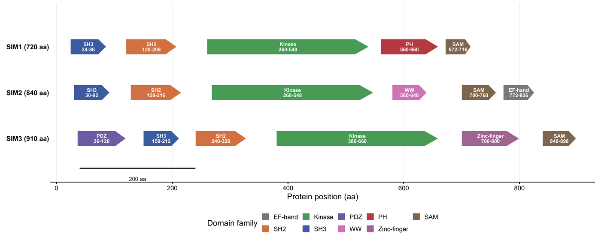

A protein figure has to answer one question before any other: where on the sequence is the feature, and what does it sit next to? Domain architecture diagrams answer it with boxes and arrows on a linear amino-acid axis; feature tracks answer it by stacking variants, PTMs and conservation strips under the same ruler; genome-to-protein maps answer it by projecting exons onto domains. This tutorial builds all three in pure R.

## Example

{fig-alt="Protein Domain Plot DEMO" fig-align="center" width="85%"}

Domain architecture of three paralogs on a shared amino-acid axis: arrows point N to C, colours mark domain families, and labels give names and residue ranges. Using one axis for all three is what makes the divergent C-termini comparable; one axis per protein would hide the fact that the last domain ends at a different residue in each paralog.

## Setup

-   System Requirements: Cross-platform (Linux/MacOS/Windows)

-   Programming language: R

-   Dependent packages: `ggplot2`; `dplyr`; `tidyr`; `patchwork`; `scales`; `ggrepel`

```{r packages setup, message=FALSE, warning=FALSE, output=FALSE}
if (!requireNamespace("ggplot2", quietly = TRUE)) install.packages("ggplot2")
if (!requireNamespace("dplyr", quietly = TRUE)) install.packages("dplyr")
if (!requireNamespace("tidyr", quietly = TRUE)) install.packages("tidyr")
if (!requireNamespace("patchwork", quietly = TRUE)) install.packages("patchwork")
if (!requireNamespace("scales", quietly = TRUE)) install.packages("scales")
if (!requireNamespace("ggrepel", quietly = TRUE)) install.packages("ggrepel")
library(ggplot2)
library(dplyr)
library(tidyr)
library(patchwork)
library(scales)
library(ggrepel)
```

```{r}
sessioninfo::session_info("attached")
```

## Data Preparation

Three simulated paralogs share the same domain families in different orders, which is exactly the comparison a domain diagram has to make legible. A fourth protein carries 14 variants and PTMs with support scores. The final panel maps eight coding exons (2,280 bp, 760 aa) onto the domain track, so every domain boundary can be traced back to an exon boundary.

```{r load data, message=FALSE, warning=FALSE}
set.seed(4355)
fam_colours <- c(SH3 = "#4C72B0", SH2 = "#DD8452", Kinase = "#55A868",
                 PH = "#C44E52", PDZ = "#8172B3", SAM = "#937860",
                 WW = "#DA8BC3", `EF-hand` = "#8C8C8C", `Zinc-finger` = "#B07AA1")
class_colours <- c(Missense = "#2166AC", Nonsense = "#B2182B",
                   Phospho = "#E08214", Ubiquitin = "#7B3294")
proteins <- c("SIM1 (720 aa)", "SIM2 (840 aa)", "SIM3 (910 aa)")
domains <- tribble(
  ~protein, ~family, ~start, ~end,
  "SIM1 (720 aa)", "SH3", 24, 86,   "SIM1 (720 aa)", "SH2", 120, 208,
  "SIM1 (720 aa)", "Kinase", 260, 540, "SIM1 (720 aa)", "PH", 560, 660,
  "SIM1 (720 aa)", "SAM", 672, 716,
  "SIM2 (840 aa)", "SH3", 30, 92,   "SIM2 (840 aa)", "SH2", 128, 216,
  "SIM2 (840 aa)", "Kinase", 268, 548, "SIM2 (840 aa)", "WW", 580, 640,
  "SIM2 (840 aa)", "SAM", 700, 760, "SIM2 (840 aa)", "EF-hand", 772, 826,
  "SIM3 (910 aa)", "PDZ", 36, 120,  "SIM3 (910 aa)", "SH3", 150, 212,
  "SIM3 (910 aa)", "SH2", 240, 328, "SIM3 (910 aa)", "Kinase", 380, 660,
  "SIM3 (910 aa)", "Zinc-finger", 700, 800, "SIM3 (910 aa)", "SAM", 840, 898
)
sim4_domains <- tribble(
  ~family, ~start, ~end,
  "SH3", 30, 95, "SH2", 130, 220, "Kinase", 270, 560, "SAM", 640, 740
)
events <- tibble(
  pos = c(42, 68, 140, 158, 205, 286, 312, 355, 401, 455, 512, 660, 690, 720),
  score = c(12, 7, 26, 9, 15, 38, 11, 22, 6, 17, 29, 8, 13, 5),
  class = c("Missense", "Missense", "Phospho", "Missense", "Ubiquitin",
            "Nonsense", "Missense", "Phospho", "Ubiquitin", "Missense",
            "Nonsense", "Phospho", "Missense", "Ubiquitin")
)
## ---- genome-to-protein mapping -----------------------------------------
exon_bp <- c(180, 240, 150, 300, 210, 270, 330, 600)   # 2,280 bp CDS
intron_bp <- c(900, 1200, 700, 1500, 800, 1100, 950)
gstart <- numeric(length(exon_bp))
for (i in seq_along(exon_bp)) {
  gstart[i] <- if (i == 1) 0 else gstart[i - 1] + exon_bp[i - 1] + intron_bp[i - 1]
}
exons <- tibble(
  exon = seq_along(exon_bp), gstart = gstart, gend = gstart + exon_bp,
  pstart = cumsum(c(0, head(exon_bp, -1))) / 3 + 1, pend = cumsum(exon_bp) / 3
) |>
  mutate(total_g = max(gend), protein_len = max(pend),
         xg = (gstart + gend) / 2 / total_g, xp = (pstart + pend) / 2 / protein_len)
protein_len <- max(exons$pend)
## Domains are drawn as five-point polygons (a flat left edge, a pointed C-tip).
arrow_poly <- function(tbl, height, y) {
  do.call(rbind, lapply(seq_len(nrow(tbl)), function(i) {
    d <- tbl[i, ]
    tip <- min(24, (d$end - d$start) * 0.22)
    data.frame(id = i, family = d$family, y = y,
               px = c(d$start, d$end - tip, d$end, d$end - tip, d$start),
               py = c(y + height / 2, y + height / 2, y, y - height / 2, y - height / 2))
  }))
}
head(domains, 3)
```

## Visualization

### 1. Domain Architecture Across Paralogs

This is the grammar of **drawProteins** (Bioconductor), **DnaFeaturesViewer**, **IBS**, **ProteinPaint**, **nightingale/ProtVista**, **Protael** and **pViz**: a linear axis in amino acids, one row per protein, and domains as labelled arrows pointing N to C. Colouring by family makes the shared and unique architecture instantly comparable between paralogs.

```{r}
#| label: fig-1.1DomainArchitecture
#| fig-cap: "Domain architecture of three paralogs on a shared amino-acid axis: arrows point N to C, colours mark domain families, labels give names and residue ranges."
#| warning: false
#| message: false
#| fig-width: 10.5
#| fig-height: 4.2
#| fig-dpi: 300
domain_height <- 0.34
row_y <- setNames(rev(seq_along(proteins)), proteins)
paralog_poly <- do.call(rbind, lapply(seq_len(nrow(domains)), function(i) {
  d <- domains[i, ]
  tip <- min(24, (d$end - d$start) * 0.22)
  y <- row_y[[d$protein]]
  data.frame(id = i, family = d$family,
             px = c(d$start, d$end - tip, d$end, d$end - tip, d$start),
             py = c(y + domain_height / 2, y + domain_height / 2, y,
                    y - domain_height / 2, y - domain_height / 2))
}))
domains$y <- row_y[domains$protein]
ggplot(paralog_poly, aes(px, py, group = id, fill = family)) +
  geom_polygon(colour = "white", linewidth = 0.3) +
  geom_text(data = domains,
            aes((start + end) / 2, y, label = paste0(family, "\n", start, "-", end)),
            size = 2.25, colour = "white", fontface = "bold", lineheight = 0.85,
            inherit.aes = FALSE) +
  annotate("segment", x = 40, xend = 240, y = 0.35, yend = 0.35,
           colour = "#333333", linewidth = 0.7) +
  annotate("text", x = 140, y = 0.12, label = "200 aa", size = 2.5,
           colour = "#333333") +
  scale_fill_manual(values = fam_colours, name = "Domain family") +
  scale_x_continuous(limits = c(-10, 930), breaks = seq(0, 900, 200),
                     expand = c(0, 0)) +
  scale_y_continuous(limits = c(0.05, 3.95), breaks = row_y,
                     labels = names(row_y), expand = c(0, 0)) +
  labs(x = "Protein position (aa)", y = NULL) +
  guides(fill = guide_legend(nrow = 2, byrow = TRUE)) +
  theme_classic(base_size = 10) +
  theme(axis.ticks.y = element_blank(), axis.line.y = element_blank(),
        axis.text.y = element_text(face = "bold", size = 8.5),
        panel.grid.major.x = element_line(colour = "#EFEFEF", linewidth = 0.25),
        legend.position = "bottom", legend.key.size = unit(3.6, "mm"),
        plot.margin = margin(4, 8, 4, 8))
```

### 2. Domain Track plus Variant and PTM Lollipops

The division of labour matters here. The [Lollipop plot](../Ranking/Lollipop.html) page ranks mutations across a cohort; this page is *feature architecture*, so the lollipop track is a positional annotation under the domain ruler, not a ranking. One shared x axis lets the reader see immediately whether a hotspot or a phosphosite falls inside a catalytic domain or in a linker. `sample()`-style codon labels are omitted deliberately: the axis is the residue coordinate.

```{r}
#| label: fig-1.2ArchitectureLollipop
#| fig-cap: "SIM4 domain track above a variant/PTM lollipop track on one shared amino-acid axis; stem height is supporting reads or PTM score, colour is the event class."
#| warning: false
#| message: false
#| fig-width: 10.5
#| fig-height: 5.2
#| fig-dpi: 300
sim4_poly <- do.call(rbind, lapply(seq_len(nrow(sim4_domains)), function(i) {
  d <- sim4_domains[i, ]
  tip <- min(24, (d$end - d$start) * 0.22)
  data.frame(id = i, family = d$family, y = 0.5,
             px = c(d$start, d$end - tip, d$end, d$end - tip, d$start),
             py = c(0.5 + domain_height / 2, 0.5 + domain_height / 2, 0.5,
                    0.5 - domain_height / 2, 0.5 - domain_height / 2))
}))
boundaries <- c(sim4_domains$start, sim4_domains$end)
p_arch <- ggplot(sim4_poly, aes(px, py, group = id, fill = family)) +
  geom_polygon(colour = "white", linewidth = 0.3) +
  geom_text(data = sim4_domains, aes((start + end) / 2, 0.5, label = family),
            size = 2.5, colour = "white", fontface = "bold", inherit.aes = FALSE) +
  geom_vline(xintercept = boundaries, colour = "#AAAAAA", linetype = "22",
             linewidth = 0.22) +
  scale_fill_manual(values = fam_colours, guide = "none") +
  scale_x_continuous(limits = c(-10, 780), expand = c(0, 0)) +
  labs(x = NULL, y = NULL, subtitle = "SIM4 domain architecture (760 aa)") +
  theme_void(base_size = 9) +
  theme(plot.subtitle = element_text(size = 8.4, colour = "#555555", hjust = 0),
        plot.margin = margin(4, 10, 0, 6))
p_lolli <- ggplot(events, aes(pos, score)) +
  geom_vline(xintercept = boundaries, colour = "#AAAAAA", linetype = "22",
             linewidth = 0.22) +
  geom_segment(aes(xend = pos, y = 0, yend = score), colour = "#666666",
               linewidth = 0.35) +
  geom_point(aes(colour = class), size = 2.4) +
  geom_text_repel(aes(label = if_else(score > 20, paste0("p.", pos, " / ", score), "")),
                  size = 2.3, min.segment.length = 0.2, box.padding = 0.25,
                  colour = "#333333", max.overlaps = 20) +
  scale_colour_manual(values = class_colours, name = "Variant / PTM class") +
  scale_x_continuous(limits = c(-10, 780), breaks = seq(0, 760, 100),
                     expand = c(0, 0)) +
  scale_y_continuous(limits = c(0, 46), expand = c(0.02, 0.02)) +
  labs(x = "Protein position (aa)", y = "Supporting reads / PTM score") +
  theme_classic(base_size = 9.5) +
  theme(axis.line = element_line(linewidth = 0.3),
        legend.position = "right", legend.key.size = unit(3.6, "mm"),
        plot.margin = margin(2, 6, 4, 6))
p_arch / p_lolli + plot_layout(heights = c(0.8, 2.6))
```

### 3. Genome-to-Protein Mapping of Exons and Domains

The **Genomics 2 Proteins Portal** and **Mason** make the last step explicit: which exon encodes which domain. Because the two rulers use different units (kilobases and amino acids), both are normalised to a common drawing width and the mapping is drawn as connectors, with the protein axis in residues and the genomic axis in kb.

```{r}
#| label: fig-1.3GenomeToProtein
#| fig-cap: "Genome-to-protein map: eight coding exons on the kilobase axis connected to the domain track on the amino-acid axis; domain boundaries can be traced back to exon boundaries."
#| warning: false
#| message: false
#| fig-width: 10.5
#| fig-height: 4.6
#| fig-dpi: 300
map_domains <- sim4_domains |>
  mutate(x0 = start / protein_len, x1 = end / protein_len, y = 0.45)
map_poly <- do.call(rbind, lapply(seq_len(nrow(map_domains)), function(i) {
  d <- map_domains[i, ]
  tip <- min(0.03, (d$x1 - d$x0) * 0.22)
  data.frame(id = i, family = d$family,
             px = c(d$x0, d$x1 - tip, d$x1, d$x1 - tip, d$x0),
             py = c(d$y + 0.13, d$y + 0.13, d$y, d$y - 0.13, d$y - 0.13))
}))
ggplot() +
  geom_curve(data = exons, aes(x = xg, xend = xp, y = 2.30, yend = 0.78),
             curvature = 0.12, colour = "#9E9E9E", linewidth = 0.4, alpha = 0.8) +
  geom_segment(aes(x = 0, xend = 1, y = 2.70, yend = 2.70), colour = "#4D4D4D",
               linewidth = 0.4) +
  geom_rect(data = exons, aes(xmin = gstart / total_g, xmax = gend / total_g,
                              ymin = 2.55, ymax = 2.85), fill = "#4D4D4D") +
  geom_text(data = exons, aes((gstart + gend) / 2 / total_g, 2.40, label = exon),
            size = 2.2, colour = "#555555") +
  geom_segment(aes(x = 0, xend = 1, y = 0.45, yend = 0.45), colour = "#4D4D4D",
               linewidth = 0.35) +
  geom_polygon(data = map_poly, aes(px, py, group = id, fill = family),
               colour = "white", linewidth = 0.3) +
  geom_text(data = map_domains, aes((x0 + x1) / 2, y, label = family),
            size = 2.4, colour = "white", fontface = "bold", inherit.aes = FALSE) +
  annotate("text", x = 0.17, y = 2.97, label = "Coding exons (2.28 kb CDS)",
           size = 2.7, colour = "#555555") +
  scale_fill_manual(values = fam_colours, name = "Domain family") +
  scale_x_continuous(limits = c(0, 1), expand = c(0, 0),
                     breaks = seq(0, 1, length.out = 5),
                     labels = round(seq(0, protein_len, length.out = 5)),
                     sec.axis = sec_axis(~ . * max(exons$total_g) / 1000,
                                         breaks = seq(0, 8, 2),
                                         name = "Genomic position (kb)")) +
  scale_y_continuous(limits = c(0, 3.1), expand = c(0, 0)) +
  labs(x = "Protein position (aa)", y = NULL,
       caption = "Exon and protein rulers are independently normalised to the drawing width.") +
  theme_classic(base_size = 9.5) +
  theme(axis.text.y = element_blank(), axis.ticks.y = element_blank(),
        axis.line.y = element_blank(),
        legend.position = "bottom", legend.key.size = unit(3.6, "mm"),
        axis.line.x = element_line(linewidth = 0.3),
        plot.caption = element_text(size = 7.5, colour = "#777777"),
        plot.margin = margin(4, 10, 4, 66))
```

::: callout-tip
**Practice tips**

-   Always label the residue range on every domain. A box without coordinates is decoration; the boundary is the biological claim.
-   Keep a single amino-acid ruler for architecture, PTM and variant tracks; independent scales silently misalign a phosphosite and the domain that contains it.
-   Draw the arrow tip in proportion to domain length (here capped at 24 aa) so a short SH3 domain does not look like a kinase.
-   Reserve width for the feature track. A domain panel that occupies the top third and lollipops the bottom two thirds matches how reviewers read a protein figure.
-   When two units must share a panel (exons in kb, domains in aa), normalise both and say so in the caption; never imply that the two axes share a numeric scale.
-   Retrieve authoritative boundaries from Pfam/InterPro or UniProt features rather than hard-coding them; this tutorial's coordinates are simulated for reproducibility.
:::

## Application

Domain and feature figures are how a mutation is argued to be functional: an exon-level deletion that removes half a kinase domain, a phosphosite mutated in a tumour, a fusion that keeps the dimerisation domain. The tool landscape mirrors the three panels. **drawProteins** builds schematics from UniProt features; **DnaFeaturesViewer** and **IBS** handle sequence-level features; **ProteinPaint**, **nightingale/ProtVista** and **pViz** provide interactive feature browsers; **Protael** and **TogoStanza** are older rendering frameworks; **Pfam generate_graphic**, **PROSITE MyDomains** and the **Genomics 2 Proteins Portal** render domains server-side; **Mason** maps exons onto proteins. Tools without a release in the last five years, or those requiring a web server, Java stack or browser runtime, are described here rather than installed; `drawProteins` is likewise not installed in this environment, so the same grammar is reproduced in ggplot2 with a data frame of domain coordinates.

## Reference

\[1\] Finn RD, Bateman A, Clements J, et al. Pfam: the protein families database. Nucleic Acids Res. 2014;42(D1):D222-D230. doi:10.1093/nar/gkt1223

\[2\] Sigrist CJA, de Castro E, Cerutti L, et al. New and continuing developments at PROSITE. Nucleic Acids Res. 2013;41(D1):D344-D347. doi:10.1093/nar/gks1067

\[3\] Watkins X, Garcia LJ, Pundir S, et al. ProtVista: visualization of protein sequence annotations. Bioinformatics. 2017;33(13):2040-2041. doi:10.1093/bioinformatics/btx120
