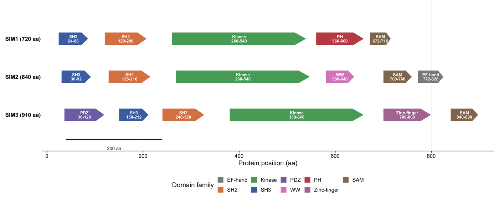

蛋白质图必须先回答一个问题：特征在序列上的什么位置、旁边是什么？结构域架构图用线性氨基酸轴上的方框与箭头回答；特征轨把变异、PTM 与保守性条带堆叠在同一把尺子下回答；基因组—蛋白映射图则把外显子投影到结构域上回答。本教程用纯 R 构建这三类视图。

## 示例

{fig-alt="蛋白结构域图 DEMO" fig-align="center" width="85%"}

三个旁系同源蛋白在共享氨基酸轴上的结构域排布：箭头指向 N 到 C，颜色区分结构域家族，标签给出名称与残基范围。三者共用一条轴，才能使分化明显的 C 端可比；若每个蛋白各用一条轴，就会掩盖最后一个结构域在各旁系同源中终止残基不同这一事实。

## Setup

-   系统要求：跨平台（Linux/MacOS/Windows）

-   编程语言：R

-   依赖包：`ggplot2`; `dplyr`; `tidyr`; `patchwork`; `scales`; `ggrepel`
```{r packages setup, message=FALSE, warning=FALSE, output=FALSE}
if (!requireNamespace("ggplot2", quietly = TRUE)) install.packages("ggplot2")
if (!requireNamespace("dplyr", quietly = TRUE)) install.packages("dplyr")
if (!requireNamespace("tidyr", quietly = TRUE)) install.packages("tidyr")
if (!requireNamespace("patchwork", quietly = TRUE)) install.packages("patchwork")
if (!requireNamespace("scales", quietly = TRUE)) install.packages("scales")
if (!requireNamespace("ggrepel", quietly = TRUE)) install.packages("ggrepel")
library(ggplot2)
library(dplyr)
library(tidyr)
library(patchwork)
library(scales)
library(ggrepel)
```

```{r}
sessioninfo::session_info("attached")
```

## Data Preparation

三个模拟旁系同源蛋白以不同顺序共享同一批结构域家族，这正是结构域图必须讲清的比较。第四个蛋白携带 14 个变异与 PTM 及其支持度分数。最后一块面板把八个编码外显子（2,280 bp，760 aa）映射到结构域轨上，因此每个结构域边界都能追溯到外显子边界。
```{r load data, message=FALSE, warning=FALSE}
set.seed(4355)
fam_colours <- c(SH3 = "#4C72B0", SH2 = "#DD8452", Kinase = "#55A868",
                 PH = "#C44E52", PDZ = "#8172B3", SAM = "#937860",
                 WW = "#DA8BC3", `EF-hand` = "#8C8C8C", `Zinc-finger` = "#B07AA1")
class_colours <- c(Missense = "#2166AC", Nonsense = "#B2182B",
                   Phospho = "#E08214", Ubiquitin = "#7B3294")
proteins <- c("SIM1 (720 aa)", "SIM2 (840 aa)", "SIM3 (910 aa)")
domains <- tribble(
  ~protein, ~family, ~start, ~end,
  "SIM1 (720 aa)", "SH3", 24, 86,   "SIM1 (720 aa)", "SH2", 120, 208,
  "SIM1 (720 aa)", "Kinase", 260, 540, "SIM1 (720 aa)", "PH", 560, 660,
  "SIM1 (720 aa)", "SAM", 672, 716,
  "SIM2 (840 aa)", "SH3", 30, 92,   "SIM2 (840 aa)", "SH2", 128, 216,
  "SIM2 (840 aa)", "Kinase", 268, 548, "SIM2 (840 aa)", "WW", 580, 640,
  "SIM2 (840 aa)", "SAM", 700, 760, "SIM2 (840 aa)", "EF-hand", 772, 826,
  "SIM3 (910 aa)", "PDZ", 36, 120,  "SIM3 (910 aa)", "SH3", 150, 212,
  "SIM3 (910 aa)", "SH2", 240, 328, "SIM3 (910 aa)", "Kinase", 380, 660,
  "SIM3 (910 aa)", "Zinc-finger", 700, 800, "SIM3 (910 aa)", "SAM", 840, 898
)
sim4_domains <- tribble(
  ~family, ~start, ~end,
  "SH3", 30, 95, "SH2", 130, 220, "Kinase", 270, 560, "SAM", 640, 740
)
events <- tibble(
  pos = c(42, 68, 140, 158, 205, 286, 312, 355, 401, 455, 512, 660, 690, 720),
  score = c(12, 7, 26, 9, 15, 38, 11, 22, 6, 17, 29, 8, 13, 5),
  class = c("Missense", "Missense", "Phospho", "Missense", "Ubiquitin",
            "Nonsense", "Missense", "Phospho", "Ubiquitin", "Missense",
            "Nonsense", "Phospho", "Missense", "Ubiquitin")
)
## ---- genome-to-protein mapping -----------------------------------------
exon_bp <- c(180, 240, 150, 300, 210, 270, 330, 600)   # 2,280 bp CDS
intron_bp <- c(900, 1200, 700, 1500, 800, 1100, 950)
gstart <- numeric(length(exon_bp))
for (i in seq_along(exon_bp)) {
  gstart[i] <- if (i == 1) 0 else gstart[i - 1] + exon_bp[i - 1] + intron_bp[i - 1]
}
exons <- tibble(
  exon = seq_along(exon_bp), gstart = gstart, gend = gstart + exon_bp,
  pstart = cumsum(c(0, head(exon_bp, -1))) / 3 + 1, pend = cumsum(exon_bp) / 3
) |>
  mutate(total_g = max(gend), protein_len = max(pend),
         xg = (gstart + gend) / 2 / total_g, xp = (pstart + pend) / 2 / protein_len)
protein_len <- max(exons$pend)
## Domains are drawn as five-point polygons (a flat left edge, a pointed C-tip).
arrow_poly <- function(tbl, height, y) {
  do.call(rbind, lapply(seq_len(nrow(tbl)), function(i) {
    d <- tbl[i, ]
    tip <- min(24, (d$end - d$start) * 0.22)
    data.frame(id = i, family = d$family, y = y,
               px = c(d$start, d$end - tip, d$end, d$end - tip, d$start),
               py = c(y + height / 2, y + height / 2, y, y - height / 2, y - height / 2))
  }))
}
head(domains, 3)
```

## Visualization

### 1. 旁系同源蛋白的结构域架构

这是 **drawProteins**（Bioconductor）、**DnaFeaturesViewer**、**IBS**、**ProteinPaint**、**nightingale/ProtVista**、**Protael** 与 **pViz** 的共同语法：氨基酸线性轴、每个蛋白一行、结构域为指向 N→C 的带标签箭头。按家族着色，可让旁系同源之间共享与特有的架构立刻可比较。
```{r}
#| label: fig-1.1DomainArchitecture
#| fig-cap: "三个旁系同源蛋白在共享氨基酸轴上的结构域架构：箭头指向 N→C，颜色标记结构域家族，标签给出名称与残基范围。"
#| warning: false
#| message: false
#| fig-width: 10.5
#| fig-height: 4.2
#| fig-dpi: 300
domain_height <- 0.34
row_y <- setNames(rev(seq_along(proteins)), proteins)
paralog_poly <- do.call(rbind, lapply(seq_len(nrow(domains)), function(i) {
  d <- domains[i, ]
  tip <- min(24, (d$end - d$start) * 0.22)
  y <- row_y[[d$protein]]
  data.frame(id = i, family = d$family,
             px = c(d$start, d$end - tip, d$end, d$end - tip, d$start),
             py = c(y + domain_height / 2, y + domain_height / 2, y,
                    y - domain_height / 2, y - domain_height / 2))
}))
domains$y <- row_y[domains$protein]
ggplot(paralog_poly, aes(px, py, group = id, fill = family)) +
  geom_polygon(colour = "white", linewidth = 0.3) +
  geom_text(data = domains,
            aes((start + end) / 2, y, label = paste0(family, "\n", start, "-", end)),
            size = 2.25, colour = "white", fontface = "bold", lineheight = 0.85,
            inherit.aes = FALSE) +
  annotate("segment", x = 40, xend = 240, y = 0.35, yend = 0.35,
           colour = "#333333", linewidth = 0.7) +
  annotate("text", x = 140, y = 0.12, label = "200 aa", size = 2.5,
           colour = "#333333") +
  scale_fill_manual(values = fam_colours, name = "Domain family") +
  scale_x_continuous(limits = c(-10, 930), breaks = seq(0, 900, 200),
                     expand = c(0, 0)) +
  scale_y_continuous(limits = c(0.05, 3.95), breaks = row_y,
                     labels = names(row_y), expand = c(0, 0)) +
  labs(x = "Protein position (aa)", y = NULL) +
  guides(fill = guide_legend(nrow = 2, byrow = TRUE)) +
  theme_classic(base_size = 10) +
  theme(axis.ticks.y = element_blank(), axis.line.y = element_blank(),
        axis.text.y = element_text(face = "bold", size = 8.5),
        panel.grid.major.x = element_line(colour = "#EFEFEF", linewidth = 0.25),
        legend.position = "bottom", legend.key.size = unit(3.6, "mm"),
        plot.margin = margin(4, 8, 4, 8))
```

### 2. 结构域轨与变异/PTM 棒棒糖轨

这里的分工很重要。[棒棒糖图](../Ranking/Lollipop.html)页面用于跨队列对突变排序；本页的主题是*特征架构*，因此棒棒糖轨只是结构域尺子下方的位置注释，而不是排序。共享同一 x 轴，读者可立即看出热点或磷酸化位点落在催化结构域内还是连接区。此处刻意不写密码子标签：坐标轴本身即残基位置。
```{r}
#| label: fig-1.2ArchitectureLollipop
#| fig-cap: "同一氨基酸轴上，SIM4 结构域轨位于变异/PTM 棒棒糖轨上方；茎高为支持读段数或 PTM 分数，颜色为事件类别。"
#| warning: false
#| message: false
#| fig-width: 10.5
#| fig-height: 5.2
#| fig-dpi: 300
sim4_poly <- do.call(rbind, lapply(seq_len(nrow(sim4_domains)), function(i) {
  d <- sim4_domains[i, ]
  tip <- min(24, (d$end - d$start) * 0.22)
  data.frame(id = i, family = d$family, y = 0.5,
             px = c(d$start, d$end - tip, d$end, d$end - tip, d$start),
             py = c(0.5 + domain_height / 2, 0.5 + domain_height / 2, 0.5,
                    0.5 - domain_height / 2, 0.5 - domain_height / 2))
}))
boundaries <- c(sim4_domains$start, sim4_domains$end)
p_arch <- ggplot(sim4_poly, aes(px, py, group = id, fill = family)) +
  geom_polygon(colour = "white", linewidth = 0.3) +
  geom_text(data = sim4_domains, aes((start + end) / 2, 0.5, label = family),
            size = 2.5, colour = "white", fontface = "bold", inherit.aes = FALSE) +
  geom_vline(xintercept = boundaries, colour = "#AAAAAA", linetype = "22",
             linewidth = 0.22) +
  scale_fill_manual(values = fam_colours, guide = "none") +
  scale_x_continuous(limits = c(-10, 780), expand = c(0, 0)) +
  labs(x = NULL, y = NULL, subtitle = "SIM4 domain architecture (760 aa)") +
  theme_void(base_size = 9) +
  theme(plot.subtitle = element_text(size = 8.4, colour = "#555555", hjust = 0),
        plot.margin = margin(4, 10, 0, 6))
p_lolli <- ggplot(events, aes(pos, score)) +
  geom_vline(xintercept = boundaries, colour = "#AAAAAA", linetype = "22",
             linewidth = 0.22) +
  geom_segment(aes(xend = pos, y = 0, yend = score), colour = "#666666",
               linewidth = 0.35) +
  geom_point(aes(colour = class), size = 2.4) +
  geom_text_repel(aes(label = if_else(score > 20, paste0("p.", pos, " / ", score), "")),
                  size = 2.3, min.segment.length = 0.2, box.padding = 0.25,
                  colour = "#333333", max.overlaps = 20) +
  scale_colour_manual(values = class_colours, name = "Variant / PTM class") +
  scale_x_continuous(limits = c(-10, 780), breaks = seq(0, 760, 100),
                     expand = c(0, 0)) +
  scale_y_continuous(limits = c(0, 46), expand = c(0.02, 0.02)) +
  labs(x = "Protein position (aa)", y = "Supporting reads / PTM score") +
  theme_classic(base_size = 9.5) +
  theme(axis.line = element_line(linewidth = 0.3),
        legend.position = "right", legend.key.size = unit(3.6, "mm"),
        plot.margin = margin(2, 6, 4, 6))
p_arch / p_lolli + plot_layout(heights = c(0.8, 2.6))
```

### 3. 外显子与结构域的基因组—蛋白映射

**Genomics 2 Proteins Portal** 与 **Mason** 把最后一步显式化：哪个外显子编码哪个结构域。由于两把尺子的单位不同（kb 与氨基酸），二者都归一化到同一绘图宽度，映射以连接线表示：蛋白轴为残基、基因组轴为 kb。
```{r}
#| label: fig-1.3GenomeToProtein
#| fig-cap: "基因组—蛋白映射：kb 轴上的八个编码外显子连接到氨基酸轴上的结构域轨；结构域边界可追溯到外显子边界。"
#| warning: false
#| message: false
#| fig-width: 10.5
#| fig-height: 4.6
#| fig-dpi: 300
map_domains <- sim4_domains |>
  mutate(x0 = start / protein_len, x1 = end / protein_len, y = 0.45)
map_poly <- do.call(rbind, lapply(seq_len(nrow(map_domains)), function(i) {
  d <- map_domains[i, ]
  tip <- min(0.03, (d$x1 - d$x0) * 0.22)
  data.frame(id = i, family = d$family,
             px = c(d$x0, d$x1 - tip, d$x1, d$x1 - tip, d$x0),
             py = c(d$y + 0.13, d$y + 0.13, d$y, d$y - 0.13, d$y - 0.13))
}))
ggplot() +
  geom_curve(data = exons, aes(x = xg, xend = xp, y = 2.30, yend = 0.78),
             curvature = 0.12, colour = "#9E9E9E", linewidth = 0.4, alpha = 0.8) +
  geom_segment(aes(x = 0, xend = 1, y = 2.70, yend = 2.70), colour = "#4D4D4D",
               linewidth = 0.4) +
  geom_rect(data = exons, aes(xmin = gstart / total_g, xmax = gend / total_g,
                              ymin = 2.55, ymax = 2.85), fill = "#4D4D4D") +
  geom_text(data = exons, aes((gstart + gend) / 2 / total_g, 2.40, label = exon),
            size = 2.2, colour = "#555555") +
  geom_segment(aes(x = 0, xend = 1, y = 0.45, yend = 0.45), colour = "#4D4D4D",
               linewidth = 0.35) +
  geom_polygon(data = map_poly, aes(px, py, group = id, fill = family),
               colour = "white", linewidth = 0.3) +
  geom_text(data = map_domains, aes((x0 + x1) / 2, y, label = family),
            size = 2.4, colour = "white", fontface = "bold", inherit.aes = FALSE) +
  annotate("text", x = 0.17, y = 2.97, label = "Coding exons (2.28 kb CDS)",
           size = 2.7, colour = "#555555") +
  scale_fill_manual(values = fam_colours, name = "Domain family") +
  scale_x_continuous(limits = c(0, 1), expand = c(0, 0),
                     breaks = seq(0, 1, length.out = 5),
                     labels = round(seq(0, protein_len, length.out = 5)),
                     sec.axis = sec_axis(~ . * max(exons$total_g) / 1000,
                                         breaks = seq(0, 8, 2),
                                         name = "Genomic position (kb)")) +
  scale_y_continuous(limits = c(0, 3.1), expand = c(0, 0)) +
  labs(x = "Protein position (aa)", y = NULL,
       caption = "Exon and protein rulers are independently normalised to the drawing width.") +
  theme_classic(base_size = 9.5) +
  theme(axis.text.y = element_blank(), axis.ticks.y = element_blank(),
        axis.line.y = element_blank(),
        legend.position = "bottom", legend.key.size = unit(3.6, "mm"),
        axis.line.x = element_line(linewidth = 0.3),
        plot.caption = element_text(size = 7.5, colour = "#777777"),
        plot.margin = margin(4, 10, 4, 66))
```
::: callout-tip
**实践要点**

-   每个结构域都必须标注残基范围。没有坐标的色块只是装饰；边界才是生物学主张。
-   架构、PTM 与变异轨应共用同一把氨基酸尺子；独立缩放会让磷酸化位点与其所属结构域悄然错位。
-   箭头尖端应按结构域长度成比例绘制（此处上限 24 aa），否则短小的 SH3 结构域会被误读成激酶。
-   为特征轨预留足够宽度。结构域面板占上方三分之一、棒棒糖占下方三分之二，最符合审稿人的阅读顺序。
-   当两种单位必须共处一图（外显子用 kb、结构域用 aa）时，应把二者归一化并在图注中说明；绝不能暗示两轴共享同一数值刻度。
-   结构域边界应从 Pfam/InterPro 或 UniProt 特征中获取，而不是硬编码；本教程坐标为可复现而使用模拟值。
:::

## Application

结构域与特征图是论证突变具有功能影响的方式：删除激酶结构域一半的外显子级缺失、肿瘤中被突变的磷酸化位点、保留二聚化结构域的融合。工具版图与三块面板一一对应。**drawProteins** 依据 UniProt 特征绘制示意图；**DnaFeaturesViewer** 与 **IBS** 处理序列级特征；**ProteinPaint**、**nightingale/ProtVista** 与 **pViz** 提供交互式特征浏览器；**Protael** 与 **TogoStanza** 是较早期的渲染框架；**Pfam generate_graphic**、**PROSITE MyDomains** 与 **Genomics 2 Proteins Portal** 在服务端渲染结构域；**Mason** 把外显子映射到蛋白。超过五年无发布、或需要 Web 服务、Java 栈与浏览器运行时的工具，本页只作介绍而不安装；`drawProteins` 在本环境中同样未安装，因此用 ggplot2 加结构域坐标数据框复现同一套语法。

## Reference

\[1\] Finn RD, Bateman A, Clements J, et al. Pfam: the protein families database. Nucleic Acids Res. 2014;42(D1):D222-D230. doi:10.1093/nar/gkt1223

\[2\] Sigrist CJA, de Castro E, Cerutti L, et al. New and continuing developments at PROSITE. Nucleic Acids Res. 2013;41(D1):D344-D347. doi:10.1093/nar/gks1067

\[3\] Watkins X, Garcia LJ, Pundir S, et al. ProtVista: visualization of protein sequence annotations. Bioinformatics. 2017;33(13):2040-2041. doi:10.1093/bioinformatics/btx120
