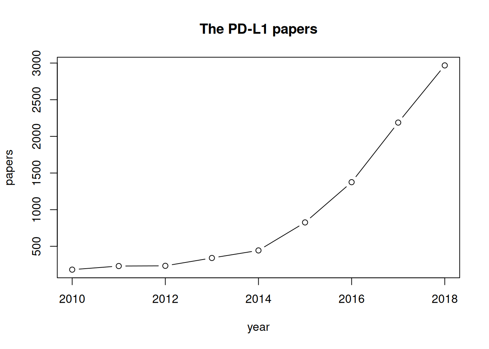

The reference mines PubMed through the NCBI E-utilities (`rentrez`): query one target gene, download titles and abstracts, then count how often **other genes** appear in those abstracts — "gene friends" that point to unfamiliar mechanisms, pathways and experiment systems worth borrowing \[1\]. Three modules come out of one query: the yearly publication trend, the article list, and the gene word-frequency table \[1\]. Live NCBI queries are not reproducible inside a static page, so the in-page pipeline runs on a **simulated abstract corpus** with planted co-occurrence structure, and the real `rentrez` query is kept verbatim in a non-executed chunk:

## Example

{fig-alt="PubMed Abstract Gene Co-occurrence Mining DEMO" fig-align="center" width="70%"}

## Setup

-   System Requirements: Cross-platform (Linux/MacOS/Windows)

-   Programming language: R

-   Dependent packages: `rentrez`; `ggplot2`

```{r packages setup, message=FALSE, warning=FALSE, output=FALSE}
suppressPackageStartupMessages({
  library(rentrez); library(ggplot2)
})
```

```{r}
sessioninfo::session_info("attached")
```

## The Real API Query (not executed)

Run this chunk (`eval=FALSE`) against the live E-utilities to replace the simulated corpus with real PubMed records — the query string follows the reference's advice of combining a gene's approved symbol with its aliases:

```{r real-api, eval=FALSE}
## module 0: search PubMed for the target gene (symbol + aliases + MeSH)
term <- "CD274 OR PD-L1 OR PDL1 AND Neoplasms[MeSH Terms]"
ids <- entrez_search(db = "pubmed", term = term,
                     mindate = 2015, maxdate = 2024, retmax = 500)

## fetch titles + abstracts
recs <- entrez_fetch(db = "pubmed", id = ids$ids, rettype = "abstract",
                     parsed = TRUE)
## ... then feed the text into the same word-frequency pipeline below
```

## Data Preparation

A simulated corpus of 300 abstracts (2015-2024) mentioning the target gene CD274/PD-L1. Planted "gene friends": T-cell markers (PDCD1, CD8A, GZMB, LAG3, TIGIT) co-occur strongly with CD274 — the immunotherapy context the reference's example shows — plus weak background mentions of unrelated genes. Each abstract carries a year, title and abstract text; the word-frequency stage tokenises the text and counts the curated gene vocabulary:

```{r load data}
suppressPackageStartupMessages({library(rentrez); library(ggplot2)})
set.seed(52329)
n_abs <- 300
years <- sample(2015:2024, n_abs, TRUE, prob = dnorm(2015:2024, 2021, 2.4))

## curated gene vocabulary (symbol + aliases as the reference suggests)
vocab <- c("CD274", "PD-L1", "PDCD1", "PD-1", "CD8A", "GZMB", "LAG3",
           "TIGIT", "IFNG", "CTLA4", "EGFR", "KRAS", "TP53", "VEGFA")
friends_hi <- c("PDCD1", "PD-1", "CD8A", "GZMB", "LAG3", "TIGIT", "IFNG")
friends_lo <- c("CTLA4", "EGFR", "KRAS", "TP53", "VEGFA")

templates <- c(
  "Expression of PD-L1 (CD274) on %s tumour cells predicted response to anti-PD-1 therapy; %s+ T cells produced %s and correlated with outcome.",
  "The study profiled CD274 alongside %s in %s biopsies; %s signature scores tracked with PD-L1 abundance.",
  "Blockade of the CD274/PDCD1 axis restored %s function; %s expression increased after therapy in %s models.",
  "Single-cell analysis of %s samples split tumours by %s infiltrate; CD274 amplified on %s cells."
)

abstracts <- do.call(rbind, lapply(seq_len(n_abs), function(k) {
  hi <- sample(friends_hi, 2)
  lo <- sample(friends_lo, 1)
  text <- sprintf(sample(templates, 1), sample(c("HCC", "melanoma", "NSCLC", "gastric"), 1),
                  hi[1], sample(c("IFN-gamma", "granzyme B", "cytokine"), 1))
  if (runif(1) < 0.55) text <- paste(text, sprintf("Prior work linked %s and %s to this axis.", lo, hi[1]))
  data.frame(pmid = 30000000 + k, year = years[k], text = text)
}))
abstracts$title <- paste("CD274 study", seq_len(n_abs))
head(abstracts$text, 2)
```

## Visualization

### 1. Yearly Publication Trend

Module 1 of the reference: how many target-gene articles appear per year — the field's growth curve:

```{r}
#| label: fig-1.1PubmedTrend
#| fig-cap: "Annual count of CD274/PD-L1 articles in the simulated corpus (2015-2024): the curve rises steeply through the immunotherapy era, the module-1 growth trend the reference extracts from a PubMed year filter."
#| out.width: "75%"
#| fig-width: 6.5
#| fig-height: 4.6

trend <- as.data.frame(table(year = abstracts$year))
trend$year <- as.numeric(as.character(trend$year))
ggplot(trend, aes(year, Freq)) +
  geom_col(fill = "#4472C4", width = 0.62) +
  geom_line(linewidth = 0.8, colour = "grey35") +
  scale_x_continuous(breaks = 2015:2024) +
  scale_y_continuous(expand = expansion(mult = c(0, 0.1))) +
  labs(x = "Publication year", y = "Articles") +
  theme_bw(base_size = 11) +
  theme(panel.grid.minor.x = element_blank())
```

### 2. Gene "Friends" from Abstract Word Frequencies

Module 3: tokenise every abstract, count the curated vocabulary, drop the target gene itself, and rank its co-mentioned genes — the planted immunotherapy axis (PDCD1/CD8A/GZMB/LAG3/TIGIT) surfaces on top, exactly the "good friends" list the reference produces:

```{r}
#| label: fig-2.1PubmedFriends
#| fig-cap: "Gene word frequencies across the 300 CD274 abstracts (module 3, target gene excluded): the planted immune-escape axis dominates — PDCD1/PD-1, CD8A, GZMB, LAG3 and TIGIT are the 'gene friends' a reader would follow up, while distant-pathway genes appear rarely."
#| out.width: "85%"
#| fig-width: 7
#| fig-height: 5.2

freq <- sapply(setdiff(vocab, c("CD274", "PD-L1")), function(g) {
  sum(grepl(g, abstracts$text, fixed = TRUE))
})
freq_df <- data.frame(gene = names(freq), count = as.numeric(freq))
freq_df <- freq_df[order(freq_df$count), ]
freq_df$gene <- factor(freq_df$gene, levels = freq_df$gene)
freq_df$is_friend <- freq_df$gene %in% friends_hi

ggplot(freq_df, aes(count, gene, fill = is_friend)) +
  geom_col(width = 0.68) +
  geom_text(aes(label = count), hjust = -0.28, size = 2.9, colour = "grey20") +
  scale_x_continuous(expand = expansion(mult = c(0, 0.16))) +
  scale_fill_manual(values = c(`TRUE` = "#B2182B", `FALSE` = "grey65"),
                    labels = c(`TRUE` = "immune-escape axis", `FALSE` = "other pathway"),
                    name = NULL) +
  labs(x = "Abstracts mentioning the gene", y = NULL) +
  theme_bw(base_size = 11) +
  theme(panel.grid.minor = element_blank(),
        legend.position = "top")
```

::: callout-tip
**Practice tips**
-   Build the query from the gene's **approved symbol + aliases** (HGNC) plus a MeSH term for the disease — PD-L1's aliases (CD274, PDL1, B7-H1) triple the recall of a symbol-only search.
-   Respect E-utilities etiquette: set `entrez_set_delay()` and batch PMIDs into `entrez_fetch` calls of ≤200 ids; a page render that hammers the API gets rate-limited.
-   Count **fixed-string** matches of symbol + aliases (the reference's HGNC table) — tokenised stemming mangles gene symbols ("KRAS" vs "kras").
-   Filter the common-word list before ranking (the reference ships a stop-word table), otherwise "cell", "patients" and "cancer" bury the real friends.
-   The frequency table is a **hypothesis generator**: follow it with a co-citation network or pathway enrichment before claiming an interaction.
:::

## Application

::: {#fig-PubmedApplications1}
{fig-alt="PubMed Abstract Gene Co-occurrence Mining" fig-align="center" width="70%"}

PubMed abstract gene co-occurrence mining
:::

Abstract mining applies to any unfamiliar gene: survey its literature neighbourhood, spot familiar pathway members, and import their experimental playbook into your own study.

## Reference

\[1\] Xiaofan Lu, et al. FigureYa: A Standardized Visualization Framework for Enhancing Biomedical Data Interpretation and Research Efficiency. iMetaMed. 2025. doi:10.1002/imm3.70005
