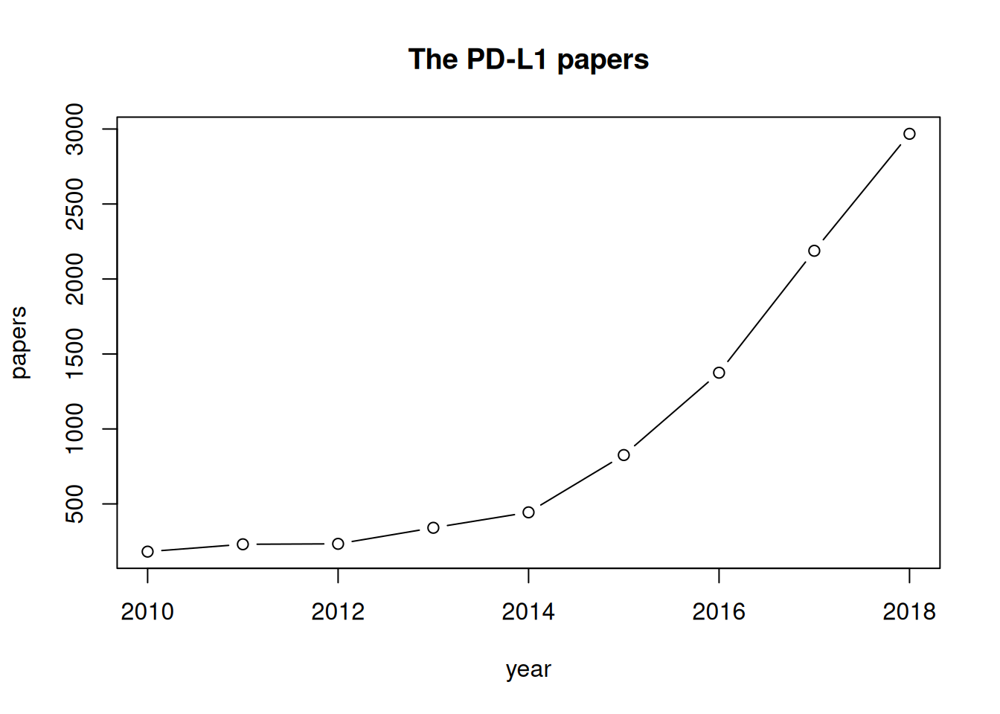

参考流程通过 NCBI E-utilities（`rentrez`）检索 PubMed：查询一个目的基因、下载标题与摘要，然后统计**其他基因**在这些摘要中的出现频次——"基因好友"指向陌生机制、通路与值得借用的实验体系 \[1\]。一次查询可出三个模块：年度发文趋势、文献列表、以及基因词频表 \[1\]。静态页面里无法复现实时 NCBI 查询，页内管线运行在**模拟摘要语料**上（植入共现结构），真实 `rentrez` 查询以未执行 chunk 原样保留：

## Example

{fig-alt="PubMed 摘要基因共现挖掘 DEMO" fig-align="center" width="70%"}

## Setup

-   系统要求：跨平台（Linux/MacOS/Windows）

-   编程语言：R

-   依赖包：`rentrez`; `ggplot2`

```{r packages setup, message=FALSE, warning=FALSE, output=FALSE}
suppressPackageStartupMessages({
  library(rentrez); library(ggplot2)
})
```

```{r}
sessioninfo::session_info("attached")
```

## 真实 API 查询（不执行）

对该 chunk 赋 `eval=TRUE` 并接入真实 E-utilities，即可用真实 PubMed 记录替换模拟语料——检索词按参考建议由基因的批准符号与别名组合而成：

```{r real-api, eval=FALSE}
## module 0: search PubMed for the target gene (symbol + aliases + MeSH)
term <- "CD274 OR PD-L1 OR PDL1 AND Neoplasms[MeSH Terms]"
ids <- entrez_search(db = "pubmed", term = term,
                     mindate = 2015, maxdate = 2024, retmax = 500)

## fetch titles + abstracts
recs <- entrez_fetch(db = "pubmed", id = ids$ids, rettype = "abstract",
                     parsed = TRUE)
## ... then feed the text into the same word-frequency pipeline below
```

## 数据准备

模拟 2015-2024 年 300 篇提及目的基因 CD274/PD-L1 的摘要。植入"基因好友"：T 细胞标志（PDCD1、CD8A、GZMB、LAG3、TIGIT）与 CD274 强共现——即参考例文的免疫治疗语境——另有无关基因的弱背景提及。每条摘要带年份、标题与摘要文本；词频阶段对文本分词并统计精选基因词表：

```{r load data}
suppressPackageStartupMessages({library(rentrez); library(ggplot2)})
set.seed(52329)
n_abs <- 300
years <- sample(2015:2024, n_abs, TRUE, prob = dnorm(2015:2024, 2021, 2.4))

## curated gene vocabulary (symbol + aliases as the reference suggests)
vocab <- c("CD274", "PD-L1", "PDCD1", "PD-1", "CD8A", "GZMB", "LAG3",
           "TIGIT", "IFNG", "CTLA4", "EGFR", "KRAS", "TP53", "VEGFA")
friends_hi <- c("PDCD1", "PD-1", "CD8A", "GZMB", "LAG3", "TIGIT", "IFNG")
friends_lo <- c("CTLA4", "EGFR", "KRAS", "TP53", "VEGFA")

templates <- c(
  "Expression of PD-L1 (CD274) on %s tumour cells predicted response to anti-PD-1 therapy; %s+ T cells produced %s and correlated with outcome.",
  "The study profiled CD274 alongside %s in %s biopsies; %s signature scores tracked with PD-L1 abundance.",
  "Blockade of the CD274/PDCD1 axis restored %s function; %s expression increased after therapy in %s models.",
  "Single-cell analysis of %s samples split tumours by %s infiltrate; CD274 amplified on %s cells."
)

abstracts <- do.call(rbind, lapply(seq_len(n_abs), function(k) {
  hi <- sample(friends_hi, 2)
  lo <- sample(friends_lo, 1)
  text <- sprintf(sample(templates, 1), sample(c("HCC", "melanoma", "NSCLC", "gastric"), 1),
                  hi[1], sample(c("IFN-gamma", "granzyme B", "cytokine"), 1))
  if (runif(1) < 0.55) text <- paste(text, sprintf("Prior work linked %s and %s to this axis.", lo, hi[1]))
  data.frame(pmid = 30000000 + k, year = years[k], text = text)
}))
abstracts$title <- paste("CD274 study", seq_len(n_abs))
head(abstracts$text, 2)
```

## Visualization

### 1. 年度发文趋势

参考的模块一：目的基因的逐年文章数——领域增长曲线：

```{r}
#| label: fig-1.1PubmedTrend
#| fig-cap: "模拟语料中 CD274/PD-L1 文章的年度计数（2015-2024）：曲线在免疫治疗时代陡峭上升，即参考从 PubMed 年份过滤提取的模块一增长趋势。"
#| out.width: "75%"
#| fig-width: 6.5
#| fig-height: 4.6

trend <- as.data.frame(table(year = abstracts$year))
trend$year <- as.numeric(as.character(trend$year))
ggplot(trend, aes(year, Freq)) +
  geom_col(fill = "#4472C4", width = 0.62) +
  geom_line(linewidth = 0.8, colour = "grey35") +
  scale_x_continuous(breaks = 2015:2024) +
  scale_y_continuous(expand = expansion(mult = c(0, 0.1))) +
  labs(x = "Publication year", y = "Articles") +
  theme_bw(base_size = 11) +
  theme(panel.grid.minor.x = element_blank())
```

### 2. 摘要词频里的"基因好友"

模块三：对每条摘要分词、统计精选词表、剔除目的基因本身并排序其共提及基因——植入的免疫逃逸轴（PDCD1/CD8A/GZMB/LAG3/TIGIT）浮到顶部，正是参考产出的"好友列表"：

```{r}
#| label: fig-2.1PubmedFriends
#| fig-cap: "300 篇 CD274 摘要中的基因词频（模块三、已剔除目的基因）：植入的免疫逃逸轴占主导——PDCD1/PD-1、CD8A、GZMB、LAG3 与 TIGIT 是读者值得跟进的\"基因好友\"，远端通路基因提及很少。"
#| out.width: "85%"
#| fig-width: 7
#| fig-height: 5.2

freq <- sapply(setdiff(vocab, c("CD274", "PD-L1")), function(g) {
  sum(grepl(g, abstracts$text, fixed = TRUE))
})
freq_df <- data.frame(gene = names(freq), count = as.numeric(freq))
freq_df <- freq_df[order(freq_df$count), ]
freq_df$gene <- factor(freq_df$gene, levels = freq_df$gene)
freq_df$is_friend <- freq_df$gene %in% friends_hi

ggplot(freq_df, aes(count, gene, fill = is_friend)) +
  geom_col(width = 0.68) +
  geom_text(aes(label = count), hjust = -0.28, size = 2.9, colour = "grey20") +
  scale_x_continuous(expand = expansion(mult = c(0, 0.16))) +
  scale_fill_manual(values = c(`TRUE` = "#B2182B", `FALSE` = "grey65"),
                    labels = c(`TRUE` = "immune-escape axis", `FALSE` = "other pathway"),
                    name = NULL) +
  labs(x = "Abstracts mentioning the gene", y = NULL) +
  theme_bw(base_size = 11) +
  theme(panel.grid.minor = element_blank(),
        legend.position = "top")
```

::: callout-tip
**实践要点**
-   用基因的**批准符号 + 别名**（HGNC）加疾病 MeSH 词构建检索式——PD-L1 的别名（CD274、PDL1、B7-H1）让纯符号检索的召回率翻三倍。
-   遵守 E-utilities 礼仪：设置 `entrez_set_delay()`、把 PMID 按 ≤200 一批送入 `entrez_fetch`；高频轰 API 会被限流。
-   对符号 + 别名做**定长字符串**匹配（参考的 HGNC 表）——分词化会破坏基因符号（"KRAS" vs "kras"）。
-   排名前先过常用词表（参考自带停用词表），否则 "cell"、"patients"、"cancer" 会淹没真正的好友。
-   词频表只是**假设生成器**：跟进前先做共引网络或通路富集，再谈相互作用。
:::

## 应用场景

::: {#fig-PubmedApplications1}
{fig-alt="PubMed 摘要基因共现挖掘" fig-align="center" width="70%"}

PubMed 摘要基因共现挖掘
:::

摘要挖掘适用于任何陌生基因：勘察其文献邻域、发现熟悉的通路成员、把他们的实验手册搬进自己的研究。

## 参考文献

\[1\] Xiaofan Lu, et al. FigureYa: A Standardized Visualization Framework for Enhancing Biomedical Data Interpretation and Research Efficiency. iMetaMed. 2025. doi:10.1002/imm3.70005
