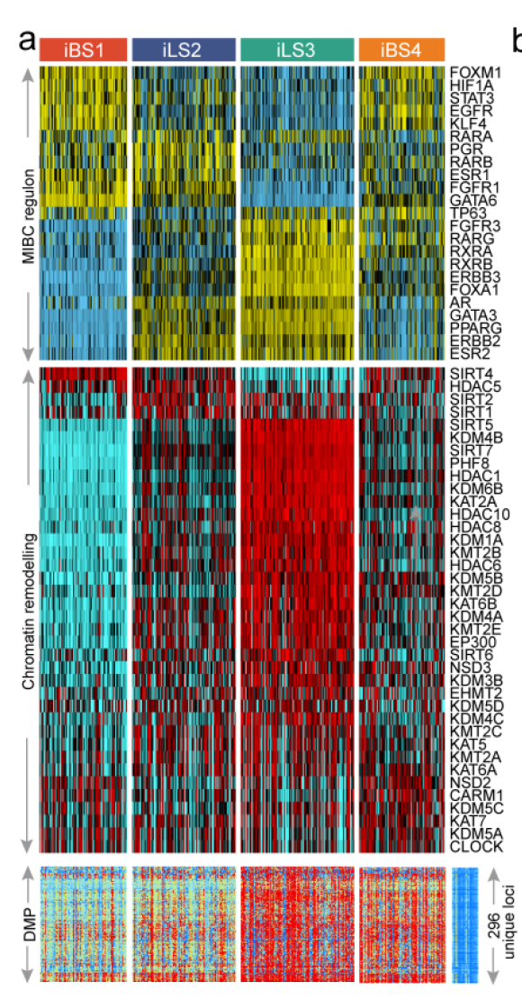

A **regulon** is a transcription factor plus its induced/repressed target genes; its *activity* per sample (not TF expression) is what separates molecular subtypes. The reference reconstructs the network with `RTN` (`tni.constructor` → `tni.permutation` → `tni.bootstrap` → `tni.dpi.filter`), scores activity with `tni.gsea2`, and heatmaps the 23 MIBC TF regulons across four immune-clinical subtypes \[1\]. `RTN` is not in this repository's lockfile, so the regulon-activity matrix is simulated with planted subtype-specific activity (the GSEA2 statistic is a normalised enrichment score — the heatmap and its ordering logic are the reference's):

## Example

{fig-alt="Regulon Activity Heatmap DEMO" fig-align="center" width="75%"}

## Setup

-   System Requirements: Cross-platform (Linux/MacOS/Windows)

-   Programming language: R

-   Dependent packages: `pheatmap`

```{r packages setup, message=FALSE, warning=FALSE, output=FALSE}
suppressPackageStartupMessages({
  library(pheatmap)
})
```

```{r}
sessioninfo::session_info("attached")
```

## Data Preparation

Regulon-activity scores (NES-like, ±3) for 23 urothelial TFs (the reference's list: ESR1/2, AR, PGR, PPARG, RAR/RXR family, ERBB2/3, FGFR1/3, FOXA1, FOXM1, GATA3/6, HIF1A, KLF4, STAT3, TP63) × 120 samples assigned to four subtypes (iBS1/iBS2/iLS3/iLS4-style), planted so each subtype activates a distinct TF programme plus shared housekeeping regulons. The annotation strip carries the subtype, and rows are z-scaled so TFs with different activity ranges stay comparable:

```{r load data}
suppressPackageStartupMessages({library(pheatmap)})
set.seed(42249)
tfs <- c("ESR1","ESR2","AR","PGR","PPARG","RARA","RARB","RARG",
         "RXRA","RXRB","RXRG","ERBB2","ERBB3","FGFR1","FGFR3",
         "FOXA1","FOXM1","GATA3","GATA6","HIF1A","KLF4","STAT3","TP63")
subtypes <- c("iBS1", "iBS2", "iLS3", "iLS4")
n_per <- 30
sam_sub <- rep(subtypes, each = n_per)
names(sam_sub) <- sprintf("S%03d", seq_along(sam_sub))
## which regulons dominate which subtype
prog <- list(iBS1 = c("TP63", "KLF4", "FGFR3", "ESR2"),
             iBS2 = c("GATA3", "FOXA1", "ERBB2", "ESR1"),
             iLS3 = c("PPARG", "RXRA", "RARA", "STAT3"),
             iLS4 = c("HIF1A", "FOXM1", "AR", "FGFR1"))
act <- matrix(rnorm(length(tfs) * length(sam_sub), 0, 0.5),
              length(tfs), length(sam_sub),
              dimnames = list(tfs, names(sam_sub)))
for (st in subtypes) {
  cols <- names(sam_sub)[sam_sub == st]
  act[prog[[st]], cols] <- act[prog[[st]], cols] + 2.2
}
plotdata <- t(scale(t(act)))
plotdata <- pmin(pmax(plotdata, -2.5), 2.5)
annCol <- data.frame(Subtype = factor(sam_sub, levels = subtypes),
                     row.names = names(sam_sub))
```

## Visualization

### 1. Regulon Activity Across Subtypes

The reference's upper panel: activity heatmap, columns ordered by subtype with gap lines between the four blocks, row annotation (none needed — TF names on the left), z-scaled with a symmetric ramp. The planted programmes read as coherent red blocks inside their subtype:

```{r}
#| label: fig-1.1RegulonActivity
#| fig-cap: "Regulon activity profiles for 23 urothelial TF regulons across 120 samples in four subtypes: columns grouped by subtype (gap-separated, sample names omitted), rows z-scaled and capped at +/-2.5; each subtype's planted programme (e.g. TP63/KLF4 in iBS1, PPARG/RXRA in iLS3) lights up as a red block."
#| out.width: "95%"
#| fig-width: 8
#| fig-height: 3.6

pheatmap(plotdata,
         color = colorRampPalette(c("#2166AC", "white", "#B2182B"))(64),
         cluster_rows = FALSE, cluster_cols = FALSE,
         annotation_col = annCol,
         annotation_colors = list(Subtype = setNames(
           c("#DD492E", "#40548A", "#32A087", "#EC7D21"), subtypes)),
         gaps_col = cumsum(table(sam_sub))[-length(subtypes)],
         border_color = NA,
         fontsize_row = 7,
         show_colnames = FALSE,
         cellwidth = 0.85, cellheight = 7,
         legend = TRUE)
```

### 2. Subtype-Mean Activity: The Condensed Readout

The heatmap's block structure condensed into one dot plot — mean ± SD activity per TF per subtype, sorted by effect spread. This is the panel reviewers actually extract numbers from:

```{r}
#| label: fig-2.1RegulonMeans
#| fig-cap: "Mean +/- SD regulon activity per subtype for the ten TFs with the largest between-subtype spread: each planted programme separates its own subtype clearly, housekeeping regulons stay near zero everywhere."
#| out.width: "85%"
#| fig-width: 7
#| fig-height: 6.5

mean_act <- sapply(subtypes, function(st) rowMeans(act[, sam_sub == st, drop = FALSE]))
sd_act <- sapply(subtypes, function(st) apply(act[, sam_sub == st, drop = FALSE], 1, sd))
spread <- apply(mean_act, 1, function(x) max(x) - min(x))
top_tfs <- names(sort(spread, decreasing = TRUE))[1:10]
df <- do.call(rbind, lapply(top_tfs, function(tf) {
  data.frame(TF = tf, Subtype = subtypes,
             mean = mean_act[tf, ], sd = sd_act[tf, ])
}))
df$TF <- factor(df$TF, levels = rev(top_tfs))
ggplot2::ggplot(df, ggplot2::aes(Subtype, TF, colour = mean)) +
  ggplot2::geom_point(size = 4.2) +
  ggplot2::geom_errorbar(ggplot2::aes(ymin = mean - sd, ymax = mean + sd),
                         width = 0.18, linewidth = 0.4) +
  ggplot2::scale_colour_gradient2(low = "#2166AC", mid = "white", high = "#B2182B",
                                  midpoint = 0, limits = c(-2.5, 2.5)) +
  ggplot2::labs(x = NULL, y = NULL, colour = "mean\nactivity") +
  ggplot2::theme_bw(base_size = 10.5) +
  ggplot2::theme(panel.grid.minor = ggplot2::element_blank(),
                 axis.text.x = ggplot2::element_text(angle = 45, hjust = 1))
```

::: callout-tip
**Practice tips**

-   Regulon activity ≠ TF expression: the GSEA-style score over the TF's target set captures target-gene coordination, which frequently anti-correlates with the TF's own mRNA.
-   Keep the column order grouped by subtype with gap lines (`gaps_col = cumsum(table(...))`), not clustered — the figure's claim is "activity follows subtype", and clustering the columns re-discovers the subtypes rather than showing it.
-   Z-scale rows (TFs) and cap the display: NES scales differ per regulon and one high-variance TF flattens everything else.
-   The DPI filter (`tni.dpi.filter`) is what makes each target belong to one TF — skip it and co-regulated TFs share targets, inflating their activity correlation.
-   Quantify the association beyond the heatmap: per-TF Kruskal test across subtypes (the reference's "strong confirmation" claim) or an AUROC of subtype classification from the top-k regulons.
:::

## Application

::: {#fig-RegulonApplications1}
{fig-alt="Regulon Activity Heatmap" fig-align="center" width="75%"}

Regulon activity heatmap
:::

Any "regulon × sample" activity matrix reads this way: RTN/VIPER/SCENIC outputs, pathway-activity scores grouped by pathway family, or kinase-substrate enrichment across tumours — wherever a transcriptional-programme readout needs to align with an existing subtype structure.

## Reference

\[1\] Xiaofan Lu, et al. FigureYa: A Standardized Visualization Framework for Enhancing Biomedical Data Interpretation and Research Efficiency. iMetaMed. 2025. doi:10.1002/imm3.70005
