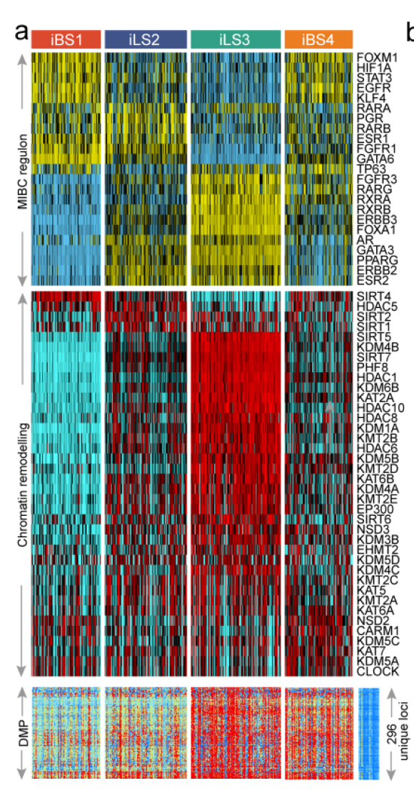

**Regulon** 是转录因子及其诱导/抑制的靶基因集合；其逐样本*活性*（非 TF 表达）才是分子亚型的分离因素。参考用 `RTN` 重建网络（`tni.constructor` → `tni.permutation` → `tni.bootstrap` → `tni.dpi.filter`）、`tni.gsea2` 评分活性、对 23 个 MIBC TF regulons 在四个免疫-临床亚型间画热图 \[1\]。`RTN` 不在本仓库 lockfile——regulon 活性矩阵以植入的亚型特异活性模拟（GSEA2 统计量即归一化富集分数——热图与其排序逻辑是参考的）：

## Example

{fig-alt="Regulon 活性热图 DEMO" fig-align="center" width="60%"}

## Setup

-   系统要求：跨平台（Linux/MacOS/Windows）

-   编程语言：R

-   依赖包：`pheatmap`

```{r packages setup, message=FALSE, warning=FALSE, output=FALSE}
suppressPackageStartupMessages({
  library(pheatmap)
})
```

```{r}
sessioninfo::session_info("attached")
```

## 数据准备

23 个尿路上皮 TF（参考清单：ESR1/2、AR、PGR、PPARG、RAR/RXR 家族、ERBB2/3、FGFR1/3、FOXA1、FOXM1、GATA3/6、HIF1A、KLF4、STAT3、TP63）× 120 样本（四个 iBS1/iBS2/iLS3/iLS4 式亚型）的 regulon 活性评分（NES 式 ±3），植入每亚型激活独立 TF 程序 + 共享管家 regulon。注释条携带亚型、行做 z 标度使活性范围不同的 TF 可比：

```{r load data}
suppressPackageStartupMessages({library(pheatmap)})
set.seed(42249)
tfs <- c("ESR1","ESR2","AR","PGR","PPARG","RARA","RARB","RARG",
         "RXRA","RXRB","RXRG","ERBB2","ERBB3","FGFR1","FGFR3",
         "FOXA1","FOXM1","GATA3","GATA6","HIF1A","KLF4","STAT3","TP63")
subtypes <- c("iBS1", "iBS2", "iLS3", "iLS4")
n_per <- 30
sam_sub <- rep(subtypes, each = n_per)
names(sam_sub) <- sprintf("S%03d", seq_along(sam_sub))
## which regulons dominate which subtype
prog <- list(iBS1 = c("TP63", "KLF4", "FGFR3", "ESR2"),
             iBS2 = c("GATA3", "FOXA1", "ERBB2", "ESR1"),
             iLS3 = c("PPARG", "RXRA", "RARA", "STAT3"),
             iLS4 = c("HIF1A", "FOXM1", "AR", "FGFR1"))
act <- matrix(rnorm(length(tfs) * length(sam_sub), 0, 0.5),
              length(tfs), length(sam_sub),
              dimnames = list(tfs, names(sam_sub)))
for (st in subtypes) {
  cols <- names(sam_sub)[sam_sub == st]
  act[prog[[st]], cols] <- act[prog[[st]], cols] + 2.2
}
plotdata <- t(scale(t(act)))
plotdata <- pmin(pmax(plotdata, -2.5), 2.5)
annCol <- data.frame(Subtype = factor(sam_sub, levels = subtypes),
                     row.names = names(sam_sub))
```

## Visualization

### 跨亚型的 regulon 活性

参考的上半面板：活性热图、列按亚型排序且四块之间有间隙线、行注释免（左侧 TF 名）、z 标度对称色带。植入的程序读作各自亚型内的连贯红块：

```{r}
#| label: fig-1.1RegulonActivity
#| fig-cap: "23 个尿路上皮 TF regulons 在四个亚型 120 样本中的活性谱：列按亚型分块（间隙分隔）、行 z 标度并截断 ±2.5；每个亚型的植入程序（如 iBS1 的 TP63/KLF4、iLS3 的 PPARG/RXRA）以红块点亮。"
#| out.width: "95%"
#| fig-width: 8
#| fig-height: 3.6

pheatmap(plotdata,
         color = colorRampPalette(c("#2166AC", "white", "#B2182B"))(64),
         cluster_rows = FALSE, cluster_cols = FALSE,
         annotation_col = annCol,
         annotation_colors = list(Subtype = setNames(
           c("#DD492E", "#40548A", "#32A087", "#EC7D21"), subtypes)),
         gaps_col = cumsum(table(sam_sub))[-length(subtypes)],
         border_color = NA,
         fontsize_row = 7,
         show_colnames = FALSE,
         cellwidth = 0.85, cellheight = 7,
         legend = TRUE)
```

### 亚型均值活性：浓缩读法

热图的块结构浓缩为一张点图——逐 TF 逐亚型的均值 ± SD、按效应跨度排序。这是评审真正从图里抽数字的面板：

```{r}
#| label: fig-2.1RegulonMeans
#| fig-cap: "跨亚型间跨度最大的十个 TF 的均值 ± SD regulon 活性：植入的各程序清晰分离自身亚型、管家 regulon 处处近零。"
#| out.width: "85%"
#| fig-width: 7
#| fig-height: 6.5

mean_act <- sapply(subtypes, function(st) rowMeans(act[, sam_sub == st, drop = FALSE]))
sd_act <- sapply(subtypes, function(st) apply(act[, sam_sub == st, drop = FALSE], 1, sd))
spread <- apply(mean_act, 1, function(x) max(x) - min(x))
top_tfs <- names(sort(spread, decreasing = TRUE))[1:10]
df <- do.call(rbind, lapply(top_tfs, function(tf) {
  data.frame(TF = tf, Subtype = subtypes,
             mean = mean_act[tf, ], sd = sd_act[tf, ])
}))
df$TF <- factor(df$TF, levels = rev(top_tfs))
ggplot2::ggplot(df, ggplot2::aes(Subtype, TF, colour = mean)) +
  ggplot2::geom_point(size = 4.2) +
  ggplot2::geom_errorbar(ggplot2::aes(ymin = mean - sd, ymax = mean + sd),
                         width = 0.18, linewidth = 0.4) +
  ggplot2::scale_colour_gradient2(low = "#2166AC", mid = "white", high = "#B2182B",
                                  midpoint = 0, limits = c(-2.5, 2.5)) +
  ggplot2::labs(x = NULL, y = NULL, colour = "mean\nactivity") +
  ggplot2::theme_bw(base_size = 10.5) +
  ggplot2::theme(panel.grid.minor = ggplot2::element_blank(),
                 axis.text.x = ggplot2::element_text(angle = 45, hjust = 1))
```


## 应用场景

::: {{#fig-RegulonApplications1}}
{fig-alt="Regulon 活性热图" fig-align="center" width="60%"}

Regulon 活性热图
:::

任何"regulon × 样本"活性矩阵都这样读：RTN/VIPER/SCENIC 输出、按通路家族分组的通路活性分数、或跨肿瘤的激酶-底物富集——凡转录程序读数需要与既有亚型结构对齐处。

## 参考文献

\[1\] Xiaofan Lu, et al. FigureYa: A Standardized Visualization Framework for Enhancing Biomedical Data Interpretation and Research Efficiency. iMetaMed. 2025. doi:10.1002/imm3.70005
