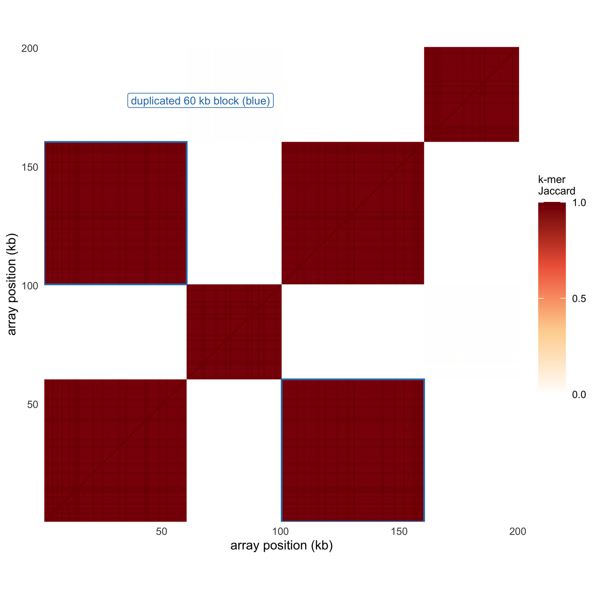

Repeat structure is the part of a genome that alignment-based figures handle worst. A tandem array can be 200 kb of near-identical sequence, and a duplicated block can sit inside the array at 97% identity, which is exactly where an aligner starts making arbitrary choices. The tools built for this problem change the object being drawn: ModDotPlot and StainedGlass compute **self-similarity from k-mers** rather than from alignments, REViewer and TRGT draw **read pileups across a short tandem repeat**, and TRviz decomposes an allele into its **motif units**.

This tutorial builds all three from one simulated array and two simulated STR alleles, so the encoding — not the data — is what the reader has to judge.

## Example

{fig-alt="Repeat Structure Plot DEMO" fig-align="center" width="85%"}

k-mer Jaccard self-similarity for a 200 kb tandem array in 1 kb bins: the diagonal is the array against itself and dark red blocks are bins sharing the same repeat unit type. The two blue squares mark a 60 kb block that occurs twice, 100 kb apart; that off-diagonal square is the higher-order repeat. Different unit types share almost no 9-mers (mean Jaccard 0.002), while same-type bins score about 0.97.

## Setup

-   System Requirements: Cross-platform (Linux/MacOS/Windows)

-   Programming language: R

-   Dependent packages: `ggplot2`; `dplyr`; `tidyr`

```{r packages setup, message=FALSE, warning=FALSE, output=FALSE}
if (!requireNamespace("ggplot2", quietly = TRUE)) install.packages("ggplot2")
if (!requireNamespace("dplyr", quietly = TRUE)) install.packages("dplyr")
if (!requireNamespace("tidyr", quietly = TRUE)) install.packages("tidyr")

library(ggplot2)
library(dplyr)
library(tidyr)
```

```{r}
sessioninfo::session_info("attached")
```

## Data Preparation

The simulated data contain a 200 kb tandem array (1 kb units of three types, with a 60 kb block duplicated 100 kb downstream) and two CAG short-tandem-repeat alleles (12 and 45 units).

```{r load data, message=FALSE, warning=FALSE}
set.seed(43519)

## A 200 kb tandem array made of 1 kb units. Three unit types are laid out in
## blocks; the type-1 block at 0-60 kb is duplicated at 100-160 kb, which is the
## higher-order repeat a self-similarity plot is meant to reveal.
K <- 9
alpha <- c("A", "C", "G", "T")
make_unit <- function() {
  paste(sample(alpha, 1000, replace = TRUE, prob = c(.3, .2, .2, .3)), collapse = "")
}
types <- replicate(3, make_unit())
unit_type <- c(rep(1, 60), rep(2, 40), rep(1, 60), rep(3, 40))

## 1% divergence per unit, so same-type pairs are near-identical but not exactly 1.
unit_seq <- lapply(seq_len(200), function(i) {
  s <- types[unit_type[i]]
  pos <- sample(1000, 10)
  substr(s, pos, pos) <- sample(alpha, 10, replace = TRUE)
  s
})

## k-mer sets per 1 kb unit; the similarity matrix is the Jaccard index.
kmers <- function(s) {
  starts <- seq_len(nchar(s) - K + 1)
  unique(substring(s, starts, starts + K - 1))
}
sets <- lapply(unit_seq, kmers)
jaccard <- outer(seq_len(200), seq_len(200), Vectorize(function(i, j) {
  length(intersect(sets[[i]], sets[[j]])) / length(union(sets[[i]], sets[[j]]))
}))
sim <- expand.grid(i = seq_len(200), j = seq_len(200)) |>
  mutate(jac = as.vector(jaccard))

## STR reads from two alleles: 12 and 45 CAG units. Repeat counts carry the
## usual stutter, so the pileup is a distribution rather than two exact lines.
motif <- "CAG"
alen <- 12
blen <- 45
n_reads <- 26
str_reads <- data.frame(
  read = sprintf("read_%02d", 1:n_reads),
  allele = rep(c("allele 1 (12)", "allele 2 (45)"), each = n_reads / 2),
  units = c(rpois(n_reads / 2, alen), rpois(n_reads / 2, blen))
) |>
  mutate(units = pmax(units, 2)) |>
  arrange(units)

## Motif composition of the two alleles: the only difference beyond length is
## where the interruptions (CAA, CCG) sit.
a1 <- c(rep("CAG", 9), "CAA", rep("CAG", 2))
a2 <- c(rep("CAG", 40), "CCG", rep("CAG", 2), "CAA")
motifs <- bind_rows(
  data.frame(allele = "allele 1 (12)", idx = seq_along(a1), motif = a1),
  data.frame(allele = "allele 2 (45)", idx = seq_along(a2), motif = a2)
) |>
  mutate(allele = factor(allele, levels = c("allele 2 (45)", "allele 1 (12)")),
         motif = factor(motif, levels = c("CAG", "CAA", "CCG")))
```

## Visualization

### 1. k-mer Self-Similarity: The Higher-Order Repeat Map

ModDotPlot and StainedGlass both replace alignment with **sequence similarity**: the region is cut into fixed bins, each bin gets a k-mer set, and every pair of bins is scored by the Jaccard index \[1,2\]. The result is a square matrix whose diagonal is the sequence itself and whose off-diagonal squares are repeats. Here the diagonal shows the unit-type blocks, and the two blue squares show that the first 60 kb occurs again 100 kb downstream. That off-diagonal square is the whole point of the figure: a dot plot drawn from alignments may miss it if the duplicated copy has diverged past the aligner's threshold, while a k-mer matrix degrades gradually instead of disappearing.

```{r}
#| label: fig-1SelfSimilarityHeatmap
#| fig-cap: "k-mer Jaccard self-similarity for a 200 kb tandem array in 1 kb bins: the diagonal is the array itself, and dark red blocks are bins sharing the same repeat unit type. The two blue squares mark a 60 kb block that occurs twice, 100 kb apart; that off-diagonal square is the higher-order repeat. Different unit types share almost no 9-mers (mean Jaccard 0.002), while same-type bins score about 0.97."
#| out.width: "100%"
#| warning: false
#| message: false
#| fig-width: 5.2
#| fig-height: 5.2
#| fig-dpi: 300

ggplot(sim, aes(i, j, fill = jac)) +
  geom_raster() +
  scale_fill_gradientn("k-mer\nJaccard",
                       colours = c("#ffffff", "#fdd49e", "#ef6548", "#7f0000"),
                       limits = c(0, 1), breaks = c(0, 0.5, 1)) +
  coord_equal(expand = FALSE) +
  annotate("rect", xmin = 0.5, xmax = 60.5, ymin = 100.5, ymax = 160.5,
           fill = NA, colour = "#2c7bb6", linewidth = 0.5) +
  annotate("rect", xmin = 100.5, xmax = 160.5, ymin = 0.5, ymax = 60.5,
           fill = NA, colour = "#2c7bb6", linewidth = 0.5) +
  ## Label the off-diagonal square in a blank corner (x < 100, y > 160): inside
  ## the plot it would sit on a dark red block and be unreadable, and closer to
  ## the diagonal it would point at the wrong square.
  annotate("label", x = 97, y = 178, hjust = 1,
           label = "duplicated 60 kb block (blue)",
           size = 2.4, colour = "#2c7bb6", fill = "white", label.size = 0.15) +
  labs(x = "array position (kb)", y = "array position (kb)") +
  theme_minimal(base_size = 8) +
  theme(panel.grid = element_blank(),
        legend.key.height = unit(0.85, "cm"),
        legend.text = element_text(size = 6.3),
        legend.title = element_text(size = 6.7))
```

### 2. STR Read Pileup: Allele Length as a Distribution

REViewer and TRGT draw a short tandem repeat as a pileup of reads, each read ending at its own repeat count \[3,4\]. The two alleles separate into two clusters, but neither cluster is a line: stutter and sequencing error widen each allele into a distribution, and the genotype call is the pair of modes. Drawing only the consensus length would hide the width of that distribution, which is exactly the quantity used to decide whether a homozygous call is safe.

```{r}
#| label: fig-2StrReadPileup
#| fig-cap: "Read pileup across a CAG short tandem repeat: 26 reads from two alleles, each drawn from zero to its own repeat count. Allele 1 centres on 12 units and allele 2 on 45, but stutter spreads each cluster over several units, so the genotype is two modes rather than two exact lengths. Dashed lines mark the two modal sizes."
#| out.width: "100%"
#| warning: false
#| message: false
#| fig-width: 5.2
#| fig-height: 3.2
#| fig-dpi: 300

str_reads <- str_reads |> mutate(read = factor(read, levels = read))

ggplot(str_reads) +
  geom_segment(aes(x = 0, xend = units, y = read, yend = read, colour = allele),
               linewidth = 1.1, lineend = "round") +
  geom_vline(xintercept = c(alen, blen), linetype = 2, linewidth = 0.3,
             colour = "#525252") +
  annotate("text", x = alen, y = n_reads + 0.7, label = "12 units",
           size = 2.4, colour = "#525252") +
  annotate("text", x = blen, y = n_reads + 0.7, label = "45 units",
           size = 2.4, colour = "#525252") +
  scale_colour_manual(values = c("allele 1 (12)" = "#4c72b0",
                                 "allele 2 (45)" = "#dd8452"), name = NULL) +
  scale_y_discrete(expand = expansion(add = c(0.5, 1.5))) +
  scale_x_continuous(expand = expansion(mult = c(0, 0.04))) +
  labs(x = "CAG repeat units", y = "26 reads, sorted by repeat count") +
  theme_minimal(base_size = 8) +
  theme(axis.text.y = element_blank(),
        panel.grid.major.y = element_blank(),
        legend.position = "bottom", legend.direction = "horizontal",
        legend.text = element_text(size = 6.6),
        legend.key.height = unit(0.2, "cm"))
```

### 3. Motif Composition: Length Is Not the Genotype

TRviz and TRGT decompose each allele into its repeat units rather than reporting a single count \[4,5\]. The two tracks below have very different lengths, but the point is the same at any length: the interruptions (CAA, CCG) are part of the allele. Two alleles with identical length and different interruption patterns can have different stutter behaviour, different protein consequences and different clinical interpretation. A repeat-count figure that does not show motif order is quoting a length, not a genotype.

```{r}
#| label: fig-3RepeatMotifComposition
#| fig-cap: "Motif decomposition of the two alleles: each tile is one repeat unit, coloured by sequence. Allele 1 carries a single CAA interruption at position 10; allele 2 carries a CCG at position 41 and a CAA at 45. The repeat count alone cannot distinguish these alleles from a length-matched allele with a different interruption pattern."
#| out.width: "100%"
#| warning: false
#| message: false
#| fig-width: 10
#| fig-height: 2.2
#| fig-dpi: 300

ggplot(motifs) +
  geom_tile(aes(idx, allele, fill = motif), width = 0.9, height = 0.5) +
  scale_fill_manual(values = c(CAG = "#4d4d4d", CAA = "#e08214", CCG = "#2c7bb6"),
                    name = "repeat unit") +
  scale_x_continuous(expand = c(0.005, 0.005)) +
  labs(x = "repeat unit index", y = NULL) +
  theme_minimal(base_size = 8) +
  theme(panel.grid = element_blank(),
        legend.position = "bottom", legend.direction = "horizontal",
        legend.text = element_text(size = 6.6),
        legend.key.height = unit(0.2, "cm"),
        legend.key.width = unit(0.35, "cm"))
```

::: callout-tip
**Practice tips**

-   State the k-mer size and bin size. A self-similarity matrix is only reproducible with both; a 9-mer at 1 kb and a 21-mer at 100 bp produce different maps of the same array.
-   Keep the diagonal. It is the reference against which every off-diagonal square is read, and it also shows the bin boundaries that the method imposes.
-   Do not call an off-diagonal square a duplication without checking its boundaries. A square that spans exactly one repeat unit is a higher-order repeat; a square that stops at a bin edge is a binning artefact.
-   Draw every read in an STR pileup. A consensus-length bar hides stutter, and stutter is what separates a confident homozygous call from a call that should be flagged.
-   Report motif composition, not only repeat count. Interruptions change stutter, protein consequence and clinical interpretation at the same total length.
-   Name the reference and the caller (TRGT, ExpansionHunter, STRling). Repeat counts are not comparable across callers without the same reference and the same motif definition.
:::

## Application

Repeat-structure figures sit at the intersection of assembly QC, genetic diagnostics and population analysis. **Self-similarity heatmaps** support assembly correction and higher-order repeat annotation; **STR pileups** support clinical repeat-expansion testing; and **motif composition** separates alleles that share a length but not a clinical meaning. The three share one data preparation because they answer three layers of the same question: where the repeat is, how long it is, and what it is made of.

## Reference
\[1\] Sweeten AP, Schatz MC, Phillippy AM. ModDotPlot: a fast and interactive dot plot for large and highly repetitive genomes. bioRxiv. 2024. doi:10.1101/2024.04.15.589623

\[2\] Vollger MR, Kerpedjiev P, Phillippy AM, Eichler EE. StainedGlass: interactive visualization of massive tandem repeat structures with identity heatmaps. Bioinformatics. 2022;38(7):2049-2051. doi:10.1093/bioinformatics/btac018

\[3\] Dolzhenko E, Weisburd B, Mattsson C, et al. REViewer: haplotype-resolved visualization of read alignments in and around tandem repeats. bioRxiv. 2021. doi:10.1101/2021.10.20.465046

\[4\] Dolzhenko E, English A, Dashnow H, et al. Characterization and visualization of tandem repeats at genome scale. Nat Biotechnol. 2024;42:1606-1614. doi:10.1038/s41587-023-02057-3

\[5\] Park J, Cook D, Lau E, et al. TRviz: a Python library for decomposing and visualizing tandem repeat sequences. Bioinform Adv. 2023;3(1):vbad058. doi:10.1093/bioadv/vbad058
