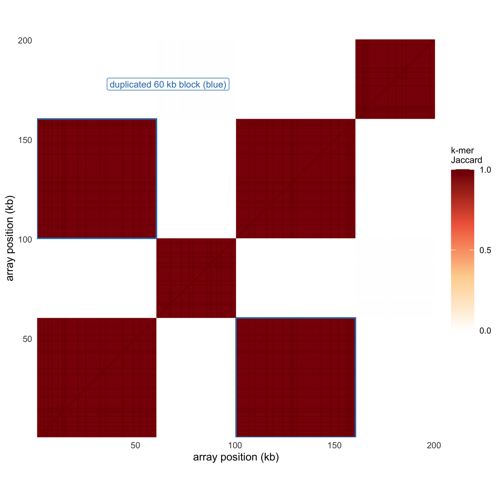

重复结构是基于比对的图形最不擅长的部分。一段串联重复阵列可以是 200 kb 近乎相同的序列，而一个重复块可能以 97% 的一致性嵌在阵列内部，这正是比对器开始随意取舍的地方。为这个问题而生的工具改变的是被画的对象：ModDotPlot 与 StainedGlass 用 **k-mer 计算自相似**而不是依赖比对，REViewer 与 TRGT 画的是**跨短串联重复的读段堆叠**，TRviz 则把等位基因分解成 **motif 单元**。

本教程用一段模拟阵列与两个模拟 STR 等位基因画出这三种视图，让读者评判的是编码方式，而不是数据本身。

## 示例

{fig-alt="重复序列结构图 DEMO" fig-align="center" width="85%"}

200 kb 串联阵列、1 kb 分箱的 k-mer Jaccard 自相似矩阵：对角线是阵列与自身，深红区块是共享同一重复单元类型的箱。两个蓝框标出一段出现两次、相隔 100 kb 的 60 kb 区块，那个非对角方块就是高阶重复。不同单元类型几乎不共享 9-mer（平均 Jaccard 0.002），而同类型箱约为 0.97。

## 环境配置

-   系统要求： 跨平台（Linux/MacOS/Windows）

-   编程语言：R

-   依赖包：`ggplot2`；`dplyr`；`tidyr`

```{r packages setup, message=FALSE, warning=FALSE, output=FALSE}
if (!requireNamespace("ggplot2", quietly = TRUE)) install.packages("ggplot2")
if (!requireNamespace("dplyr", quietly = TRUE)) install.packages("dplyr")
if (!requireNamespace("tidyr", quietly = TRUE)) install.packages("tidyr")

library(ggplot2)
library(dplyr)
library(tidyr)
```

```{r}
sessioninfo::session_info("attached")
```

## 数据准备

模拟数据包含一段 200 kb 的串联重复阵列（1 kb 单元、三种单元类型，其中一段 60 kb 在下游 100 kb 处重复）与两个 CAG 短串联重复等位基因（12 与 45 个单元）。

```{r load data, message=FALSE, warning=FALSE}
set.seed(43519)

## A 200 kb tandem array made of 1 kb units. Three unit types are laid out in
## blocks; the type-1 block at 0-60 kb is duplicated at 100-160 kb, which is the
## higher-order repeat a self-similarity plot is meant to reveal.
K <- 9
alpha <- c("A", "C", "G", "T")
make_unit <- function() {
  paste(sample(alpha, 1000, replace = TRUE, prob = c(.3, .2, .2, .3)), collapse = "")
}
types <- replicate(3, make_unit())
unit_type <- c(rep(1, 60), rep(2, 40), rep(1, 60), rep(3, 40))

## 1% divergence per unit, so same-type pairs are near-identical but not exactly 1.
unit_seq <- lapply(seq_len(200), function(i) {
  s <- types[unit_type[i]]
  pos <- sample(1000, 10)
  substr(s, pos, pos) <- sample(alpha, 10, replace = TRUE)
  s
})

## k-mer sets per 1 kb unit; the similarity matrix is the Jaccard index.
kmers <- function(s) {
  starts <- seq_len(nchar(s) - K + 1)
  unique(substring(s, starts, starts + K - 1))
}
sets <- lapply(unit_seq, kmers)
jaccard <- outer(seq_len(200), seq_len(200), Vectorize(function(i, j) {
  length(intersect(sets[[i]], sets[[j]])) / length(union(sets[[i]], sets[[j]]))
}))
sim <- expand.grid(i = seq_len(200), j = seq_len(200)) |>
  mutate(jac = as.vector(jaccard))

## STR reads from two alleles: 12 and 45 CAG units. Repeat counts carry the
## usual stutter, so the pileup is a distribution rather than two exact lines.
motif <- "CAG"
alen <- 12
blen <- 45
n_reads <- 26
str_reads <- data.frame(
  read = sprintf("read_%02d", 1:n_reads),
  allele = rep(c("allele 1 (12)", "allele 2 (45)"), each = n_reads / 2),
  units = c(rpois(n_reads / 2, alen), rpois(n_reads / 2, blen))
) |>
  mutate(units = pmax(units, 2)) |>
  arrange(units)

## Motif composition of the two alleles: the only difference beyond length is
## where the interruptions (CAA, CCG) sit.
a1 <- c(rep("CAG", 9), "CAA", rep("CAG", 2))
a2 <- c(rep("CAG", 40), "CCG", rep("CAG", 3), "CAA")
motifs <- bind_rows(
  data.frame(allele = "allele 1 (12)", idx = seq_along(a1), motif = a1),
  data.frame(allele = "allele 2 (45)", idx = seq_along(a2), motif = a2)
) |>
  mutate(allele = factor(allele, levels = c("allele 2 (45)", "allele 1 (12)")),
         motif = factor(motif, levels = c("CAG", "CAA", "CCG")))
```

## 可视化

### 1. k-mer 自相似性：高阶重复图谱

ModDotPlot 与 StainedGlass 都用**序列相似度**取代比对：把区域切成固定大小的 bin，每个 bin 取 k-mer 集合，两两之间用 Jaccard 指数打分 \[1,2\]。结果是一个方阵，对角线是序列自身，非对角方块就是重复。这里对角线上是各单元类型的块，两个蓝框表明前 60 kb 在 100 kb 下游再次出现。这个非对角方块正是本图的意义所在：基于比对的点阵图在重复拷贝分化超过比对器阈值时会漏掉它，而 k-mer 矩阵是逐渐衰减，不会突然消失。

```{r}
#| label: fig-1SelfSimilarityHeatmap
#| fig-cap: "200 kb 串联重复阵列的 k-mer Jaccard 自相似矩阵（1 kb 分箱）：对角线是阵列自身，深红色块表示共享同一重复单元类型。两个蓝框标出一段 60 kb 的块在 100 kb 之外再次出现，这个非对角方块就是高阶重复。不同单元类型几乎不共享 9-mer（平均 Jaccard 0.002），同类型 bin 约为 0.97。"
#| out.width: "100%"
#| warning: false
#| message: false
#| fig-width: 5.2
#| fig-height: 5.2
#| fig-dpi: 300

ggplot(sim, aes(i, j, fill = jac)) +
  geom_raster() +
  scale_fill_gradientn("k-mer\nJaccard",
                       colours = c("#ffffff", "#fdd49e", "#ef6548", "#7f0000"),
                       limits = c(0, 1), breaks = c(0, 0.5, 1)) +
  coord_equal(expand = FALSE) +
  annotate("rect", xmin = 0.5, xmax = 60.5, ymin = 100.5, ymax = 160.5,
           fill = NA, colour = "#2c7bb6", linewidth = 0.5) +
  annotate("rect", xmin = 100.5, xmax = 160.5, ymin = 0.5, ymax = 60.5,
           fill = NA, colour = "#2c7bb6", linewidth = 0.5) +
  ## Label the off-diagonal square in a blank corner (x < 100, y > 160): inside
  ## the plot it would sit on a dark red block and be unreadable, and closer to
  ## the diagonal it would point at the wrong square.
  annotate("label", x = 97, y = 178, hjust = 1,
           label = "duplicated 60 kb block (blue)",
           size = 2.4, colour = "#2c7bb6", fill = "white", label.size = 0.15) +
  labs(x = "array position (kb)", y = "array position (kb)") +
  theme_minimal(base_size = 8) +
  theme(panel.grid = element_blank(),
        legend.key.height = unit(0.85, "cm"),
        legend.text = element_text(size = 6.3),
        legend.title = element_text(size = 6.7))
```

### 2. STR 读段堆叠：等位基因长度是一个分布

REViewer 与 TRGT 把短串联重复画成读段堆叠，每条读段终止于自己的重复数 \[3,4\]。两个等位基因分成两簇，但任何一簇都不是一条线：stutter 与测序错误把每个等位基因展宽成一个分布，基因型调用取的是两个众数。只画一致长度会隐藏分布的宽度，而这个宽度恰恰是用来判断纯合调用是否安全的关键量。

```{r}
#| label: fig-2StrReadPileup
#| fig-cap: "CAG 短串联重复的读段堆叠：来自两个等位基因的 26 条读段，每条从 0 画到自己的重复数。等位基因 1 集中在 12 个单元、等位基因 2 集中在 45 个，但 stutter 让每一簇在若干个单元上展开，因此基因型是两个众数而不是两个精确长度。虚线标出两个众数大小。"
#| out.width: "100%"
#| warning: false
#| message: false
#| fig-width: 5.2
#| fig-height: 3.2
#| fig-dpi: 300

str_reads <- str_reads |> mutate(read = factor(read, levels = read))

ggplot(str_reads) +
  geom_segment(aes(x = 0, xend = units, y = read, yend = read, colour = allele),
               linewidth = 1.1, lineend = "round") +
  geom_vline(xintercept = c(alen, blen), linetype = 2, linewidth = 0.3,
             colour = "#525252") +
  annotate("text", x = alen, y = n_reads + 0.7, label = "12 units",
           size = 2.4, colour = "#525252") +
  annotate("text", x = blen, y = n_reads + 0.7, label = "45 units",
           size = 2.4, colour = "#525252") +
  scale_colour_manual(values = c("allele 1 (12)" = "#4c72b0",
                                 "allele 2 (45)" = "#dd8452"), name = NULL) +
  scale_y_discrete(expand = expansion(add = c(0.5, 1.5))) +
  scale_x_continuous(expand = expansion(mult = c(0, 0.04))) +
  labs(x = "CAG repeat units", y = "26 reads, sorted by repeat count") +
  theme_minimal(base_size = 8) +
  theme(axis.text.y = element_blank(),
        panel.grid.major.y = element_blank(),
        legend.position = "bottom", legend.direction = "horizontal",
        legend.text = element_text(size = 6.6),
        legend.key.height = unit(0.2, "cm"))
```

### 3. Motif 组成：长度不等于基因型

TRviz 与 TRGT 把每个等位基因分解成重复单元，而不是只报告一个计数 \[4,5\]。下面两条轨道长度相差很大，但要点在任何长度上都成立：中断（CAA、CCG）是等位基因的一部分。长度相同、中断模式不同的两个等位基因，可能有不同的 stutter 行为、不同的蛋白后果与不同的临床解释。不展示 motif 顺序的重复计数图，报告的只是长度，不是基因型。

```{r}
#| label: fig-3RepeatMotifComposition
#| fig-cap: "两个等位基因的 motif 分解：每个小方块是一个重复单元，按序列着色。等位基因 1 在第 10 位有一个 CAA 中断；等位基因 2 在第 41 位有 CCG、第 45 位有 CAA。仅凭重复计数，无法把它与长度相同但中断模式不同的等位基因区分开。"
#| out.width: "100%"
#| warning: false
#| message: false
#| fig-width: 10
#| fig-height: 2.2
#| fig-dpi: 300

ggplot(motifs) +
  geom_tile(aes(idx, allele, fill = motif), width = 0.9, height = 0.5) +
  scale_fill_manual(values = c(CAG = "#4d4d4d", CAA = "#e08214", CCG = "#2c7bb6"),
                    name = "repeat unit") +
  scale_x_continuous(expand = c(0.005, 0.005)) +
  labs(x = "repeat unit index", y = NULL) +
  theme_minimal(base_size = 8) +
  theme(panel.grid = element_blank(),
        legend.position = "bottom", legend.direction = "horizontal",
        legend.text = element_text(size = 6.6),
        legend.key.height = unit(0.2, "cm"),
        legend.key.width = unit(0.35, "cm"))
```

::: callout-tip
**实践要点**

-   写明 k-mer 长度与分箱大小。自相似矩阵必须同时给出这两个参数才可复现；1 kb 分箱的 9-mer 与 100 bp 分箱的 21-mer 会给出同一阵列的不同图谱。
-   保留对角线。它是解读每个非对角方块的参照，同时也显示了方法强加的分箱边界。
-   没有核对边界之前，不要把非对角方块称为重复。恰好跨越一个重复单元的方块是高阶重复；停在分箱边界上的方块是分箱伪影。
-   STR 堆叠图要画出每一条读段。只画一致长度会隐藏 stutter，而 stutter 正是区分高置信纯合调用与应被标记的调用的关键。
-   报告 motif 组成，而不只是重复计数。在相同总长度下，中断会改变 stutter、蛋白后果与临床解释。
-   写明参考基因组与 caller（TRGT、ExpansionHunter、STRling）。没有相同的参考与相同的 motif 定义，不同 caller 的重复计数不可直接比较。
:::

## 关于本页跳过的实现

本页刻意只用基础图形自行绘制。在 issue-435 清单中归到 Omics/RepeatStructurePlot 的工具里，有 1 条被标记为**跳过**，仅作为版式参考、不作为依赖：其中 1 条超过 5 年无运维更新（截止日 2021-11-07），0 条依赖闭包过重，不值得为一张静态图引入。本页先把这些工具的图形约定读懂，再自行重画，以便逐行核验每个面板。

| 工具 | 最近提交 | 状态 | 跳过原因 |
| --- | --- | --- | --- |
| REViewer | 2026-04-20 | 已归档 | 仓库已归档，不再维护 |

## 应用

重复结构图是基因组组装质控、遗传病诊断与群体结构分析的交叉点。**自相似热图**用于组装纠错与高阶重复注释；**STR 堆叠**用于临床重复扩增检测；**motif 组成**用于区分长度相同但临床意义不同的等位基因。三张图共用同一份数据准备，是因为它们回答的是同一个问题的三个层次：重复在哪里、有多长、由什么组成。

## 参考资料
\[1\] Sweeten AP, Schatz MC, Phillippy AM. ModDotPlot: rapid and interactive visualization of complex repeats. bioRxiv. 2024. doi:10.1101/2024.04.15.589623

\[2\] Vollger MR, Kerpedjiev P, Phillippy AM, Eichler EE. StainedGlass: interactive visualization of massive tandem repeat structures with identity heatmaps. Bioinformatics. 2022;38(7):2049-2051. doi:10.1093/bioinformatics/btac018

\[3\] Dolzhenko E, Weisburd B, Mattsson C, et al. REViewer: haplotype-resolved visualization of read alignments in and around tandem repeats. bioRxiv. 2021. doi:10.1101/2021.10.20.465046

\[4\] Dolzhenko E, English A, Dashnow H, et al. Characterization and visualization of tandem repeats at genome scale. Nat Biotechnol. 2024;42:1606-1614. doi:10.1038/s41587-023-02057-3

\[5\] Park J, Cook D, Lau E, et al. TRviz: a Python library for decomposing and visualizing tandem repeat sequences. Bioinform Adv. 2023;3(1):vbad058. doi:10.1093/bioadv/vbad058
