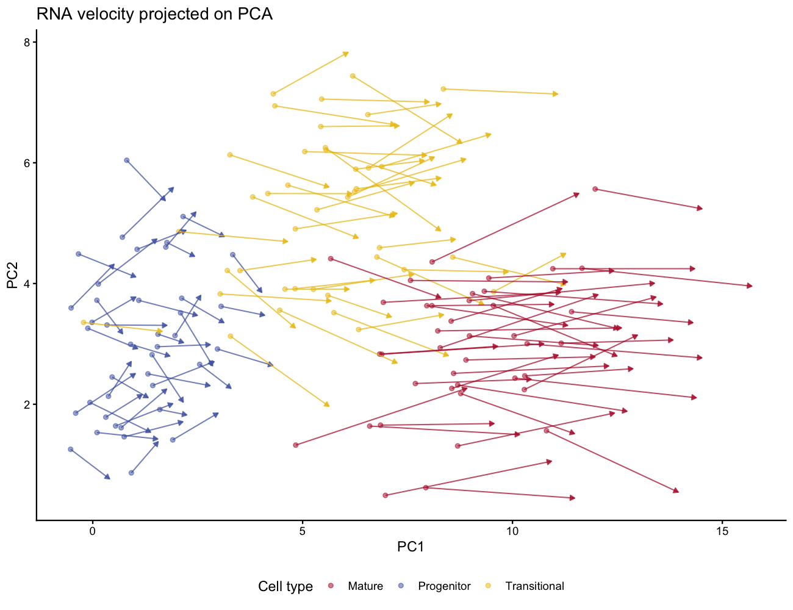

RNA velocity — the time derivative of gene expression — is estimated from the ratio of unspliced to spliced mRNA in single-cell RNA-seq \[1\]. The canonical figure projects velocity **arrows** onto a low-dimensional embedding (PCA or UMAP): longer arrows indicate higher predicted transcriptional activity. This tutorial simulates velocity data and draws the arrow plot with `geom_segment()` + `arrow()`.

## Example

{fig-alt="RnaVelocityPlot DEMO" fig-align="center" width="60%"}

## Setup

-   System Requirements: Cross-platform (Linux/MacOS/Windows)

-   Programming Language: R

-   Dependent packages: `ggplot2`; `dplyr`

```{r packages setup, message=FALSE, warning=FALSE, output=FALSE}
if (!requireNamespace("ggplot2", quietly = TRUE)) install.packages("ggplot2")
if (!requireNamespace("dplyr", quietly = TRUE)) install.packages("dplyr")

library(ggplot2)
library(dplyr)
```

```{r}
sessioninfo::session_info("attached")
```

## Data Preparation

With real data, velocyto.R computes a cell-level velocity matrix from the spliced/unspliced counts, then projects the arrows onto PCA or UMAP coordinates. We simulate that output directly: 120 cells in 3 clusters along a differentiation trajectory, with velocity vectors pointing forward along PC1.

```{r load data, message=FALSE, warning=FALSE}
set.seed(2501)
n_per <- 40
n_cell <- n_per * 3
cell_type <- rep(c("Progenitor", "Transitional", "Mature"), each = n_per)

pca1 <- c(rep(1, n_per), rep(5, n_per), rep(9, n_per)) + rnorm(n_cell, sd = 1.5)
pca2 <- c(rnorm(n_per, 3), rnorm(n_per, 5), rnorm(n_per, 3)) + rnorm(n_cell, sd = 0.5)

# velocity: points forward along PC1, magnitude increases with differentiation
vel_x <- c(runif(n_per, 0.5, 1.5), runif(n_per, 1.5, 3.0), runif(n_per, 2.5, 4.5))
vel_y <- rnorm(n_cell, sd = 0.5)

vel_df <- data.frame(PC1 = pca1, PC2 = pca2, cluster = cell_type,
                     vx = vel_x, vy = vel_y)
head(vel_df, 3)
```

## Visualization

### 1. RNA Velocity Arrows on PCA

```{r}
#| label: fig-1.1VelocityArrows
#| fig-cap: "RNA velocity arrows projected on PCA: arrows point from each cell towards its predicted future state. Longer arrows indicate higher transcriptional activity."
#| out.width: "85%"
#| warning: false
#| message: false
#| fig-width: 8
#| fig-height: 6

ggplot(vel_df, aes(PC1, PC2, colour = cluster)) +
  geom_point(size = 1.5, alpha = 0.5) +
  geom_segment(aes(xend = PC1 + vx, yend = PC2 + vy),
               arrow = arrow(length = unit(0.15, "cm"), type = "closed"),
               linewidth = 0.5, alpha = 0.7, show.legend = FALSE) +
  scale_colour_manual(values = c(Progenitor = "#445EAD", Transitional = "#EABF00",
                                 Mature = "#B2182B")) +
  labs(x = "PC1", y = "PC2", colour = "Cell type",
       title = "RNA velocity projected on PCA") +
  theme_classic(base_size = 11) +
  theme(legend.position = "bottom")
```

### 2. Velocity Magnitude by Cell Type

```{r}
#| label: fig-1.2VelocityMagnitude
#| fig-cap: "Velocity magnitude (speed) by cell type; mature cells show the highest transcriptional activity."
#| out.width: "65%"
#| warning: false
#| message: false
#| fig-width: 6
#| fig-height: 4.5

vel_df$speed <- sqrt(vel_df$vx^2 + vel_df$vy^2)
p_kw <- kruskal.test(speed ~ cluster, data = vel_df)$p.value

ggplot(vel_df, aes(cluster, speed, fill = cluster)) +
  geom_boxplot(outlier.shape = NA, width = 0.55) +
  geom_jitter(width = 0.15, size = 0.6, alpha = 0.5, show.legend = FALSE) +
  scale_fill_manual(values = c(Progenitor = "#445EAD", Transitional = "#EABF00",
                               Mature = "#B2182B")) +
  labs(title = sprintf("Velocity magnitude (Kruskal-Wallis %s)",
       ifelse(p_kw < 0.001, "p < 0.001", sprintf("p = %.3f", p_kw))),
       x = NULL, y = "Velocity magnitude") +
  theme_classic(base_size = 11) +
  theme(legend.position = "none")
```

::: callout-tip
**Practice tips**

-   The velocity arrows use `geom_segment()` with `arrow(length = unit(0.15, "cm"), type = "closed")` — adjust the length for readability at different figure sizes.
-   With real data, use `velocyto.R::gene.relative.velocity.estimates()` to compute the velocity matrix, then `velocyto.R::show.velocity.on.embedding.cor()` for the built-in arrow plot; the ggplot2 recipe above gives finer control over aesthetics.
-   Colour the arrows by speed (`sqrt(vx^2 + vy^2)`) instead of cell type to highlight regions of high transcriptional activity.
:::

## Application

RNA velocity arrows are the standard figure for demonstrating differentiation direction in developmental and cancer scRNA-seq studies; the simulated-data workflow on this page adapts FigureYa177RNAvelocity \[2\].

## Reference

\[1\] La Manno G, Soldatov R, Zeisel A, et al. RNA velocity of single cells. Nature. 2018;560(7719):494-498. doi:10.1038/s41586-018-0414-6

\[2\] Xiaofan Lu, et al. FigureYa: A Standardized Visualization Framework for Enhancing Biomedical Data Interpretation and Research Efficiency. iMetaMed. 2025. doi:10.1002/imm3.70005
