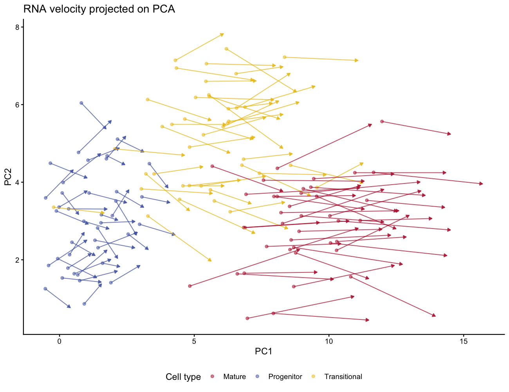

RNA 速率——基因表达的时间导数——从单细胞 RNA-seq 中的未剪接与剪接 mRNA 比值估计 \[1\]。经典配图将速率**箭头**投影到低维嵌入（PCA 或 UMAP）上：箭头越长表示预测的转录活性越高。本教程模拟速率数据并用 `geom_segment()` + `arrow()` 绘制箭头图。

## Example

{fig-alt="RnaVelocityPlot DEMO" fig-align="center" width="60%"}

## Setup

-   系统要求：跨平台（Linux/MacOS/Windows）

-   编程语言：R

-   依赖包： `ggplot2`; `dplyr`

```{r packages setup, message=FALSE, warning=FALSE, output=FALSE}
if (!requireNamespace("ggplot2", quietly = TRUE)) install.packages("ggplot2")
if (!requireNamespace("dplyr", quietly = TRUE)) install.packages("dplyr")

library(ggplot2)
library(dplyr)
```

```{r}
sessioninfo::session_info("attached")
```

## Data Preparation

真实数据中，velocyto.R 从剪接/未剪接计数计算细胞级速率矩阵，再将箭头投影到 PCA 或 UMAP 坐标。我们直接模拟该输出：沿分化轨迹排列的 3 个群共 120 个细胞，速率向量沿 PC1 正向指向前方。

```{r load data, message=FALSE, warning=FALSE}
set.seed(2501)
n_per <- 40
n_cell <- n_per * 3
cell_type <- rep(c("Progenitor", "Transitional", "Mature"), each = n_per)

pca1 <- c(rep(1, n_per), rep(5, n_per), rep(9, n_per)) + rnorm(n_cell, sd = 1.5)
pca2 <- c(rnorm(n_per, 3), rnorm(n_per, 5), rnorm(n_per, 3)) + rnorm(n_cell, sd = 0.5)

# velocity: points forward along PC1, magnitude increases with differentiation
vel_x <- c(runif(n_per, 0.5, 1.5), runif(n_per, 1.5, 3.0), runif(n_per, 2.5, 4.5))
vel_y <- rnorm(n_cell, sd = 0.5)

vel_df <- data.frame(PC1 = pca1, PC2 = pca2, cluster = cell_type,
                     vx = vel_x, vy = vel_y)
head(vel_df, 3)
```

## Visualization

### 1. PCA 上的 RNA 速率箭头

```{r}
#| label: fig-1.1VelocityArrows
#| fig-cap: "投影到 PCA 上的 RNA 速率箭头：箭头从每个细胞指向其预测的未来状态。箭头越长表示转录活性越高。"
#| out.width: "85%"
#| warning: false
#| message: false
#| fig-width: 8
#| fig-height: 6

ggplot(vel_df, aes(PC1, PC2, colour = cluster)) +
  geom_point(size = 1.5, alpha = 0.5) +
  geom_segment(aes(xend = PC1 + vx, yend = PC2 + vy),
               arrow = arrow(length = unit(0.15, "cm"), type = "closed"),
               linewidth = 0.5, alpha = 0.7, show.legend = FALSE) +
  scale_colour_manual(values = c(Progenitor = "#445EAD", Transitional = "#EABF00",
                                 Mature = "#B2182B")) +
  labs(x = "PC1", y = "PC2", colour = "Cell type",
       title = "RNA velocity projected on PCA") +
  theme_classic(base_size = 11) +
  theme(legend.position = "bottom")
```

### 2. 各细胞类型的速率量级

```{r}
#| label: fig-1.2VelocityMagnitude
#| fig-cap: "各细胞类型的速率量级（速度）；成熟细胞转录活性最高。"
#| out.width: "65%"
#| warning: false
#| message: false
#| fig-width: 6
#| fig-height: 4.5

vel_df$speed <- sqrt(vel_df$vx^2 + vel_df$vy^2)
p_kw <- kruskal.test(speed ~ cluster, data = vel_df)$p.value

ggplot(vel_df, aes(cluster, speed, fill = cluster)) +
  geom_boxplot(outlier.shape = NA, width = 0.55) +
  geom_jitter(width = 0.15, size = 0.6, alpha = 0.5, show.legend = FALSE) +
  scale_fill_manual(values = c(Progenitor = "#445EAD", Transitional = "#EABF00",
                               Mature = "#B2182B")) +
  labs(title = sprintf("Velocity magnitude (Kruskal-Wallis %s)",
       ifelse(p_kw < 0.001, "p < 0.001", sprintf("p = %.3f", p_kw))),
       x = NULL, y = "Velocity magnitude") +
  theme_classic(base_size = 11) +
  theme(legend.position = "none")
```

::: callout-tip
**Practice tips**

-   速率箭头用 `geom_segment()` + `arrow(length = unit(0.15, "cm"), type = "closed")`——不同图幅下调整长度以保持可读性。
-   真实数据用 `velocyto.R::gene.relative.velocity.estimates()` 计算速率矩阵，再用 `velocyto.R::show.velocity.on.embedding.cor()` 画内建箭头图；上方 ggplot2 配方提供更精细的美学控制。
-   用速度（`sqrt(vx^2 + vy^2)`）而非细胞类型给箭头着色，可突出转录活性高的区域。
:::

## Application

RNA 速率箭头是发育和肿瘤 scRNA-seq 研究中展示分化方向的标准配图；本页的模拟数据工作流改编自 FigureYa177RNAvelocity \[2\]。

## Reference

\[1\] La Manno G, Soldatov R, Zeisel A, et al. RNA velocity of single cells. Nature. 2018;560(7719):494-498. doi:10.1038/s41586-018-0414-6

\[2\] Xiaofan Lu, et al. FigureYa: A Standardized Visualization Framework for Enhancing Biomedical Data Interpretation and Research Efficiency. iMetaMed. 2025. doi:10.1002/imm3.70005
