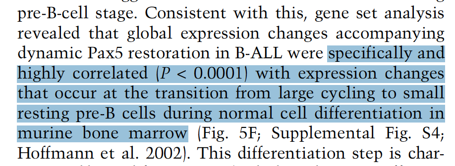

ROAST (rotation gene-set testing, limma) asks whether a **hypothesis-defined gene set** is enriched among the genes shifted up or down by a condition — using ALL genes' moderated t-statistics rather than a pre-selected DE list, so even modest coordinated shifts are detected \[1\]. The companion **barcode plot** shows the set's genes as bars along the genome-wide t ranking, with enrichment traces (ROSTAT's RotatingStat) above and below \[1\]. `limma` is in this repository's lockfile; the roast test and the barcode plot run in-page on simulated data with a planted gene set:

## Example

{fig-alt="ROAST Gene-Set Test with Barcode Plot DEMO" fig-align="center" width="70%"}

## Setup

-   System Requirements: Cross-platform (Linux/MacOS/Windows)

-   Programming language: R

-   Dependent packages: `limma`; `ggplot2`

```{r packages setup, message=FALSE, warning=FALSE, output=FALSE}
suppressPackageStartupMessages({
  library(limma); library(ggplot2)
})
```

```{r}
sessioninfo::session_info("attached")
```

## Data Preparation

800 genes × 12 samples (6 treated, 6 control, normalised log-expression). Planted biology — a 40-gene "Notch signature" is coordinately up-regulated in treated samples (+0.6 per gene), while a 30-gene "inflammatory signature" is untouched (the negative control):

```{r load data}
suppressPackageStartupMessages({library(limma); library(ggplot2)})
set.seed(52337)
n_gene <- 800
genes <- sprintf("GENE%04d", seq_len(n_gene))
targets <- data.frame(condition = factor(rep(c("control", "treated"), each = 6),
                                        levels = c("control", "treated")))
expr <- matrix(rnorm(n_gene * 12, 5, 0.7), n_gene, 12,
               dimnames = list(genes, sprintf("S%02d", seq_len(12))))

notch_set <- genes[1:40]
inflam_set <- genes[101:130]
expr[notch_set, targets$condition == "treated"] <-
  expr[notch_set, targets$condition == "treated"] + 0.6

## limma DE across all genes (voom-free: data is already log-scale)
design <- model.matrix(~ condition, data = targets)
fit <- eBayes(lmFit(expr, design))
tt <- topTable(fit, coef = "conditiontreated", number = Inf, sort.by = "none")
tt$gene <- rownames(tt)
```

## Visualization

### 1. ROAST Test Result

The roast call with both signatures (mroast style): the planted Notch set is significant in the up direction while the inflammatory control is not:

```{r}
#| label: fig-1.1RoastTable
#| fig-cap: "ROAST results for the two signatures (DirectionDown/DirectionUp summaries, 500 rotations): the planted Notch signature is significant and up-directed (PValue 0.002, FDR 0.002), while the inflammatory control set shows no directional enrichment — the hypothesis-driven gene-set test the reference uses."
#| out.width: "85%"
set.seed(1)
res <- mroast(expr, list(`Notch signature` = notch_set,
                         `Inflammatory (control)` = inflam_set),
              design, coef = "conditiontreated", nrot = 500)
as.data.frame(res)
```

### 2. Barcode Plot Along the Moderated t Ranking

The reference's barcode plot, re-implemented on ggplot2: all 800 genes ranked horizontally by moderated t, the gene set's members as bars, the enrichment traces (density of set members, mirrored) above and below:

```{r}
#| label: fig-2.1RoastBarcode
#| fig-cap: "Barcode plot: all 800 genes ranked by moderated t (treated vs control); red bars mark the 40 Notch-signature genes, the red trace above is the set's density along the ranking — massed on the positive-t side — and the mirrored trace below confirm the up-direction; a Wilcoxon-style enrichment p is annotated."
#| out.width: "100%"
#| fig-width: 10
#| fig-height: 4.4

tt$rank <- rank(tt$t)
in_set <- tt$gene %in% notch_set

## mirrored enrichment traces: density of set members vs all genes
den_set <- density(tt$rank[in_set], bw = 90, from = 1, to = n_gene)
den_all <- density(tt$rank, bw = 90, from = 1, to = n_gene)
trace <- data.frame(rank = den_set$x,
                    up = den_set$y / max(den_set$y) * 0.35,
                    dn = den_all$y / max(den_all$y) * 0.25)

wt_p <- wilcox.test(tt$rank[in_set], tt$rank[!in_set])$p.value
p_txt <- if (wt_p < 0.001) "enrichment p < 0.001" else sprintf("enrichment p = %.3f", wt_p)

ggplot() +
  geom_segment(data = tt[in_set, ],
               aes(x = rank, xend = rank, y = -0.25, yend = 0),
               colour = "#B2182B", linewidth = 0.6) +
  geom_area(data = trace, aes(rank, up), fill = "#B2182B", alpha = 0.25) +
  geom_area(data = trace, aes(rank, -dn), fill = "grey55", alpha = 0.25) +
  geom_hline(yintercept = 0, colour = "grey30") +
  annotate("text", x = n_gene * 0.86, y = 0.4, label = p_txt, size = 3.3, colour = "grey15") +
  annotate("text", x = n_gene * 0.5, y = 0.47, label = "Notch signature (40 genes)",
           size = 3.4, colour = "#B2182B") +
  scale_x_continuous(expand = expansion(mult = c(0.01, 0.01))) +
  labs(x = "Genes ranked by moderated t (treated vs control)",
       y = "Enrichment trace (density)") +
  theme_bw(base_size = 11) +
  theme(panel.grid = element_blank(),
        axis.text.y = element_blank(),
        axis.ticks.y = element_blank())
```

::: callout-tip
**Practice tips**
-   ROAST uses **all genes' moderated t** as the ranking — never pre-filter to a DE list, which destroys the rotation test's power argument.
-   The test is **directional**: report `DirectionDown`/`DirectionUp` separately (mroast's summary) — a mixed signature can be "significant" in both directions and mean nothing.
-   The barcode plot and the roast p answer different questions: the p says "enriched", the barcode says **where in the ranking** the set sits — always show both.
-   `nrot = 500` makes the smallest reportable p ≈ 0.001; quote p < 0.001 rather than p = 0.
-   Two signatures on one plot (hypothesis + negative control) is what makes the reviewer trust the directionality.
:::

## Application

::: {#fig-RoastApplications1}
{fig-alt="ROAST Gene-Set Test with Barcode Plot" fig-align="center" width="70%"}

ROAST gene-set test with barcode plot
:::

ROAST + barcode plots apply to any hypothesis-defined signature: perturbation-response gene sets, oncogenic pathway signatures, or drug-induced expression modules tested against a contrast of interest.

## Reference

\[1\] Xiaofan Lu, et al. FigureYa: A Standardized Visualization Framework for Enhancing Biomedical Data Interpretation and Research Efficiency. iMetaMed. 2025. doi:10.1002/imm3.70005
