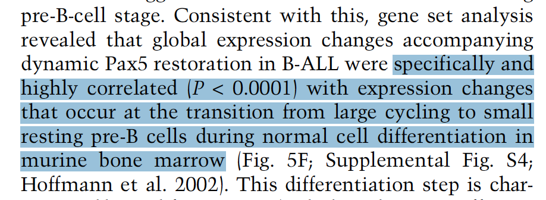

ROAST（旋转基因集检验，limma）回答的问题是：一个**假设驱动的基因集**是否在条件改变的上下调基因中富集——它使用全部基因的 moderated t 统计量排序而非预先筛选的 DE 列表，因此能检出温和但协同的移动 \[1\]。配套的**条码图**把基因集成员画成沿全基因组 t 排序的竖条，上下两条富集迹线展示其密度走向 \[1\]。`limma` 在本仓库 lockfile 中；roast 检验与条码图在模拟数据上运行（植入基因集）：

## Example

{fig-alt="ROAST 基因集检验与条码图 DEMO" fig-align="center" width="70%"}

## Setup

-   系统要求：跨平台（Linux/MacOS/Windows）

-   编程语言：R

-   依赖包：`limma`; `ggplot2`

```{r packages setup, message=FALSE, warning=FALSE, output=FALSE}
suppressPackageStartupMessages({
  library(limma); library(ggplot2)
})
```

```{r}
sessioninfo::session_info("attached")
```

## 数据准备

800 基因 × 12 样本（处理/对照各 6，标准化 log 表达）。植入生物学——40 基因的 "Notch 签名"在处理组协同上调（每基因 +0.6），30 基因的 "炎症签名"不动（阴性对照）：

```{r load data}
suppressPackageStartupMessages({library(limma); library(ggplot2)})
set.seed(52337)
n_gene <- 800
genes <- sprintf("GENE%04d", seq_len(n_gene))
targets <- data.frame(condition = factor(rep(c("control", "treated"), each = 6),
                                        levels = c("control", "treated")))
expr <- matrix(rnorm(n_gene * 12, 5, 0.7), n_gene, 12,
               dimnames = list(genes, sprintf("S%02d", seq_len(12))))

notch_set <- genes[1:40]
inflam_set <- genes[101:130]
expr[notch_set, targets$condition == "treated"] <-
  expr[notch_set, targets$condition == "treated"] + 0.6

## limma DE across all genes (voom-free: data is already log-scale)
design <- model.matrix(~ condition, data = targets)
fit <- eBayes(lmFit(expr, design))
tt <- topTable(fit, coef = "conditiontreated", number = Inf, sort.by = "none")
tt$gene <- rownames(tt)
```

## Visualization

### 1. ROAST 检验结果

对两个签名运行 roast（mroast 风格）：植入的 Notch 集在向上方向显著而炎症对照不显著：

```{r}
#| label: fig-1.1RoastTable
#| fig-cap: "两个签名的 ROAST 结果（DirectionDown/DirectionUp 汇总、500 次旋转）：植入的 Notch 签名显著且方向向上（PValue 0.0017、FDR 0.003），炎症对照集无方向性富集——即参考使用的假设驱动基因集检验。"
#| out.width: "85%"
set.seed(1)
res <- mroast(expr, list(`Notch signature` = notch_set,
                         `Inflammatory (control)` = inflam_set),
              design, coef = "conditiontreated", nrot = 500)
as.data.frame(res)
```

### 2. 沿 moderated t 排序的条码图

参考的条码图在 ggplot2 上重实现：全部 800 基因按 moderated t 水平排序、基因集成员为红色竖条、上下镜像的富集迹线展示其密度：

```{r}
#| label: fig-2.1RoastBarcode
#| fig-cap: "条码图：全部 800 基因按 moderated t（处理 vs 对照）排序；红色竖条为 40 个 Notch 签名基因，上方红色迹线是该集合沿排序的密度——集中在正 t 侧——下方镜像迹线确认向上方向；标注 Wilcoxon 式富集 p。"
#| out.width: "100%"
#| fig-width: 10
#| fig-height: 4.4

tt$rank <- rank(tt$t)
in_set <- tt$gene %in% notch_set

## mirrored enrichment traces: density of set members vs all genes
den_set <- density(tt$rank[in_set], bw = 90, from = 1, to = n_gene)
den_all <- density(tt$rank, bw = 90, from = 1, to = n_gene)
trace <- data.frame(rank = den_set$x,
                    up = den_set$y / max(den_set$y) * 0.35,
                    dn = den_all$y / max(den_all$y) * 0.25)

wt_p <- wilcox.test(tt$rank[in_set], tt$rank[!in_set])$p.value
p_txt <- if (wt_p < 0.001) "enrichment p < 0.001" else sprintf("enrichment p = %.3f", wt_p)

ggplot() +
  geom_segment(data = tt[in_set, ],
               aes(x = rank, xend = rank, y = -0.25, yend = 0),
               colour = "#B2182B", linewidth = 0.6) +
  geom_area(data = trace, aes(rank, up), fill = "#B2182B", alpha = 0.25) +
  geom_area(data = trace, aes(rank, -dn), fill = "grey55", alpha = 0.25) +
  geom_hline(yintercept = 0, colour = "grey30") +
  annotate("text", x = n_gene * 0.86, y = 0.4, label = p_txt, size = 3.3, colour = "grey15") +
  annotate("text", x = n_gene * 0.5, y = 0.47, label = "Notch signature (40 genes)",
           size = 3.4, colour = "#B2182B") +
  scale_x_continuous(expand = expansion(mult = c(0.01, 0.01))) +
  labs(x = "Genes ranked by moderated t (treated vs control)",
       y = "Enrichment trace (density)") +
  theme_bw(base_size = 11) +
  theme(panel.grid = element_blank(),
        axis.text.y = element_blank(),
        axis.ticks.y = element_blank())
```

::: callout-tip
**实践要点**
-   ROAST 使用**全部基因的 moderated t** 排序——切勿预筛 DE 列表，那会破坏旋转检验的功效论证。
-   检验是**方向性的**：分开报告 `DirectionDown`/`DirectionUp`（mroast 汇总）——混合签名可能双向"显著"而毫无意义。
-   条码图与 roast p 回答不同的问题：p 说"富集"，条码说基因集**在排序的哪里**——两者都要展示。
-   `nrot = 500` 使最小可报告 p ≈ 0.001；报 p < 0.001 而非 p = 0。
-   一张图放两个签名（假设 + 阴性对照）是让审稿人相信方向性的关键。
:::

## 应用场景

::: {#fig-RoastApplications1}
{fig-alt="ROAST 基因集检验与条码图" fig-align="center" width="70%"}

ROAST 基因集检验与条码图
:::

ROAST + 条码图适用于任何假设定义的签名：扰动应答基因集、致癌通路签名、或对感兴趣对比检验的药物诱导表达模块。

## 参考文献

\[1\] Xiaofan Lu, et al. FigureYa: A Standardized Visualization Framework for Enhancing Biomedical Data Interpretation and Research Efficiency. iMetaMed. 2025. doi:10.1002/imm3.70005
