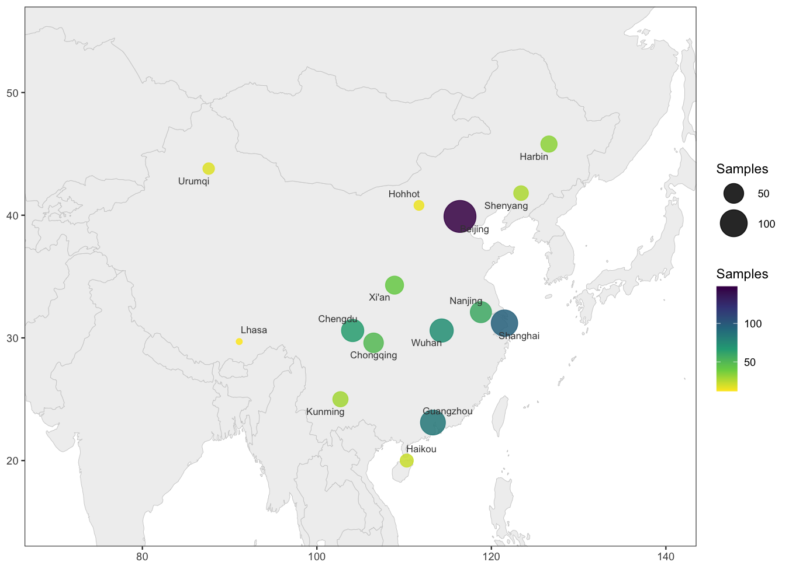

A sampling site map places every collection site on a geographic basemap, with bubble size (and optionally colour) reporting how many samples came from each site. In genomics, epidemiology and ecology papers it is usually the first figure: it documents where the cohort was recruited, exposes geographic imbalance in the sampling, and anchors every downstream analysis to real places. This tutorial reproduces the chart type covered by the *顶刊图社* series (issue 012); see the Reference section below.

## Example

{fig-alt="SamplingMap DEMO" fig-align="center" width="90%"}

This example maps a simulated 15-site sampling campaign across China (city coordinates are real; the sample counts are simulated). Bubble size and colour both encode the number of samples per site — Beijing dominates with 148 samples while the western sites contribute a handful each — and `ggrepel` labels keep the site names legible without overlapping.

## Setup

-   System Requirements: Cross-platform (Linux/MacOS/Windows)

-   Programming Language: R

-   Dependencies: `tidyverse`; `ggrepel`; `maps`

```{r packages setup, message=FALSE, warning=FALSE, output=FALSE}
# Installing necessary packages
if (!requireNamespace("tidyverse", quietly = TRUE)) {
  install.packages("tidyverse")
}
if (!requireNamespace("ggrepel", quietly = TRUE)) {
  install.packages("ggrepel")
}
if (!requireNamespace("maps", quietly = TRUE)) {
  install.packages("maps")
}

# Load packages
library(tidyverse)
library(ggrepel)
```

## Data Preparation

Two ingredients: a basemap (the `maps` package ships the world polygon data offline, so the figure renders without any network access) and one row per site with longitude, latitude and sample count.

```{r load map, message=FALSE}
world_map <- ggplot2::map_data("world")

sampling_sites <- tribble(
  ~site,       ~lon,   ~lat,   ~n,
  "Beijing",   116.4,  39.9,   148,
  "Shanghai",  121.5,  31.2,    96,
  "Guangzhou", 113.3,  23.1,    84,
  "Wuhan",     114.3,  30.6,    72,
  "Chengdu",   104.1,  30.6,    65,
  "Xi\'an",     108.9,  34.3,    41,
  "Harbin",    126.6,  45.8,    33,
  "Kunming",   102.7,  25.0,    29,
  "Lhasa",      91.1,  29.7,    12,
  "Urumqi",     87.6,  43.8,    18,
  "Shenyang",  123.4,  41.8,    27,
  "Nanjing",   118.8,  32.1,    58,
  "Chongqing", 106.5,  29.6,    49,
  "Hohhot",    111.7,  40.8,    15,
  "Haikou",    110.3,  20.0,    22)

head(sampling_sites, 3)
```

**Note:** in real studies the three columns come straight from your sample metadata (site name, GPS coordinates, specimen count). The basemap can be cropped to any region with `coord_cartesian()` — no projection packages needed.

## Visualization

### 1. Basic Plot

The polygon layer draws the basemap (`group` is required — the world polygons have many disjoint parts), and the points layer is an ordinary bubble plot in geographic coordinates. Both the size and the colour scales carry the count, giving a double encoding.

```{r}
#| label: fig-1.1BasicSamplingMap
#| fig-cap: "Basic sampling site map"
#| out.width: "95%"
#| warning: false
#| message: false
#| fig-width: 9
#| fig-height: 6.5

ggplot() +
  geom_polygon(data = world_map, aes(long, lat, group = group),
               fill = "grey94", colour = "grey80", linewidth = .2) +
  geom_point(data = sampling_sites, aes(lon, lat, size = n, colour = n), alpha = .85) +
  geom_text_repel(data = sampling_sites, aes(lon, lat, label = site),
                  size = 2.8, colour = "grey25", min.segment.length = .2,
                  box.padding = .4, point.padding = .3) +
  scale_size_continuous(range = c(2, 12), name = "Samples") +
  scale_colour_viridis_c(option = "viridis", direction = -1, name = "Samples") +
  coord_cartesian(xlim = c(70, 140), ylim = c(15, 55)) +
  labs(x = NULL, y = NULL) +
  theme_bw(base_size = 11) +
  theme(panel.grid = element_blank())
```

::: callout-tip
**Key Parameters: **

- `range = c(2, 12)`: smallest and largest bubble size; keep the minimum above zero so single-sample sites stay visible.
- `coord_cartesian(xlim, ylim)`: crops the view to the study region; switching to `coord_fixed(ratio = 1.3)` stretches the latitude for a world view (~1.3x, the usual aspect at mid latitudes).
- `geom_text_repel(min.segment.length = .2)`: draws a leader line whenever a label is nudged away from its point; `point.padding = .3` keeps labels off their own bubbles.
:::

### 2. Size Only, Counts in the Labels

Dropping the colour channel and folding the count into each label leaves a single legend and an unambiguous readout — the version most reviewers ask for when the size encoding must stand alone.

```{r}
#| label: fig-1.2LabelledSamplingMap
#| fig-cap: "Sampling map with counts in the labels"
#| out.width: "95%"
#| warning: false
#| message: false
#| fig-width: 9
#| fig-height: 6.5

ggplot() +
  geom_polygon(data = world_map, aes(long, lat, group = group),
               fill = "grey94", colour = "grey80", linewidth = .2) +
  geom_point(data = sampling_sites, aes(lon, lat, size = n), colour = "#2a6f97", alpha = .85) +
  geom_text_repel(data = sampling_sites, aes(lon, lat, label = paste0(site, " (", n, ")")),
                  size = 2.7, colour = "grey25", min.segment.length = .2,
                  box.padding = .4, point.padding = .3) +
  scale_size_continuous(range = c(2, 12), name = "Samples") +
  coord_cartesian(xlim = c(70, 140), ylim = c(15, 55)) +
  labs(x = NULL, y = NULL) +
  theme_bw(base_size = 11) +
  theme(panel.grid = element_blank())
```

### 3. World View

The same layers without a crop show the campaign at global scale; `coord_fixed(ratio = 1.3)` approximates the usual map aspect without any projection package.

```{r}
#| label: fig-1.3WorldSamplingMap
#| fig-cap: "World view of the sampling sites"
#| out.width: "95%"
#| warning: false
#| message: false
#| fig-width: 9
#| fig-height: 5.2

ggplot() +
  geom_polygon(data = world_map, aes(long, lat, group = group),
               fill = "grey95", colour = "grey82", linewidth = .15) +
  geom_point(data = sampling_sites, aes(lon, lat, size = n), colour = "#c1121f", alpha = .9) +
  scale_size_continuous(range = c(1.5, 10), name = "Samples") +
  coord_fixed(ratio = 1.3) +
  labs(x = NULL, y = NULL) +
  theme_void(base_size = 11)
```

## Applications

-   **Cohort documentation**: the opening figure of multi-center studies — who was sampled, and where.
-   **Sampling bias checks**: imbalanced geography is visible before it biases downstream statistics.
-   **Epidemiology and ecology**: outbreak clusters, species ranges, field-station networks.
-   The basemap is offline data and the layers are plain ggplot2 — swap `map_data("world")` for `map_data("state")`, `map_data("county")` or your own polygon layer for regional maps.

## Reference

\[1\] 顶刊图社 | 第012期：采样地图. WeChat article. <http://mp.weixin.qq.com/s?__biz=MzU5NjE2ODU0OQ==&mid=2247483863&idx=1&sn=f9e1f4caca6fd8ee8f6663babd8f5da7>

\[2\] Becker RA, Wilks AR, Brownrigg R, Minka TP, Deckmyn A. maps: Draw Geographical Maps. R package version 3.4.3, 2025. <https://cran.r-project.org/package=maps>
