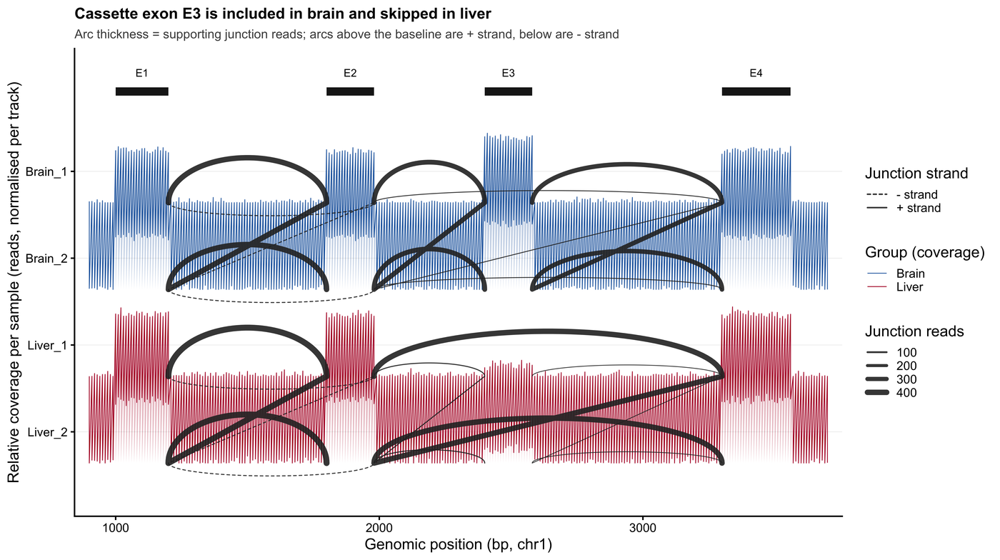

A Sashimi plot is the standard figure for alternative splicing: per-sample RNA-seq coverage is drawn along a gene locus, and each junction is drawn as an arc whose thickness equals the number of reads supporting it \[1\]. The layout carries scientific meaning — junctions must be split by strand, and the y axis must state whether it shows read depth or a splicing ratio, because the two answer different questions. This tutorial rebuilds the figure from a transparent junction-count table, including a PSI panel and the transcript models the arcs are measured against.

## Example

{fig-alt="Sashimi Plot DEMO" fig-align="center" width="85%"}

A strand-split Sashimi plot of a four-exon locus: per-sample coverage tracks for two brain and two liver libraries, junction arcs scaled to supporting reads, up-strand junctions solid and down-strand junctions dashed below the baseline. The cassette exon E3 is covered in brain and skipped in liver, and the thick E2-E4 arcs in the liver tracks are the skipping junction.

## Setup

-   System Requirements: Cross-platform (Linux/MacOS/Windows)

-   Programming language: R

-   Dependent packages: `ggplot2`; `dplyr`; `tidyr`; `patchwork`; `scales`

```{r packages setup, message=FALSE, warning=FALSE, output=FALSE}
if (!requireNamespace("ggplot2", quietly = TRUE)) install.packages("ggplot2")
if (!requireNamespace("dplyr", quietly = TRUE)) install.packages("dplyr")
if (!requireNamespace("tidyr", quietly = TRUE)) install.packages("tidyr")
if (!requireNamespace("patchwork", quietly = TRUE)) install.packages("patchwork")
if (!requireNamespace("scales", quietly = TRUE)) install.packages("scales")

library(ggplot2)
library(dplyr)
library(tidyr)
library(patchwork)
library(scales)
```

```{r}
sessioninfo::session_info("attached")
```

## Data Preparation

The upstream tools (MISO `sashimi_plot`, GGsashimi, SpliceGrapher) all consume two tables: per-base coverage for each sample and per-junction counts annotated with the strand of the transcript that produced them. We simulate a four-exon gene whose cassette exon (E3) is included in brain and skipped in liver.

```{r load data, message=FALSE, warning=FALSE}
set.seed(4352)

## 1-based coordinates of three constitutive exons and one cassette exon
exons <- tibble(
  exon   = c("E1", "E2", "E3", "E4"),
  start  = c(1000, 1800, 2400, 3300),
  end    = c(1200, 1980, 2580, 3560)
)

samples <- c("Brain_1", "Brain_2", "Liver_1", "Liver_2")
group   <- c("Brain", "Brain", "Liver", "Liver")

cov <- expand_grid(pos = seq(900, 3700, by = 10), sample = samples) |>
  mutate(
    in_exon = (pos >= 1000 & pos <= 1200) | (pos >= 1800 & pos <= 1980) |
      (pos >= 2400 & pos <= 2580) | (pos >= 3300 & pos <= 3560),
    group = group[match(sample, samples)]
  )

## E3 is four times deeper in brain because the inclusion isoform dominates there
cov <- cov |>
  mutate(
    depth = ifelse(
      in_exon,
      ifelse(pos >= 2400 & pos <= 2580,
             ifelse(group == "Brain", 260, 40),
             ifelse(group == "Brain", 210, 200)),
      rpois(n(), 2)
    ),
    depth = pmax(0, round(depth + rnorm(n(), 0, 8)))
  )

junctions <- tribble(
  ~donor, ~acceptor, ~strand, ~sample, ~reads,
  1200, 1800, "+", "Brain_1", 412,
  1200, 1800, "+", "Brain_2", 388,
  1200, 1800, "+", "Liver_1", 455,
  1200, 1800, "+", "Liver_2", 431,
  1980, 2400, "+", "Brain_1", 356,
  1980, 2400, "+", "Brain_2", 341,
  1980, 2400, "+", "Liver_1",  38,
  1980, 2400, "+", "Liver_2",  29,
  2580, 3300, "+", "Brain_1", 331,
  2580, 3300, "+", "Brain_2", 318,
  2580, 3300, "+", "Liver_1",  12,
  2580, 3300, "+", "Liver_2",   9,
  ## exon-skipping junction E2 -> E4, dominant in liver
  1980, 3300, "+", "Brain_1",  21,
  1980, 3300, "+", "Brain_2",  17,
  1980, 3300, "+", "Liver_1", 392,
  1980, 3300, "+", "Liver_2", 410,
  ## antisense junction on the opposite strand, low but real
  1200, 1980, "-", "Brain_1",  34,
  1200, 1980, "-", "Brain_2",  28,
  1200, 1980, "-", "Liver_1",  31,
  1200, 1980, "-", "Liver_2",  26
) |>
  mutate(group = group[match(sample, samples)])

junction_means <- junctions |>
  group_by(group, donor, acceptor, strand) |>
  summarise(reads = mean(reads), .groups = "drop")

junction_means
```

## Visualization

### 1. Strand-Split Sashimi Plot

Each sample gets its own coverage track. Junction arcs rise from the track baseline so their thickness reads directly against depth; up-strand junctions are drawn in one layer and down-strand junctions mirrored below the baseline with a dashed outline. Splitting the strand is not cosmetic — a merged arc would fold the antisense junctions above into the sense counts.

```{r}
#| label: fig-1.1SashimiStrand
#| fig-cap: "Strand-split Sashimi plot of a four-exon locus: per-sample coverage tracks, junction arcs scaled to supporting reads, up-strand solid and down-strand dashed below the baseline."
#| out.width: "100%"
#| warning: false
#| message: false
#| fig-width: 10
#| fig-height: 5.6
#| fig-dpi: 300

arc_points <- function(donor, acceptor, y0, height, n = 60) {
  t <- seq(0, pi, length.out = n)
  tibble(pos = donor + (acceptor - donor) * (1 - cos(t)) / 2,
         y = y0 + height * sin(t))
}

cov_scaled <- cov |>
  group_by(sample) |>
  mutate(depth_rel = depth / max(depth)) |>
  ungroup()

tracks <- cov_scaled |>
  distinct(sample, group) |>
  arrange(group, sample) |>
  mutate(y_base = -row_number() * 1.25)

cov_scaled <- cov_scaled |>
  left_join(tracks, by = c("sample", "group")) |>
  mutate(y = y_base + depth_rel)

arcs <- junction_means |>
  left_join(tracks, by = "group") |>
  mutate(height = (0.15 + 0.55 * reads / max(reads)) * ifelse(strand == "+", 1, -1))

arc_df <- arcs |>
  rowwise() |>
  mutate(pts = list(arc_points(donor, acceptor, y_base, height))) |>
  unnest(pts) |>
  ungroup()

ggplot() +
  geom_ribbon(data = cov_scaled, aes(pos, ymin = y_base, ymax = y, fill = group),
              alpha = 0.28, colour = NA) +
  geom_line(data = cov_scaled, aes(pos, y, colour = group), linewidth = 0.25) +
  geom_path(data = arc_df,
            aes(pos, y, group = interaction(donor, acceptor, group, strand),
                linetype = strand, linewidth = reads),
            colour = "#2B2B2B", alpha = 0.9, lineend = "round") +
  geom_segment(data = exons, aes(x = start, xend = end, y = 0.35, yend = 0.35),
               linewidth = 2.8, colour = "#1B1B1B") +
  geom_text(data = exons, aes(x = (start + end) / 2, y = 0.62, label = exon),
            size = 2.7) +
  scale_fill_manual(values = c(Brain = "#2166AC", Liver = "#B2182B"), guide = "none") +
  scale_colour_manual(values = c(Brain = "#2166AC", Liver = "#B2182B"),
                      name = "Group (coverage)") +
  scale_linetype_manual(values = c(`+` = "solid", `-` = "22"),
                        labels = c(`+` = "+ strand", `-` = "- strand"),
                        name = "Junction strand") +
  scale_linewidth_continuous(range = c(0.25, 2.0), name = "Junction reads") +
  scale_x_continuous(expand = c(0.02, 0)) +
  scale_y_continuous(
    breaks = tracks$y_base + 0.45, labels = tracks$sample,
    expand = expansion(mult = c(0.10, 0.06))
  ) +
  labs(
    x = "Genomic position (bp, chr1)",
    y = "Relative coverage per sample (reads, normalised per track)",
    title = "Cassette exon E3 is included in brain and skipped in liver",
    subtitle = "Arc thickness = supporting junction reads; arcs above the baseline are + strand, below are - strand"
  ) +
  theme_classic(base_size = 11) +
  theme(
    legend.position = "right",
    legend.key.height = unit(3.4, "mm"),
    plot.title = element_text(face = "bold", size = 11),
    plot.subtitle = element_text(colour = "#4D4D4D", size = 9),
    panel.grid.major.y = element_line(colour = "#F0F0F0", linewidth = 0.25)
  )
```

### 2. PSI Panel: A Ratio, Not a Count

The same junctions expressed as percent-spliced-in make the switch quantitative: PSI is the inclusion junction over inclusion plus skipping, bounded between 0 and 100% and therefore independent of sequencing depth. That bound is why the axis must say PSI — plotting raw junction counts on a percentage axis is a common and misleading substitution.

```{r}
#| label: fig-1.2PSI
#| fig-cap: "Percent-spliced-in of exon E3 per replicate (bars) with the group mean (diamond): PSI is a bounded ratio, unlike the read counts in the Sashimi panel."
#| out.width: "60%"
#| warning: false
#| message: false
#| fig-width: 5.6
#| fig-height: 4.2
#| fig-dpi: 300

psi <- junctions |>
  filter(strand == "+", donor == 1980) |>
  mutate(event = ifelse(acceptor == 2400, "inclusion", "skipping")) |>
  group_by(sample, group, event) |>
  summarise(reads = sum(reads), .groups = "drop") |>
  group_by(sample, group) |>
  summarise(
    inclusion = reads[event == "inclusion"],
    skipping  = reads[event == "skipping"],
    psi       = inclusion / (inclusion + skipping),
    .groups = "drop"
  )

ggplot(psi, aes(group, psi * 100, fill = group)) +
  geom_col(width = 0.5, colour = "white", linewidth = 0.5) +
  geom_point(aes(group, psi * 100), position = position_jitter(width = 0.06,
                                                              height = 0, seed = 1),
             size = 2, colour = "#1B1B1B", inherit.aes = FALSE) +
  geom_hline(yintercept = 50, linetype = "22", linewidth = 0.35, colour = "#7F7F7F") +
  scale_fill_manual(values = c(Brain = "#2166AC", Liver = "#B2182B"), guide = "none") +
  scale_y_continuous(limits = c(0, 100), expand = c(0, 0),
                     labels = function(x) paste0(x, "%")) +
  labs(
    x = NULL,
    y = "PSI (%, exon E3 inclusion)",
    title = "PSI of exon E3",
    subtitle = "Bars = group mean; points = replicates; dashed line = 50%"
  ) +
  theme_classic(base_size = 11) +
  theme(plot.title = element_text(face = "bold", size = 11),
        plot.subtitle = element_text(colour = "#4D4D4D", size = 9))
```

### 3. Isoform Models the Junctions Support

Arcs are only interpretable against the transcripts that produce them. Drawing the two isoform models beneath the locus marks which junction diagnoses inclusion and which diagnoses skipping — the panel reviewers check first.

```{r}
#| label: fig-1.3Isoforms
#| fig-cap: "Transcript models for the inclusion and skipping isoforms; dashed connectors mark the two junctions quantified in the Sashimi panel."
#| out.width: "92%"
#| warning: false
#| message: false
#| fig-width: 9
#| fig-height: 3.0
#| fig-dpi: 300

iso <- tribble(
  ~isoform, ~exon, ~start, ~end,
  "Include", "E1", 1000, 1200,
  "Include", "E2", 1800, 1980,
  "Include", "E3", 2400, 2580,
  "Include", "E4", 3300, 3560,
  "Skip",    "E1", 1000, 1200,
  "Skip",    "E2", 1800, 1980,
  "Skip",    "E4", 3300, 3560
) |>
  mutate(y = ifelse(isoform == "Include", 2, 1))

ggplot(iso) +
  geom_segment(aes(x = 1000, xend = 3560, y = y, yend = y),
               linewidth = 0.7, colour = "#6E6E6E") +
  geom_segment(aes(x = start, xend = end, y = y, yend = y),
               linewidth = 3.2, colour = "#1B1B1B", lineend = "butt") +
  geom_text(aes((start + end) / 2, y + 0.22, label = exon), size = 2.7) +
  annotate("segment", x = 1980, xend = 2400, y = 2.5, yend = 2.5,
           linetype = "22", colour = "#2166AC", linewidth = 0.7) +
  annotate("segment", x = 1980, xend = 3300, y = 0.5, yend = 0.5,
           linetype = "22", colour = "#B2182B", linewidth = 0.7) +
  annotate("text", x = 2190, y = 2.62, label = "inclusion junction", size = 2.6,
           colour = "#2166AC") +
  annotate("text", x = 2640, y = 0.38, label = "skipping junction", size = 2.6,
           colour = "#B2182B") +
  scale_y_continuous(limits = c(0.2, 2.9), breaks = c(1, 2),
                     labels = c("E3 skipped", "E3 included")) +
  scale_x_continuous(expand = c(0.01, 0)) +
  labs(x = "Genomic position (bp)", y = NULL, title = "Isoform models") +
  theme_classic(base_size = 10.5) +
  theme(plot.title = element_text(face = "bold", size = 10.5),
        axis.line.y = element_blank(), axis.ticks.y = element_blank())
```

::: callout-tip
**Practice tips**

-   Draw + and - junctions as separate layers. A merged arc hides antisense transcription and silently doubles counts wherever genes overlap.
-   State on the y axis whether the panel shows coverage (read depth) or PSI (a ratio). They are not interchangeable, and the red line for genomic figures in this collection requires the distinction.
-   Normalise each track before stacking, but report the untransformed maximum depth in the caption; an unscaled relative track is not quantitative.
-   Do not install archived tooling (MISO, `ggsashimi`) just to draw arcs. The geometry is a dozen lines of trigonometry, and keeping it in ggplot2 makes the encoding explicit and the figure reproducible.
:::

## Application

Sashimi plots are the primary evidence figure for alternative splicing in development, disease, and drug response: cassette-exon switching, mutually exclusive exons, intron retention, and differential splice-site usage. Paired with the PSI panel, the layout feeds directly into differential-splicing statistics (`rMATS`, `MAJIQ`, `SUPPA2`), because inclusion and skipping counts are exactly the ratio's numerator and denominator.

## Reference

\[1\] Katz Y, Wang ET, Airoldi EM, Burge CB. Analysis and design of RNA sequencing experiments for identifying isoform regulation. Nat Methods. 2010;7(12):1009-1015. doi:10.1038/nmeth.1528

\[2\] Garrido-Martín D, et al. ggsashimi: Sashimi plot revised for browser- and annotation-independent splicing visualization. PLoS Comput Biol. 2018;14(8):e1006360. doi:10.1371/journal.pcbi.1006360

\[3\] Trincado JL, Entizne JC, Hysenaj G, et al. SUPPA2: fast, accurate, and uncertainty-aware differential splicing analysis across multiple conditions. Genome Biol. 2018;19:40. doi:10.1186/s13059-018-1417-1
