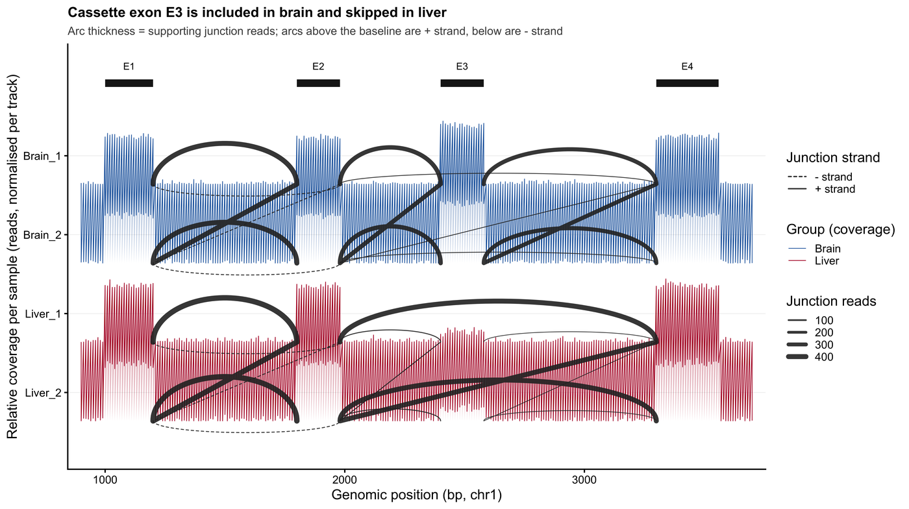

Sashimi 图是可变剪接的标准图形：沿基因位点绘制各样本的 RNA-seq 覆盖度，并把每个连接点画成一条弧线，弧线粗细等于支持它的 reads 数 \[1\]。版式本身承载科学含义——连接点必须按链拆分，y 轴必须注明显示的是 read 深度还是剪接比率，因为二者回答的是不同问题。本教程从透明的连接点计数表重建该图，并附上 PSI 面板与弧线所参照的转录本模型。

## 示例

{fig-alt="Sashimi 图 DEMO" fig-align="center" width="85%"}

四外显子位点、按链拆分的 Sashimi 图：两个脑、两个肝文库各自的覆盖度轨道，连接弧按支持 reads 数缩放，正链实线、负链虚线画在基线下方。可变外显子 E3 在脑中被覆盖、在肝中被跳过，肝轨道里粗壮的 E2-E4 弧就是跳跃连接。

## Setup

-   系统要求：跨平台（Linux/MacOS/Windows）

-   编程语言：R

-   依赖包： `ggplot2`; `dplyr`; `tidyr`; `patchwork`; `scales`

```{r packages setup, message=FALSE, warning=FALSE, output=FALSE}
# 安装依赖包
if (!requireNamespace("ggplot2", quietly = TRUE)) install.packages("ggplot2")
if (!requireNamespace("dplyr", quietly = TRUE)) install.packages("dplyr")
if (!requireNamespace("tidyr", quietly = TRUE)) install.packages("tidyr")
if (!requireNamespace("patchwork", quietly = TRUE)) install.packages("patchwork")
if (!requireNamespace("scales", quietly = TRUE)) install.packages("scales")

library(ggplot2)
library(dplyr)
library(tidyr)
library(patchwork)
library(scales)
```

```{r}
sessioninfo::session_info("attached")
```

## 数据准备

上游工具（MISO `sashimi_plot`、GGsashimi、SpliceGrapher）都消费两张表：每个样本的逐碱基覆盖度，以及带转录本链注释的逐连接点计数。我们模拟一个四外显子基因：其 cassette 外显子（E3）在脑组织中包含、在肝组织中跳跃。

```{r load data, message=FALSE, warning=FALSE}
set.seed(4352)

## 1-based coordinates of three constitutive exons and one cassette exon
exons <- tibble(
  exon   = c("E1", "E2", "E3", "E4"),
  start  = c(1000, 1800, 2400, 3300),
  end    = c(1200, 1980, 2580, 3560)
)

samples <- c("Brain_1", "Brain_2", "Liver_1", "Liver_2")
group   <- c("Brain", "Brain", "Liver", "Liver")

cov <- expand_grid(pos = seq(900, 3700, by = 10), sample = samples) |>
  mutate(
    in_exon = (pos >= 1000 & pos <= 1200) | (pos >= 1800 & pos <= 1980) |
      (pos >= 2400 & pos <= 2580) | (pos >= 3300 & pos <= 3560),
    group = group[match(sample, samples)]
  )

## E3 is four times deeper in brain because the inclusion isoform dominates there
cov <- cov |>
  mutate(
    depth = ifelse(
      in_exon,
      ifelse(pos >= 2400 & pos <= 2580,
             ifelse(group == "Brain", 260, 40),
             ifelse(group == "Brain", 210, 200)),
      rpois(n(), 2)
    ),
    depth = pmax(0, round(depth + rnorm(n(), 0, 8)))
  )

junctions <- tribble(
  ~donor, ~acceptor, ~strand, ~sample, ~reads,
  1200, 1800, "+", "Brain_1", 412,
  1200, 1800, "+", "Brain_2", 388,
  1200, 1800, "+", "Liver_1", 455,
  1200, 1800, "+", "Liver_2", 431,
  1980, 2400, "+", "Brain_1", 356,
  1980, 2400, "+", "Brain_2", 341,
  1980, 2400, "+", "Liver_1",  38,
  1980, 2400, "+", "Liver_2",  29,
  2580, 3300, "+", "Brain_1", 331,
  2580, 3300, "+", "Brain_2", 318,
  2580, 3300, "+", "Liver_1",  12,
  2580, 3300, "+", "Liver_2",   9,
  ## exon-skipping junction E2 -> E4, dominant in liver
  1980, 3300, "+", "Brain_1",  21,
  1980, 3300, "+", "Brain_2",  17,
  1980, 3300, "+", "Liver_1", 392,
  1980, 3300, "+", "Liver_2", 410,
  ## antisense junction on the opposite strand, low but real
  1200, 1980, "-", "Brain_1",  34,
  1200, 1980, "-", "Brain_2",  28,
  1200, 1980, "-", "Liver_1",  31,
  1200, 1980, "-", "Liver_2",  26
) |>
  mutate(group = group[match(sample, samples)])

junction_means <- junctions |>
  group_by(group, donor, acceptor, strand) |>
  summarise(reads = mean(reads), .groups = "drop")

junction_means
```

## 可视化

### 1. 按链拆分的 Sashimi 图

每个样本各有一条覆盖度轨。连接点弧线从轨道基线升起，粗细可直接对读深度；正链连接点单独成层，负链以虚线镜像画在基线下方。按链拆分不是装饰——合并的弧线会把反义连接点折进正义计数。

```{r}
#| label: fig-1.1SashimiStrand
#| fig-cap: "四外显子位点的按链拆分 Sashimi 图：逐样本覆盖度轨，连接点弧线按支持 reads 缩放，正链实线、负链以虚线画在基线下方。"
#| out.width: "100%"
#| warning: false
#| message: false
#| fig-width: 10
#| fig-height: 5.6
#| fig-dpi: 300

arc_points <- function(donor, acceptor, y0, height, n = 60) {
  t <- seq(0, pi, length.out = n)
  tibble(pos = donor + (acceptor - donor) * (1 - cos(t)) / 2,
         y = y0 + height * sin(t))
}

cov_scaled <- cov |>
  group_by(sample) |>
  mutate(depth_rel = depth / max(depth)) |>
  ungroup()

tracks <- cov_scaled |>
  distinct(sample, group) |>
  arrange(group, sample) |>
  mutate(y_base = -row_number() * 1.25)

cov_scaled <- cov_scaled |>
  left_join(tracks, by = c("sample", "group")) |>
  mutate(y = y_base + depth_rel)

arcs <- junction_means |>
  left_join(tracks, by = "group") |>
  mutate(height = (0.15 + 0.55 * reads / max(reads)) * ifelse(strand == "+", 1, -1))

arc_df <- arcs |>
  rowwise() |>
  mutate(pts = list(arc_points(donor, acceptor, y_base, height))) |>
  unnest(pts) |>
  ungroup()

ggplot() +
  geom_ribbon(data = cov_scaled, aes(pos, ymin = y_base, ymax = y, fill = group),
              alpha = 0.28, colour = NA) +
  geom_line(data = cov_scaled, aes(pos, y, colour = group), linewidth = 0.25) +
  geom_path(data = arc_df,
            aes(pos, y, group = interaction(donor, acceptor, group, strand),
                linetype = strand, linewidth = reads),
            colour = "#2B2B2B", alpha = 0.9, lineend = "round") +
  geom_segment(data = exons, aes(x = start, xend = end, y = 0.35, yend = 0.35),
               linewidth = 2.8, colour = "#1B1B1B") +
  geom_text(data = exons, aes(x = (start + end) / 2, y = 0.62, label = exon),
            size = 2.7) +
  scale_fill_manual(values = c(Brain = "#2166AC", Liver = "#B2182B"), guide = "none") +
  scale_colour_manual(values = c(Brain = "#2166AC", Liver = "#B2182B"),
                      name = "Group (coverage)") +
  scale_linetype_manual(values = c(`+` = "solid", `-` = "22"),
                        labels = c(`+` = "+ strand", `-` = "- strand"),
                        name = "Junction strand") +
  scale_linewidth_continuous(range = c(0.25, 2.0), name = "Junction reads") +
  scale_x_continuous(expand = c(0.02, 0)) +
  scale_y_continuous(
    breaks = tracks$y_base + 0.45, labels = tracks$sample,
    expand = expansion(mult = c(0.10, 0.06))
  ) +
  labs(
    x = "Genomic position (bp, chr1)",
    y = "Relative coverage per sample (reads, normalised per track)",
    title = "Cassette exon E3 is included in brain and skipped in liver",
    subtitle = "Arc thickness = supporting junction reads; arcs above the baseline are + strand, below are - strand"
  ) +
  theme_classic(base_size = 11) +
  theme(
    legend.position = "right",
    legend.key.height = unit(3.4, "mm"),
    plot.title = element_text(face = "bold", size = 11),
    plot.subtitle = element_text(colour = "#4D4D4D", size = 9),
    panel.grid.major.y = element_line(colour = "#F0F0F0", linewidth = 0.25)
  )
```

### 2. PSI 面板：比率而非计数

把同一批连接点写成 percent-spliced-in 即可定量刻画切换：PSI 为包含型连接点除以包含加跳跃，取值被限制在 0-100%，因而与测序深度无关。本图以 E2-E3 为包含型连接点、E2-E4 为跳跃型连接点；若把 E3-E4 也计入，则需把两条包含型连接点相加。正因有界，轴必须标注 PSI——在百分比轴上画原始连接点计数是常见且误导的替代。

```{r}
#| label: fig-1.2PSI
#| fig-cap: "外显子 E3 的 percent-spliced-in（点=重复，柱与菱形=各组均值）：PSI 是有界比率，不同于 Sashimi 面板中的 read 计数。"
#| out.width: "60%"
#| warning: false
#| message: false
#| fig-width: 5.6
#| fig-height: 4.2
#| fig-dpi: 300

## PSI 此处以 E2-E3 为包含型连接点、E2-E4 为跳跃型连接点。另一种定义会
## 同时计入 E3-E4，即把两条包含型连接点相加；图注明确本图采用的定义。
psi <- junctions |>
  filter(strand == "+", donor == 1980) |>
  mutate(event = ifelse(acceptor == 2400, "inclusion", "skipping")) |>
  group_by(sample, group, event) |>
  summarise(reads = sum(reads), .groups = "drop") |>
  group_by(sample, group) |>
  summarise(
    inclusion = reads[event == "inclusion"],
    skipping  = reads[event == "skipping"],
    psi       = inclusion / (inclusion + skipping),
    .groups = "drop"
  )

psi_summary <- psi |>
  group_by(group) |>
  summarise(mean_psi = mean(psi), .groups = "drop")

ggplot() +
  geom_col(data = psi_summary,
           aes(group, mean_psi * 100, fill = group),
           width = 0.5, colour = "white", linewidth = 0.5) +
  geom_point(data = psi, aes(group, psi * 100),
             position = position_jitter(width = 0.06, height = 0, seed = 1),
             size = 2, colour = "#1B1B1B", inherit.aes = FALSE) +
  geom_point(data = psi_summary, aes(group, mean_psi * 100), shape = 18,
             size = 3.2, colour = "#1B1B1B", inherit.aes = FALSE) +
  geom_hline(yintercept = 50, linetype = "22", linewidth = 0.35, colour = "#7F7F7F") +
  scale_fill_manual(values = c(Brain = "#2166AC", Liver = "#B2182B"), guide = "none") +
  scale_y_continuous(limits = c(0, 100), expand = c(0, 0),
                     labels = function(x) paste0(x, "%")) +
  labs(
    x = NULL,
    y = "PSI (%, exon E3 inclusion)",
    title = "PSI of exon E3",
    subtitle = "Bars/diamonds = group mean; points = replicates; dashed line = 50%"
  ) +
  theme_classic(base_size = 11) +
  theme(plot.title = element_text(face = "bold", size = 11),
        plot.subtitle = element_text(colour = "#4D4D4D", size = 9))
```

### 3. 弧线所支持的转录本模型

弧线只有对照产生它的转录本才可解释。在位点下方画出两种异构体模型，可标出哪条连接点诊断包含、哪条诊断跳跃——这是审稿人最先核对的板块。

```{r}
#| label: fig-1.3Isoforms
#| fig-cap: "包含型与跳跃型异构体的转录本模型；虚线连接标出 Sashimi 面板中量化的两条连接点。"
#| out.width: "92%"
#| warning: false
#| message: false
#| fig-width: 9
#| fig-height: 3.0
#| fig-dpi: 300

iso <- tribble(
  ~isoform, ~exon, ~start, ~end,
  "Include", "E1", 1000, 1200,
  "Include", "E2", 1800, 1980,
  "Include", "E3", 2400, 2580,
  "Include", "E4", 3300, 3560,
  "Skip",    "E1", 1000, 1200,
  "Skip",    "E2", 1800, 1980,
  "Skip",    "E4", 3300, 3560
) |>
  mutate(y = ifelse(isoform == "Include", 2, 1))

ggplot(iso) +
  geom_segment(aes(x = 1000, xend = 3560, y = y, yend = y),
               linewidth = 0.7, colour = "#6E6E6E") +
  geom_segment(aes(x = start, xend = end, y = y, yend = y),
               linewidth = 3.2, colour = "#1B1B1B", lineend = "butt") +
  geom_text(aes((start + end) / 2, y + 0.22, label = exon), size = 2.7) +
  annotate("segment", x = 1980, xend = 2400, y = 2.5, yend = 2.5,
           linetype = "22", colour = "#2166AC", linewidth = 0.7) +
  annotate("segment", x = 1980, xend = 3300, y = 0.5, yend = 0.5,
           linetype = "22", colour = "#B2182B", linewidth = 0.7) +
  annotate("text", x = 2190, y = 2.62, label = "inclusion junction", size = 2.6,
           colour = "#2166AC") +
  annotate("text", x = 2640, y = 0.38, label = "skipping junction", size = 2.6,
           colour = "#B2182B") +
  scale_y_continuous(limits = c(0.2, 2.9), breaks = c(1, 2),
                     labels = c("E3 skipped", "E3 included")) +
  scale_x_continuous(expand = c(0.01, 0)) +
  labs(x = "Genomic position (bp)", y = NULL, title = "Isoform models") +
  theme_classic(base_size = 10.5) +
  theme(plot.title = element_text(face = "bold", size = 10.5),
        axis.line.y = element_blank(), axis.ticks.y = element_blank())
```

::: callout-tip
**实践要点**

-   把 + 与 - 连接点画成独立图层。合并弧线会掩盖反义转录，并在基因重叠处悄悄把计数翻倍。
-   在 y 轴上写明面板显示的是覆盖度（read 深度）还是 PSI（比率）。二者不可互换，本集对基因组图的红线要求明确区分。
-   堆叠前先对每条轨归一化，但要在图注中给出未变换的最大深度；没有标尺的相对轨道不是定量的。
-   不要仅为画弧线就安装已归档工具（MISO、`ggsashimi`）。几何只是十几行三角运算，留在 ggplot2 中能让编码规则显式、图形可复现。
:::

## 关于本页跳过的实现

本页刻意只用本项目基础绘图栈自行绘制。在 issue-435 清单中归到 Omics/SashimiPlot 的工具里，有 1 条被标记为**跳过**，仅作为版式参考、不作为依赖：该工具已超过 5 年无运维更新（截止日 2021-11-07）。沿用这套工具等于锁定已无法构建的代码。本页先把这些工具的图形约定读懂，再自行重画，以便逐行核验每个面板。

| 工具 | 最近提交 | 状态 | 跳过原因 |
| --- | --- | --- | --- |
| Spliceclust | 2019-12-30 | 陈旧 | 超过 5 年无运维更新 |

## 应用

Sashimi 图是发育、疾病与药物反应中可变剪接的主要证据图：cassette 外显子切换、互斥外显子、内含子保留与差异剪接位点使用。配合 PSI 面板，该版式可直接对接差异剪接统计（`rMATS`、`MAJIQ`、`SUPPA2`），因为包含型与跳跃型计数正是该比率的分子与分母。

## 参考资料

\[1\] Katz Y, Wang ET, Airoldi EM, Burge CB. Analysis and design of RNA sequencing experiments for identifying isoform regulation. Nat Methods. 2010;7(12):1009-1015. doi:10.1038/nmeth.1528

\[2\] Garrido-Martín D, et al. ggsashimi: Sashimi plot revised for browser- and annotation-independent splicing visualization. PLoS Comput Biol. 2018;14(8):e1006360. doi:10.1371/journal.pcbi.1006360

\[3\] Trincado JL, Entizne JC, Hysenaj G, et al. SUPPA2: fast, accurate, and uncertainty-aware differential splicing analysis across multiple conditions. Genome Biol. 2018;19:40. doi:10.1186/s13059-018-1417-1
