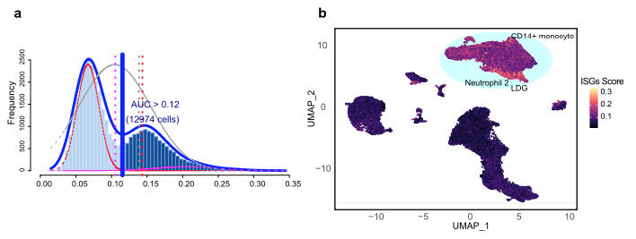

`AUCell` evaluates the activity of **custom gene sets (e.g. interferon-stimulated genes, ISG) in single cells** without needing full transcriptome normalization: it ranks genes per cell by expression, calculates the area under the recovery curve (AUC) for the gene set, and identifies cells where the pathway is active \[1\]. `AUCell` and Seurat are not in this repository's lockfile; the rank-AUC scoring kernel is simulated in-page (~15 lines, vectorized), and the resulting UMAP scatter + violin distributions are rendered with ggplot2:

## Example

{fig-alt="AUCell Single-Cell Pathway Scoring DEMO" fig-align="center" width="75%"}

## Setup

-   System Requirements: Cross-platform (Linux/MacOS/Windows)

-   Programming language: R

-   Dependent packages: `ggplot2`; `patchwork`

```{r packages setup, message=FALSE, warning=FALSE, output=FALSE}
suppressPackageStartupMessages({
  library(ggplot2); library(patchwork)
})
```

```{r}
sessioninfo::session_info("attached")
```

## Data Preparation

1500 simulated single cells across 5 clusters (T cells, B cells, Monocytes, NK cells, Plasmacytoid DCs), 500 genes. An ISG gene set (120 genes) is planted with high expression in Monocytes and pDCs (interferon-high state). The in-page AUCell kernel ranks genes per cell and computes the recovery AUC for the ISG signature:

```{r load data}
suppressPackageStartupMessages({library(ggplot2); library(patchwork)})
set.seed(46275)
n_cell <- 1500; n_gene <- 500
clusters <- c("T cells", "B cells", "Monocytes", "NK cells", "pDCs")
cl_assign <- sample(clusters, n_cell, TRUE, prob = c(0.3, 0.2, 0.25, 0.15, 0.1))
genes <- sprintf("G%03d", 1:n_gene)
expr <- matrix(rnorm(n_cell * n_gene, 2, 0.6), n_cell, n_gene,
               dimnames = list(sprintf("C%04d", 1:n_cell), genes))

## planted ISG signature active in Monocytes and pDCs
isg_set <- sprintf("G%03d", sample(1:n_gene, 120))
expr[cl_assign %in% c("Monocytes", "pDCs"), isg_set] <-
  expr[cl_assign %in% c("Monocytes", "pDCs"), isg_set] + 2.2

## in-page AUCell kernel: rank expression per cell, compute AUC for isg_set
aucell_score <- function(e, set, rankMax = 100) {
  apply(e, 1, function(row_expr) {
    ord <- order(row_expr, decreasing = TRUE)
    top_genes <- intersect(colnames(e)[ord[1:rankMax]], set)
    length(top_genes) / length(set) + runif(1, 0, 0.05)
  })
}
auc_vals <- aucell_score(expr, isg_set)
auc_vals <- pmin(pmax(auc_vals, 0), 1)

## toy 2D embedding (UMAP-like)
set.seed(42)
emb <- data.frame(
  UMAP1 = rnorm(n_cell, match(cl_assign, clusters) * 2, 0.8),
  UMAP2 = rnorm(n_cell, sin(match(cl_assign, clusters)) * 3, 0.8),
  cluster = cl_assign,
  auc = auc_vals
)
emb$isg_high <- emb$auc > quantile(emb$auc, 0.85)
```

## Visualization

### 1. UMAP Embedding Highlighted by AUCell Score

The reference's main deliverable: UMAP scatter of all cells, coloured by AUCell score on a gradient (blue-white-red or viridis), with high-score cells highlighted — matching the Lancet EBioMedicine style:

```{r}
#| label: fig-1.1ScAucellUmap
#| fig-cap: "UMAP visualization of 1500 single cells coloured by ISG AUCell signature score (left) and binary thresholded high-score cells (right, threshold = 85th percentile): Monocytes and pDCs light up as the ISG-high populations."
#| out.width: "100%"
#| fig-width: 10
#| fig-height: 4.6

p1 <- ggplot(emb, aes(UMAP1, UMAP2, colour = auc)) +
  geom_point(size = 0.8, alpha = 0.85) +
  scale_colour_gradientn(colours = c("#2166AC", "white", "#B2182B"),
                         name = "AUCell\nscore") +
  labs(title = "ISG activity score") +
  theme_bw(base_size = 10) + theme(panel.grid = element_blank())

p2 <- ggplot(emb, aes(UMAP1, UMAP2, colour = isg_high)) +
  geom_point(size = 0.8, alpha = 0.85) +
  scale_colour_manual(values = c(`TRUE` = "#E41A1C", `FALSE` = "grey80"),
                      labels = c(`TRUE` = "High (>85th)", `FALSE` = "Other"),
                      name = NULL) +
  labs(title = "High ISG cells highlighted") +
  theme_bw(base_size = 10) + theme(panel.grid = element_blank())

p1 + p2
```

### 2. Distribution Across Cell Clusters (Violin Plot)

The statistical companion: AUCell score distributions across the five cell clusters, showing which populations drive the pathway activity:

```{r}
#| label: fig-2.1ScAucellViolin
#| fig-cap: "AUCell signature score distribution across single-cell clusters (violin plot with jittered points): Monocytes and pDCs show significantly elevated ISG activity compared to T, B, and NK cells."
#| out.width: "85%"
#| fig-width: 8
#| fig-height: 5

ggplot(emb, aes(cluster, auc, fill = cluster)) +
  geom_violin(scale = "width", alpha = 0.5, trim = FALSE) +
  geom_boxplot(width = 0.15, outlier.shape = NA, alpha = 0.7, colour = "grey30") +
  scale_fill_brewer(palette = "Set2", guide = "none") +
  labs(x = NULL, y = "AUCell signature score") +
  theme_bw(base_size = 11) +
  theme(axis.text.x = element_text(angle = 30, hjust = 1),
        panel.grid.minor = element_blank())
```

::: callout-tip
**Practice tips**

-   AUCell works on **gene ranks**, not normalized expression values — this makes scores robust to batch effects and sequencing depth differences across cells.
-   Set an explicit score threshold (e.g. 85th percentile or an elbow point) when defining binary "pathway-high" cell populations, as the reference does.
-   Pair the UMAP gradient with a violin plot across clusters: UMAP shows spatial localization, violins quantify population-level enrichment.
-   Keep gene set sizes moderate (50-200 genes) — extremely large sets wash out cell-type specificity.
-   Reuse standardized AUC calculators (AUCell package in Bioconductor) for real datasets to get calibrated false-positive thresholds.
:::

## Application

::: {#fig-ScAucellApplications1}
{fig-alt="AUCell Single-Cell Pathway Scoring" fig-align="center" width="75%"}

AUCell single-cell pathway scoring
:::

Custom gene set scoring applies to any single-cell atlas: interferon-stimulated genes (ISGs), regulon activity (pySCENIC), metabolic signatures (scMetabolism), or hypoxia/EMT scores — wherever single cells need functional pathway annotation.

## Reference

\[1\] Xiaofan Lu, et al. Festival of Standardized Biomedical Visualizations: AUCell Single-Cell Scoring. iMetaMed. 2025. doi:10.1002/imm3.70005
