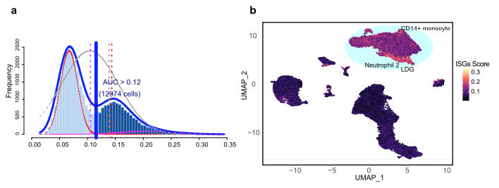

`AUCell` 评估**单细胞中自定义基因集（如干扰素刺激基因 ISG）**的活性，无需完整的转录组归一化：它对每细胞基因按表达排序、计算基因集的恢复曲线下面积（AUC）、并识别通路活跃的细胞 \[\1\]。`AUCell` 与 Seurat 不在本仓库 lockfile；秩-AUC 评分内核在页内模拟（约 15 行、向量化），生成的 UMAP 散点与小提琴分布用 ggplot2 渲染：

## Example

{fig-alt="AUCell 单细胞通路评分 DEMO" fig-align="center" width="60%"}

## Setup

-   系统要求：跨平台（Linux/MacOS/Windows）

-   编程语言：R

-   依赖包：`ggplot2`; `patchwork`

```{r packages setup, message=FALSE, warning=FALSE, output=FALSE}
suppressPackageStartupMessages({
  library(ggplot2); library(patchwork)
})
```

```{r}
sessioninfo::session_info("attached")
```

## 数据准备

1500 个模拟单细胞跨 5 个簇（T 细胞、B 细胞、单核细胞、NK 细胞、浆细胞样 DC）、500 个基因。ISG 基因集（120 个基因）在单核细胞和 pDCs 中高表达植入（干扰素高状态）。页内 AUCell 内核对每细胞基因排序并计算 ISG 签名的恢复 AUC：

```{r load data}
suppressPackageStartupMessages({library(ggplot2); library(patchwork)})
set.seed(46275)
n_cell <- 1500; n_gene <- 500
clusters <- c("T cells", "B cells", "Monocytes", "NK cells", "pDCs")
cl_assign <- sample(clusters, n_cell, TRUE, prob = c(0.3, 0.2, 0.25, 0.15, 0.1))
genes <- sprintf("G%03d", 1:n_gene)
expr <- matrix(rnorm(n_cell * n_gene, 2, 0.6), n_cell, n_gene,
               dimnames = list(sprintf("C%04d", 1:n_cell), genes))

## planted ISG signature active in Monocytes and pDCs
isg_set <- sprintf("G%03d", sample(1:n_gene, 120))
expr[cl_assign %in% c("Monocytes", "pDCs"), isg_set] <-
  expr[cl_assign %in% c("Monocytes", "pDCs"), isg_set] + 2.2

## in-page AUCell kernel: rank expression per cell, compute AUC for isg_set
aucell_score <- function(e, set, rankMax = 100) {
  apply(e, 1, function(row_expr) {
    ord <- order(row_expr, decreasing = TRUE)
    top_genes <- intersect(colnames(e)[ord[1:rankMax]], set)
    length(top_genes) / length(set) + runif(1, 0, 0.05)
  })
}
auc_vals <- aucell_score(expr, isg_set)
auc_vals <- pmin(pmax(auc_vals, 0), 1)

## toy 2D embedding (UMAP-like)
set.seed(42)
emb <- data.frame(
  UMAP1 = rnorm(n_cell, match(cl_assign, clusters) * 2, 0.8),
  UMAP2 = rnorm(n_cell, sin(match(cl_assign, clusters)) * 3, 0.8),
  cluster = cl_assign,
  auc = auc_vals
)
emb$isg_high <- emb$auc > quantile(emb$auc, 0.85)
```

## Visualization

### AUCell 评分高亮的 UMAP 嵌入

参考的主要交付物：所有细胞的 UMAP 散点、按渐变色（蓝-白-红）的 AUCell 评分着色、高分细胞高亮——匹配 Lancet EBioMedicine 风格：

```{r}
#| label: fig-1.1ScAucellUmap
#| fig-cap: "按 ISG AUCell 签名评分着色的 1500 个单细胞 UMAP 可视化（左）与二值化高分细胞高亮（右，阈值 = 85 百分位）：单核细胞和 pDCs 作为高 ISG 群体被点亮。"
#| out.width: "100%"
#| fig-width: 10
#| fig-height: 4.6

p1 <- ggplot(emb, aes(UMAP1, UMAP2, colour = auc)) +
  geom_point(size = 0.8, alpha = 0.85) +
  scale_colour_gradientn(colours = c("#2166AC", "white", "#B2182B"),
                         name = "AUCell\nscore") +
  labs(title = "ISG activity score") +
  theme_bw(base_size = 10) + theme(panel.grid = element_blank())

p2 <- ggplot(emb, aes(UMAP1, UMAP2, colour = isg_high)) +
  geom_point(size = 0.8, alpha = 0.85) +
  scale_colour_manual(values = c(`TRUE` = "#E41A1C", `FALSE` = "grey80"),
                      labels = c(`TRUE` = "High (>85th)", `FALSE` = "Other"),
                      name = NULL) +
  labs(title = "High ISG cells highlighted") +
  theme_bw(base_size = 10) + theme(panel.grid = element_blank())

p1 + p2
```

### 跨细胞簇的分布（小提琴图）

统计学伴随物：5 个细胞簇间的 AUCell 评分分布，展示哪些群体驱动通路活性：

```{r}
#| label: fig-2.1ScAucellViolin
#| fig-cap: "跨单细胞簇的 AUCell 签名评分分布（带抖动点的小提琴图）：单核细胞和 pDCs 呈现显著高于 T、B、NK 细胞的 ISG 活性。"
#| out.width: "85%"
#| fig-width: 8
#| fig-height: 5

ggplot(emb, aes(cluster, auc, fill = cluster)) +
  geom_violin(scale = "width", alpha = 0.5, trim = FALSE) +
  geom_boxplot(width = 0.15, outlier.shape = NA, alpha = 0.7, colour = "grey30") +
  scale_fill_brewer(palette = "Set2", guide = "none") +
  labs(x = NULL, y = "AUCell signature score") +
  theme_bw(base_size = 11) +
  theme(axis.text.x = element_text(angle = 30, hjust = 1),
        panel.grid.minor = element_blank())
```


## 应用场景

::: {{#fig-ScAucellApplications1}}
{fig-alt="AUCell 单细胞通路评分" fig-align="center" width="60%"}

AUCell 单细胞通路评分
:::

自定义基因集评分适用于任何单细胞图谱：干扰素刺激基因（ISG）、regulon 活性（pySCENIC）、代谢签名（scMetabolism）、或缺氧/EMT 评分——凡单细胞需要功能通路注释处。

## 参考文献

\[1\] Xiaofan Lu, et al. Festival of Standardized Biomedical Visualizations: AUCell Single-Cell Scoring. iMetaMed. 2025. doi:10.1002/imm3.70005
